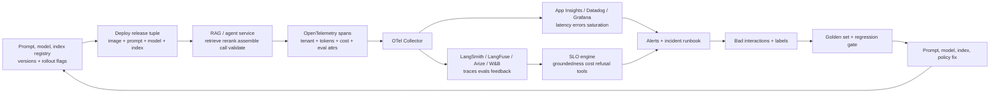

# LLMOps, Monitoring, Cost & Reliability — Reference Patterns

> Topic package — Week 22a · Roadmap Week 22a — LLMOps, Monitoring, Cost & Reliability · Reference Patterns.
> Depth goal: operate LLM-backed enterprise products with SRE-grade reliability and AI-specific controls: prompt/model/index registries, OpenTelemetry traces across RAG, eval-backed SLOs, cost and quota budgets, provider fallback, drift detection, and post-incident correction loops that improve the system after every bad interaction.

## Source
- Track: AI Architecture (self-directed, FDE roadmap)
- Slide deck: `07 Resources Library/AI Architecture/Slides/Lesson_05_LLMOps,_Monitoring,_Cost_&_Reliability_—_Reference_Patterns.pptx`
- Hands-on notebook: `07 Resources Library/AI Architecture/Notebooks/05_LLMOps,_Monitoring,_Cost_&_Reliability_—_Reference_Patterns.ipynb` (runs offline)
- Reference reading: OpenTelemetry specification and semantic conventions; Azure OpenAI Service quotas, TPM/RPM, PTU, Retry-After, and pricing docs; Azure Monitor/Application Insights docs; AWS Bedrock and Google Vertex AI operations docs; LangSmith, LangFuse, Arize Phoenix, WhyLabs, and Weights & Biases documentation; Datadog and Grafana observability docs; OWASP Top 10 for LLM Applications; SRE error budget and alerting literature
- Builds on: [[02 Literature Notes/AI Architecture/Cloud Architecture & Deployment — Reference Patterns]]
- Date: 2026-07-18

---

## 1. Mental Model

**LLMOps is classical SRE plus a control loop for probabilistic, versioned behavior.** Uptime, p95 latency, saturation, retries, and error budgets still matter. LLM systems add artifacts that change answer quality without a code deploy: prompt templates, model deployments, embedding models, chunking logic, rerankers, vector indexes, tool schemas, safety policies, and golden datasets.

The production question is no longer only 'is the service up?' It is 'is the answer grounded, safe, affordable, attributable, and rollbackable for this tenant?' A green Kubernetes deployment can still be a failed AI release if groundedness drops five points, cost/request doubles, or a silent provider model update changes tool-call behavior.

> Key intuition: **treat LLM behavior as an observable, budgeted, versioned production surface.** The FDE loop is registry → deploy → trace → evaluate → alert → capture feedback → fix prompt/model/index → redeploy with proof.



---

## 2. How It Actually Works

### 22a.1 The LLMOps discipline vs classical SRE
Classical SRE asks whether the service is available, fast enough, safe to change, and inside its error budget. LLMOps keeps those questions and adds artifacts whose behavior can drift without application code changing: prompt versions, model deployments, embedding models, chunking policies, vector indexes, rerankers, tool schemas, safety filters, and eval datasets. These artifacts need registries, owners, versions, rollout rings, and rollback paths just like container images.

The standard MLOps loop is **data → train → deploy → monitor → retrain**. LLMOps extends it for systems that often use hosted foundation models and retrieval: **prompt/index/model registry → deploy → measure traces and costs → run offline/online evals → collect feedback → tune prompt, retriever, fine-tune, or policy → redeploy**. Hallucination, groundedness, faithfulness, refusal correctness, and tool-call success become first-class SLOs, not post-hoc QA notes. Cost/request also becomes a KPI because token spend varies by prompt, retrieved context, output length, model route, retries, and agent loops; CPU is comparatively predictable. A production AI release gate should block if golden-set quality regresses, even when uptime and latency are green.

### 22a.2 Observability for LLM systems
Trace the request at the RAG pipeline level: `rag.query` root span with children for retrieval, rerank, prompt assembly, model call, tool calls, output validation, safety filtering, and feedback recording. OpenTelemetry is the common substrate; App Insights, Datadog, and Grafana explain infra symptoms while LangSmith, LangFuse, Arize Phoenix, WhyLabs, and Weights & Biases explain AI behavior. Useful span attributes include `ai.prompt_hash`, `ai.prompt_version`, `ai.model_deployment`, `ai.embedding_model`, `ai.index_version`, `ai.retrieved_doc_ids`, `ai.tokens.prompt`, `ai.tokens.completion`, `ai.cost_usd`, `ai.groundedness_score`, `ai.safety_flags`, `tenant.id`, and `feature.name`.

Sampling must be deliberate. Capture 100% of provider errors, validation failures, eval failures, prompt-injection detections, PII-policy blocks, and expensive outliers; sample perhaps 5-10% of healthy traffic, always after dropping or hashing PII. In multi-tenant enterprise systems, per-tenant tracing is non-negotiable: a bad index for one business unit should not look like global quality drift. Correlate AI metrics with infra metrics: a p95 spike may be provider saturation, while a groundedness drop may be a prompt/index/model change with no CPU signal.

### 22a.3 SLOs and SLIs for LLM-backed products
Keep normal service SLIs: availability, 5xx rate, p95/p99 latency, queue age, provider error rate, and saturation. Then add AI-specific SLIs: groundedness ≥ 0.88 on the golden set, faithfulness ≥ 0.90, hallucination rate < 2%, refusal correctness ≥ 0.95, unsafe completion rate < 0.1%, tool-call success ≥ 0.97, citation coverage ≥ 0.95 for RAG answers, and cost/request ≤ a product-specific threshold such as $0.02 for GPT-4o-mini paths or $0.20 for GPT-4o analyst workflows. Typical latency expectations: embedding calls around 100-300 ms, gpt-4o-mini around 500 ms-1 s for short outputs, and GPT-4o around 2-4 s p95 depending on output length and region.

Error budgets apply to quality. If a prompt release drops groundedness from 0.91 to 0.86, it burns budget even when uptime remains 99.9%. Alert on trends and statistically meaningful windows, not single-answer spikes, because LLM quality is naturally noisy. Define the golden dataset from real tenant workflows: top questions, high-risk edge cases, known prior incidents, adversarial injection examples, and fresh corpus changes. Keep it fresh with SME review and production sampling; stale labels create label rot and make a drifting system look safe.

### 22a.4 Cost, token, and rate-limit management
Token attribution is an architecture requirement. Track prompt tokens, completion tokens, embedding tokens, rerank calls, retries, cache hits, and cost by user, tenant, feature, model, prompt version, and route. This enables chargeback per business unit and lets the customer see that one agent workflow or 10% of users may drive 60% of spend. Use representative pricing in design reviews and verify current price cards before committing: GPT-4o has historically been in the few dollars per million input tokens and about ten dollars per million output tokens; gpt-4o-mini is far cheaper. Azure OpenAI capacity is constrained by **TPM** and **RPM** quotas; **PTU** utilization should be watched because reserved capacity that is idle still burns money.

Budget guards belong on the client and server: per-request max tokens, max tool calls, per-user daily budgets, per-tenant monthly caps, feature-level budgets, and model downgrade policies. Semantic caching can reduce spend by embedding the query and reusing a response above a similarity threshold, but it risks staleness, privacy leaks across tenants, and cache poisoning after prompt injection. Prompt compression and retrieval tuning trade context size against answer quality; fewer chunks lower cost but may harm groundedness. On budget exhaustion, degrade deliberately: cheaper model, shorter answer, search-only response, queued batch job, or denial with an auditable budget reason.

### 22a.5 Reliability, drift, and incident response
Provider calls need retry discipline from Week 04+ and circuit breakers from earlier reliability work. Retry 429s only after respecting `Retry-After`; retry 5xx and transient network failures with exponential backoff and jitter; never let every web worker retry at once. Put circuit breakers around model providers, vector stores, rerankers, and tools. Dual-provider fallback, such as Azure OpenAI GPT-4o primary to Bedrock Claude fallback, improves availability but is not plug-and-play: token counting, prompt behavior, safety filters, streaming shape, tool-call schema, and refusal style differ. Normalize through provider ports and test prompts against both.

Drift appears in multiple places: embedding-space drift in incoming queries, retrieval quality drift after corpus updates or re-chunking, prompt behavior drift after edits, and model-version drift when a provider silently updates a deployment. Eval regression tests in CI should block deploys if golden-set score falls beyond tolerance. AI incident response needs named runbooks: mass hallucination outbreak, prompt injection incident, retrieval poisoning, runaway agent cost, provider outage, and PII leak. The post-incident correction loop is mandatory: capture bad interactions, redact safely, add them to the eval set, fix prompt/model/index/policy, verify no regression, and document rollback and customer impact.

---

## 3. Implementation

Assumed stack: Python stdlib plus Pydantic v2 and OpenTelemetry SDK available offline. Snippets make LLMOps observable and enforceable: a local RAG trace with cost accounting and a budget/SLO guard for request admission. Snippets:
- [[04 Code Snippets/AI Architecture/AI Week 22a LLM Request Tracer With Cost Accounting]]
- [[04 Code Snippets/AI Architecture/AI Week 22a SLO and Cost Budget Guard]]

### AI Week 22a LLM Request Tracer With Cost Accounting
An offline OpenTelemetry RAG trace with child spans for retrieval, rerank, prompt assembly, model call, validation, token counts, cost, and groundedness flags.
```python
import hashlib
from dataclasses import dataclass
from opentelemetry import trace
from opentelemetry.sdk.trace import TracerProvider
from opentelemetry.sdk.trace.export import SimpleSpanProcessor
from opentelemetry.sdk.trace.export.in_memory_span_exporter import InMemorySpanExporter

MODEL_PRICES_PER_1K = {
    'gpt-4o-prod': {'prompt': 0.0050, 'completion': 0.0150},
    'gpt-4o-mini-prod': {'prompt': 0.00015, 'completion': 0.00060},
}

exporter = InMemorySpanExporter()
provider = TracerProvider()
provider.add_span_processor(SimpleSpanProcessor(exporter))
trace.set_tracer_provider(provider)
tracer = trace.get_tracer('ai-week-22a-llmops')

@dataclass(frozen=True)
class QueryScenario:
    tenant: str
    query: str
    model: str
    docs: list[str]
    prompt_tokens: int
    completion_tokens: int
    groundedness: float
    safety_flags: list[str]

def prompt_hash(text: str) -> str:
    return hashlib.sha256(text.encode()).hexdigest()[:12]

def request_cost(model: str, prompt_tokens: int, completion_tokens: int) -> float:
    price = MODEL_PRICES_PER_1K[model]
    return (prompt_tokens / 1000 * price['prompt']) + (completion_tokens / 1000 * price['completion'])

def traced_rag_query(s: QueryScenario):
    prompt = f'Answer with citations only. Tenant={s.tenant}. Question={s.query}. Docs={s.docs}'
    cost = request_cost(s.model, s.prompt_tokens, s.completion_tokens)
    with tracer.start_as_current_span('rag.query') as root:
        root.set_attribute('tenant.id', s.tenant)
        root.set_attribute('ai.prompt_hash', prompt_hash(prompt))
        root.set_attribute('ai.model_deployment', s.model)
        root.set_attribute('ai.cost_usd', round(cost, 6))
        with tracer.start_as_current_span('rag.retrieve') as span:
            span.set_attribute('ai.index_version', 'kb-index-2026-07-18')
            span.set_attribute('ai.embedding_model', 'text-embedding-3-large')
            span.set_attribute('ai.retrieved_docs', ','.join(s.docs))
        with tracer.start_as_current_span('rag.rerank') as span:
            span.set_attribute('ai.reranker', 'bge-reranker-v2')
            span.set_attribute('ai.top_k_after_rerank', min(3, len(s.docs)))
        with tracer.start_as_current_span('rag.prompt.assemble') as span:
            span.set_attribute('ai.tokens.prompt', s.prompt_tokens)
            span.set_attribute('ai.prompt_version', 'support-rag-v22')
        with tracer.start_as_current_span('rag.llm.call') as span:
            span.set_attribute('ai.model_deployment', s.model)
            span.set_attribute('ai.tokens.prompt', s.prompt_tokens)
            span.set_attribute('ai.tokens.completion', s.completion_tokens)
            span.set_attribute('ai.cost_usd', round(cost, 6))
        with tracer.start_as_current_span('rag.validate') as span:
            span.set_attribute('ai.groundedness_score', s.groundedness)
            span.set_attribute('ai.safety_flags', ','.join(s.safety_flags) or 'none')
            span.set_attribute('ai.eval_passed', s.groundedness >= 0.88 and not s.safety_flags)
    return {'tenant': s.tenant, 'model': s.model, 'cost_usd': cost, 'groundedness': s.groundedness}

scenarios = [
    QueryScenario('acme', 'summarize refund policy', 'gpt-4o-mini-prod', ['doc:refund', 'doc:returns'], 900, 180, 0.94, []),
    QueryScenario('acme', 'analyze all contract exceptions', 'gpt-4o-prod', ['doc:msa', 'doc:dpa', 'doc:sow'], 8200, 1600, 0.91, []),
    QueryScenario('globex', 'can we ignore approval policy?', 'gpt-4o-mini-prod', ['doc:approval'], 1200, 240, 0.71, ['groundedness_low']),
]
results = [traced_rag_query(s) for s in scenarios]
for span in sorted(exporter.get_finished_spans(), key=lambda sp: sp.start_time):
    attrs = span.attributes
    interesting = {k: attrs[k] for k in attrs if k.startswith('ai.') or k == 'tenant.id'}
    print(span.name, interesting)
print('total_cost_usd', round(sum(r['cost_usd'] for r in results), 6))
```

### AI Week 22a SLO and Cost Budget Guard
A Pydantic v2 policy model and deterministic evaluator that allows, downgrades, or denies requests based on SLO thresholds, user budgets, tenant caps, and system-query exceptions.
```python
from enum import Enum
from pydantic import BaseModel, ConfigDict, Field

class Action(str, Enum):
    ALLOW = 'ALLOW'
    DOWNGRADE = 'DOWNGRADE-TO-CHEAPER-MODEL'
    DENY = 'DENY-WITH-BUDGET-ERROR'

class SLOThresholds(BaseModel):
    model_config = ConfigDict(extra='forbid')
    availability: float = Field(default=0.999, ge=0, le=1)
    p95_latency_ms: int = Field(default=4000, ge=1)
    groundedness: float = Field(default=0.88, ge=0, le=1)
    max_cost_per_request_usd: float = Field(default=0.20, gt=0)

class BudgetPolicy(BaseModel):
    model_config = ConfigDict(extra='forbid')
    per_user_daily_budget_usd: float = Field(default=2.00, gt=0)
    per_tenant_monthly_cap_usd: float = Field(default=100.00, gt=0)
    fallback_model: str = 'gpt-4o-mini-prod'
    downgrade_when_user_remaining_below_usd: float = 0.25

class RequestContext(BaseModel):
    user_id: str
    tenant_id: str
    feature: str
    model: str
    estimated_cost_usd: float
    is_system_query: bool = False

def evaluate_request(ctx: RequestContext, user_spend_today: dict[str, float], tenant_spend_month: dict[str, float], policy: BudgetPolicy):
    if ctx.is_system_query:
        return Action.ALLOW, ctx.model, 'system query'
    tenant_after = tenant_spend_month.get(ctx.tenant_id, 0.0) + ctx.estimated_cost_usd
    if tenant_after > policy.per_tenant_monthly_cap_usd:
        return Action.DENY, None, f'tenant monthly cap exceeded: {tenant_after:.2f}'
    user_after = user_spend_today.get(ctx.user_id, 0.0) + ctx.estimated_cost_usd
    remaining = policy.per_user_daily_budget_usd - user_after
    if user_after > policy.per_user_daily_budget_usd:
        if ctx.model != policy.fallback_model:
            return Action.DOWNGRADE, policy.fallback_model, f'user daily budget would exceed by {abs(remaining):.2f}'
        return Action.DENY, None, f'user daily cap exceeded: {user_after:.2f}'
    if remaining < policy.downgrade_when_user_remaining_below_usd and ctx.model != policy.fallback_model:
        return Action.DOWNGRADE, policy.fallback_model, f'user budget nearly exhausted: {remaining:.2f} remaining'
    return Action.ALLOW, ctx.model, f'budget ok: {remaining:.2f} user budget remaining'

slo = SLOThresholds()
policy = BudgetPolicy()
user_spend = {'heavy': 1.82}
tenant_spend = {'over-cap': 100.05, 'acme': 73.20}
scenarios = [
    RequestContext(user_id='fresh', tenant_id='acme', feature='chat', model='gpt-4o-prod', estimated_cost_usd=0.08),
    RequestContext(user_id='heavy', tenant_id='acme', feature='analysis', model='gpt-4o-prod', estimated_cost_usd=0.15),
    RequestContext(user_id='u3', tenant_id='over-cap', feature='chat', model='gpt-4o-mini-prod', estimated_cost_usd=0.01),
    RequestContext(user_id='monitor', tenant_id='over-cap', feature='health-check', model='gpt-4o-prod', estimated_cost_usd=0.50, is_system_query=True),
]
for ctx in scenarios:
    action, model, reason = evaluate_request(ctx, user_spend, tenant_spend, policy)
    print(ctx.user_id, '->', action.value, model, '|', reason)
print('slo_floor_groundedness', slo.groundedness, 'p95_ms', slo.p95_latency_ms)
```

---

## 4. Design Decisions & Tradeoffs

| Decision | Guidance |
|---|---|
| **Trace sampling policy** | Capture 100% of errors, eval failures, safety flags, prompt-injection detections, PII blocks, and high-cost outliers; sample only healthy traffic and drop/hash PII before export. |
| **Quality SLO vs uptime SLO** | Keep availability and p95 latency SLOs, but promote releases only when groundedness, faithfulness, refusal, tool success, and cost/request stay inside budget. |
| **Golden dataset ownership** | Build the golden set from real workflows, incident examples, high-risk edge cases, and fresh corpus changes; assign SME review so labels do not rot. |
| **Standard quota vs PTU** | Use Azure OpenAI Standard TPM/RPM for variable traffic; use PTU only when p95 variance, quota ceilings, and steady utilization justify reserved spend. |
| **Semantic cache vs fresh generation** | Cache only tenant-scoped, low-risk, freshness-tolerant answers with similarity and age thresholds; never share cache across tenants or cache unsafe/injected outputs. |
| **Single provider vs fallback** | Fallback improves availability only when provider ports normalize token counting, tool schemas, streaming, safety behavior, and eval results across Azure OpenAI, Bedrock, or Vertex. |

---

## 5. Failure Modes & Gotchas

- A silent provider model-version bump changes citation behavior overnight and groundedness drops five points while uptime, CPU, and HTTP error rate remain green.
- A semantic cache stores an answer produced after prompt injection; similar future questions receive the poisoned response until cache keys and safety invalidation are redesigned.
- A runaway agent loops over search and ticket tools, retries after 429s, and burns $10k in a night before tenant-level cost budgets are added.
- Verbose prompt and retrieved-context logs are shipped at 100% sampling; log-ingest cost dwarfs model cost and sensitive snippets appear in the observability backend.
- A drift detector alerts too late because the golden set still reflects last quarter's corpus; new policy documents changed expected answers but labels were never refreshed.
- During an Azure OpenAI provider incident, every app replica retries 429 and 5xx responses immediately instead of respecting Retry-After with jitter, amplifying the outage into a retry storm.

---

## 6. FDE Angle

- LLMOps discipline turns customer trust into evidence: every answer can be traced to prompt version, model deployment, index version, retrieved documents, cost, and eval outcome.
- Per-tenant token and cost attribution enables enterprise chargeback by business unit and prevents one pilot team from silently consuming the whole AI budget.
- A credible FDE incident story is specific: we detected groundedness regression, rolled back prompt/index/model within 15 minutes, and added the failure to the eval suite.
- Cost predictability is a feature: TPM/RPM quotas, PTU utilization, semantic cache policy, fallback models, and budget denials must be explainable to finance and platform owners.

---

## 7. Self-Check

1. What artifacts besides code must be versioned and rolled back in an LLM-backed product?
2. Which OpenTelemetry spans and attributes would you require for a production RAG request?
3. How can a prompt regression burn an error budget even if availability and latency stay green?
4. When is semantic caching safe, and what privacy or poisoning risks must be controlled?
5. How do Azure OpenAI TPM/RPM quotas and PTU utilization affect production architecture?
6. What steps belong in the post-incident correction loop after a hallucination or prompt-injection incident?

---

## 9. Interview Q&A

**Q: What artifacts besides code must be versioned and rolled back in an LLM-backed product, and why doesn't a container image rollback alone cover them?**
A: Prompt templates, model deployment selection, embedding model choice, chunking/retrieval configuration, vector index version, reranker configuration, tool schemas, safety policy rules, and the golden eval dataset itself all need independent versioning and rollback — none of these live inside the application's compiled code in a way a container image rollback would actually revert.

The reason a container rollback alone doesn't cover these: a prompt template is commonly stored in an external registry (a config store, a blob, a database row) specifically so it *can* change without a code deploy — that's the whole design point, letting a prompt change roll out and (if needed) roll back independently and quickly, without the overhead of a full container rebuild and redeploy. But this same design choice means a container image rollback, by itself, reverts none of this external, independently-versioned state — if a bad prompt update caused a regression, rolling back the container image changes nothing about which prompt version is actually loaded, since the prompt was never part of the image in the first place. The same logic applies to the vector index (a live, separately-updated data store) and the model deployment selection (often just a config pointer to which model endpoint to call) — all of these can regress independently of, and without touching, the application's own code.

This is precisely why this lesson's release tuple is `(image, prompt, model, index)` rather than just the image — each piece needs its own registry, its own version history, and its own independent rollback path, because each one can be the actual cause of a regression while the other three remain completely healthy.

*One-liner: prompts, model deployment selection, chunking/retrieval config, vector index version, tool schemas, and safety policy all live in external registries/stores specifically so they can change without a code deploy — which means a container image rollback reverts none of them, since they were never part of the image in the first place, which is exactly why each needs its own independent version history and rollback path rather than being bundled with the code.*

**Q: Which OpenTelemetry spans and attributes would you specifically require for a production RAG request, and why does each one matter for debugging a real incident later?**
A: Span structure: a root `rag.query` span with children for `rag.retrieve`, `rag.rerank`, `rag.prompt.assemble`, `rag.llm.call`, and `rag.validate` — this nesting matters specifically because it lets you see, for any single request, exactly how much time and what outcome occurred at *each specific stage*, rather than just "the whole request took 6 seconds" with no way to tell which stage actually consumed that time or where a failure actually occurred.

Attributes, and why each specific one matters: `ai.prompt_version` and `ai.model_deployment` let you attribute a quality regression to the specific prompt or model that was actually used for this request — without these, you can't connect "this specific answer was bad" back to "which specific version caused it." `ai.index_version` does the same for retrieval — connecting a bad answer to a specific index build, which matters since indexes get rebuilt periodically and a regression might be tied to one specific rebuild. `ai.retrieved_doc_ids` (or `retrieved_docs`) lets you verify exactly what evidence the answer was supposedly grounded in, which is essential for diagnosing whether a hallucination came from bad retrieval or from the model ignoring good retrieval. `ai.tokens.prompt`/`ai.tokens.completion` and `ai.cost_usd` let you attribute cost precisely, by request, tenant, and feature — necessary for the chargeback and cost-regression diagnosis covered elsewhere in this lesson. `ai.groundedness_score` and `ai.safety_flags` let you see, per request, whether the eval/safety gates actually caught (or missed) a problem. `tenant.id` is essential specifically for multi-tenant systems — without it, a quality problem isolated to one specific tenant's bad index or bad data looks indistinguishable from a global system-wide quality regression, which sends investigation in the wrong direction entirely.

*One-liner: nested spans (retrieve, rerank, assemble, call, validate) let you isolate which specific stage of a request consumed time or failed, rather than seeing only an undifferentiated total; attributes like prompt/model/index version let you attribute a regression to the specific artifact responsible, retrieved_doc_ids lets you verify what evidence an answer was actually grounded in, token/cost attributes enable precise cost attribution, and tenant.id is essential for telling a single tenant's isolated problem apart from a genuine global regression — missing any one of these leaves a specific class of incident investigation unanswerable.*

**Q: How can a prompt regression burn an error budget even when availability and latency both stay perfectly green — walk through why this is a real SLO violation, not just a quality nitpick?**
A: Classical SRE error budgets are built around uptime/latency-style SLIs — if the service responds, and responds fast enough, the SLO is satisfied by the service's traditional definition of "working." But an LLM-backed product's actual value to its users isn't "the service responded" — it's "the service gave a correct, well-grounded answer." A prompt change can cause the system to confidently generate worse, less-grounded answers while the underlying infrastructure (the container, the network, the database) remains completely healthy and fast — nothing about a bad prompt necessarily makes the service slower or less available; it just makes it wrong more often.

This is exactly why this lesson treats groundedness, faithfulness, and similar quality metrics as first-class SLIs with their own error budgets, separate from and alongside the traditional availability/latency SLIs — a release that drops groundedness from 0.91 to 0.86, even with 99.9% uptime and healthy p95 latency, has genuinely failed to deliver the actual value the product promises (correct, trustworthy answers), even though every traditional infrastructure signal says everything is fine. Treating this as a real SLO violation — burning real error budget, triggering real alerting and rollback consideration — rather than a "quality nitpick" to investigate later at leisure is what actually catches this kind of regression quickly, before it accumulates into a serious trust or compliance problem; dismissing it as a secondary concern beneath the "real" infrastructure SLOs is exactly how this kind of regression can run in production for a long time while every dashboard looks green.

*One-liner: traditional SRE SLOs measure whether the service responds, and responds fast — but an LLM product's actual value is whether it responds correctly and well-grounded, and a bad prompt can make it confidently wrong while every infrastructure signal (uptime, latency) stays completely healthy; treating groundedness/faithfulness as first-class SLIs with their own error budget is exactly what catches this kind of regression as the real SLO violation it is, rather than letting it run unnoticed because every traditional dashboard looks green.*

**Q: When is semantic caching actually safe to use for LLM responses, and what two specific risks need to be controlled before relying on it?**
A: Semantic caching is safe specifically for queries that are genuinely tenant-scoped (never shared across different tenants' data), genuinely low-risk (not touching sensitive or high-stakes content where a slightly-off cached match could cause real harm), and genuinely freshness-tolerant (the answer isn't likely to have changed recently, and isn't needed to reflect the very latest state of fast-changing information) — under these conditions, reusing a previously-generated answer for a sufficiently similar new query is a reasonable, cost-saving tradeoff.

The first specific risk to control is **staleness**: a cached answer was correct when it was generated, but if the underlying source data has since changed (a policy was updated, a document was revised), the cached answer can now be confidently wrong, served without any indication that it's now outdated. This needs an explicit age/TTL threshold on cache entries, invalidation tied to actual corpus/index updates, and freshness-tolerance awareness specifically for the kinds of queries being cached (don't cache anything where "this might have changed recently" is a real, likely concern).

The second specific risk is **cross-tenant leakage and poisoning**: if cache keys aren't strictly scoped per-tenant, one tenant's cached answer (potentially containing that tenant's own specific, sensitive context) could get served to a different tenant whose query happened to be semantically similar — a serious data-boundary violation in a multi-tenant system. Separately, if a response was ever generated as the result of a successful prompt injection (producing some subtly manipulated or incorrect output), and that poisoned response gets cached, every future semantically-similar query would keep receiving that same poisoned answer until the cache entry is specifically identified and invalidated — meaning the injection's effect persists and spreads *through the cache itself*, well beyond the original single interaction that triggered it.

*One-liner: semantic caching is safe for genuinely tenant-scoped, low-risk, freshness-tolerant queries — the two specific risks to control are staleness (a cached answer that was correct when generated silently going wrong as underlying data changes, requiring TTLs and invalidation tied to actual corpus updates) and cross-tenant leakage/poisoning (cache keys not strictly scoped per tenant, or a response generated from a successful prompt injection getting cached and then served repeatedly to future similar queries, spreading the injection's effect through the cache itself).*

**Q: How do Azure OpenAI's TPM/RPM quotas and PTU utilization actually affect production architecture decisions, beyond just "watch your usage"?**
A: TPM (tokens per minute) and RPM (requests per minute) are hard quota ceilings on Standard tier — if your actual traffic approaches or exceeds these limits, requests start getting rate-limited (429 responses) regardless of whether you're willing to pay more, since Standard's quota is a genuine capacity ceiling, not just a billing tier. This directly shapes architecture: a production system needs explicit handling for 429s (respecting `Retry-After`, exponential backoff with jitter, as covered in Reliability Patterns) built in from the start, not as an afterthought, since hitting these limits under real production load is an expected, recurring event, not a rare edge case — and it shapes capacity planning, since you need to actually know your quota ceiling and compare it against projected peak traffic before launch, not discover the mismatch during a real traffic spike.

PTU (Provisioned Throughput Units) sidesteps the quota-ceiling problem by reserving dedicated capacity, but it introduces a different architectural concern: idle PTU capacity still costs money whether or not it's actually being used, meaning the architecture needs active utilization monitoring specifically to catch a scenario where reserved capacity was purchased for an expected load level that didn't materialize (or where traffic patterns shifted), silently burning budget on capacity that's sitting mostly unused. This is a genuinely different operational concern than Standard's quota-ceiling risk — Standard risks "we hit a hard limit and get rate-limited," while PTU risks "we're paying for capacity we're not actually using," and a mature production architecture needs to actively monitor for and guard against both of these, in different ways, rather than assuming moving to PTU simply "solves" the capacity problem once and for all.

*One-liner: TPM/RPM quotas are hard capacity ceilings on Standard tier (not just a billing tier), meaning production architecture needs built-in 429/Retry-After handling from the start and capacity planning that compares actual projected traffic against the real quota ceiling before launch — PTU sidesteps the quota-ceiling risk by reserving dedicated capacity, but introduces the opposite risk of idle reserved capacity silently burning budget, requiring active utilization monitoring rather than assuming PTU "solves" capacity planning once and for all.*

**Q: What specific steps belong in the post-incident correction loop after a hallucination or prompt-injection incident, and why does skipping any one of them leave the system vulnerable to the exact same failure recurring?**
A: The loop: capture the bad interaction (the actual prompt, retrieved context, and output that caused the problem), redact it safely (removing any genuinely sensitive content while preserving what's needed to understand and reproduce the failure), add it to the eval/golden set as a permanent regression test case, fix the actual root cause (the prompt, model routing, index content, or safety policy, whichever was actually responsible), verify the fix doesn't regress anything else (run the full eval suite, not just a check that this one specific case now passes), and document the rollback/customer impact for the incident record.

Skipping the capture-and-add-to-eval-set step specifically is what leaves the system vulnerable to the *exact same* failure recurring later — fixing the immediate cause addresses this one instance, but without a permanent, automated regression test guarding against it, some future prompt edit, model update, or index rebuild could silently reintroduce the exact same vulnerability, and nothing in the automated test suite would catch it a second time, since the original incident was never actually turned into a checkable, permanent test case (this is the exact same principle covered in Prompt Versioning and Red-Teaming's discussion of turning production incidents into permanent regression tests, applied here specifically to the LLMOps incident-response context).

Skipping the "verify no regression" step specifically risks a different problem: fixing this one incident while accidentally breaking something else that was previously working — a narrow fix applied under incident pressure, without checking it against the broader eval suite, can introduce a new regression precisely because the fix was validated only against the one failing case it was meant to address, not against the system's overall behavior.

*One-liner: the loop is capture, redact, add to the permanent eval set, fix the root cause, verify against the full eval suite (not just this one case), and document impact — skipping the "add to eval set" step is what leaves the system vulnerable to the exact same failure silently recurring later (since nothing would catch it a second time), and skipping "verify no regression" risks the narrow fix accidentally breaking something else that was previously working.*

## 8. Links
- Domain MOC: [[06 Maps of Content/AI Architecture Concepts]]
- Code: [[04 Code Snippets/AI Architecture/AI Week 22a LLM Request Tracer With Cost Accounting]], [[04 Code Snippets/AI Architecture/AI Week 22a SLO and Cost Budget Guard]]
- Distilled: [[03 Permanent Notes/AI Week 22a LLM Observability Attribute Reference]], [[03 Permanent Notes/AI Week 22a AI SLO Design Guide]]
- Upstream: [[02 Literature Notes/AI Architecture/Cloud Architecture & Deployment — Reference Patterns]] · Downstream: [[06 Maps of Content/AI Architecture Concepts]]
