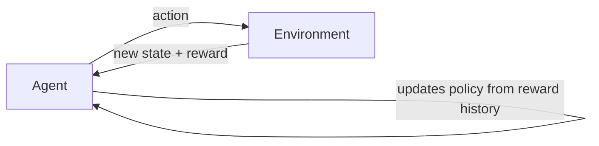

# Machine Learning - Lesson 08 Reinforcement Learning

> Depth goal: understand the agent-environment-reward loop as a genuinely different learning paradigm from supervised/unsupervised learning, the exploration-exploitation tradeoff, the off-policy vs. on-policy distinction, and why deep Q-learning extends classical Q-learning to large/continuous state spaces.

## Source
- Course: Machine Learning
- Lesson / Chapter: Lesson 08 - Reinforcement Learning (added to close a gap: Lesson 02 names RL as one of the three ML paradigms, but no dedicated lesson existed)
- Resource: companion to [[02 Literature Notes/Courses/Machine Learning - Lesson 02 Introduction to Machine Learning]]

---

## 1. Mental Model

**Reinforcement learning is learning a decision policy through trial and error, from delayed reward feedback on a sequence of actions — not from a fixed dataset of correct answers.** Supervised learning is told the right answer for every example up front; RL only ever gets a reward signal after acting, often long after the action that actually mattered, and has to work backward from outcomes to figure out which earlier decisions deserve credit.

The core loop: an **agent** observes a **state**, takes an **action**, the **environment** transitions to a new state and returns a **reward**, and the agent repeats this to accumulate experience it learns from. The agent's goal is never to maximize the next single reward — it's to maximize *cumulative* reward over an entire sequence of decisions, which is what makes RL structurally different from a one-shot prediction problem: a locally bad-looking move (sacrificing a piece in chess) can be the correct choice if it leads to a better long-term outcome, and RL is specifically built to reason about that tradeoff.

> Key intuition: **RL has no dataset of "correct" actions to imitate — every ounce of information about what's actually good comes from reward signals the agent has to interpret itself, often from actions taken many steps earlier than the reward that resulted.**



---

## 2. How It Actually Works

### 2.1 The core vocabulary: state, action, reward, policy
A **state** is the agent's current observation of the environment (a board position, a sensor reading). An **action** is a choice the agent can make from that state. A **reward** is a numeric signal — positive or negative — the environment returns after an action, reflecting how good or bad that action was. A **policy** is the agent's strategy: a mapping from states to actions (or a probability distribution over actions) that the agent is trying to improve over time. The entire RL problem is: find the policy that maximizes expected cumulative reward.

### 2.2 Exploration vs. exploitation
At every decision point, the agent faces a genuine tension: **exploit** the best action it currently believes it knows (based on experience so far), or **explore** a different, less-tried action that might turn out to be better than what it currently believes is best. Pure exploitation risks getting permanently stuck on a mediocre strategy the agent happened to try early and never revisited; pure exploration never actually uses what's been learned. A common concrete strategy is **epsilon-greedy**: take the currently-best-known action most of the time, but take a random action with small probability epsilon, so the agent keeps gathering information about alternatives it might otherwise never try again.

### 2.3 Q-learning: learning action-values
**Q-learning** learns a function `Q(state, action)` — the expected cumulative future reward of taking a specific action from a specific state, then acting optimally afterward. It updates this estimate incrementally using the **Bellman equation**: after taking action `a` in state `s`, observing reward `r` and landing in new state `s'`, update:

$$Q(s, a) \leftarrow Q(s, a) + \alpha \left[ r + \gamma \max_{a'} Q(s', a') - Q(s, a) \right]$$

Here `α` (learning rate) controls how much each new experience updates the existing estimate, and `γ` (discount factor, between 0 and 1) controls how much future reward matters relative to immediate reward — a `γ` near 0 makes the agent short-sighted (only immediate reward matters); a `γ` near 1 makes it weigh distant future reward almost as much as immediate reward. Critically, Q-learning's update uses `max` over the *next* state's actions regardless of which action the agent actually takes next — it's learning the value of the optimal policy, even while following a different, exploratory policy during training. This is what makes it **off-policy** (section 2.4).

### 2.4 Off-policy vs. on-policy learning
This distinction is about whether the policy being *learned* (the target policy) is the same as the policy being *followed* to generate experience (the behavior policy). Q-learning is **off-policy**: it follows an exploratory policy (epsilon-greedy, trying some random actions) to gather experience, but its update rule always bootstraps off the *best* possible next action (`max` over `Q(s', a')`), regardless of what the exploratory policy would actually do next — it's learning the value of the optimal policy while behaving according to a different, more exploratory one.

**SARSA** (State-Action-Reward-State-Action) is the **on-policy** counterpart: its update uses the Q-value of the action the policy *actually takes next* (including exploratory random actions), not the best possible action. This makes SARSA's learned values reflect the actual behavior policy's performance, including the risk introduced by its own exploration — practically, this makes SARSA more "cautious" in environments with real danger (e.g., a cliff-walking environment where a wrong move is catastrophic), since it accounts for the chance its own exploratory policy might wander into a bad action, while Q-learning's values assume optimal play going forward and can underestimate the real risk of its own exploration.

### 2.5 Why "deep" Q-learning
Classical Q-learning stores `Q(s, a)` as a table — one entry per state-action pair. This works fine when the state space is small and discrete (a grid world with a few hundred cells). It breaks down completely for large or continuous state spaces (raw pixel input from a video game, a robot's continuous joint angles) — there are simply too many possible states (or infinitely many, if continuous) to store a table entry for each one, and even if you could, the agent would never visit most states enough times to learn a reliable value for them individually.

**Deep Q-Networks (DQN)** replace the table with a neural network that takes a state as input and outputs an estimated Q-value for each possible action — the network *generalizes* across similar states instead of requiring every exact state to be visited individually, the same way a neural network generalizes across similar images in supervised learning rather than memorizing every training pixel pattern. This is specifically why "deep" matters: it's not a different algorithm from Q-learning's core update logic, it's Q-learning's same Bellman-equation update, applied to a function approximator (a neural network) instead of an explicit table, which is what makes it tractable for state spaces too large or continuous to tabulate directly.

### 2.6 Where RL genuinely fits (and where it doesn't)
RL requires a genuine sequential-decision problem with a reward signal and an environment the agent can interact with (even if that interaction is simulated) — game-playing, robotics control, resource allocation over time, RLHF-style preference optimization for LLMs (covered in [[02 Literature Notes/LLM Engineering/Preference Optimization]]). It's a poor fit for problems that are really just a one-shot prediction from a fixed dataset — if there's no genuine sequence of actions-leading-to-delayed-reward structure, and you already have labeled correct answers, supervised learning is simpler, cheaper, and a better match to the actual problem shape. Reaching for RL when a static "input → correct answer" dataset already exists is solving a harder problem than the one actually presented.

---

## 3. Implementation

Assumed stack: `numpy` (no external RL library needed to demonstrate the core mechanism offline).

### Tabular Q-Learning on a Tiny Grid World
```python
import numpy as np

rng = np.random.RandomState(0)
N_STATES, N_ACTIONS = 5, 2  # 5 states in a line, 2 actions: left(0)/right(1)
GOAL_STATE = 4
Q = np.zeros((N_STATES, N_ACTIONS))
alpha, gamma, epsilon = 0.5, 0.9, 0.2

def step(state, action):
    new_state = max(0, state - 1) if action == 0 else min(N_STATES - 1, state + 1)
    reward = 10.0 if new_state == GOAL_STATE else -1.0
    return new_state, reward

for episode in range(200):
    state = 0
    for _ in range(20):
        action = rng.randint(N_ACTIONS) if rng.rand() < epsilon else np.argmax(Q[state])
        new_state, reward = step(state, action)
        Q[state, action] += alpha * (reward + gamma * np.max(Q[new_state]) - Q[state, action])
        state = new_state
        if state == GOAL_STATE:
            break

print("Learned Q-table (rows=state, cols=[left, right]):")
print(Q.round(2))
print("Learned policy per state:", [["left", "right"][a] for a in np.argmax(Q, axis=1)])
```

### Epsilon-Greedy vs. Pure Exploitation Comparison
```python
def run_policy(epsilon, episodes=100):
    Q_local = np.zeros((N_STATES, N_ACTIONS))
    total_reward = 0.0
    for _ in range(episodes):
        state = 0
        for _ in range(20):
            action = rng.randint(N_ACTIONS) if rng.rand() < epsilon else np.argmax(Q_local[state])
            new_state, reward = step(state, action)
            Q_local[state, action] += alpha * (reward + gamma * np.max(Q_local[new_state]) - Q_local[state, action])
            total_reward += reward
            state = new_state
            if state == GOAL_STATE:
                break
    return total_reward

print("Pure exploitation (epsilon=0) total reward:", run_policy(0.0))
print("Epsilon-greedy (epsilon=0.2) total reward:  ", run_policy(0.2))
# On this simple, trap-free line-world, pure exploitation actually scores higher
# in total accumulated reward, because every epsilon-greedy random move still
# costs real reward during training -- exploration is a real, paid cost, not a
# free action. Pure exploitation's risk shows up differently: change the reward
# structure to include even one misleading early state (a state that looks good
# short-term but leads to a dead end), and pure exploitation can lock onto that
# trap permanently, having never tried the alternative that would reveal it's a
# trap -- while epsilon-greedy would eventually sample the alternative path and
# correct course. The real tradeoff isn't "epsilon-greedy always scores higher,"
# it's "pure exploitation never recovers from a wrong first impression; epsilon-
# greedy pays an ongoing cost for the ability to recover from one."
```

---

## 4. Design Decisions & Tradeoffs

| Decision | Guidance |
|---|---|
| **RL vs. supervised learning** | Only reach for RL when there's a genuine sequential-decision problem with delayed reward and an interactable environment; don't use it for a one-shot prediction task that already has labeled data. |
| **Discount factor γ** | Near 1 for problems where long-term consequences matter a lot (strategic games); lower for problems where near-term reward should dominate. |
| **Exploration strategy** | Epsilon-greedy is a simple, usually-sufficient default; decay epsilon over training as the policy becomes more trustworthy. |
| **Q-learning vs. SARSA** | Q-learning when you want the value of the optimal policy regardless of exploration risk; SARSA when the cost of the behavior policy's own exploratory mistakes needs to be reflected in the learned values (safety-critical environments). |
| **Tabular vs. deep Q-learning** | Tabular for small, discrete state spaces where every state can realistically be visited many times; deep (function approximation) once the state space is too large or continuous to tabulate. |

---

## 5. Failure Modes & Gotchas

- Reaching for RL on a problem that's actually a static supervised-learning task with a labeled dataset already available — solving a harder problem than necessary.
- Setting epsilon to 0 (pure exploitation) from the start, locking the agent into whatever policy it happened to learn first, however suboptimal.
- Setting the discount factor γ without considering the actual time horizon the problem cares about — a myopic γ on a problem with important long-term consequences systematically undervalues the right long-term strategy.
- Confusing Q-learning's off-policy "assume optimal future play" update with SARSA's on-policy "assume actual future behavior" update, and being surprised when Q-learning doesn't account for its own exploration risk.
- Assuming "deep" Q-learning requires an entirely different algorithm, rather than recognizing it's the same Bellman update applied to a neural network function approximator instead of a table.

---

## 6. Self-Check

1. Why is RL's reward signal "delayed" in a way that makes it fundamentally different from supervised learning's labels?
2. Walk through the exploration-exploitation tradeoff and why pure exploitation can fail.
3. Write the Q-learning Bellman update and explain what α and γ each control.
4. What's the actual mechanical difference between Q-learning (off-policy) and SARSA (on-policy)?
5. Why does a large or continuous state space require "deep" Q-learning instead of a Q-table?

---

## 7. Interview Q&A

**Q: Walk through the steps of a typical reinforcement learning algorithm, from the agent's first action to a converged policy.**
A: The loop starts with the agent observing an initial state from the environment. It selects an action according to its current policy — in early training this usually includes some randomness (exploration) rather than purely following its current best guess, since it hasn't learned enough yet to trust that guess fully. The environment responds with a new state and a reward reflecting how good that action was. The agent uses this (state, action, reward, new state) experience to update its internal value estimates — in Q-learning, this means nudging `Q(state, action)` toward the observed reward plus the estimated value of the best action from the new state. This single step repeats, episode after episode: observe, act, receive feedback, update — with the agent's exploration gradually decreasing (shifting more toward exploiting what it's learned) as training progresses and its value estimates become more trustworthy. Convergence means the agent's policy stops meaningfully changing — its action choices have stabilized because further experience no longer meaningfully updates its value estimates.

The key structural difference from supervised learning's training loop: there's no fixed, pre-labeled dataset being iterated over — the agent's own actions determine what experience it gets to learn from next, which means a poor early policy can actually limit what the agent gets to observe and learn from, a feedback loop supervised learning (where the training set is fixed regardless of model behavior) simply doesn't have.

*One-liner: the RL loop is observe-act-receive reward-update, repeated until the policy stabilizes — the crucial structural difference from supervised learning is that the agent's own actions determine what experience it gets to learn from next, creating a feedback loop between current policy quality and future learning opportunity that a fixed, pre-labeled supervised dataset never has.*

**Q: What's the actual difference between off-policy and on-policy learning, mechanically — not just the textbook labels?**
A: The distinction is about whether the policy being improved (the target policy) matches the policy actually generating the agent's experience (the behavior policy). In Q-learning (off-policy), the agent might behave using an exploratory epsilon-greedy policy — occasionally taking random, non-optimal actions to gather information — but its *update rule* always bootstraps off `max` over the next state's Q-values, i.e., it always assumes optimal play will happen from the next state onward, regardless of what the actual (exploratory) behavior policy would really do. It's learning "how good would this be under optimal play," while behaving non-optimally to gather data.

SARSA (on-policy) instead updates using the Q-value of whatever action the behavior policy *actually selects next* — including a genuinely random exploratory action, if that's what the policy happens to choose. This means SARSA's learned values incorporate the real risk the agent's own exploration introduces, while Q-learning's values describe a hypothetically optimal future that ignores the agent's actual (exploratory, sometimes risky) behavior. The concrete, well-known consequence: in a gridworld with a cliff the agent can accidentally step off during random exploration, Q-learning learns the value of the objectively shortest path along the cliff edge (since its updates assume optimal play afterward, discounting its own exploration risk), while SARSA learns a safer, slightly longer path that accounts for the real chance its own epsilon-greedy exploration could wander off the cliff — SARSA's values reflect what actually happens when you behave the way you're really behaving, not what would happen under a hypothetical optimal policy you aren't actually following during training.

*One-liner: Q-learning's update always assumes optimal play from the next state onward regardless of the actual exploratory behavior policy (off-policy), while SARSA's update uses the value of whatever action the behavior policy actually takes next, including risky exploratory ones (on-policy) — which is why SARSA learns more cautious, exploration-aware policies in genuinely dangerous environments while Q-learning can underestimate the real risk its own exploration introduces.*

**Q: Why do we need "deep" Q-learning — what specifically breaks about classical, tabular Q-learning that deep Q-learning fixes?**
A: Classical Q-learning stores one explicit value, `Q(state, action)`, per state-action pair in a table — which requires visiting each state-action pair enough times to get a reliable estimate for that specific entry. This is completely fine when the state space is small and discrete (a few hundred grid cells), but breaks down in two related ways once the state space is large or continuous: first, the table itself becomes impossibly large to even store (a video game's raw pixel input has an astronomically large number of possible states); second, even if you could store it, the agent would almost never revisit the *exact* same state twice in a large/continuous space, so it could never accumulate enough repeated experience at any single table entry to learn a reliable value for it.

Deep Q-learning replaces the explicit table with a neural network that takes a state as input and outputs a Q-value estimate for each action — the network's whole point is that it *generalizes* across similar-but-not-identical states, the same way an image classifier generalizes across images it's never seen exactly before by learning features that transfer across similar inputs. This means the agent can learn something useful about a near-identical state it's genuinely never visited before, as long as it's visited similar states, which is structurally impossible for a table that only knows about exact states it's explicitly seen.

Critically, this isn't a different algorithm — the underlying Bellman-equation update (reward plus discounted estimate of future value, bootstrapping off the current value estimate) is identical; what changes is purely the *representation* of the value function, from an explicit lookup table to a learned function approximator, which is what makes the same core Q-learning logic tractable for state spaces too large or continuous to ever tabulate directly.

*One-liner: tabular Q-learning needs to visit each exact state-action pair repeatedly to learn its value, which is impossible once the state space is too large or continuous to ever fully revisit — deep Q-learning replaces the explicit table with a neural network that generalizes across similar states, using the exact same Bellman-equation update underneath, just with a learned function approximator instead of a lookup table as the value representation.*

## 8. Links
- Related course note: [[02 Literature Notes/Courses/Machine Learning]]
- Related map: [[06 Maps of Content/Machine Learning Concepts]]
- Related: [[02 Literature Notes/LLM Engineering/Preference Optimization]] (RLHF applies RL-style optimization to LLM alignment)
- Upstream: [[02 Literature Notes/Courses/Machine Learning - Lesson 02 Introduction to Machine Learning]] (introduces RL as one of the three ML paradigms)
