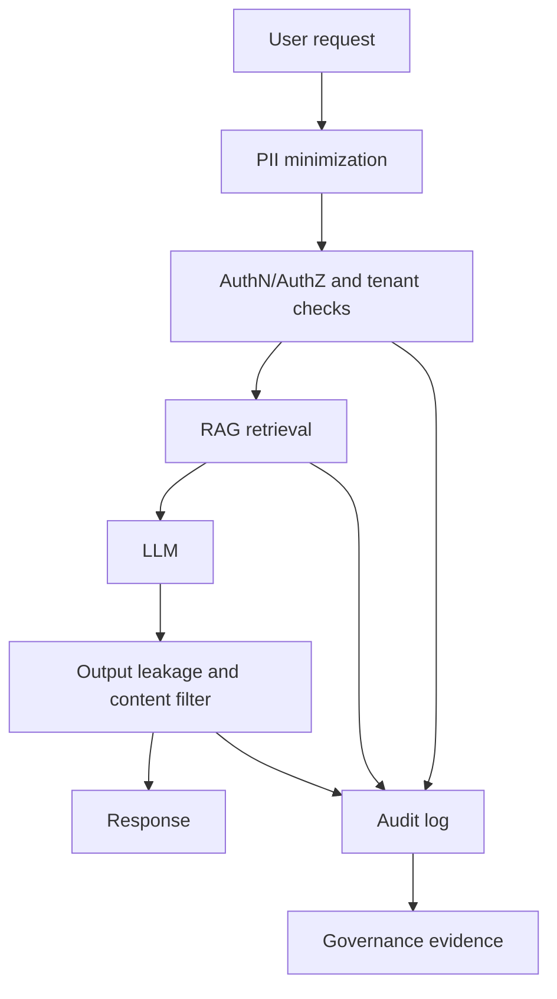

# AI Security & Governance

> Topic package — Domain 9 · Roadmap Week 21.
> Depth goal: design an enterprise LLM security program that maps threats to controls: PII minimization, RAG access control, audit evidence, leakage filters, compliance, responsible-AI review, and a launch risk checklist.

## Source
- Track: LLM Engineering (self-directed, FDE roadmap)
- Slide deck: `07 Resources Library/LLM Engineering/Slides/Lesson_49_AI_Security_and_Governance.pptx`
- Hands-on notebook: `07 Resources Library/LLM Engineering/Notebooks/49_AI_Security_and_Governance.ipynb` (runs offline)
- Reference reading: OWASP LLM Top 10; NIST AI Risk Management Framework; EU AI Act; GDPR; SOC 2 Trust Services Criteria; ISO/IEC 42001 AI management systems
- Builds on: [[02 Literature Notes/LLM Engineering/RAG Evaluation]]
- Date: 2026-07-18

---

## 1. Mental Model

**AI security is not one filter at the edge — it is a layered control system around data, users, tools, model behavior, and evidence.** The model is only one component; failures often happen because private data enters a prompt, the wrong user retrieves the wrong document, generated text leaks secrets, or no audit trail exists when something goes wrong.

Think in layers: classify data before it reaches the model, enforce tenant/RBAC boundaries before retrieval, constrain tools, filter outputs, log security-relevant decisions, and connect those controls to governance frameworks such as OWASP LLM Top 10, NIST AI RMF, GDPR/SOC2, and the EU AI Act.

> Key intuition: **secure the AI workflow, not just the prompt** — every transition from user to retriever to model to tool to output needs a control and an audit event.



---

## 2. How It Actually Works

### 9.1 Threat model with OWASP LLM Top 10
Start with named failure classes: prompt injection, sensitive information disclosure, insecure output handling, excessive agency, vector/database weaknesses, model denial of service, and supply-chain risks. For each production use case, write an abuse story: *who attacks, what asset is targeted, which boundary fails, and what evidence would prove the control worked?* OWASP is the checklist; your architecture is the answer.

### 9.2 PII and data privacy by design
Minimize before you generate. Detect direct identifiers (email, phone, SSN), pseudonymize where possible, avoid logging raw prompts with personal data, and set retention/deletion policies. GDPR-style thinking matters even outside Europe: lawful basis, purpose limitation, data minimization, subject access, and erasure. The safest token is the one never sent to a model provider.

### 9.3 RBAC for RAG
RAG changes access control because retrieval silently injects documents into the prompt. The retriever must enforce the same tenant, role, document-level ACL, region, and time-bound entitlements as the source system *before* the model sees text. Never rely on the LLM to ignore unauthorized context; unauthorized context should not be retrieved.

### 9.4 Audit logging and compliance evidence
Every sensitive decision should leave evidence: user, request id, model/version, retrieved document ids, policy decision, filters applied, tool calls, refusal/escalation, and final disposition. SOC2 and AI governance reviews ask: can you show the control happened? Audit logs convert good intentions into verifiable operations.

### 9.5 Responsible-AI governance
Security overlaps with responsible AI: define intended use, prohibited use, human escalation, evaluation coverage, bias/safety tests, incident response, vendor risk review, and model-change management. NIST AI RMF frames this as govern-map-measure-manage; the EU AI Act adds risk tiers and obligations. A launch checklist should connect technical controls to these governance artifacts.

---

## 3. Implementation

Assumed stack: stdlib. Snippets demonstrate deterministic PII redaction and RAG RBAC audit logging. Snippets:
- [[04 Code Snippets/LLM/Deterministic PII Redaction Gate]]
- [[04 Code Snippets/LLM/RAG RBAC Audit Gate]]

### Deterministic PII Redaction Gate
Regex-detect common identifiers and pseudonymize them before model or log exposure.
```python
import re, hashlib
PII_PATTERNS = {
    "email": re.compile(r"\b[A-Za-z0-9._%+-]+@[A-Za-z0-9.-]+\.[A-Za-z]{2,}\b"),
    "phone": re.compile(r"\b(?:\+?1[-. ]?)?\(?\d{3}\)?[-. ]?\d{3}[-. ]?\d{4}\b"),
    "ssn": re.compile(r"\b\d{3}-\d{2}-\d{4}\b"),
}

def pseudonymize(kind, value):
    digest = hashlib.sha256(value.encode()).hexdigest()[:10]
    return f"<{kind.upper()}:{digest}>"

def redact_pii(text):
    findings = []
    for kind, pat in PII_PATTERNS.items():
        def repl(m):
            findings.append({"type": kind, "value": m.group(0)})
            return pseudonymize(kind, m.group(0))
        text = pat.sub(repl, text)
    return text, findings

sample = "Email jane@corp.com or call 415-555-1212; SSN 123-45-6789."
redacted, findings = redact_pii(sample)
print(redacted)
print([f["type"] for f in findings])
```

### RAG RBAC Audit Gate
Enforce tenant and role boundaries before retrieval and record policy decisions.
```python
from datetime import datetime

class AuditLog:
    def __init__(self):
        self.events = []
    def record(self, user, action, resource, decision, reason):
        self.events.append({
            "ts": datetime.utcnow().isoformat(timespec="seconds") + "Z",
            "user": user, "action": action, "resource": resource,
            "decision": decision, "reason": reason,
        })

def can_retrieve(user, doc, log):
    allowed = user["role"] in doc["roles"] and user["tenant"] == doc["tenant"]
    log.record(user["id"], "retrieve", doc["id"], "allow" if allowed else "deny",
               "tenant+role match" if allowed else "RBAC or tenant boundary failed")
    return allowed

log = AuditLog()
user = {"id":"u7", "role":"analyst", "tenant":"acme"}
docs = [{"id":"policy", "roles":{"analyst"}, "tenant":"acme"},
        {"id":"payroll", "roles":{"hr"}, "tenant":"acme"}]
print([d["id"] for d in docs if can_retrieve(user, d, log)])
print(log.events)
```

---

## 4. Design Decisions & Tradeoffs

| Decision | Guidance |
|---|---|
| **Data minimization** | Redact or pseudonymize before prompts and logs; raw sensitive data requires explicit business need. |
| **Retriever authorization** | Apply RBAC/ABAC and tenant filters before vector search results enter context. |
| **Audit granularity** | Log document ids, policy decisions, model version, and tool calls without storing unnecessary PII. |
| **Provider posture** | Review DPA, retention, training-on-data defaults, region, SOC2/ISO evidence, and incident process. |
| **Human escalation** | Escalate regulated, high-impact, or low-confidence outcomes; do not automate consequential decisions blindly. |
| **Risk acceptance** | Document residual risks and owners; governance is a living register, not a launch checkbox. |

---

## 5. Failure Modes & Gotchas

- Letting unauthorized documents reach the prompt and asking the model not to use them.
- Logging raw prompts/responses that contain PII or secrets.
- Treating SOC2/GDPR as paperwork disconnected from runtime controls.
- No model/version/request trace, making incidents impossible to reconstruct.
- Output filters only, with no input minimization or retrieval authorization.
- No abuse-case testing for prompt injection, data leakage, or excessive agency.

---

## 6. FDE Angle

- FDE clients need a security architecture and a governance story, not just a demo.
- A risk checklist turns vague AI anxiety into concrete controls, owners, and evidence.
- RBAC-for-RAG is a board-level data-leakage control when enterprise documents are involved.
- Deliverable: threat model, risk register, PII/RBAC/audit gates, and compliance evidence map.

---

## 7. Self-Check

1. Name three OWASP LLM risks and the control you would implement for each.
2. Why must RAG enforce authorization before retrieval?
3. What should an audit log capture without creating a new privacy risk?
4. How do NIST AI RMF and EU AI Act change launch governance?
5. What belongs on an enterprise AI risk checklist?

---

## 9. Interview Q&A

**Q: Name three OWASP LLM Top 10 risks and the specific control you'd implement for each.**
A: Prompt injection — malicious instructions hidden inside content the system processes (a retrieved document, a tool result) attempting to hijack the model's behavior, covered in Prompt Contracts and the Guardrails topic. Control: clearly delimit untrusted content, explicitly instruct the model to treat it as data rather than instructions, and establish explicit precedence (system rules always outrank anything found in retrieved or tool-returned content) — architectural boundaries, not relying on the model alone to tell instructions apart from data.

Sensitive information disclosure — the model revealing private or sensitive data it shouldn't, whether from training data, retrieved context, or conversation history. Control: minimize what sensitive data ever reaches the model in the first place (PII redaction/pseudonymization before prompts and logs, covered in this topic), combined with RBAC-enforced retrieval that never lets unauthorized documents enter the context to begin with — the safest data is the data that was never sent to the model at all.

Excessive agency — an agent or tool-calling system being given more capability or autonomy than the task actually requires, risking real-world harm if it misuses that capability (covered throughout the Agents domain, especially Tool and Function Calling and Agent Reliability and Cost). Control: narrow, specifically-scoped tools rather than broad "do-anything" capabilities, strict argument validation before execution, human approval checkpoints for high-impact or irreversible actions, and hard budget/step caps limiting how much an agent can do unsupervised.

*One-liner: prompt injection is controlled by delimiting untrusted content and enforcing explicit instruction precedence; sensitive information disclosure is controlled by minimizing what sensitive data reaches the model at all (redaction) plus RBAC-enforced retrieval; excessive agency is controlled by narrow-scoped tools, strict validation, human checkpoints for high-impact actions, and hard budget/step caps — each risk gets a control targeting its specific failure mechanism, not one generic fix.*

**Q: Why must RAG enforce authorization before retrieval, rather than asking the model to simply not use unauthorized content it was given?**
A: Once a document's content has actually entered the model's context window, the access boundary has already been crossed — the model has already "seen" the unauthorized content, and asking it afterward to please not reference or use that content is a request, not a real security guarantee. A model is a probabilistic system, not a reliable, deterministic access-control enforcement mechanism — there's no guarantee it will perfectly honor an instruction to ignore specific content it has already been shown, especially under adversarial conditions (a deliberate attempt to extract that content) or simply due to ordinary model unpredictability.

This is exactly the same principle covered in RAG Pipeline Fundamentals and Vector Search's authorization discussion: a real security boundary has to prevent unauthorized content from ever entering the pipeline's working set in the first place, rather than relying on a downstream instruction to the model to behave correctly after the fact. Enforcing authorization as a genuine pre-filter at retrieval time — before documents are ranked, before they enter context assembly — means unauthorized content is never actually shown to the model at all, which is a structurally real guarantee, not a probabilistic hope resting on the model's good behavior.

*One-liner: once unauthorized content has entered the model's context, asking it to "please not use that" is a request to a probabilistic system, not a real security guarantee — authorization has to be enforced as a genuine pre-filter at retrieval time, before unauthorized documents ever enter the pipeline's working set, so the model structurally never sees content it shouldn't, rather than relying on it to behave correctly after being shown it.*

**Q: What should an audit log capture, while specifically avoiding creating a new privacy risk of its own?**
A: An audit log needs enough detail to answer "did the control actually happen, and what decision was made" for every sensitive operation — the user who made the request, a request ID, the specific model/version involved, which document IDs were retrieved, what policy decision was made (allowed/denied, and why), what filters were applied, what tool calls occurred, and the final disposition (answered, refused, escalated) — this is what lets a security or compliance review later verify a control actually fired correctly, rather than just trusting it did.

The specific tension to manage: logging needs to capture *that a decision was made and what it was*, without necessarily capturing the full, raw sensitive content that decision was actually about. You can log "document ID payroll-2024-Q3 was denied to user u7 because of an RBAC/tenant mismatch" — which is genuinely useful audit evidence — without needing to also log the actual raw, sensitive payroll content itself inside the audit trail. If the audit log itself ends up accumulating raw PII or sensitive document content just by virtue of logging "what happened," the audit system becomes a brand new privacy liability in its own right — a second place where sensitive data now lives and needs its own protection, defeating part of the purpose of having careful data-minimization controls elsewhere in the system.

*One-liner: audit logs need user, request ID, model/version, retrieved document IDs, policy decisions, filters applied, tool calls, and final disposition — enough to verify a control actually fired — but should log identifiers and decisions, not the raw sensitive content itself, since an audit trail that accumulates raw PII or sensitive document content becomes a new privacy liability in its own right, undermining the data-minimization controls it's supposed to be verifying.*

**Q: How do frameworks like the NIST AI RMF and the EU AI Act actually change how you'd approach launching an AI system, beyond just technical controls?**
A: These frameworks push governance from being an informal, ad-hoc set of good intentions into something structured, documented, and genuinely accountable — shifting the question from "do we believe this is safe" to "can we demonstrate, with evidence, that we assessed and managed the risk systematically."

NIST AI RMF structures this through a specific cycle — govern (establish accountability and policy), map (identify the actual risks and context for this specific system), measure (actually evaluate and test for those identified risks, connecting directly to the Evaluation domain's red-teaming and eval practices), and manage (actively mitigate identified risks and monitor them ongoing, not just at a one-time launch review). This means a launch isn't just "we shipped it" — it's "we can show the specific risks we identified for this system, what we measured to assess them, and what we're doing to manage them continuously."

The EU AI Act adds a risk-tiering structure on top of this — different AI systems face different levels of regulatory obligation depending on which risk tier they fall into (an AI system used in a low-stakes context faces lighter obligations than one used in a high-stakes context like employment decisions or critical infrastructure) — meaning part of launch governance now includes correctly classifying which tier a given system falls into, and ensuring the obligations attached to that specific tier are actually met, not applying one uniform governance process regardless of actual risk level.

Practically, this means a launch checklist needs to connect technical controls (the PII redaction, RBAC enforcement, and audit logging covered in this topic) directly to these governance artifacts — showing not just "we built the control" but "here's the documented risk assessment, the measured evaluation evidence, and the ongoing management plan that this control is satisfying," which is what these frameworks actually expect a mature AI governance program to produce.

*One-liner: these frameworks shift AI governance from informal good intentions to a structured, evidence-based process — NIST AI RMF's govern-map-measure-manage cycle requires documented risk identification, actual measured evaluation (not just belief), and ongoing management; the EU AI Act adds risk-tiering, requiring correct classification of a system's risk level and meeting that tier's specific obligations — meaning launch governance needs to connect technical controls to documented evidence, not just implement the controls silently.*

**Q: What belongs on an enterprise AI risk checklist, and why is it described as "a living register, not a launch checkbox"?**
A: A genuinely complete checklist spans technical, data, and organizational dimensions: data minimization and PII handling practices, RBAC/authorization enforcement for any retrieval-augmented system, audit logging coverage for sensitive decisions, provider posture review (data processing agreements, data retention policies, whether the provider trains on your data by default, their own compliance certifications), human escalation paths for regulated or high-impact decisions, evaluation and red-teaming coverage (connecting to the Evaluation domain's practices), incident response planning (what happens when something does go wrong), vendor risk review, and a process for managing model changes over time (since a model update can change behavior in ways that need re-assessment, not a one-time check).

The reason this needs to be a living register rather than a one-time launch checkbox: the risks a system actually faces aren't fixed at launch — the underlying model can get updated by the provider, the corpus being retrieved over changes over time, new attack patterns get discovered, usage patterns shift as the system scales to new contexts or user populations. A risk assessment done once at launch and then never revisited becomes stale and potentially misleading almost immediately as any of these things change — treating it as a living register means risks, their current status, and their owners are tracked and revisited continuously, not just verified once and then forgotten.

*One-liner: an enterprise AI risk checklist spans data minimization, RBAC/authorization enforcement, audit logging, provider/vendor posture review, human escalation paths, evaluation/red-teaming coverage, incident response planning, and model-change management — it needs to be a living, continuously-revisited register rather than a one-time launch checkbox because the underlying model, corpus, attack landscape, and usage patterns all keep changing after launch, making a point-in-time assessment stale almost immediately.*

## 8. Links
- Domain MOC: [[06 Maps of Content/LLM Engineering Concepts]]
- Code: [[04 Code Snippets/LLM/Deterministic PII Redaction Gate]], [[04 Code Snippets/LLM/RAG RBAC Audit Gate]]
- Distilled: [[03 Permanent Notes/Secure the AI Workflow Not Just the Prompt]], [[03 Permanent Notes/RAG Authorization Happens Before Retrieval]]
- Upstream: [[02 Literature Notes/LLM Engineering/RAG Evaluation]] · Downstream: [[02 Literature Notes/LLM Engineering/Guardrails and Prompt Injection]]
