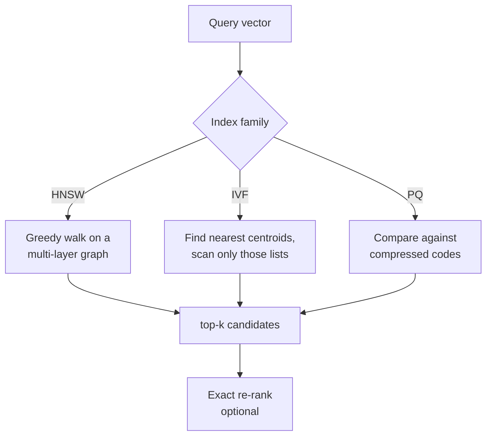

# ANN Index Internals

> Topic package — Domain 1 (Data Representation) · Roadmap Weeks 09/14.
> Depth goal: understand *how* the three ANN index families (HNSW, IVF, PQ) actually work, the knobs that trade recall for latency/memory, and how to pick and tune one for a real workload.

## Source
- Track: LLM Engineering (self-directed, FDE roadmap)
- Slide deck: `07 Resources Library/LLM Engineering/Slides/Lesson_06_ANN_Index_Internals.pptx`
- Hands-on notebook: `07 Resources Library/LLM Engineering/Notebooks/06_ANN_Index_Internals.ipynb` (runs offline)
- Reference reading: Malkov & Yashunin "HNSW" (arXiv:1603.09320); Jégou et al. "Product Quantization for NN Search" (IEEE TPAMI 2011); Johnson et al. "Billion-scale similarity search with GPUs" (FAISS, arXiv:1702.08734); Pinecone HNSW/IVF/PQ guides; FAISS wiki "Guidelines to choose an index"
- Builds on: [[02 Literature Notes/LLM Engineering/Vector Search]]
- Date: 2026-07-18

---

## 1. Mental Model

**An ANN index is a data structure that avoids comparing the query to every vector.** Exact search is `O(N·d)` per query — fine for thousands of vectors, hopeless for millions. Approximate Nearest Neighbor (ANN) indexes accept a small, *tunable* chance of missing a true neighbor in exchange for sub-linear query time and/or a smaller memory footprint.

There are three core ideas, and every production index is one of them or a hybrid:

- **HNSW (graph)** — *navigate* to the answer. Build a navigable small-world graph and greedily walk toward the query. Fast, high recall, memory-hungry. The default for most vector DBs.
- **IVF (clustering / inverted file)** — *prune* the search space. Cluster vectors, only scan the few clusters nearest the query. Cheap memory, needs training, recall depends on how many clusters you probe.
- **PQ (product quantization)** — *compress* the vectors. Replace each vector with a short code so millions fit in RAM and distances are computed via lookup tables. Massive memory savings, lossy.

> Key intuition: the three families attack a different cost. **HNSW spends memory to save time; IVF prunes to save time; PQ compresses to save memory.** Real systems combine them (e.g. FAISS `IVF4096,PQ64`, or HNSW over PQ codes).



---

## 2. How It Actually Works

### 2.1 HNSW — Hierarchical Navigable Small World
A multi-layer graph. The bottom layer contains every vector; each higher layer is a sparse random subset, like the express lanes of a **skip list**. Search starts at the top layer's entry point, greedily hops to the neighbor closest to the query, drops a layer when it can't get closer, and repeats down to layer 0.

- **Build knobs:**
  - `M` — edges per node (graph degree). Higher `M` → better recall, more memory (roughly `~ M·N` links).
  - `efConstruction` — candidate list size while inserting. Higher → better graph quality, slower build.
- **Search knob:**
  - `efSearch` — candidate list size at query time. Higher → higher recall, more latency. This is the primary recall/latency dial.

Query time is roughly `O(log N)` hops. HNSW gives the best recall-at-latency of the three but stores the full vectors **plus** the graph, so it is the most memory-expensive.

$$\text{memory}_{\text{HNSW}} \approx \underbrace{N \cdot d \cdot 4}_{\text{float32 vectors}} + \underbrace{N \cdot M \cdot 2 \cdot 8}_{\text{graph links (bytes)}}$$

### 2.2 IVF — Inverted File Index
Run k-means to learn `nlist` centroids ("Voronoi cells"). Each vector is assigned to its nearest centroid's list. At query time, find the `nprobe` centroids nearest the query and scan **only** those lists.

- **Build knob:** `nlist` — number of clusters. Rule of thumb `nlist ≈ √N` … `4·√N`. Needs a `train()` step on representative data.
- **Search knob:** `nprobe` — how many clusters to scan. `nprobe = 1` is fast but low recall (misses neighbors sitting just across a cell boundary); raising `nprobe` trades latency for recall. `nprobe = nlist` degenerates to exact search.

IVF is memory-light (just the vectors + tiny centroid table) and great when you can afford a training pass. Its weakness is **boundary effects**: true neighbors near a Voronoi edge live in a cell you didn't probe.

### 2.3 PQ — Product Quantization
Split each `d`-dim vector into `m` sub-vectors; run k-means (usually 256 centroids = 1 byte) **per sub-space**. A vector becomes `m` bytes of centroid IDs. Distances are computed with a precomputed query-to-centroid lookup table (Asymmetric Distance Computation), so you never decompress.

- **Knobs:** `m` (number of sub-quantizers → code length) and `nbits` (bits per code, usually 8). A 768-d float32 vector (3072 bytes) → `m=64, nbits=8` = **64 bytes**, a ~48× shrink.
- **Cost:** lossy — distances are approximate, so recall drops. Usually paired with an exact **re-rank** of the top candidates using full vectors, and/or wrapped in IVF (`IVFPQ`) to also prune.

$$\text{bytes per vector}_{\text{PQ}} = m \cdot \frac{\text{nbits}}{8}, \qquad \text{compression} = \frac{4d}{m \cdot \text{nbits}/8}$$

### 2.4 How they combine
- `IVFPQ` — prune with IVF, store PQ codes → billion-scale on one machine (FAISS default for huge corpora).
- `HNSW,PQ` / `HNSWPQ` — graph navigation over compressed codes when HNSW's full-vector memory is too high.
- Most managed DBs (Pinecone, Qdrant, Weaviate, Milvus) default to **HNSW** for < ~10M vectors because it's the easiest to get high recall with minimal tuning.

---

## 3. Implementation

Assumed stack (pin): `faiss-cpu>=1.8`, `numpy`. Snippets:
- [[04 Code Snippets/LLM/HNSW and IVF with FAISS]]
- [[04 Code Snippets/LLM/Tuning ANN Recall vs Latency]]

### 3.1 The three indexes in FAISS
```python
import faiss, numpy as np
d = 768
# HNSW — navigate
hnsw = faiss.IndexHNSWFlat(d, 32)          # M=32
hnsw.hnsw.efConstruction = 200
hnsw.hnsw.efSearch = 64                      # recall/latency dial
hnsw.add(xb)

# IVF — prune (needs training)
quant = faiss.IndexFlatIP(d)
ivf = faiss.IndexIVFFlat(quant, d, 4096)    # nlist=4096
ivf.train(xb); ivf.add(xb)
ivf.nprobe = 16                              # recall/latency dial

# IVFPQ — prune + compress
ivfpq = faiss.IndexIVFPQ(quant, d, 4096, 64, 8)  # m=64, nbits=8
ivfpq.train(xb); ivfpq.add(xb); ivfpq.nprobe = 16
```

### 3.2 Measuring recall against an exact baseline
```python
flat = faiss.IndexFlatIP(d); flat.add(xb)
_, true_ids = flat.search(xq, 10)           # ground truth
_, ann_ids  = hnsw.search(xq, 10)
recall = np.mean([len(set(a) & set(t)) / 10
                  for a, t in zip(ann_ids, true_ids)])
```

### 3.3 Sweeping the recall/latency knob
```python
for ef in (16, 32, 64, 128, 256):
    hnsw.hnsw.efSearch = ef
    # ... time search + compute recall ...  -> plot recall vs latency
```

---

## 4. Design Decisions & Tradeoffs

| Decision | Guidance |
|---|---|
| **Which family** | HNSW for < ~10M vectors and you want high recall with little tuning. IVF(+PQ) when memory-bound or at 100M–1B scale. Flat only for baselines / < ~100k. |
| **HNSW `M`** | 16–48. Higher = better recall + more RAM. 32 is a solid default. |
| **HNSW `efSearch`** | The live recall dial — raise until recall@k plateaus, then stop (latency keeps rising). |
| **IVF `nlist`** | ~√N to 4√N; more cells = finer pruning but each needs enough training points. |
| **IVF `nprobe`** | Start at 1–2% of `nlist`; raise for recall. |
| **PQ `m`** | Larger `m` = better recall, less compression. Must divide `d`. Add an exact re-rank of top candidates. |
| **Memory vs recall** | HNSW = most memory, best recall/latency. IVFPQ = least memory, needs tuning + re-rank. |
| **Updates** | HNSW supports incremental inserts well; IVF/PQ need a representative `train()` and periodic retraining as the distribution drifts. |

---

## 5. Failure Modes & Gotchas

- **Not training IVF/PQ on representative data** → bad centroids → poor recall for the real distribution.
- **`nprobe=1` in production** → fast but silently drops boundary neighbors; recall can be < 0.7.
- **PQ without re-rank** → approximate distances rank the wrong candidate first; always re-score top-N with full vectors when accuracy matters.
- **Treating `efSearch`/`nprobe` as build-time constants** → they're *query-time* dials you can tune live per latency budget.
- **No exact baseline** → you literally cannot compute recall, so you're tuning blind.
- **Underestimating HNSW memory** → the graph links add up; a "128 GB corpus" can OOM once the graph is built.
- **Rebuilding the whole index on every write** → know your DB's incremental-update semantics; IVF may need periodic retrain, not per-write rebuild.
- **`m` doesn't divide `d`** → FAISS errors or silently pads; check dimensions.
- **Comparing indexes at different recall** → always compare latency *at equal recall*, never raw QPS.

---

## 6. FDE Angle

- This is the topic that lets you answer a client's "why is retrieval slow / expensive / missing things?" with a mechanism, not a shrug: it's `efSearch` too low, `nprobe` too low, PQ with no re-rank, or an index that doesn't fit RAM.
- **Cost lever:** switching HNSW → IVFPQ can cut memory ~40× and let a corpus fit on a cheaper node — a real architecture/cost decision.
- **Capacity planning:** be able to estimate index memory from `N`, `d`, `M`/`m` on a whiteboard.
- Deliverable: a documented index choice with a **recall-vs-latency curve** proving the chosen operating point, plus a re-rank stage if PQ is used.

---

## 7. Self-Check

1. Explain HNSW as a skip list — what do the upper layers do and why is search ~`O(log N)`?
2. What do `M`, `efConstruction`, and `efSearch` each control, and which is a query-time dial?
3. Why does IVF miss neighbors, and how does `nprobe` fix it? What's the cost?
4. How many bytes does PQ with `m=64, nbits=8` use per 768-d vector, and why do you re-rank afterward?
5. You have 200M vectors and a tight RAM budget — which index and why?
6. How do you measure and report ANN quality honestly? (Hint: recall@k at equal latency.)

---

## 9. Interview Q&A

**Q: Explain HNSW as a skip list — what do the upper layers do, and why is search roughly O(log N)?**
A: A skip list is a classic trick for searching a sorted list faster than checking one item at a time: instead of just one layer of items in order, you build several layers on top, where each higher layer contains only a sparse sample of the items below it — like express lanes on a highway that skip over most of the exits.

HNSW builds the exact same idea, but for vectors instead of sorted numbers. The bottom layer contains every single vector in your corpus. Each layer above that contains a random, sparse subset of the vectors from the layer below — so the very top layer might only have a handful of vectors, acting as quick, coarse "entry points" into the whole structure.

A search starts at the top, sparse layer. From the current point, it greedily moves to whichever neighbor is closest to the query — "greedily" meaning it always takes the most promising next step available, without looking further ahead. Once it can't find any neighbor closer than where it already is on the current layer, it drops down to the next, denser layer and repeats the same greedy walk, now with more options available. By the time it reaches the bottom, full layer, it's already very close to the true answer, and only needs a small amount of further refinement.

The reason this ends up costing roughly O(log N) instead of O(N): each layer is deliberately built to be sparser than the one below it (similar to how a skip list's layers roughly halve in size), so the number of layers you have to pass through grows very slowly even as the total number of vectors grows a lot. You're not checking every vector — you're taking a small number of big jumps at the top, then progressively smaller, more careful steps as you descend, which is exactly the shape that gives you logarithmic rather than linear search cost.

*One-liner: HNSW stacks sparser and sparser layers on top of the full set of vectors, like a skip list's express lanes — search starts at the sparse top layer and greedily descends toward the query, taking big jumps early and small refinements late, which is why it costs roughly O(log N) instead of checking every vector.*

**Q: What do M, efConstruction, and efSearch each control, and which one is a query-time dial?**
A: These three knobs control HNSW at two different points in its life: when the graph is first being built, and when it's actually being searched.

`M` controls how many connections ("edges") each vector gets to other vectors when the graph is built — think of it as how many neighbors each point in the graph knows about directly. A higher `M` means a richer, more densely connected graph, which generally improves recall (better chance of finding the true nearest neighbors), but it also means more memory, since you're storing more links per vector. This is a build-time decision — once the graph exists with a certain `M`, you can't easily change it without rebuilding.

`efConstruction` also only matters while the graph is being built — it controls how large a list of candidate neighbors the algorithm considers while deciding which connections to actually keep for each new vector being inserted. A higher `efConstruction` means a more careful, thorough search for good neighbors during construction, producing a higher-quality graph, at the cost of a slower build process. Like `M`, this is locked in once the index is built.

`efSearch` is the one that's different: it only matters at query time, not build time, and it controls how large a candidate list the greedy walk keeps track of while actually answering a search. This is the dial you can freely adjust after the index already exists, per query if you want — raise it, and the search considers more candidates before settling on an answer, improving recall at the cost of more time per query; lower it, and search gets faster but risks missing some true neighbors.

*One-liner: M (connections per vector) and efConstruction (candidate list size during build) are both build-time decisions baked into the graph — efSearch is the one query-time dial you can freely adjust afterward to trade recall against latency, live, without rebuilding anything.*

**Q: Why does IVF miss neighbors, and how does nprobe address it? What's the cost?**
A: IVF works by grouping vectors into clusters (using something like k-means) and, at query time, only searching inside the clusters closest to the query — rather than scanning everything. This is the whole source of its speed, but it's also exactly where it can go wrong.

The problem is what happens near the *edges* of these clusters. Clustering divides the vector space into regions, but a true nearest neighbor to your query might happen to sit just barely on the other side of a cluster boundary — closer to your query in actual distance, but technically assigned to a different, neighboring cluster because that's where the clustering algorithm happened to draw the line. If you only search the single closest cluster, you'll completely miss that neighbor, even though it was genuinely one of the closest vectors to your query — it's an artifact of how the space got carved up, not a reflection of actual similarity.

`nprobe` is the fix: instead of only searching the single nearest cluster, you search the `nprobe` nearest clusters instead. Raising `nprobe` means checking more neighboring clusters, which catches more of these boundary cases — a true neighbor that got assigned just across a boundary from your query's own cluster is much more likely to be caught if you're also checking the next few closest clusters, not just the one.

The cost is the obvious tradeoff: searching more clusters means more work per query, so raising `nprobe` directly increases latency in exchange for better recall. Taken to its extreme, setting `nprobe` equal to the total number of clusters means you're searching every cluster — which is just exact, brute-force search again, with none of IVF's speed benefit left.

*One-liner: IVF only searches the clusters nearest the query, which can miss true neighbors sitting just across a cluster boundary — raising nprobe searches more neighboring clusters to catch these boundary cases, trading more latency for better recall, with nprobe=all clusters degenerating back into exact search.*

**Q: How many bytes does PQ use per 768-dimension vector with m=64, nbits=8, and why do you re-rank the results afterward?**
A: Work through what PQ actually stores. Instead of keeping the full vector, PQ splits each vector into `m` smaller sub-vectors, and for each sub-vector, it replaces the actual numbers with just the ID of whichever pre-learned cluster that sub-vector is closest to. With `nbits=8`, each of those cluster IDs needs exactly 1 byte to store (since 8 bits can represent up to 256 distinct cluster IDs).

So the storage per vector is simply `m × (nbits / 8)` bytes — with `m=64` and `nbits=8`, that's `64 × 1 = 64 bytes` per vector. Compare that to the original: a 768-dimension float32 vector takes `768 × 4 = 3,072 bytes`. So PQ compresses this down from 3,072 bytes to just 64 bytes — roughly a 48x reduction in size, which is why PQ lets you fit far more vectors into the same amount of RAM.

Here's why you can't just trust the PQ-based ranking directly, though: this compression is lossy. Each sub-vector gets replaced by the *nearest cluster's* representative value, not its own exact original value — so the distance you compute using these compressed codes is only an approximation of the true distance, not the real thing. Two vectors that are actually slightly different distances from the query could easily get assigned to the same cluster IDs and look identical under PQ, even though they weren't identical originally. This means the PQ-based ranking can genuinely put the wrong candidate first, or miss subtle but real differences between close candidates.

The fix is a re-ranking step: use PQ to quickly narrow a huge corpus down to some larger set of plausible candidates (say, the top 100), then go back and compute the *real, exact* distance using the original, full-precision vectors for just those 100 candidates, and re-sort based on that. This gets you PQ's massive memory savings for the expensive part (searching across millions of vectors) while still getting an exact, trustworthy final ranking for the much smaller set of candidates that actually matter.

*One-liner: PQ storage is `m × (nbits/8)` bytes per vector — with m=64, nbits=8, that's 64 bytes (a 48x shrink from the original 3,072-byte float32 vector) — but since PQ distances are only approximate, a final re-ranking step using exact full-precision vectors on the narrowed candidate set is needed to get a trustworthy final ranking.*

**Q: You have 200 million vectors and a tight RAM budget — which index would you choose, and why?**
A: Start from what each index family actually trades off, then match that against the specific constraint here, which is memory, not just raw speed.

HNSW gives excellent recall and fast search, but it stores the full, uncompressed vectors *plus* an entire graph of connections on top of that — this is the most memory-hungry of the three options. At 200 million vectors, storing full vectors alone is already a large amount of memory, and HNSW adds the graph structure on top of that. Given that the stated constraint here is a *tight* RAM budget, HNSW alone is likely to be the wrong choice, or at least risky, at this scale.

IVF alone helps with speed (by pruning which clusters to search) but doesn't actually reduce how much memory each vector takes up — you're still storing full, uncompressed vectors, just organized into clusters. So IVF by itself doesn't solve the memory problem here either.

This is exactly the situation `IVFPQ` (combining both) is built for: IVF prunes the search space for speed, while PQ compresses each vector down to a small code (as in the question above, potentially 48x smaller or more), so the actual memory footprint for 200 million vectors becomes dramatically smaller than storing them at full precision. The tradeoff is some loss of raw accuracy from the compression, which is why you'd pair this with an exact re-rank step on the narrowed candidates, and the fact that IVF needs a training pass on representative data before you can start adding vectors to it.

*One-liner: at 200M vectors with a tight RAM budget, IVFPQ is the right choice — IVF prunes the search space for speed and PQ compresses each vector for memory, together making billion-scale search fit in much less RAM than HNSW's full-vector-plus-graph approach would require, at the cost of needing a re-rank step to recover exact accuracy.*

**Q: How do you measure and report ANN index quality honestly?**
A: The one rule that matters most here: never compare two indexes (or two settings of the same index) by raw speed alone, without also stating what recall each one achieved — because speed without a recall number attached is a meaningless, even misleading comparison.

Here's why: it's trivially easy to make any ANN index extremely fast by cranking its recall-sacrificing settings (a tiny `efSearch`, a tiny `nprobe`) all the way down — but that fast result might be returning genuinely poor results, missing many true neighbors. If you only report "queries per second," you could be comparing a fast-but-inaccurate configuration against a slower-but-much-more-accurate one, and the raw speed number alone would make the worse option look like the winner.

The honest way to report this: first, measure recall@k against an exact, brute-force baseline (as covered in Vector Search) — this tells you what fraction of the true top-k results your approximate index is actually finding. Then, report latency *at a specific, stated recall level* — for example, "at 95% recall, this index answers queries in 12 milliseconds" — rather than just "this index does X queries per second" with no recall number attached at all. Ideally, you'd show a full recall-vs-latency curve (sweeping a knob like `efSearch` or `nprobe` across several values) so you can see the full tradeoff, and pick the operating point that fits your actual latency budget while still hitting an acceptable recall floor — and you can defend that specific choice with real data, not just a single flattering number.

*One-liner: always report ANN speed alongside the recall it achieved — comparing raw speed without stating recall is misleading, since recall can trivially be sacrificed for speed; the honest practice is reporting latency at a fixed, stated recall level (or better, a full recall-vs-latency curve) so the tradeoff is visible and defensible.*

## 8. Links
- Domain MOC: [[06 Maps of Content/LLM Engineering Concepts]]
- Code: [[04 Code Snippets/LLM/HNSW and IVF with FAISS]], [[04 Code Snippets/LLM/Tuning ANN Recall vs Latency]]
- Distilled: [[03 Permanent Notes/HNSW Trades Memory for Fast High-Recall Search]], [[03 Permanent Notes/IVF and PQ Prune and Compress the Search Space]]
- Upstream: [[02 Literature Notes/LLM Engineering/Vector Search]]
