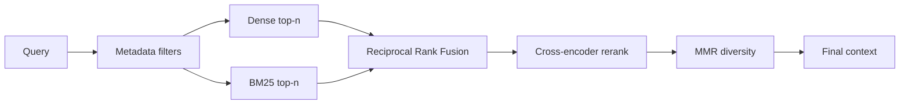

# Advanced Retrieval (hybrid, reranking, MMR)

> Topic package — Domain 4 · Roadmap Weeks 14/18.
> Depth goal: upgrade a baseline vector retriever into a production two-stage retrieval stack using BM25+dense fusion, metadata filters, cross-encoder reranking, and MMR diversity selection.

## Source
- Track: LLM Engineering (self-directed, FDE roadmap)
- Slide deck: `07 Resources Library/LLM Engineering/Slides/Lesson_18_Advanced_Retrieval.pptx`
- Hands-on notebook: `07 Resources Library/LLM Engineering/Notebooks/18_Advanced_Retrieval.ipynb` (runs offline)
- Reference reading: Cormack et al. Reciprocal Rank Fusion; Carbonell & Goldstein Maximal Marginal Relevance; Reimers & Gurevych Sentence-BERT / cross-encoders; Cohere Rerank docs; BGE reranker docs; Pinecone and Weaviate hybrid search docs
- Builds on: [[02 Literature Notes/LLM Engineering/RAG Pipeline Fundamentals]] · [[02 Literature Notes/LLM Engineering/Vector Search]] · [[02 Literature Notes/LLM Engineering/ANN Index Internals]]
- Date: 2026-07-18

---

## 1. Mental Model

**Advanced retrieval is a funnel: cheap broad recall first, expensive precision second, diversity last.** Dense embeddings catch semantic matches; lexical/BM25 catches exact names, IDs, and rare terms; fusion combines them; rerankers read query-document pairs more carefully; MMR prevents the final context from being five copies of the same evidence.

The production question is not 'which retriever is best?' It is 'what sequence of retrieval operations maximizes answerable evidence under latency and context budgets?' The answer is usually two-stage: retrieve many candidates cheaply, rerank fewer candidates expensively, then pack a diverse, filtered context.

> Key intuition: **retrieve for recall, rerank for precision, diversify for context budget.** Dense search alone is rarely the full production answer.



---

## 2. How It Actually Works

### 4.1 Dense vs lexical retrieval
Dense retrieval maps query and chunks into embedding space, so it handles paraphrase and semantic similarity. Lexical retrieval (BM25) rewards exact token overlap, so it excels on part numbers, proper nouns, error codes, and terms the embedding model underweights. Production search often needs both because user questions mix semantic intent with exact constraints.

### 4.2 Reciprocal Rank Fusion
RRF combines ranked lists without assuming comparable scores: $$score(d)=\sum_r rac{1}{k+rank_r(d)}$$. It is robust because it trusts rank positions rather than raw dense/BM25 score scales. Use it to merge dense top-50 and BM25 top-50 before reranking.

### 4.3 Cross-encoder reranking
A bi-encoder embeds query and doc separately for fast retrieval. A **cross-encoder** reads `[query, document]` jointly and outputs a relevance score, making it much more precise but slower. Common pattern: retrieve 50-200 candidates, rerank top 20-50 with Cohere/BGE/cross-encoder, then send 5-10 chunks to the LLM.

### 4.4 MMR for diversity
Maximal Marginal Relevance balances relevance to the query with novelty against already selected chunks: $$MMR=\lambda sim(q,d) - (1-\lambda)\max_{s\in S} sim(d,s)$$. This is critical when top hits are near-duplicates; the LLM needs complementary evidence, not redundant paragraphs.

### 4.5 Filters and two-stage budgets
Metadata filters (tenant, date, product, doc type, language, ACL) should happen before expensive reranking whenever possible. Retrieval budgets are product budgets: candidate count affects recall and latency; reranker count affects precision and cost; final k affects context usage and generation faithfulness.

---

## 3. Implementation

Assumed stack: stdlib + numpy. Snippets show RRF fusion and MMR final selection. Snippets:
- [[04 Code Snippets/LLM/Reciprocal Rank Fusion Retriever]]
- [[04 Code Snippets/LLM/MMR Diversification Selector]]

### Reciprocal Rank Fusion Retriever
Merge dense and lexical ranked lists without score calibration.
```python
def rrf(*ranked_lists, k=60):
    scores = {}
    for ranked in ranked_lists:
        for rank, doc_id in enumerate(ranked, 1):
            scores[doc_id] = scores.get(doc_id, 0.0) + 1.0 / (k + rank)
    return sorted(scores.items(), key=lambda x: x[1], reverse=True)

dense = ["refund_policy", "returns_faq", "shipping"]
bm25 = ["sku_ABC123", "refund_policy", "returns_faq"]
print(rrf(dense, bm25)[:4])
```

### MMR Diversification Selector
Select relevant but non-redundant chunks for the final RAG context.
```python
import numpy as np

def mmr(query_vec, doc_vecs, doc_ids, k=3, lam=0.7):
    selected, remaining = [], list(range(len(doc_ids)))
    sims_q = doc_vecs @ query_vec
    while remaining and len(selected) < k:
        best_i, best_score = None, -1e9
        for i in remaining:
            redundancy = max([float(doc_vecs[i] @ doc_vecs[j]) for j in selected] or [0.0])
            score = lam * float(sims_q[i]) - (1 - lam) * redundancy
            if score > best_score: best_i, best_score = i, score
        selected.append(best_i); remaining.remove(best_i)
    return [doc_ids[i] for i in selected]

rng = np.random.RandomState(1)
vecs = rng.randn(5, 6); vecs /= np.linalg.norm(vecs, axis=1, keepdims=True)
q = rng.randn(6); q /= np.linalg.norm(q)
print(mmr(q, vecs, [f"d{i}" for i in range(5)]))
```

---

## 4. Design Decisions & Tradeoffs

| Decision | Guidance |
|---|---|
| **Hybrid vs dense only** | Use hybrid when exact terms, IDs, names, or sparse domain vocabulary matter. |
| **Fusion method** | RRF is the safest default because it avoids score calibration across retrievers. |
| **Reranker budget** | Rerank tens, not thousands; retrieve broad candidates first, then spend expensive scoring. |
| **MMR lambda** | Higher lambda favors relevance; lower lambda favors diversity. Tune by answer coverage. |
| **Filtering stage** | Apply ACL/tenant/date filters before reranking to avoid leaks and wasted cost. |
| **Final k** | Optimize for sufficient evidence, not maximum chunks; redundancy burns context. |

---

## 5. Failure Modes & Gotchas

- Using dense-only retrieval for exact error codes or SKUs.
- Averaging dense and BM25 raw scores as if they share a scale.
- Reranking too few candidates, so the reranker never sees the right answer.
- Skipping MMR and filling context with near-duplicate chunks.
- Filtering after generation instead of before retrieval.
- Treating reranker score as faithfulness rather than relevance.

---

## 6. FDE Angle

- Hybrid+rerank is the standard upgrade path when a demo RAG system misses obvious documents.
- RRF is easy to explain to stakeholders and robust enough for first production versions.
- MMR is a context-budget tool: it turns five redundant hits into a more complete evidence set.
- The FDE deliverable is a retrieval trace showing dense, lexical, fused, reranked, and final selected evidence.

---

## 7. Self-Check

1. Why do dense and BM25 retrieval complement each other?
2. Write the RRF formula and explain why ranks beat raw scores.
3. What is the difference between a bi-encoder and a cross-encoder?
4. How does MMR trade off relevance and novelty?
5. Where should metadata filters be applied and why?

---

## 9. Interview Q&A

**Q: Why do dense and BM25 retrieval complement each other, rather than one simply being better?**
A: They're actually good at capturing two genuinely different kinds of "match," so neither one is a strictly better version of the other — each one is blind to exactly what the other one sees well.

Dense retrieval works by comparing meaning — it can recognize that "car" and "automobile" are related even though they share no letters, because it's comparing learned semantic representations, not exact words. This makes it excellent at handling paraphrasing and conceptual similarity. But this same strength is also its weakness for anything where the *exact characters* are what matters: an arbitrary error code, product SKU, or specific name has no particular "meaning" for an embedding model to latch onto — it just looks like an unusual string, and the model has no strong semantic signal to work with.

BM25 works completely differently — it rewards exact word overlap between the query and a document, weighted by how rare and distinctive those words are. This makes it excellent at precisely the thing dense retrieval struggles with: an exact error code or product ID appearing in both the query and a document is a strong, direct signal for BM25, regardless of whether the model has any "understanding" of what that code means. But BM25's weakness is the mirror image of dense retrieval's strength — it has no way to recognize that two different words mean the same thing, so a query using different (but synonymous) wording than the document would score poorly, even if they're clearly about the same thing to a human reader.

Since real user questions often mix both kinds of need — a conceptual question that also happens to reference a specific product name or code — combining both retrieval methods covers the blind spot each one has on its own.

*One-liner: dense retrieval excels at matching meaning and paraphrase (but is blind to arbitrary exact strings like codes or IDs); BM25 excels at matching exact terms (but is blind to synonyms and paraphrased meaning) — combining them covers each one's blind spot, which matters because real questions often mix both conceptual and exact-term needs.*

**Q: Write the Reciprocal Rank Fusion formula and explain why it uses ranks instead of raw scores.**
A: The formula gives each document a combined score based on where it ranked in each separate ranked list: `score(d) = sum over each retriever of 1 / (k + rank_in_that_list(d))`, where `k` is a small constant (commonly 60) that softens the impact of very top ranks slightly. A document gets credit from every list it appears in, with higher credit the closer to the top it ranked in that list.

Here's the key reasoning for why this uses rank position rather than the raw similarity scores each retriever produces directly: dense retrieval and BM25 produce scores on genuinely different, incompatible scales — a dense cosine similarity score lives roughly between -1 and 1, while a BM25 score is an unbounded value driven by term frequency and rarity statistics that can be practically any magnitude depending on the corpus and query. If you tried to directly combine these two raw scores (say, by simply adding them together, or averaging them), you'd be mixing numbers that don't mean the same thing, on different numeric ranges entirely — a BM25 score of "15" and a cosine similarity of "0.8" aren't comparable in any meaningful sense, so adding them together produces a combined number that doesn't actually reflect a sensible blend of relevance.

By using *rank position* instead of the raw scores, RRF sidesteps this problem entirely — "ranked 1st out of 50" means the same thing regardless of which retriever produced that ranking, and regardless of what specific numeric score happened to produce that rank. This makes the fusion robust without needing any calibration step between the two retrievers' very different scoring scales — you're trusting the relative *ordering* each retriever produced, not the specific raw numbers behind that ordering.

*One-liner: RRF scores each document by `1/(k + rank)` summed across every ranked list it appears in, using rank position specifically because dense and BM25 scores live on completely different, incompatible numeric scales — rank position means the same thing across both retrievers without needing any score calibration between them.*

**Q: What's the difference between a bi-encoder and a cross-encoder?**
A: A bi-encoder processes the query and each document completely separately — it embeds the query into one vector, and separately embeds each document into its own vector, with no interaction between the two during this process. Similarity is then computed afterward, as a simple comparison (like a dot product) between these two independently-produced vectors. The big advantage: because documents are embedded independently of any specific query, you can embed your entire corpus once, ahead of time, and reuse those same vectors for every future query — which is exactly what makes bi-encoders fast enough for searching across millions of documents.

A cross-encoder works completely differently — it takes the query and a *specific* document *together*, as one combined input, and processes them jointly through the model in a single pass, producing one relevance score for that specific query-document pair. Because the model gets to look at the query and document together, considering how specific words and phrases in one relate to specific words and phrases in the other, directly and jointly, it can pick up on much finer-grained relevance signals that a bi-encoder's "compare two independently-produced vectors after the fact" approach simply can't capture. This makes cross-encoders meaningfully more accurate at judging true relevance.

The cost is exactly what you'd expect from this joint-processing requirement: a cross-encoder has to be run fresh for every single query-document pair you want to score — there's no way to pre-compute anything ahead of time, since the model needs both pieces together at scoring time. This makes cross-encoders much slower, and genuinely impractical to run against millions of documents for every query. This is precisely why production systems use bi-encoders for the first, broad retrieval pass (fast, scales to millions of documents) and reserve cross-encoders for reranking just the smaller set of candidates that initial pass already narrowed things down to.

*One-liner: a bi-encoder embeds query and documents separately (fast, pre-computable, scales to millions of documents, but less precise) — a cross-encoder processes a query and one specific document jointly in a single pass (much more accurate at judging true relevance, but has to be re-run per pair, making it too slow for broad search) — which is why bi-encoders handle initial retrieval and cross-encoders handle reranking a much smaller candidate set.*

**Q: How does MMR trade off relevance and novelty when selecting a final context?**
A: MMR solves a specific problem: if you just pick the top-k most relevant results by similarity alone, you can easily end up with several results that are all relevant to the query but also nearly identical to *each other* — five near-duplicate paragraphs saying almost the same thing, instead of five genuinely different, complementary pieces of evidence.

The formula captures this directly: for each candidate document, MMR computes a score that's a weighted balance of two things — how similar this document is to the query (its raw relevance) minus how similar it is to documents *already selected* so far (its redundancy against what you've already picked). A document that's highly relevant to the query but also highly similar to something you've already chosen gets penalized for that redundancy, even though its raw relevance score alone might be very high.

The weighting parameter (commonly called lambda) controls exactly how much this redundancy penalty matters relative to raw relevance. A higher lambda leans the selection toward favoring pure relevance, even if that means picking somewhat redundant results — useful when you specifically want the absolute most relevant evidence regardless of overlap. A lower lambda leans harder toward favoring novelty, actively preferring a document that adds genuinely new information over one that's merely slightly more relevant but says the same thing as something already chosen.

This matters specifically for a RAG system's limited context budget: if your final context is filled with five chunks all making essentially the same point, you've wasted most of your token budget on redundant information instead of using it to cover the different facets of a question that might actually need separate pieces of evidence to answer completely.

*One-liner: MMR scores each candidate as its relevance to the query minus its similarity to documents already selected, so a highly relevant but redundant result gets penalized in favor of something that adds genuinely new information — the lambda weighting controls how much that redundancy penalty matters, which directly protects a limited context budget from being wasted on near-duplicate evidence.*

**Q: Where should metadata filters (tenant, date, ACL) be applied in the retrieval pipeline, and why there specifically?**
A: As early as possible — ideally as a pre-filter applied before the main retrieval and reranking steps even run, not as a cleanup step applied afterward to whatever came out the other end.

There are two separate reasons this matters, and they reinforce each other. First, cost and efficiency: reranking (especially cross-encoder reranking) is comparatively expensive to run per candidate. If you don't filter out ineligible documents before reranking, you're potentially spending that expensive computation scoring documents that were never going to be allowed in the final answer anyway, purely because they'll get thrown out by a filter applied after the fact — that's wasted compute that didn't need to happen at all.

Second, and more serious: security. As covered in Vector Search, access control (which documents a specific user or tenant is even allowed to see) is a hard boundary, not a soft preference — and applying it only as a late-stage filter, after retrieval and reranking have already run, means that for some portion of the pipeline, unauthorized content was actually present, visible, and being processed, even if it technically gets removed before the final answer is returned. That's a meaningfully weaker security posture than simply never letting unauthorized content enter the pipeline's working set at all. If any bug or oversight exists in that late-stage filtering step, unauthorized content could leak through to the user — a risk that doesn't exist at all if the content was correctly excluded from the very first search operation.

*One-liner: apply ACL/tenant/date filters as early as possible, ideally as a pre-filter before retrieval and reranking even run — this avoids wasting expensive reranking compute on documents that will be filtered out anyway, and more importantly, it means unauthorized content never enters the pipeline's working set at all, rather than relying on a later filtering step to catch it before it reaches the user.*

## 8. Links
- Domain MOC: [[06 Maps of Content/LLM Engineering Concepts]]
- Code: [[04 Code Snippets/LLM/Reciprocal Rank Fusion Retriever]], [[04 Code Snippets/LLM/MMR Diversification Selector]]
- Distilled: [[03 Permanent Notes/Production Retrieval Is a Recall Precision Diversity Funnel]], [[03 Permanent Notes/Reciprocal Rank Fusion Avoids Score Calibration Problems]]
- Upstream: [[02 Literature Notes/LLM Engineering/RAG Pipeline Fundamentals]] · Downstream: [[02 Literature Notes/LLM Engineering/Query Transformation]]
