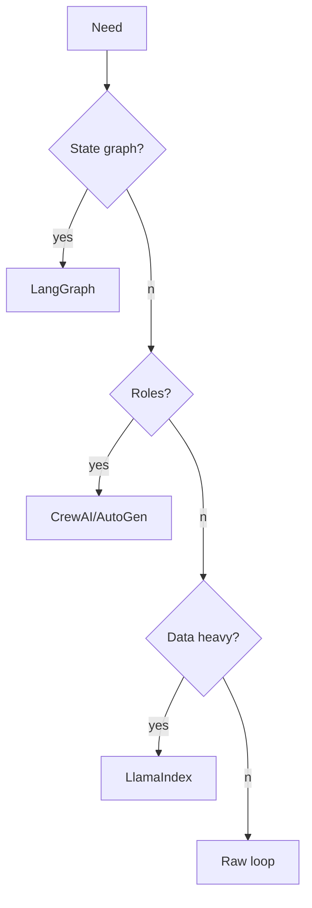

# Agent Framework Literacy

> Topic package — Domain 5 · Roadmap Week 16.
> Depth goal: compare LangGraph, CrewAI, AutoGen, OpenAI Agents SDK, Google ADK, and LlamaIndex agents; choose raw loops vs frameworks.

## Source
- Track: LLM Engineering (self-directed, FDE roadmap)
- Slide deck: `07 Resources Library/LLM Engineering/Slides/Lesson_29_Agent_Framework_Literacy.pptx`
- Hands-on notebook: `07 Resources Library/LLM Engineering/Notebooks/29_Agent_Framework_Literacy.ipynb` (runs offline)
- Reference reading: LangGraph docs; CrewAI docs; AutoGen docs; OpenAI Agents SDK docs; Google ADK docs; LlamaIndex docs
- Builds on: [[02 Literature Notes/LLM Engineering/Structured Generation]] · [[02 Literature Notes/LLM Engineering/Prompt Contracts]] · [[02 Literature Notes/LLM Engineering/Reasoning Prompt Patterns]]
- Date: 2026-07-18

---

## 1. Mental Model

**Framework literacy means matching the framework control model to your workflow before adopting abstractions.** Graph, role, conversation, SDK, and data-agent paradigms shape reliability and lock-in.



---

## 2. How It Actually Works

### 5.1 Graph paradigm
LangGraph makes nodes, edges, state, and checkpoints explicit.

### 5.2 Role/conversation
CrewAI and AutoGen emphasize collaborative agent interaction.

### 5.3 SDKs
OpenAI Agents SDK and Google ADK package tools, handoffs, and app integration.

### 5.4 Data agents
LlamaIndex is strongest when retrieval/data workflows dominate.

### 5.5 Raw loops
Best baseline for small auditable workflows.

---

## 3. Implementation

Assumed stack: stdlib + numpy where useful. Snippets:
- [[04 Code Snippets/LLM/Agent Framework Decision Matrix]]
- [[04 Code Snippets/LLM/Portable Agent State Shape]]

### Agent Framework Decision Matrix
Choose by workflow need
```python
def recommend(needs):
    if needs.get("stateful"): return "LangGraph"
    if needs.get("roles"): return "CrewAI or AutoGen"
    if needs.get("data"): return "LlamaIndex"
    return "raw loop"
print(recommend({"stateful":True}))
```

### Portable Agent State Shape
Keep core state framework-neutral
```python
state={"goal":"answer","messages":[],"tool_trace":[],"budget":{"steps":5},"status":"running"}
print(state.keys())
```

---

## 4. Design Decisions & Tradeoffs

| Decision | Guidance |
|---|---|
| **Raw** | Use for small clear loops. |
| **LangGraph** | Use for state and branching. |
| **CrewAI** | Use for role crews. |
| **AutoGen** | Use for conversational multi-agent. |
| **LlamaIndex** | Use for RAG/data agents. |

---

## 5. Failure Modes & Gotchas

- Picking framework before state machine.
- Framework magic hides failures.
- Multi-agent for simple loop.
- No portability plan.
- Demo mistaken for production.
- No observability.

---

## 6. FDE Angle

- FDEs make the runtime policy explicit rather than relying on model vibes.
- The deliverable includes contracts, traces, tests, and operational limits.
- Stakeholders need to understand both capability and blast radius.
- A small reliable system beats an impressive uncontrolled demo.

---

## 7. Self-Check

1. What is the core abstraction?
2. Where does validation happen?
3. What should be traced?
4. What are the main failure modes?
5. When would you choose the simpler design?

---

## 9. Interview Q&A

**Q: What is the core abstraction behind choosing an agent framework — why "match the control model to the workflow" rather than just picking a popular one?**
A: Every framework is built around a specific *shape* of coordination, and that shape is baked into how you're expected to structure your logic — it's not a neutral wrapper you can bend to fit any workflow equally well. LangGraph's shape is an explicit state graph (nodes, edges, checkpoints) — great when your workflow genuinely has complex branching and state transitions worth modeling explicitly. CrewAI and AutoGen's shape is collaborative roles/conversation between agents — great when the workflow genuinely benefits from multiple distinct agent personas interacting. LlamaIndex's shape is built around data and retrieval workflows — great when your task is fundamentally about querying and reasoning over data.

If your actual workflow's natural shape doesn't match the framework's built-in control model, you end up fighting the framework — forcing your simple, linear logic into a graph structure it doesn't need, or forcing a single-purpose task into a multi-role conversation it was never meant to have. This costs real time and adds real complexity without benefit. This is why framework choice should start from "what shape is my actual workflow" rather than "which framework is most popular or most talked-about" — popularity doesn't tell you whether its control model actually fits what you're building.

*One-liner: every framework bakes in a specific control model (state graph, role conversation, data/retrieval workflow) that shapes how you're expected to structure logic — choosing based on your workflow's actual natural shape avoids fighting the framework's assumptions, which popularity or hype alone won't tell you.*

**Q: Where does validation still need to happen, regardless of which framework (or no framework) you choose?**
A: In your own code, at the same boundaries it always does — tool-call argument validation, budget/guardrail checks before costly actions, output schema validation — none of which any framework automatically and fully handles for you just by being adopted. A framework can provide convenient scaffolding for *wiring together* these checks, but it doesn't replace the actual work of defining what "valid" means for your specific tools and deciding what the acceptable bounds are for your specific task.

This matters because frameworks can create a false sense that adopting one "handles" reliability and safety — in reality, the same principles covered throughout this domain (validate before execution, cap before cost is incurred, never trust self-assessment alone) still need to be deliberately implemented, whether you're using a specific framework's built-in hooks for this or writing the checks yourself in a raw loop. The framework changes *how convenient* it is to wire these checks in; it doesn't eliminate the need to actually design and implement them correctly for your specific use case.

*One-liner: validation still has to happen at the same boundaries regardless of framework choice (argument checks, budget/guardrail gates before costly actions, output validation) — a framework can make these more convenient to wire in, but adopting one doesn't automatically design or implement the actual checks your specific tools and task need.*

**Q: What should be traced regardless of which framework you're using?**
A: The same fundamentals covered throughout this domain — every model call and tool call as its own span with cost/latency/tokens, the full step-by-step sequence (not just a final output), and why a run actually terminated — regardless of whether a framework is providing built-in observability hooks for this or you're logging it yourself in a raw loop.

The specific risk worth calling out here: some frameworks' convenience comes specifically from abstracting away intermediate detail — hiding the exact prompts being sent, the exact tool arguments, the exact intermediate reasoning — in favor of a cleaner, higher-level API. This convenience is a real, genuine tradeoff: if a framework's abstraction makes it harder to see exactly what happened at each step when something goes wrong, that's a cost specifically on debuggability, even though the same abstraction may have saved real development time elsewhere. Before adopting a framework, it's worth specifically checking whether it still gives you visibility into the actual underlying calls and arguments, not just a clean high-level summary — since that visibility is exactly what you need when something fails and you have to figure out why.

*One-liner: trace the same fundamentals regardless of framework (every call as its own span, the full step sequence, why a run terminated) — specifically check whether a framework's convenient abstraction still exposes the actual underlying prompts/arguments, since a framework that hides this detail for a cleaner API is trading away debuggability, which matters a lot when something fails.*

**Q: What are the main failure modes in adopting an agent framework?**
A: Picking a framework before actually understanding your own workflow's state machine or control-flow needs is the root failure — committing to LangGraph's graph model, or CrewAI's role model, before knowing whether your task actually needs that shape, risks forcing your logic into a structure that doesn't fit, which costs more time than it saves. Framework "magic" — convenient, high-level behavior that hides what's actually happening underneath — can make failures much harder to debug specifically because you can't easily see the actual prompts, arguments, or reasoning steps that led to a bad outcome (covered above).

Using a multi-agent framework (CrewAI, AutoGen) for what's genuinely just a simple, single-agent loop needlessly imports multi-agent coordination complexity (covered in Multi-Agent Orchestration) for a task that never needed it. Having no portability plan — building directly and deeply against one specific framework's APIs with no clear boundary between your core logic and the framework's specific interface — means a future framework migration, if ever needed, becomes a costly, invasive rewrite rather than a more contained change. Mistaking an impressive framework-powered demo for something production-ready is a risk specifically because frameworks can make building something that *looks* sophisticated quite fast, without that speed meaning the underlying reliability, validation, and cost-control work (covered throughout this domain) has actually been done. And no observability (covered above) applies here just as much as to a raw loop — a framework doesn't automatically solve this for you.

*One-liner: the main failure modes are picking a framework before understanding your workflow's actual shape, framework abstractions hiding failures and hurting debuggability, using multi-agent frameworks for simple single-agent tasks, building with no portability boundary against the framework's specific APIs, mistaking a fast, impressive demo for production-readiness, and assuming the framework automatically provides observability it doesn't.*

**Q: When would you choose a raw agent loop over any framework at all?**
A: When your workflow is small, genuinely well-understood, and auditable without needing a framework's structure to manage its complexity — a simple, bounded loop (observe, think, act, check termination) that you write and fully control yourself is often both simpler to build correctly and easier to fully understand, debug, and trust than importing a framework whose abstractions you'd need to learn and whose internal behavior you can't fully see.

This is the right default specifically for workflows that don't actually need a framework's control model — no genuine multi-role coordination, no genuinely complex branching state machine, no heavy data/retrieval orchestration that a data-focused framework specifically helps with. A raw loop keeps full visibility into every step (nothing is hidden behind framework abstraction), full control over exactly how validation, budgets, and tracing are implemented (nothing is inherited from a framework's defaults that may not match your actual needs), and a smaller overall surface area to reason about and debug.

The general judgment, consistent with the broader pattern across this whole domain: added structure (a framework's control model, a multi-agent architecture, durable memory) is a real cost that should be matched to genuine need — a raw loop is the right baseline whenever a task's actual complexity doesn't clearly exceed what a simple, self-written loop can already handle well.

*One-liner: choose a raw loop when your workflow is small, well-understood, and doesn't genuinely need a framework's specific control model (no real multi-role coordination, no genuinely complex state machine, no heavy data-orchestration need) — it keeps full visibility and control, with a smaller surface area to debug, matching the general principle that added structure should be earned by genuine need, not adopted by default.*

## 8. Links
- Domain MOC: [[06 Maps of Content/LLM Engineering Concepts]]
- Code: [[04 Code Snippets/LLM/Agent Framework Decision Matrix]], [[04 Code Snippets/LLM/Portable Agent State Shape]]
- Distilled: [[03 Permanent Notes/Choose Frameworks by Control Model]], [[03 Permanent Notes/Raw Agent Loops Are a Baseline]]
- Upstream: [[02 Literature Notes/LLM Engineering/Structured Generation]] · [[02 Literature Notes/LLM Engineering/Prompt Contracts]] · [[02 Literature Notes/LLM Engineering/Reasoning Prompt Patterns]] · Downstream: [[02 Literature Notes/LLM Engineering/Agent Reliability and Cost]]
