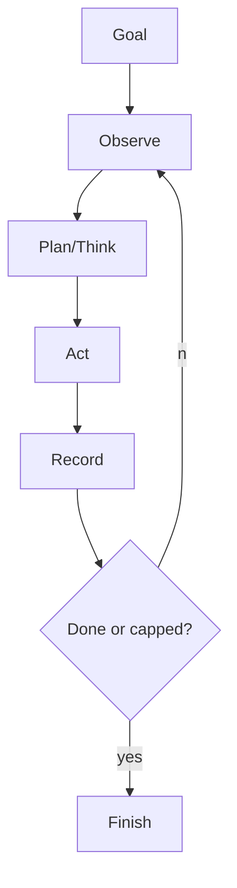

# Agent Loops & Planning

> Topic package — Domain 5 · Roadmap Week 16.
> Depth goal: implement observe-think-act, ReAct, plan-then-execute, task decomposition, and termination with step limits.

## Source
- Track: LLM Engineering (self-directed, FDE roadmap)
- Slide deck: `07 Resources Library/LLM Engineering/Slides/Lesson_25_Agent_Loops_and_Planning.pptx`
- Hands-on notebook: `07 Resources Library/LLM Engineering/Notebooks/25_Agent_Loops_and_Planning.ipynb` (runs offline)
- Reference reading: ReAct (Yao 2210.03629); Plan-and-Solve; BabyAGI patterns
- Builds on: [[02 Literature Notes/LLM Engineering/Structured Generation]] · [[02 Literature Notes/LLM Engineering/Prompt Contracts]] · [[02 Literature Notes/LLM Engineering/Reasoning Prompt Patterns]]
- Date: 2026-07-18

---

## 1. Mental Model

**An agent is a bounded observe-think-act loop with a model policy inside a software runtime.** Planning helps decompose work, but termination conditions make autonomy safe.



---

## 2. How It Actually Works

### 5.1 Observe-think-act
State contains goal, observations, scratchpad, budget, and done status.

### 5.2 ReAct
Interleave reasoning/action/observation when evidence changes the next step.

### 5.3 Plan-then-execute
Create a small checkable plan, execute steps, and re-plan when evidence invalidates it.

### 5.4 Task queues
Useful for independent tasks but risky when ownership is vague.

### 5.5 Termination
Use max steps, timeout, cost budget, no-progress detection, and success predicates.

---

## 3. Implementation

Assumed stack: stdlib + numpy where useful. Snippets:
- [[04 Code Snippets/LLM/Bounded ReAct Loop]]
- [[04 Code Snippets/LLM/Plan Then Execute Agent Skeleton]]

### Bounded ReAct Loop
A capped observe-act loop
```python
def policy(state): return "finish" if state.get("answer") else "lookup"
def run(max_steps=3):
    state={"trace":[]}
    for _ in range(max_steps):
        a=policy(state)
        if a=="finish": break
        state["answer"]="42"; state["trace"].append(a)
    return state
print(run())
```

### Plan Then Execute Agent Skeleton
Plan steps then execute with checks
```python
plan=["search","compute","verify"]
state={"done":[]}
for step in plan:
    state["done"].append(step)
    if step=="verify": state["status"]="done"
print(state)
```

---

## 4. Design Decisions & Tradeoffs

| Decision | Guidance |
|---|---|
| **Pattern** | ReAct for evidence-dependent tasks. |
| **Plans** | Keep steps measurable. |
| **Caps** | Always cap steps/time/cost. |
| **Replanning** | Re-plan when observations conflict. |
| **Trace** | Log actions and observations. |

---

## 5. Failure Modes & Gotchas

- No step cap.
- Vague plans.
- Never re-planning.
- Loop done because model says so only.
- Task queue overkill.
- No trace.

---

## 6. FDE Angle

- FDEs make the runtime policy explicit rather than relying on model vibes.
- The deliverable includes contracts, traces, tests, and operational limits.
- Stakeholders need to understand both capability and blast radius.
- A small reliable system beats an impressive uncontrolled demo.

---

## 7. Self-Check

1. What is the core abstraction?
2. Where does validation happen?
3. What should be traced?
4. What are the main failure modes?
5. When would you choose the simpler design?

---

## 9. Interview Q&A

**Q: What is the core abstraction of an agent loop — what makes something "an agent" rather than just a single model call?**
A: A single model call takes one input and produces one output, done. An agent is fundamentally different: it's a *loop* — observe the current state, think about what to do next, act (often by calling a tool), record what happened, and then check whether to repeat this cycle again or stop — running inside software that enforces real boundaries on how long this can go on.

The key word here is "bounded" — an agent isn't just "let the model keep going until it feels done," because a model deciding for itself when it's finished has no hard guarantee it won't just keep going indefinitely, especially if something's gone subtly wrong. A real agent loop has actual, software-enforced stopping conditions — a maximum number of steps, a time limit, a cost budget — that exist independently of whatever the model itself believes about its own progress. The model proposes what to do at each step; the surrounding software decides whether another step is even allowed to happen at all.

*One-liner: an agent is a repeating observe-think-act loop, not a single model call — and what actually makes it "an agent" rather than just an unconstrained repeating prompt is that the loop is bounded by real, software-enforced limits (max steps, time, cost) that exist independently of whether the model itself believes it's done.*

**Q: Where does validation happen in an agent loop, and why can't you rely on the model to self-police?**
A: Validation happens in the surrounding runtime code, at the boundary between "the model decided to take an action" and "that action actually executes" — the exact same principle as tool-calling validation (covered in Tool and Function Calling), just now applied continuously, at every single step of a potentially multi-step loop, rather than just once.

The reason you can't rely on the model to self-police is the same reason you can't trust any probabilistic system to reliably enforce its own hard limits: a model can be told "stop after a reasonable number of steps" or "don't do X" as an instruction, but instructions are soft — the model might ignore them, misjudge "reasonable," or encounter a situation (a confusing tool result, an ambiguous intermediate state) that leads it to keep going well past where a human would have stopped. A model's own internal sense of "am I done yet" or "is this action safe" is not a reliable safety mechanism, because it's exactly the thing that can fail when something unusual happens — which is specifically when you need the safety check to actually hold.

This is why the actual enforcement — the step cap, the cost budget, the argument validation on each individual action — has to live in code that runs regardless of what the model "thinks," rather than inside a prompt instruction the model could simply fail to follow correctly in an unusual situation.

*One-liner: validation lives in the surrounding runtime code at every single step, checking each proposed action before it executes — not in a prompt instruction telling the model to self-limit, since a model's own judgment about when to stop or what's safe is exactly what can fail in an unusual situation, which is precisely when a hard, code-enforced check is needed most.*

**Q: What should be traced in an agent loop, specifically (beyond what a single tool call would need)?**
A: Everything a single tool call's trace needs (the proposed action, validation outcome, result — covered in Tool and Function Calling), but now captured at *every single step* across the whole loop, plus some additional loop-level state that only exists because this is a repeating process rather than one call.

Specifically, you need: the full sequence of steps taken, in order (not just the final result) — since understanding *how* the agent arrived at its final answer, not just what that answer was, is often exactly what you need to debug a bad outcome; what the agent's internal plan or reasoning looked like at each step (its "thought," in ReAct terms), so you can see whether it was reasoning sensibly given what it had observed so far; and specifically, why the loop actually stopped — did it genuinely reach a success condition, did it hit the step cap, did it hit a cost or time budget, or did something else trigger termination. This last piece matters enormously: "the agent finished" and "the agent was cut off by a budget limit without genuinely completing the task" look identical from the outside if you only see the final output, but they're very different situations that need very different responses.

*One-liner: trace the full step-by-step sequence of actions and reasoning across the whole loop (not just the final output), plus specifically why the loop actually terminated (genuine success, step cap, cost/time budget, or something else) — since "it finished successfully" and "it got cut off by a budget limit" can look identical from the final output alone, but need very different responses.*

**Q: What are the main failure modes specific to agent loops (beyond single tool-call failures)?**
A: Several failure modes emerge specifically from the fact that this is a *repeating, multi-step* process, not a single action — these are additional to (not instead of) the single-call failure modes already covered.

No step cap is the most direct risk: without one, a model stuck reasoning in circles, or genuinely facing a task it can't solve, has nothing forcing it to eventually stop — it could continue indefinitely, burning cost and time with no guaranteed end. Vague, unmeasurable plans are risky because a plan step like "handle the customer's issue" gives no clear way to check whether that step actually succeeded or not, which makes the whole loop's progress unverifiable — plan steps need to be specific and checkable. Never re-planning is a problem when new evidence genuinely contradicts the original plan's assumptions — continuing to blindly execute a plan that new information has already invalidated wastes effort on steps that are no longer the right thing to do.

Trusting "the model says it's done" as the *only* termination signal is risky for the same reason model self-policing is unreliable elsewhere — the model's own belief that it's finished isn't a guaranteed-correct signal, and should be checked against an actual, verifiable success condition where possible, not simply trusted at face value. Reaching for a complex task-queue architecture (managing many parallel, potentially-interdependent tasks) when a single, simple sequential loop would do is its own failure mode — added architectural complexity that isn't actually needed for the task at hand, making the system harder to reason about for no real benefit. And, as with tool calls generally, having no trace at all (covered above) makes any of these failures essentially undebuggable after the fact.

*One-liner: beyond single-call failures, agent loops specifically risk unbounded repetition (no step cap), unverifiable progress (vague plan steps with no checkable success criteria), stale plans (never re-planning when new evidence contradicts the original plan), trusting the model's own "I'm done" signal as the sole termination check, and overbuilt task-queue complexity where a simple sequential loop would have sufficed.*

**Q: When would you choose a simple sequential loop over a more complex plan-then-execute or task-queue architecture?**
A: Whenever the task's steps are naturally sequential and don't genuinely need upfront, inspectable planning or independent, potentially-parallel task management — a simple observe-think-act loop, without a separate planning phase or a task-queue architecture on top, is both easier to build correctly and easier to reason about.

Plan-then-execute earns its added complexity specifically when having an explicit, inspectable plan *before* any execution happens provides real value — for instance, when you want to be able to check a plan for obvious problems before committing any real resources to carrying it out, or when the task genuinely benefits from thinking through the whole sequence of steps upfront rather than discovering them one at a time. A task-queue architecture earns its complexity specifically when there are genuinely multiple, independent tasks that could reasonably run in parallel, with real benefit to doing so — if there's no such independence (each step genuinely depends on the result of the step before it), a task queue is solving a parallelism problem that doesn't actually exist for this task, adding real architectural complexity for no real benefit.

The general principle, consistent with tool-calling design: additional structure (an explicit upfront plan, parallel task management) is a genuine cost in system complexity, and should only be taken on when the task actually has the shape that structure is meant to help with — not added by default just because it's available or sounds more sophisticated.

*One-liner: choose a simple sequential loop when the task's steps are naturally sequential with no real need for upfront inspectable planning or genuine task independence — plan-then-execute and task-queue architectures earn their added complexity only when a task genuinely benefits from an inspectable upfront plan or real parallel task independence, not by default.*

## 8. Links
- Domain MOC: [[06 Maps of Content/LLM Engineering Concepts]]
- Code: [[04 Code Snippets/LLM/Bounded ReAct Loop]], [[04 Code Snippets/LLM/Plan Then Execute Agent Skeleton]]
- Distilled: [[03 Permanent Notes/An Agent Is a While Loop With Brakes]], [[03 Permanent Notes/Plans Are Hypotheses Not Commitments]]
- Upstream: [[02 Literature Notes/LLM Engineering/Structured Generation]] · [[02 Literature Notes/LLM Engineering/Prompt Contracts]] · [[02 Literature Notes/LLM Engineering/Reasoning Prompt Patterns]] · Downstream: [[02 Literature Notes/LLM Engineering/Agent Reliability and Cost]]
