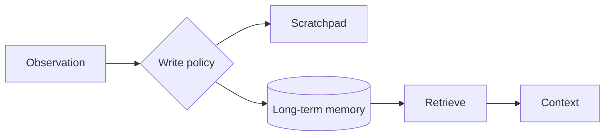

# Agent Memory

> Topic package — Domain 5 · Roadmap Week 16.
> Depth goal: distinguish scratchpad vs durable memory, episodic vs semantic memory, retrieval, summarization, and safe write policies.

## Source
- Track: LLM Engineering (self-directed, FDE roadmap)
- Slide deck: `07 Resources Library/LLM Engineering/Slides/Lesson_26_Agent_Memory.pptx`
- Hands-on notebook: `07 Resources Library/LLM Engineering/Notebooks/26_Agent_Memory.ipynb` (runs offline)
- Reference reading: MemGPT (Packer 2310.08560); Generative Agents (Park 2304.03442); vector retrieval patterns
- Builds on: [[02 Literature Notes/LLM Engineering/Structured Generation]] · [[02 Literature Notes/LLM Engineering/Prompt Contracts]] · [[02 Literature Notes/LLM Engineering/Reasoning Prompt Patterns]]
- Date: 2026-07-18

---

## 1. Mental Model

**Agent memory is a write policy plus a retrieval policy, not merely a vector database.** Short-term scratchpad supports the current run; long-term memory persists facts, preferences, and episodes.



---

## 2. How It Actually Works

### 5.1 Short vs long term
Scratchpad is per-run; durable memory is persisted and retrieved later.

### 5.2 Episodic vs semantic
Episodes record events; semantic facts record stable knowledge or preferences.

### 5.3 Retrieval
Combine similarity, recency, provenance, and filters.

### 5.4 Consolidation
Summarize raw histories into durable facts and mark stale memories.

### 5.5 Write policy
Store useful, safe, consented facts; block secrets and transient chatter.

---

## 3. Implementation

Assumed stack: stdlib + numpy where useful. Snippets:
- [[04 Code Snippets/LLM/Tiny Vector Memory Store]]
- [[04 Code Snippets/LLM/Safe Memory Write Gate]]

### Tiny Vector Memory Store
Deterministic numpy retrieval
```python
import numpy as np
def emb(t):
    v=np.zeros(8)
    for c in t.lower(): v[ord(c)%8]+=1
    return v/(np.linalg.norm(v) or 1)
mem=[("user prefers concise answers",emb("user prefers concise answers"))]
q=emb("preferred style")
print(max((float(q@v),t) for t,v in mem))
```

### Safe Memory Write Gate
Block secrets and low-value memories
```python
def should_write(text):
    low=text.lower()
    if any(s in low for s in ["password","token","ssn"]): return False
    return any(w in low for w in ["prefers","remember","project"])
print([should_write(x) for x in ["prefers tables","password abc","joke"]])
```

---

## 4. Design Decisions & Tradeoffs

| Decision | Guidance |
|---|---|
| **Write** | Only durable safe facts. |
| **Retrieve** | Use similarity plus metadata. |
| **Summarize** | Consolidate old episodes. |
| **Delete** | Support retention and deletion. |
| **Precedence** | Current user instruction beats memory. |

---

## 5. Failure Modes & Gotchas

- Writing every turn.
- Storing secrets.
- Stale memories.
- Similarity-only retrieval.
- No provenance.
- Memory overrides current instruction.

---

## 6. FDE Angle

- FDEs make the runtime policy explicit rather than relying on model vibes.
- The deliverable includes contracts, traces, tests, and operational limits.
- Stakeholders need to understand both capability and blast radius.
- A small reliable system beats an impressive uncontrolled demo.

---

## 7. Self-Check

1. What is the core abstraction?
2. Where does validation happen?
3. What should be traced?
4. What are the main failure modes?
5. When would you choose the simpler design?

---

## 9. Interview Q&A

**Q: What is the core abstraction of agent memory — why is it "a policy," not just "a vector database"?**
A: It's tempting to think "memory" just means "store things in a vector database and retrieve similar ones later" — but that framing only covers the mechanical retrieval part, and skips the much harder, more important question: *what should even get written down in the first place, and when should it be used instead of ignored*? That's the policy part, and it's doing most of the real work.

A write policy decides, for every single thing an agent observes or produces, whether it's actually worth persisting — most of what happens during a conversation or a task run is transient and not worth remembering forever (small talk, intermediate scratch calculations, things only relevant to this one run). A retrieval policy decides, at the moment memory might be used, whether a stored memory is actually relevant and trustworthy enough to pull into the current context — not just "is this similar by embedding distance," but also "is this memory still fresh, or has it gone stale," and "does the current situation actually call for this memory, or would using it here actually be wrong."

Without both of these policies deliberately designed, "memory" just becomes an ever-growing dump of everything that was ever said, blindly searched by similarity — which accumulates noise, staleness, and irrelevant clutter over time, rather than genuinely useful, curated, trustworthy recall.

*One-liner: agent memory is fundamentally a write policy (deciding what's actually worth persisting, since most of what happens is transient) plus a retrieval policy (deciding what's relevant and still trustworthy enough to use right now) — a vector database is just the mechanical storage/search layer underneath; without deliberate policies on top of it, memory becomes an ever-growing, noisy dump rather than genuinely useful recall.*

**Q: Where does validation/safety checking happen when writing to agent memory?**
A: It happens at write time, as a gate that every candidate piece of information has to pass through before it's allowed to be persisted at all — not as something checked later, after it's already been stored.

This gate needs to check at least two distinct things. First, is this actually safe to store at all — does it contain something that should never be persisted as a durable memory, like a password, an API token, or other sensitive personal information that happened to appear in the conversation? If so, it should be blocked from being written, regardless of how "useful" it might otherwise seem, since persisting sensitive data creates an ongoing risk every single time that memory store is later read or searched. Second, is this actually worth persisting at all — is it the kind of durable, stable fact or preference that's genuinely useful to recall in future interactions, or is it just transient conversational content (small talk, a one-off comment) that doesn't need to live beyond this single run?

The reason this has to be a hard gate at write time, rather than something sorted out later: once something sensitive is actually written into a persistent memory store, every future retrieval from that store now carries the risk of surfacing it again — the problem compounds with every future use, rather than being a one-time, contained risk. Catching it before it's ever written avoids that compounding risk entirely.

*One-liner: validation happens at write time, as a gate checking both whether something is safe to persist (blocking secrets/sensitive data) and whether it's actually worth persisting (a durable fact, not transient chatter) — this has to happen before writing, since once something sensitive is actually stored, every future retrieval carries a compounding risk of surfacing it again.*

**Q: What should be traced in an agent memory system?**
A: Enough to answer, for any memory that gets used, two questions: "where did this come from" and "why did it get pulled into this specific context right now."

Concretely: for every write, log what was written, when, and from what source conversation or event (provenance) — without this, a memory surfacing later has no way to be traced back to its origin, which makes it impossible to judge whether it's still trustworthy or relevant. For every retrieval, log which memories were actually pulled in and used for this specific interaction, and on what basis (similarity score, recency, an explicit filter) they were selected — this is what lets you debug a situation where a stale or wrong memory got surfaced and improperly influenced an answer, by letting you trace back exactly which memory it was, why the retrieval step picked it, and when it was originally written.

Without this tracing, a bad outcome caused by a stale or incorrect memory is very hard to diagnose — you'd see a wrong answer, but have no way to connect it back to a specific piece of memory that caused it, when that memory was actually written, or why the retrieval step decided to surface it at this particular moment.

*One-liner: trace both the write side (what was stored, when, and from what source) and the retrieval side (which memories were actually pulled into a given interaction, and why) — without this, a wrong answer caused by a stale or incorrect memory can't be traced back to its origin or explained.*

**Q: What are the main failure modes specific to agent memory systems?**
A: Writing every single turn indiscriminately is a common failure — if everything gets persisted regardless of whether it's actually durable, useful information, the memory store rapidly fills with noise and transient chatter, making genuinely important memories harder to find amid the clutter. Storing secrets (covered above) is a serious, specific risk of this same indiscriminate-writing pattern. Letting memories go stale without any mechanism to mark or retire them is another real problem — a stored preference or fact that was true months ago but has since changed can get surfaced as if it were still current, actively misleading the system rather than helping it.

Relying on similarity alone for retrieval, with no consideration of recency or provenance, is also a failure mode — an old, outdated memory can be a strong semantic match to a current query purely by topic similarity, even though a more recent, more accurate memory on the same topic exists and should be preferred instead; similarity by itself doesn't account for which memory is actually still correct. No provenance tracking (covered above) makes memories impossible to audit or trust confidently. And perhaps most importantly: letting a stored memory override the user's current, explicit instruction is a design failure — if a memory says "this user prefers short answers" but they explicitly ask for a detailed one right now, the current, explicit instruction should always win; a memory is a prior signal, not a rule that overrides what's being asked for in this exact moment.

*One-liner: the main failure modes are writing everything indiscriminately (noise crowds out useful memories), storing secrets, letting memories go stale with no mechanism to retire them, retrieving by similarity alone without considering recency (surfacing an outdated memory over a more current one), missing provenance (unauditable memories), and letting stored memory override the user's current explicit instruction instead of deferring to it.*

**Q: When would you choose a simpler memory design (just a scratchpad, no durable memory) over a full long-term memory system?**
A: Whenever the task genuinely doesn't need to recall anything beyond the current run — if every interaction is self-contained, with nothing from a prior conversation or session that would actually improve how this one is handled, building a full durable memory system (with write policies, retrieval policies, consolidation, staleness tracking) is real added complexity solving a problem that doesn't actually exist for this use case.

A scratchpad alone — state that exists only for the duration of the current run and is discarded afterward — is the right, simpler choice whenever the task is naturally single-session: a one-off question-answering interaction, a task that completes fully within one conversation with no expectation of continuity into a future session. Durable, long-term memory earns its added complexity specifically when there's a genuine need to recall something *across* separate sessions — a returning user's known preferences, facts learned in a previous interaction that remain relevant to a later one, an ongoing project's accumulated context that should persist beyond any single conversation.

The same general principle that applies to tool design and agent-loop design applies here: durable memory is real, ongoing complexity (write policies, retrieval policies, staleness handling, security review for what's allowed to persist) that should only be taken on when the actual task genuinely has a cross-session continuity need — not added as a default "more capability is always better" choice when a simple, run-scoped scratchpad would fully serve the task at hand.

*One-liner: choose a simple scratchpad (run-scoped, discarded afterward) when the task is naturally self-contained within one session with no genuine need to recall anything from a prior interaction — durable long-term memory earns its real added complexity (write/retrieval policies, staleness handling) only when there's an actual cross-session continuity need, not by default.*

## 8. Links
- Domain MOC: [[06 Maps of Content/LLM Engineering Concepts]]
- Code: [[04 Code Snippets/LLM/Tiny Vector Memory Store]], [[04 Code Snippets/LLM/Safe Memory Write Gate]]
- Distilled: [[03 Permanent Notes/Memory Is Policy Not Storage]], [[03 Permanent Notes/Scratchpad State Is Not Durable Memory]]
- Upstream: [[02 Literature Notes/LLM Engineering/Structured Generation]] · [[02 Literature Notes/LLM Engineering/Prompt Contracts]] · [[02 Literature Notes/LLM Engineering/Reasoning Prompt Patterns]] · Downstream: [[02 Literature Notes/LLM Engineering/Agent Reliability and Cost]]
