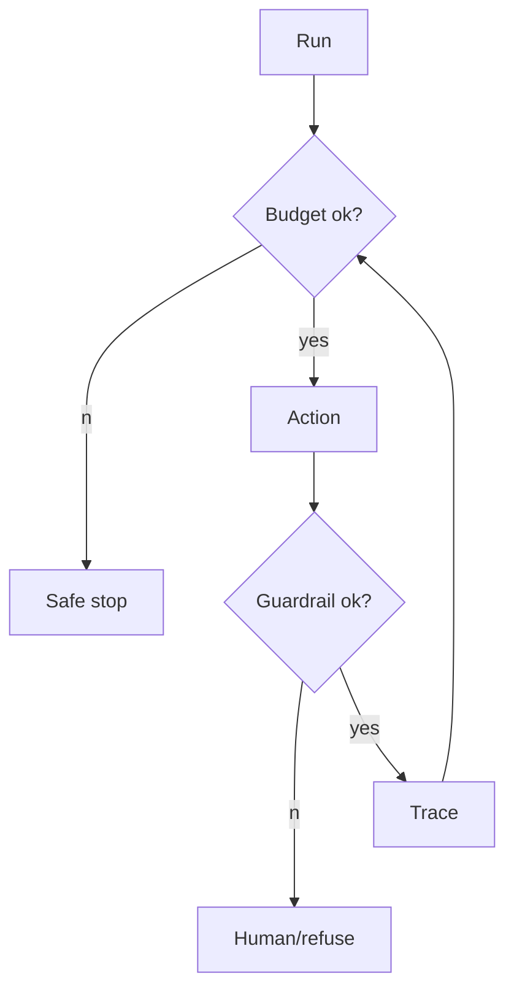

# Agent Reliability & Cost Control

> Topic package — Domain 5 · Roadmap Weeks 16/22.
> Depth goal: implement step caps, timeouts, retries, guardrails, cost budgets, token accounting, caching, human checkpoints, recovery, and observability.

## Source
- Track: LLM Engineering (self-directed, FDE roadmap)
- Slide deck: `07 Resources Library/LLM Engineering/Slides/Lesson_30_Agent_Reliability_and_Cost.pptx`
- Hands-on notebook: `07 Resources Library/LLM Engineering/Notebooks/30_Agent_Reliability_and_Cost.ipynb` (runs offline)
- Reference reading: Production agent patterns; LangSmith tracing docs; Langfuse tracing docs; OpenTelemetry concepts
- Builds on: [[02 Literature Notes/LLM Engineering/Structured Generation]] · [[02 Literature Notes/LLM Engineering/Prompt Contracts]] · [[02 Literature Notes/LLM Engineering/Reasoning Prompt Patterns]]
- Date: 2026-07-18

---

## 1. Mental Model

**Agent reliability is runtime control around a stochastic planner: caps, budgets, retries, guardrails, checkpoints, caching, recovery, and traces.** Prompts help; systems keep users safe.



---

## 2. How It Actually Works

### 5.1 Caps
Max steps, tool calls, wall-clock time, and no-progress stops.

### 5.2 Budgets
Token and dollar budgets per run, user, and tenant.

### 5.3 Retries
Retry transient errors only; bound attempts and use idempotency for writes.

### 5.4 Checkpoints
Humans approve irreversible, costly, or reputation-impacting actions.

### 5.5 Observability
Trace model calls, tool calls, memory retrieval, guardrails, latency, tokens, and cost.

---

## 3. Implementation

Assumed stack: stdlib + numpy where useful. Snippets:
- [[04 Code Snippets/LLM/Budgeted Agent Run Guard]]
- [[04 Code Snippets/LLM/Agent Trace Span Logger]]

### Budgeted Agent Run Guard
Enforce step and token caps
```python
class Budget:
    def __init__(self,steps=3,tokens=100): self.steps=steps; self.tokens=tokens; self.s=0; self.t=0
    def charge(self,n):
        self.s+=1; self.t+=n
        if self.s>self.steps or self.t>self.tokens: raise RuntimeError("budget exceeded")
b=Budget(); b.charge(20); print(b.s,b.t)
```

### Agent Trace Span Logger
Record model and tool spans
```python
trace=[]
def span(kind, **kw): trace.append({"kind":kind, **kw})
span("model", tokens=42, cost=0.001)
span("tool", name="search", ok=True)
print(trace)
```

---

## 4. Design Decisions & Tradeoffs

| Decision | Guidance |
|---|---|
| **Steps** | Set hard caps. |
| **Cost** | Track before calls. |
| **Retries** | Only transient. |
| **Human** | Approve high impact. |
| **Trace** | Span every boundary. |

---

## 5. Failure Modes & Gotchas

- No step cap.
- Retrying permanent failures.
- No idempotency.
- Budget after billing.
- No human checkpoint.
- Traces omit cost.

---

## 6. FDE Angle

- FDEs make the runtime policy explicit rather than relying on model vibes.
- The deliverable includes contracts, traces, tests, and operational limits.
- Stakeholders need to understand both capability and blast radius.
- A small reliable system beats an impressive uncontrolled demo.

---

## 7. Self-Check

1. What is the core abstraction?
2. Where does validation happen?
3. What should be traced?
4. What are the main failure modes?
5. When would you choose the simpler design?

---

## 9. Interview Q&A

**Q: What is the core abstraction behind agent reliability — why frame it as "runtime control around a stochastic planner"?**
A: The key word is "stochastic" — a model isn't a deterministic program that behaves the exact same way every time given the same input; it's a probabilistic system that can genuinely behave unexpectedly, even with careful prompting. You can reduce how often it misbehaves through good prompt design, but you can't get a hard, absolute guarantee of correct behavior purely through prompting alone, the same way you could with carefully-written deterministic code.

Because of that, reliability can't live entirely inside the prompt — it has to live in the surrounding software, as an independent layer of control that holds regardless of what the model actually does. This means hard caps on how many steps or tool calls are allowed, budgets that track and limit actual spend, guardrails that check outputs before they're acted on, and checkpoints that require human approval for high-stakes actions — all of this exists specifically *because* the model itself can't be fully trusted to self-regulate reliably on its own. The runtime is what turns an inherently unpredictable planner into something safe enough to actually run unattended in production.

*One-liner: a model is a stochastic planner that can't be fully trusted to self-regulate through prompting alone — so reliability has to live in the surrounding runtime (hard caps, budgets, guardrails, human checkpoints) as an independent layer of control that holds regardless of what the model actually does, which is what makes it safe to run unattended.*

**Q: Where does validation/budget-checking actually happen in an agent system — before or after a costly action?**
A: Before — budget and guardrail checks need to happen *before* a costly or risky action is actually taken, not after the fact as a post-hoc check on something that's already happened and can't be undone.

Here's why the ordering matters so much: if you only check "did we exceed our budget" or "did this action violate a guardrail" *after* the action already executed, you've only succeeded at detecting the problem — you haven't actually prevented it. Money has already been spent, or a potentially harmful action has already taken real effect, by the time an after-the-fact check notices something went wrong. This is a specific, common, real mistake — tracking cost and checking guardrails is sometimes implemented as logging/monitoring that happens alongside or after execution, which can tell you something went wrong, but can't actually stop it from happening in the first place.

The correct pattern is: check the budget and run the guardrail evaluation *before* the action is allowed to proceed — if the budget would be exceeded, or a guardrail would be violated, block the action from happening at all, rather than letting it run and finding out afterward. This is the same "gate before execution, not audit after" principle that applies to tool-call argument validation (covered in Tool and Function Calling) — just applied specifically to cost and safety limits here, rather than argument correctness.

*One-liner: budget and guardrail checks have to happen before a costly or risky action executes, not after — checking afterward can only detect that something already went wrong, it can't actually prevent the cost from being spent or the risky action from having already taken effect, which is why the check needs to gate execution, not just audit it afterward.*

**Q: What should be traced in an agent system built for reliability, specifically around cost and safety?**
A: Every single model call and tool call, as its own distinct, timestamped span — with its token count, its actual cost, its latency, and whether any guardrail check passed or failed at that specific point. Not just a summary at the end of the run ("the whole thing cost $X"), but a full breakdown of exactly where that cost and time actually went, step by step.

The reason this granularity matters: if a run ends up costing far more than expected, or takes far longer than it should have, a single aggregate number at the end tells you *that* something was expensive, but not *why* — was it one specific tool call that got retried too many times, was it an unusually long model response, was it many small steps that each seemed individually reasonable but added up? Without per-step tracing, you can't actually answer that, which means you can't actually fix the real cause — you'd just be guessing at what to optimize. Tracing every span individually, with its own cost and timing attached, is what turns "this run was expensive" into "this specific tool call, retried 4 times due to a transient error, accounted for 60% of the total cost" — an actionable, specific diagnosis rather than a vague, unfixable observation.

*One-liner: trace every individual model call and tool call as its own span, with token count, cost, latency, and guardrail pass/fail recorded at each one — not just an aggregate total at the end — since only this level of granularity lets you pinpoint exactly which specific step in a run actually drove an unexpectedly high cost or long duration, rather than just knowing the total was too high with no way to diagnose why.*

**Q: What are the main failure modes in agent reliability and cost control?**
A: No step cap (covered in Agent Loops and Planning) allows a loop to run indefinitely with no hard limit — directly risking unbounded cost. Retrying permanent failures — errors that will never succeed no matter how many times you retry, like a fundamentally malformed request — wastes real time and cost on retries that were never going to help; retries should specifically be reserved for transient errors (temporary network issues, momentary rate limits) that have a genuine chance of succeeding on a subsequent attempt.

No idempotency for write actions is a serious risk specifically in combination with retries: if a write action (like "charge this customer" or "send this email") isn't designed to be safely repeated, and it gets retried after a failure that actually succeeded on the first attempt but failed to report success back cleanly, you risk the action happening twice — a real, user-visible problem, not just a wasted retry. Checking the budget only *after* billing/execution (covered above) defeats the entire purpose of having a budget check, since the cost was already incurred by the time the check runs. No human checkpoint for high-impact, irreversible, or reputation-sensitive actions means a stochastic system is making consequential real-world decisions with zero opportunity for a human to catch a mistake before it actually happens. And traces that omit cost information specifically (even if they capture other details) leave you unable to diagnose exactly the kind of cost-overrun problem covered in the previous question.

*One-liner: the main failure modes are missing step caps (unbounded cost risk), retrying permanent (non-transient) failures, lacking idempotency on write actions combined with retries (risking a real action happening twice), checking budget only after cost was already incurred, skipping human checkpoints for high-impact/irreversible actions, and traces that omit cost data specifically, which leaves cost overruns undiagnosable.*

**Q: When would you choose a simpler reliability design (fewer guardrails, no human checkpoints) over a fully hardened one?**
A: When the actual blast radius of a mistake is genuinely small and recoverable — if the worst-case outcome of the agent making an error is low-stakes and easily corrected (a wrong answer in a low-stakes internal tool, for instance, where a human will naturally review the output anyway before it matters), the full weight of hard budgets, extensive guardrails, and mandatory human-approval checkpoints may be more operational overhead than the actual risk justifies.

The calculation genuinely shifts, though, as soon as the agent's actions become costly to reverse, affect real money, touch production systems, or carry reputational risk if something goes wrong publicly — in any of these cases, the cost of a rare but real failure is high enough that the investment in full reliability infrastructure (hard caps, careful budget tracking, guardrails, human checkpoints for the genuinely high-stakes actions specifically) is clearly worth it, even though it adds real engineering and sometimes latency overhead to every run.

The general judgment call, consistent with the broader theme across this whole agents domain: added reliability infrastructure is a real cost (engineering time, sometimes latency, sometimes friction for users), and it should be matched to the actual stakes of what the agent is doing — a simpler design is the right choice specifically when the real-world cost of a mistake is genuinely low and recoverable, not as a shortcut taken by default regardless of what the agent is actually doing.

*One-liner: choose a simpler reliability design when the actual blast radius of a mistake is genuinely small and easily recoverable — move to full hardening (hard budgets, extensive guardrails, human checkpoints) specifically once actions become costly to reverse, touch real money or production systems, or carry real reputational risk, matching the investment to the actual stakes rather than applying maximum caution by default regardless of what's at risk.*

## 8. Links
- Domain MOC: [[06 Maps of Content/LLM Engineering Concepts]]
- Code: [[04 Code Snippets/LLM/Budgeted Agent Run Guard]], [[04 Code Snippets/LLM/Agent Trace Span Logger]]
- Distilled: [[03 Permanent Notes/Agent Reliability Lives in the Runtime]], [[03 Permanent Notes/Every Agent Run Needs a Cost Budget]]
- Upstream: [[02 Literature Notes/LLM Engineering/Structured Generation]] · [[02 Literature Notes/LLM Engineering/Prompt Contracts]] · [[02 Literature Notes/LLM Engineering/Reasoning Prompt Patterns]] · Downstream: [[02 Literature Notes/LLM Engineering/Agent Reliability and Cost]]
