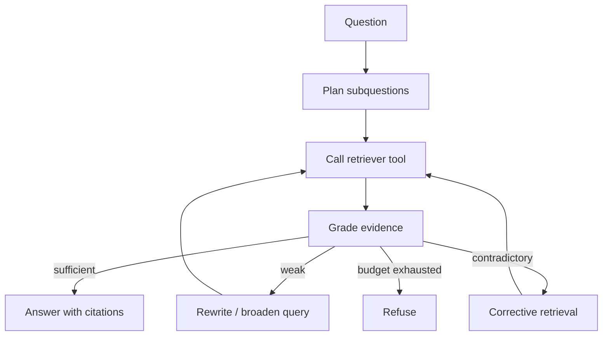

# Agentic RAG

> Topic package — Domain 4 · Roadmap Week 21.
> Depth goal: design an agentic RAG loop where retrieval is an adaptive tool call, not a one-shot preprocessing step, including query planning, evidence grading, corrective retrieval, and stopping conditions.

## Source
- Track: LLM Engineering (self-directed, FDE roadmap)
- Slide deck: `07 Resources Library/LLM Engineering/Slides/Lesson_21_Agentic_RAG.pptx`
- Hands-on notebook: `07 Resources Library/LLM Engineering/Notebooks/21_Agentic_RAG.ipynb` (runs offline)
- Reference reading: Asai et al. Self-RAG (arXiv:2310.11511); Yan et al. Corrective RAG / CRAG (arXiv:2401.15884); LangChain agentic RAG patterns; LlamaIndex agents and query planning docs
- Builds on: [[02 Literature Notes/LLM Engineering/RAG Pipeline Fundamentals]] · [[02 Literature Notes/LLM Engineering/Query Transformation]] · [[02 Literature Notes/LLM Engineering/Prompt Contracts]]
- Date: 2026-07-18

---

## 1. Mental Model

**Agentic RAG moves retrieval from a fixed pre-step into the model's control loop.** Instead of retrieve-once-then-answer, the agent plans what it needs, calls retrieval tools, grades evidence, refines queries, and stops only when the evidence is sufficient or a refusal is warranted.

The benefit is adaptivity: multi-hop questions, ambiguous asks, and weak first-pass retrieval can be repaired. The risk is runaway loops, tool overuse, and self-confirming reasoning. Agentic RAG therefore needs explicit state, budgets, evidence grading, and a final grounding contract.

> Key intuition: **make retrieval a tool the reasoner can call, but make evidence sufficiency a gate the reasoner cannot skip.**



---

## 2. How It Actually Works

### 4.1 Retrieval as a tool
In vanilla RAG, the application retrieves before the LLM sees the prompt. In agentic RAG, the LLM (or controller) can call a retriever tool during reasoning. This supports follow-up searches, source switching, and decomposition, but requires a strict tool API and logs for each call.

### 4.2 Iterative retrieve-reason-retrieve
The loop is: plan what is missing, retrieve, inspect evidence, update the plan, and retrieve again if needed. This is useful for multi-hop questions where the first evidence reveals the next entity or constraint. The loop must track used queries and avoid repeating them.

### 4.3 Self-RAG and evidence critique
Self-RAG-style systems ask the model to critique whether retrieved passages are relevant and whether generation is supported. In production, treat this as a noisy classifier: combine model critique with retrieval scores, citation checks, and deterministic thresholds.

### 4.4 CRAG / corrective retrieval
Corrective RAG adds a retrieval evaluator. If evidence is weak, the system rewrites the query, broadens sources, or falls back to web/alternate indexes. The corrective step is valuable because it prevents low-quality retrieved context from being blindly passed to the generator.

### 4.5 Budgets and stopping
Agentic RAG can explode latency and cost. Define max tool calls, max candidate chunks, max rewrites, and stop conditions: sufficient evidence, contradiction requiring clarification/refusal, or budget exhausted. The final answer still follows the RAG citation/refusal contract.

### 4.6 Multi-agent RAG
Single-agent agentic RAG (4.1–4.5) has one controller deciding what to retrieve next. Multi-agent RAG instead specializes retrieval itself: several retrieval agents, each scoped to one source or domain (e.g., a product-docs agent, a support-tickets agent, a web-search agent), run their own retrieve-grade-rewrite loop independently, and a separate **synthesis agent** combines their individual findings into one answer. This is the Routing/Parallelization distinction from [[02 Literature Notes/LLM Engineering/Agentic Workflow Patterns]] applied to retrieval specifically: each retrieval agent is a sectioned subtask (its own source), and the synthesis agent plays the same role an aggregation step plays in Parallelization.

Use multi-agent RAG when sources are genuinely heterogeneous enough that one retrieval agent with one tool API can't serve all of them well (different schemas, different query styles, different evidence-grading rules per source) — not as a default upgrade from single-agent agentic RAG. The synthesis agent inherits the same grounding contract as single-agent RAG (section 4.5's "final answer" rule): it may only cite documents its retrieval agents actually returned, never one retrieval agent's summary standing in for another's unretrieved evidence, and it must be able to flag when two retrieval agents' evidence conflicts rather than silently picking one.

---

## 3. Implementation

Assumed stack: stdlib + numpy. Snippets implement a deterministic agent loop and a corrective evidence gate. Snippets:
- [[04 Code Snippets/LLM/Iterative Retrieval Agent Loop]]
- [[04 Code Snippets/LLM/Corrective RAG Retrieval Gate]]
- [[04 Code Snippets/LLM/Multi-Agent RAG Synthesis]]

### Iterative Retrieval Agent Loop
A small retrieve-grade-rewrite loop with max tool-call budget and cited final answer.
```python
DOCS = {"rag":"RAG retrieves evidence before answering.",
        "hyde":"HyDE rewrites a query into a hypothetical document for retrieval.",
        "crag":"CRAG evaluates retrieval quality and corrects weak searches."}

def retrieve(q):
    q = q.lower()
    return [(k, v) for k, v in DOCS.items() if any(w in v.lower() for w in q.split())]

def agent(question, max_calls=3):
    query = question
    for step in range(max_calls):
        hits = retrieve(query)
        if len(hits) >= 2:
            cites = " ".join(f"[{k}]" for k, _ in hits)
            return f"Answer using evidence {cites}"
        query = query + " RAG retrieval correction"
    return "insufficient_context"

print(agent("How does CRAG improve RAG?"))
```

### Corrective RAG Retrieval Gate
Grade retrieved evidence and choose accept, rewrite, broaden, or refuse.
```python
def retrieval_gate(scores, min_top=0.55, min_hits=2):
    strong = [s for s in scores if s >= min_top]
    if len(strong) >= min_hits: return "accept"
    if scores and max(scores) >= min_top: return "rewrite_query"
    if scores: return "broaden_sources"
    return "refuse"

for scores in [[0.8,0.7,0.2], [0.7,0.3], [0.4,0.3], []]:
    print(scores, "->", retrieval_gate(scores))
```

### Multi-Agent RAG Synthesis
Independent retrieval agents per source; a synthesis step flags conflicts rather than silently picking one.
```python
def retrieval_agent(source, query):
    FAKE_SOURCES = {
        "docs": "The API rate limit is 100 req/min.",
        "tickets": "Customer reported rate limit as 50 req/min after a recent change.",
    }
    return {"source": source, "evidence": FAKE_SOURCES.get(source, ""), "query": query}

def synthesize(results):
    nonempty = [r for r in results if r["evidence"]]
    if len(nonempty) >= 2 and nonempty[0]["evidence"] != nonempty[1]["evidence"]:
        return {"status": "conflict", "evidence": nonempty}
    if nonempty:
        return {"status": "answer", "evidence": nonempty}
    return {"status": "refuse"}

results = [retrieval_agent(s, "rate limit") for s in ["docs", "tickets"]]
print(synthesize(results))
```

---

## 4. Design Decisions & Tradeoffs

| Decision | Guidance |
|---|---|
| **Agent vs pipeline** | Use agentic RAG for ambiguous/multi-hop tasks; keep simple QA as fixed RAG for latency and reliability. |
| **Tool API** | Expose narrow retrieval tools with source names, filters, and logged inputs/outputs. |
| **Evidence grading** | Use model critique plus deterministic checks; never rely on self-assessment alone. |
| **Correction action** | Rewrite query for near misses; broaden sources when all scores are weak; refuse when budgets exhaust. |
| **Budgets** | Hard limits on tool calls, rewrites, and chunks are mandatory. |
| **Final answer** | Same citation/refusal contract as RAG; agent reasoning is not evidence. |

---

## 5. Failure Modes & Gotchas

- Letting the agent search indefinitely with no tool-call budget.
- Answering from the agent's chain-of-thought rather than retrieved evidence.
- Repeating the same failed query with minor wording changes.
- Trusting model self-grades without retrieval/citation validation.
- Using agentic RAG for simple FAQ where one-shot retrieval is cheaper and safer.
- Not logging tool calls, making failures impossible to debug.
- Splitting retrieval into multiple source-specific agents when one agent with one tool API would have served all sources equally well (added coordination cost for no real benefit).
- Letting the synthesis agent silently pick one retrieval agent's evidence over another's without surfacing the conflict.

---

## 6. FDE Angle

- Agentic RAG is useful when a human analyst would naturally search, read, refine, and search again.
- The FDE deliverable is the loop trace: plan, queries, hits, grades, corrections, answer/refusal.
- Budgets turn an impressive demo into a predictable product surface.
- Self-RAG/CRAG concepts are best implemented as gates and controllers, not magic prompts.

---

## 7. Self-Check

1. How is agentic RAG different from one-shot RAG?
2. What should the evidence grader decide?
3. When should corrective retrieval rewrite vs broaden sources?
4. Why are budgets essential?
5. What can the final answer cite?

---

## 9. Interview Q&A

**Q: How is agentic RAG fundamentally different from one-shot RAG?**
A: In one-shot (standard) RAG, retrieval happens exactly once, as a fixed step that runs *before* the model ever sees the question — search once, hand the model whatever came back, and ask it to answer. The model itself has no say in this process; it just receives whatever evidence the one fixed retrieval step happened to find, good or bad.

In agentic RAG, retrieval becomes something the reasoning process can call *during* its own reasoning, potentially multiple times, adaptively. The agent can look at what the first search returned, decide it's insufficient or off-target, and deliberately search again — with a refined query, a different source, or a narrower follow-up question based specifically on what the first search revealed was missing. This is a fundamentally different control flow: instead of "search once, then reason," it's "reason, search, inspect what came back, reason some more about what's still needed, search again if necessary," repeating until the evidence is actually sufficient or some stopping condition is hit.

This adaptivity is what makes agentic RAG valuable for genuinely multi-hop or ambiguous questions, where the first search might reveal an important detail (like "oh, I need to also know X") that the original, upfront query had no way of anticipating — a fixed, one-shot retrieval step would just return whatever imperfect first-pass results it could and stop there, with no mechanism to notice the gap and adaptively search again.

*One-liner: one-shot RAG retrieves exactly once, as a fixed step before the model ever reasons about the question — agentic RAG lets retrieval be called adaptively during reasoning itself, so the system can inspect what came back, recognize it's insufficient, and deliberately search again with a refined approach, which is what makes it handle multi-hop or ambiguous questions that a single fixed search would miss.*

**Q: What specifically should the evidence grader decide, and what should it be checking?**
A: The evidence grader's job is to answer one core question after each retrieval attempt: is what came back actually good enough to answer the question confidently, or does something need to happen before generation is allowed to proceed? This isn't a binary yes/no in practice — it typically needs to distinguish between several different outcomes, each pointing toward a different next action.

It should check: is the retrieved evidence *relevant* to the actual question being asked (not just superficially similar, but does it actually address what's being asked)? Is there *enough* of it — a single weak hit versus several strong, consistent hits are very different situations? Does the evidence show any internal *contradiction* — different retrieved passages disagreeing with each other, which would need to be flagged rather than silently blended into one confident-sounding answer? And how *strong* is the match overall — a near-miss (close but not quite right) suggests a different corrective action than a complete miss (nothing even close was found).

Critically, this grading shouldn't rely purely on the model's own self-assessment of "do I think this evidence looks good" — that's a noisy signal on its own, since a model can be confidently wrong about whether weak evidence is actually sufficient. In production, this grading should combine the model's critique with more objective, deterministic signals — the actual retrieval relevance scores from the retriever itself, and citation-coverage checks (does the evidence genuinely support the specific claims being made) — rather than trusting the model's subjective judgment about its own evidence in isolation.

*One-liner: the evidence grader decides whether retrieved evidence is relevant, sufficient in quantity, free of internal contradiction, and strong enough to proceed to generation — and it should combine the model's own critique with objective signals like retrieval scores and citation checks, rather than trusting the model's self-assessment of its own evidence alone.*

**Q: When should corrective retrieval rewrite the query versus broaden the sources being searched?**
A: This decision depends on *what kind* of weak result you're actually looking at — a near-miss and a complete miss call for genuinely different fixes, and picking the wrong one wastes a retry without actually fixing the underlying problem.

Rewrite the query when the evidence is a near-miss — some results came back with a reasonably strong match score, suggesting the right general area or topic was found, but perhaps the specific phrasing of the query didn't quite line up with how the corpus actually discusses this topic. In this situation, the problem is likely how the question was *phrased*, not that the right information doesn't exist in the searched sources at all — so rewriting the query (rephrasing it, adding clarifying terms, trying a different angle on the same underlying question) is the more promising next step, since it's addressing a wording mismatch rather than a fundamentally missing source.

Broaden sources when none of the retrieved evidence scored well at all — everything came back weak, suggesting the issue isn't phrasing, it's that the right information might not even exist in whatever specific source or index was searched in the first place. In this case, rewriting the same query against the same narrow source is unlikely to help much, since the underlying problem isn't the wording — it's that the search is looking in the wrong place entirely. Expanding to search additional sources, or a broader index, is the more promising next step here.

*One-liner: rewrite the query when some results came back reasonably strong (suggesting a phrasing mismatch against the right source), and broaden to additional sources when everything scored weak (suggesting the right information isn't even in the source being searched) — picking based on whether the problem looks like wording or like searching in the wrong place.*

**Q: Why are hard budgets (on tool calls, rewrites, candidate chunks) essential in agentic RAG?**
A: Because an agentic loop is, by design, allowed to decide for itself to search again — and without an explicit, hard limit on how many times it's allowed to do that, there's nothing structurally preventing it from looping far longer than is useful, or even indefinitely, if it keeps judging its own evidence as insufficient over and over.

Here's the concrete risk without budgets: a question that's just inherently hard to find good evidence for, or a bug in the evidence grading logic that's too conservative, could cause the agent to keep rewriting and re-searching far past the point of any realistic benefit — burning real, billed API calls and real latency on an attempt that was never going to succeed, with no mechanism telling it to stop and just report "I couldn't find sufficient evidence" instead of continuing to try. Every additional retrieval attempt and every additional reasoning step costs real money and real time; an unbounded loop means a single difficult or ambiguous question could silently consume a wildly disproportionate amount of cost compared to a normal question, with no warning until someone notices an unusually expensive or slow request.

Hard budgets — a maximum number of tool calls, a maximum number of query rewrites, a maximum number of candidate chunks considered — turn this open-ended, potentially-unbounded process into something with a predictable worst-case cost and latency. Once a budget is exhausted without reaching sufficient evidence, the defined behavior should be to stop and refuse (following the same citation/refusal contract as any RAG system) rather than continuing indefinitely — an explicit, bounded "I don't have enough information" is vastly preferable to an agent that might, in rare cases, loop for an unpredictable and potentially very large amount of time and cost.

*One-liner: an agentic loop can decide on its own to keep searching again, and without a hard limit on how many times it's allowed to do that, a hard or ambiguous question (or a bug in the grading logic) could cause it to loop far longer than useful — hard budgets on tool calls, rewrites, and chunks cap the worst-case cost and latency, with the defined behavior on exhaustion being an explicit refusal rather than an open-ended, unpredictable loop.*

**Q: What is the final answer in agentic RAG allowed to cite as evidence?**
A: Only the actual, real documents retrieved through the agent's tool calls during its process — never the agent's own internal reasoning, chain-of-thought, or self-generated critique as if those were themselves evidence.

This distinction matters because agentic RAG involves the model doing a lot of internal reasoning along the way — planning what to search for, critiquing whether evidence looks sufficient, deciding to rewrite a query. All of that reasoning is useful *process* that guides what gets searched and when to stop, but none of it is itself a verified, real fact about the world — it's the model's own generated text, reasoning about what it's seeing, not grounded source material. If the final answer ends up citing or relying on something the agent said to itself during its reasoning process, rather than something an actual retrieved document said, you've broken the core grounding guarantee that makes RAG trustworthy in the first place — you'd effectively be letting the model's own possibly-wrong assumptions sneak into the answer as if they were verified facts.

So the rule carries forward from standard RAG's citation contract unchanged: the final answer must be grounded only in the real, retrieved documents that actually came back from genuine tool calls, cited by their actual source identifiers — and if the agent's loop never found sufficient real evidence (even after exhausting its retry budget), the correct final answer is an explicit refusal, not a confident-sounding synthesis built from the agent's own internal reasoning standing in for evidence it never actually found.

*One-liner: the final answer can only cite real documents that actually came back from genuine retrieval tool calls — never the agent's own internal reasoning, planning, or self-critique, since that's process, not verified evidence, and letting it stand in for real evidence breaks RAG's core grounding guarantee.*

**Q: When does multi-agent RAG (multiple specialized retrieval agents + a synthesis agent) actually earn its cost over a single agentic-RAG loop with a broader tool API?**
A: The same test as any multi-agent decision in [[02 Literature Notes/LLM Engineering/Multi-Agent Orchestration]] applies here specifically to retrieval: it earns its cost when the sources being searched are genuinely different enough — different schemas, different query conventions, different rules for what counts as "strong evidence" in that source — that one retrieval agent with one tool API and one evidence-grading policy can't actually serve all of them well. A single well-built retrieval agent with a flexible enough tool API is often sufficient, and splitting into multiple agents purely because there are multiple sources (without this genuine heterogeneity) just adds coordination overhead — more handoffs, more synthesis complexity — without a corresponding quality benefit.

It doesn't earn its cost just because "there are several sources" — if those sources share a similar enough structure and query pattern that one retrieval agent's tool and grading logic already handles all of them well, multi-agent RAG is solving a specialization problem that doesn't actually exist here.

*One-liner: multi-agent RAG earns its cost when sources are genuinely heterogeneous enough (different schemas, query styles, evidence-grading rules) that one retrieval agent can't serve them all well — not merely because there happen to be multiple sources, which a single agent with a flexible tool API can often already handle.*

**Q: What must the synthesis agent in multi-agent RAG do when two retrieval agents return conflicting evidence?**
A: It must surface the conflict explicitly rather than silently choosing one retrieval agent's evidence over the other's — picking one side without flagging the disagreement would mean fabricating confidence the system doesn't actually have, which breaks the same grounding contract covered in section 4's "final answer" rule for single-agent agentic RAG.

Concretely, the synthesis step needs to compare what each retrieval agent actually found, and when they genuinely disagree on a material fact, the final answer should say so — citing both pieces of conflicting evidence and their sources — rather than quietly resolving the disagreement by preferring one retrieval agent arbitrarily (by order, by which agent happened to respond first, or by which source "sounds more authoritative" without actual justification). This mirrors the single-agent evidence grader's job of detecting internal contradiction (section 4's evidence-grading question) — just applied across agents instead of across retrieved chunks within one agent's search.

*One-liner: the synthesis agent must detect and explicitly surface genuine conflicts between retrieval agents' evidence rather than silently preferring one — fabricating resolved confidence where the retrieval agents actually disagreed breaks the same grounding guarantee that governs single-agent agentic RAG's final-answer contract.*

## 8. Links
- Domain MOC: [[06 Maps of Content/LLM Engineering Concepts]]
- Code: [[04 Code Snippets/LLM/Iterative Retrieval Agent Loop]], [[04 Code Snippets/LLM/Corrective RAG Retrieval Gate]], [[04 Code Snippets/LLM/Multi-Agent RAG Synthesis]]
- Distilled: [[03 Permanent Notes/Agentic RAG Makes Retrieval an Adaptive Tool Call]], [[03 Permanent Notes/Corrective RAG Is an Evidence Quality Gate]], [[03 Permanent Notes/Multi-Agent RAG Specializes Retrieval Not Just Generation]]
- Upstream: [[02 Literature Notes/LLM Engineering/GraphRAG]] · Downstream: [[02 Literature Notes/LLM Engineering/Retrieval Evaluation]]
