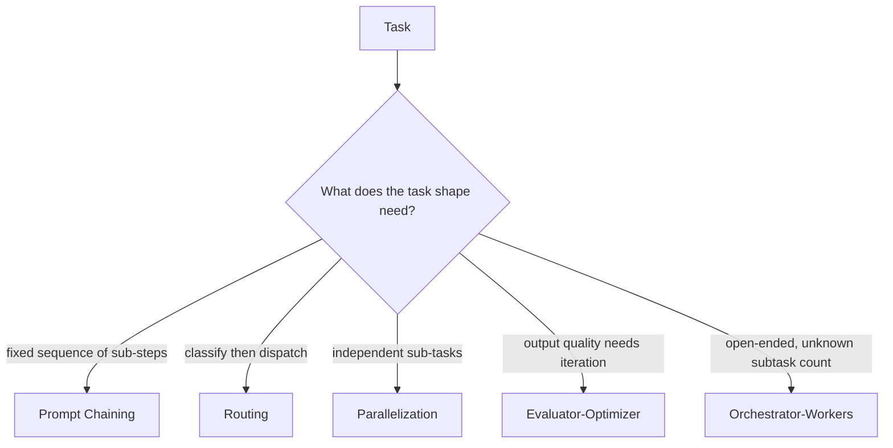

# Agentic Workflow Patterns

> Topic package — Domain 5 · Roadmap Week 16.
> Depth goal: name and distinguish the five canonical agentic workflow archetypes — Prompt Chaining, Routing, Parallelization, Evaluator-Optimizer, Orchestrator-Workers — and know which one a given task actually calls for.

## Source
- Track: LLM Engineering (self-directed, FDE roadmap)
- Reference reading: Anthropic, "Building Effective Agents" (engineering blog, Dec 2024); Udacity Agentic AI ND900, "Agentic Workflows" course
- Builds on: [[02 Literature Notes/LLM Engineering/Agent Loops and Planning]] · [[02 Literature Notes/LLM Engineering/Multi-Agent Orchestration]] · [[02 Literature Notes/LLM Engineering/Reasoning Prompt Patterns]]
- Date: 2026-11-25

---

## 1. Mental Model

**A workflow is a fixed graph of LLM calls and code; an agent is a model dynamically directing its own control flow.** Most production systems that look like "agents" are actually workflows — a known, composable shape that happens to call an LLM at each node. Naming the shape before writing code is what keeps the system simple enough to debug.

There are five recurring shapes. Each trades predictability for flexibility in a different place.



> Key intuition: **these are workflow topologies, not agent personalities.** The question is never "which pattern sounds smarter" — it's "does this task's actual shape match this pattern's control flow."

---

## 2. How It Actually Works

### 2.1 Prompt Chaining
Decompose a task into a fixed sequence of LLM steps, where each step's output feeds the next step's input. Add a programmatic check ("gate") between steps to catch malformed output before it propagates. Use when a task cleanly decomposes into sequential sub-steps and the latency cost of serial calls is acceptable in exchange for higher accuracy per step (each step has a narrower, easier job than the whole task at once).

### 2.2 Routing
Classify an incoming input and direct it to one of several specialized downstream paths, each optimized for its category. The classifier can be a small fast model, a cheap LLM call, or even a traditional classifier — it doesn't need to be the same model that handles the routed work. Use when inputs fall into distinct categories better handled by separate prompts, tools, or models, and mixing them into one general-purpose prompt would hurt accuracy on each category.

### 2.3 Parallelization
Run multiple LLM calls concurrently on the same or different inputs, then aggregate. Two variants: **sectioning** (break one task into independent subtasks, run each in parallel, stitch results together — e.g., multiple sub-agents each analyzing one aspect of a document) and **voting** (run the same task multiple times with varied prompts/temperature, aggregate via majority vote or synthesis — for higher confidence on a single judgment). Use when subtasks are genuinely independent (no subtask needs another's output) or when diverse perspectives on the same question improve reliability.

### 2.4 Evaluator-Optimizer
One LLM call generates a candidate response; a second call (the evaluator) critiques it against explicit criteria and returns structured feedback; the generator revises; repeat until the evaluator accepts or a retry budget is exhausted. This is the grounded-reflection pattern from [[02 Literature Notes/LLM Engineering/Reasoning Prompt Patterns]] formalized as a two-role loop with an explicit stopping contract. Use when there's a clear, articulable quality bar and iterative critique demonstrably improves the result (translation nuance, code that must pass tests, writing that must hit a style guide) — not when the evaluator has no real way to detect what's wrong.

### 2.5 Orchestrator-Workers
A central orchestrator LLM call dynamically breaks down a task into an a priori unknown number of subtasks, delegates each to a worker call, then synthesizes the worker outputs into a final result. The key difference from Parallelization: in parallelization the subtask decomposition is fixed in advance by your code; in orchestrator-workers the orchestrator *decides the decomposition itself*, so the number and nature of subtasks can vary per input. Use when the subtask breakdown can't be predicted upfront (e.g., "make all the necessary changes to these N files" where N and the nature of each change are only knowable after inspecting the task).

### 2.6 Workflow vs. agent
All five patterns above are **workflows**: the control flow (which call happens after which) is written in your code, even though an LLM decides the content at each node. A true **agent** is different — the LLM itself decides, step by step, what to do next and when to stop, using tools in an open-ended loop (this is what [[02 Literature Notes/LLM Engineering/Agent Loops and Planning]] covers). Workflows are more predictable and easier to validate; agents are more flexible but harder to bound. Start with the simplest workflow pattern that fits; escalate to full agentic control only when the task's path genuinely can't be predicted in advance.

### 2.7 Visualizing before implementing
Diagram the chosen pattern (nodes = LLM/tool calls, edges = data flow) before writing code. This surfaces two things cheaply: whether the chosen pattern actually matches the task's real shape, and where validation gates need to sit. A workflow diagram that can't be drawn cleanly in one of these five shapes is a signal the task may need genuine agentic control instead, or needs further decomposition.

---

## 3. Implementation

Assumed stack: stdlib + numpy where useful. Snippets:
- [[04 Code Snippets/LLM/Agentic Workflow Pattern Selector]]
- [[04 Code Snippets/LLM/Orchestrator Worker Dynamic Dispatch]]

### Agentic Workflow Pattern Selector
A decision function mapping task shape to pattern name.
```python
def select_pattern(subtasks_known_upfront, subtasks_independent, needs_classification, needs_quality_iteration):
    if needs_classification:
        return "routing"
    if needs_quality_iteration:
        return "evaluator-optimizer"
    if not subtasks_known_upfront:
        return "orchestrator-workers"
    if subtasks_independent:
        return "parallelization"
    return "prompt-chaining"

print(select_pattern(True, False, False, False))   # prompt-chaining
print(select_pattern(True, True, False, False))     # parallelization
print(select_pattern(False, False, False, False))   # orchestrator-workers
```

### Orchestrator Worker Dynamic Dispatch
Orchestrator decides subtask count/shape at runtime; workers execute; synthesizer combines.
```python
def orchestrator(task):
    # In production this is an LLM call producing a plan; here, deterministic for demo.
    if "report" in task:
        return ["gather_data", "analyze_trends", "draft_summary"]
    return ["handle_generic"]

def worker(subtask):
    return f"result({subtask})"

def synthesize(results):
    return " + ".join(results)

plan = orchestrator("write market report")
results = [worker(s) for s in plan]
print(synthesize(results))
```

---

## 4. Design Decisions & Tradeoffs

| Decision | Guidance |
|---|---|
| **Chaining vs. one big prompt** | Chain when each step benefits from a narrower, checkable job; add a gate between every step. |
| **Routing granularity** | Route on genuinely distinct categories only; don't route if one well-written prompt already handles all cases. |
| **Parallelization variant** | Sectioning for independent subtasks; voting for higher confidence on one judgment. |
| **Evaluator-Optimizer loop** | Only when the evaluator has a real, articulable basis for judging quality — not generic self-critique. |
| **Orchestrator-Workers vs. Parallelization** | If you can enumerate the subtasks in your own code ahead of time, it's parallelization; if the model must decide the breakdown, it's orchestrator-workers. |
| **Workflow vs. agent** | Default to the simplest fixed-topology workflow that fits; escalate to open-ended agent control only when the task's path is genuinely unpredictable in advance. |

---

## 5. Failure Modes & Gotchas

- Picking a pattern because it sounds sophisticated, not because the task's shape calls for it.
- Chaining without a validation gate between steps, letting a malformed intermediate output silently corrupt everything downstream.
- Routing to a default/fallback path silently, with no visibility into misclassification rate.
- Parallelizing subtasks that actually have hidden dependencies, producing inconsistent results when stitched together.
- Evaluator-Optimizer loops with no retry cap, or an evaluator with no real signal (just "does this look okay"), producing verbose non-convergent churn.
- Reaching for Orchestrator-Workers by default when the subtask set is actually fixed and enumerable (that's just Parallelization with extra, unnecessary LLM-driven planning overhead).

---

## 6. FDE Angle

- The deliverable to a client is often "which of these five shapes does your task match," not a custom architecture invented from scratch.
- Workflow diagrams (section 2.7) are a cheap, high-leverage artifact for aligning with stakeholders before writing code.
- Most production "agent" requests are actually well-served by Prompt Chaining or Routing — reserve Orchestrator-Workers and full agentic loops for tasks that have earned the added complexity.
- A workflow is far easier to test, trace, and explain to a client than an open-ended agent loop; prefer it whenever the task's shape allows.

---

## 7. Self-Check

1. What distinguishes a "workflow" from an "agent" in this framing?
2. What's the practical difference between Parallelization and Orchestrator-Workers?
3. When does Evaluator-Optimizer actually help versus produce performative churn?
4. Why diagram the workflow before implementing it?
5. Given a task, which of the five patterns fits, and why?

---

## 9. Interview Q&A

**Q: What's the actual difference between a "workflow" and an "agent," and why does the distinction matter?**
A: In a workflow, the control flow — which call happens after which, under what condition — is fixed in your code ahead of time; the LLM only decides the *content* at each node, not the *shape* of the process. In an agent, the LLM itself decides, dynamically and step by step, what to do next and when to stop, with your code mostly providing tools and guardrails rather than dictating the sequence.

This distinction matters because workflows are dramatically easier to reason about, test, and bound: you can enumerate every path through a fixed graph, write tests against specific nodes, and know the worst-case shape of execution in advance. An open-ended agent loop can't be fully enumerated this way — its path is only known after the fact, which is exactly why [[02 Literature Notes/LLM Engineering/Agent Loops and Planning]] and [[02 Literature Notes/LLM Engineering/Agent Reliability and Cost]] spend so much effort on runtime caps and traces: that machinery exists specifically to compensate for the predictability a fixed workflow gets for free.

*One-liner: a workflow has its control flow fixed in code with the LLM only filling in content at each node — an agent has the LLM deciding the control flow itself — and the practical consequence is that workflows are far easier to test and bound, which is why you should default to the simplest workflow shape that fits before reaching for open-ended agentic control.*

**Q: What's the practical difference between Parallelization and Orchestrator-Workers — they both seem to "run multiple things and combine results"?**
A: The difference is *who decides the subtask breakdown, and when*. In Parallelization, your own code enumerates the subtasks ahead of time — you already know there are, say, three aspects of a document to analyze, so you write code that kicks off three parallel calls, one per known aspect. In Orchestrator-Workers, the subtask breakdown itself is not known in advance — a central orchestrator LLM call looks at the actual task and decides, at runtime, how many subtasks there are and what each one should be, then dispatches workers accordingly.

This matters practically because it changes what your code needs to handle: Parallelization's code path is static — N known subtask types, N parallel calls, a fixed aggregation step. Orchestrator-Workers' code path has to handle a variable, unpredictable number and shape of worker calls, decided by a model that could get the decomposition wrong, which means the orchestrator's plan itself becomes something worth validating before dispatching workers against it.

*One-liner: Parallelization uses a subtask breakdown your code already knows ahead of time (fixed N, fixed shape); Orchestrator-Workers has the model decide the breakdown itself at runtime (variable N, shape only known after inspecting the task) — which is why orchestrator-workers needs to validate its own generated plan, something parallelization never has to do since the plan was never generated in the first place.*

**Q: When does Evaluator-Optimizer actually help, versus just produce performative churn?**
A: The deciding factor — same one covered in [[02 Literature Notes/LLM Engineering/Reasoning Prompt Patterns]]'s reflection question — is whether the evaluator step has a real, articulable, checkable basis for judging quality, or whether it's just a second LLM call restating "does this look good" with no more grounding than the first call had.

It helps when the evaluation criteria are concrete and the evaluator can actually detect specific, nameable problems: code that fails a test suite, a translation that misses a specific nuance a bilingual reviewer would catch, a document that violates a specific stated style rule. In these cases the generator gets genuinely new, actionable information on each iteration, and the loop converges toward something measurably better.

It becomes performative churn when the "evaluation" is just another generic pass asking the model to judge its own prior output with no sharper criteria than before — two LLM calls agreeing or disagreeing with each other based on nothing but their own internal sense of quality, producing verbose revisions that don't actually get closer to anything, since no new information entered the loop between iterations.

*One-liner: Evaluator-Optimizer earns its cost when the evaluator has concrete, checkable criteria that can catch something specific and real (a failing test, a missed nuance, a violated rule) — it becomes performative churn when the evaluator is just a second generic "does this look good" pass with no sharper grounding than the original generation had, producing revisions that don't actually converge on anything better.*

**Q: Why diagram a workflow before implementing it, rather than just writing the code directly?**
A: A diagram (nodes as LLM/tool calls, edges as data flow) is cheap to produce and cheap to change, while code is comparatively expensive to restructure once written — so catching a mismatch between "the pattern I picked" and "what this task actually needs" is far cheaper to do on paper than after a chaining implementation is half-built and turns out to actually need routing instead.

It also surfaces, concretely and visually, exactly where a validation gate needs to sit — a diagram showing one node's output flowing directly into the next node's input makes it obvious where a malformed intermediate result could silently propagate, in a way that's easy to overlook when reading linear code top to bottom. And if a task genuinely can't be drawn cleanly as one of the five canonical shapes, that's a useful, early signal — either the task needs further decomposition into sub-problems that *do* fit a pattern, or it genuinely needs open-ended agentic control rather than a fixed workflow at all.

*One-liner: diagramming is cheap to produce and cheap to revise, unlike code, so it catches a mismatched pattern choice before implementation cost is sunk, and it makes validation-gate placement visually obvious — a task that can't be cleanly diagrammed as one of the five shapes is itself a signal that it needs further decomposition or genuine agentic control instead.*

**Q: Given a task like "triage incoming support tickets by category, then handle each category with a specialized response," which pattern fits, and why?**
A: Routing. The task has a clean two-stage shape that matches Routing exactly: first, classify the input (which category does this ticket belong to), then dispatch to one of several specialized downstream paths, each already optimized for handling its specific category well.

The signal that rules out the other patterns: it's not Prompt Chaining, because there's no fixed sequence of dependent sub-steps every ticket goes through — different tickets take genuinely different paths after classification. It's not Parallelization, because a single ticket doesn't need multiple independent analyses run concurrently and combined — it needs exactly one path chosen and followed. It's not Evaluator-Optimizer, because the task described has no iterative quality-refinement loop — it's a one-shot classify-then-handle, not a generate-critique-revise cycle. And it's not Orchestrator-Workers, because the "subtasks" (the categories and their handlers) are already fully known in advance, not something that needs to be dynamically discovered per ticket.

*One-liner: "classify then dispatch to a specialized handler" is the defining shape of Routing — it's ruled out from the other four patterns specifically because there's no fixed dependent sequence (not chaining), no need for concurrent independent analysis of one input (not parallelization), no iterative quality loop (not evaluator-optimizer), and the handler categories are fully known in advance rather than discovered per task (not orchestrator-workers).*

## 8. Links
- Domain MOC: [[06 Maps of Content/LLM Engineering Concepts]]
- Code: [[04 Code Snippets/LLM/Agentic Workflow Pattern Selector]], [[04 Code Snippets/LLM/Orchestrator Worker Dynamic Dispatch]]
- Distilled: [[03 Permanent Notes/A Workflow Is a Fixed Graph an Agent Writes Its Own]], [[03 Permanent Notes/Name the Pattern Before You Build It]]
- Upstream: [[02 Literature Notes/LLM Engineering/Agent Loops and Planning]] · [[02 Literature Notes/LLM Engineering/Multi-Agent Orchestration]] · [[02 Literature Notes/LLM Engineering/Reasoning Prompt Patterns]] · Downstream: [[02 Literature Notes/LLM Engineering/Agent Reliability and Cost]]
