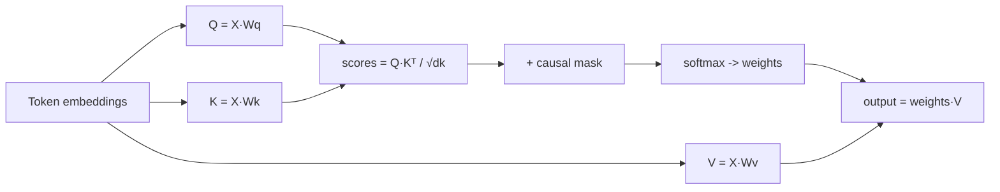

# Attention Deep-Dive

> Topic package — Domain 2 · Roadmap Weeks 08/10.
> Depth goal: derive scaled dot-product attention, understand Q/K/V, multi-head, causal masking, and the KV-cache implication — well enough to implement it in numpy.

## Source
- Track: LLM Engineering (self-directed, FDE roadmap)
- Slide deck: `07 Resources Library/LLM Engineering/Slides/Lesson_07_Attention_Deep-Dive.pptx`
- Hands-on notebook: `07 Resources Library/LLM Engineering/Notebooks/07_Attention_Deep-Dive.ipynb` (runs offline)
- Reference reading: Vaswani et al. 'Attention Is All You Need' (arXiv:1706.03762); Jay Alammar 'The Illustrated Transformer'; Karpathy 'Let's build GPT'; Lilian Weng 'Attention? Attention!'
- Builds on: [[03 Permanent Notes/Transformers Use Attention for Sequence Modeling]]
- Date: 2026-07-18

---

## 1. Mental Model

**Attention lets every token look at every other token and pull in the information it needs.** Instead of processing a sequence strictly left-to-right (RNNs) or through a fixed window (CNNs), attention computes, for each position, a *weighted average of all positions* — where the weights say "how relevant is token j to token i?".

Each token emits three learned projections: a **Query** ("what am I looking for?"), a **Key** ("what do I offer?"), and a **Value** ("what I'll pass on if attended to"). Relevance = query·key; the softmax of those scores becomes the mixing weights over values.

> Key intuition: **attention is content-based soft lookup.** Q·K measures match, softmax turns matches into a probability distribution, and the output is a weighted sum of values. Everything else in a transformer (multi-head, masks, positions) is refinement on this one operation.



---

## 2. How It Actually Works

### 2.1 Scaled dot-product attention
The whole operation is one formula:

$$\text{Attention}(Q,K,V) = \text{softmax}\!\left(\frac{QK^\top}{\sqrt{d_k}}\right)V$$

- `Q,K,V` are matrices of shape `[seq, d_k]` (values `[seq, d_v]`).
- `QKᵀ` is a `[seq, seq]` matrix of pairwise scores.
- Dividing by `√d_k` keeps the dot products from growing with dimension, which would push softmax into saturated (near-one-hot) regions with vanishing gradients.
- softmax normalizes each row to a distribution; multiplying by `V` mixes the values.

### 2.2 Why Q, K, V are separate
If a token used the same vector for matching and for content, it couldn't ask for something different from what it advertises. Separate learned projections let a token *query* for "the subject of this sentence" while *offering* "I am a past-tense verb." The three weight matrices `Wq, Wk, Wv` are what training actually learns.

### 2.3 Multi-head attention
One attention doesn't capture everything: syntax, coreference, and topic all matter. Multi-head attention runs `h` attention operations in parallel on lower-dimensional slices (`d_k = d_model/h`), then concatenates and projects:

$$\text{MHA}(X) = \text{Concat}(\text{head}_1,\dots,\text{head}_h)\,W_O$$

Each head can specialize (one tracks the previous token, another the verb, etc.). Cost is the same as single-head at full width because the dimensions are split.

### 2.4 Causal masking (decoder attention)
In a decoder-only LLM, position `i` must not see future positions `> i` (that would be cheating at next-token prediction). Before softmax, set the upper-triangular scores to `-inf` so their weights become zero. This is the single line that makes a transformer autoregressive.

### 2.5 The KV-cache implication
At generation time, tokens 0..t-1 don't change, so their K and V don't change. Caching them means each new token only computes one new Q against the cached K/V — turning per-step cost from O(t²) to O(t). This is why KV cache dominates inference memory (covered in LLM Efficiency).

---

## 3. Implementation

Assumed stack: `numpy` only — attention is small enough to implement from scratch, which is the best way to understand it. Snippets:
- [[04 Code Snippets/LLM/Scaled Dot-Product Attention in NumPy]]
- [[04 Code Snippets/LLM/Multi-Head Attention in NumPy]]

### Scaled Dot-Product Attention in NumPy
Self-contained scaled dot-product attention with optional causal mask.
```python
import numpy as np

def softmax(x, axis=-1):
    x = x - x.max(axis=axis, keepdims=True)
    e = np.exp(x)
    return e / e.sum(axis=axis, keepdims=True)

def attention(Q, K, V, causal=False):
    dk = Q.shape[-1]
    scores = Q @ K.swapaxes(-1, -2) / np.sqrt(dk)   # [seq, seq]
    if causal:
        seq = scores.shape[-1]
        mask = np.triu(np.ones((seq, seq)), k=1).astype(bool)
        scores = np.where(mask, -1e9, scores)
    weights = softmax(scores, axis=-1)
    return weights @ V, weights

seq, d = 4, 8
rng = np.random.RandomState(0)
Q = K = V = rng.randn(seq, d)
out, w = attention(Q, K, V, causal=True)
print("output:", out.shape, "  row sums (=1):", w.sum(1).round(3))
```

### Multi-Head Attention in NumPy
Splits d_model into h heads, attends per head, concatenates and projects.
```python
import numpy as np
from numpy import ndarray

def softmax(x, axis=-1):
    x = x - x.max(axis=axis, keepdims=True); e = np.exp(x)
    return e / e.sum(axis=axis, keepdims=True)

def mha(X, Wq, Wk, Wv, Wo, h, causal=True):
    seq, d = X.shape; dk = d // h
    Q, K, V = X @ Wq, X @ Wk, X @ Wv
    def split(t): return t.reshape(seq, h, dk).transpose(1, 0, 2)  # [h, seq, dk]
    Q, K, V = split(Q), split(K), split(V)
    scores = Q @ K.transpose(0, 2, 1) / np.sqrt(dk)               # [h, seq, seq]
    if causal:
        m = np.triu(np.ones((seq, seq)), 1).astype(bool)
        scores = np.where(m, -1e9, scores)
    ctx = softmax(scores, -1) @ V                                  # [h, seq, dk]
    ctx = ctx.transpose(1, 0, 2).reshape(seq, d)                  # concat heads
    return ctx @ Wo

rng = np.random.RandomState(0); seq, d, h = 5, 16, 4
X = rng.randn(seq, d)
Wq, Wk, Wv, Wo = (rng.randn(d, d) * 0.1 for _ in range(4))
print("MHA output:", mha(X, Wq, Wk, Wv, Wo, h).shape)
```

---

## 4. Design Decisions & Tradeoffs

| Decision | Guidance |
|---|---|
| **Number of heads** | More heads = more specialized subspaces but smaller d_k each; 8-32 typical. d_model must divide by h. |
| **Scaling by √d_k** | Always — without it, large-dim dot products saturate softmax and kill gradients. |
| **Causal vs bidirectional** | Decoder-only LLMs use causal masks; encoders (BERT-style) attend both directions. |
| **Attention variant** | Vanilla MHA for learning; production uses GQA/MQA + FlashAttention for memory/speed (see LLM Efficiency). |

---

## 5. Failure Modes & Gotchas

- Forgetting the `1/√d_k` scale → saturated softmax, unstable training.
- Wrong mask (off-by-one on the diagonal) → token sees itself-plus-one or leaks the future.
- Softmax over the wrong axis → mixing across the batch instead of the sequence.
- Assuming attention is O(seq) — it's **O(seq²)** in time and memory; long context is expensive.
- Confusing d_model with d_k: per-head dim is d_model/h, not d_model.

---

## 6. FDE Angle

- Attention's O(seq²) cost is *the* reason long-context and RAG chunking economics matter — you can explain the bill.
- KV cache (a direct consequence of attention) is the dominant inference-memory cost; ties to model-serving decisions.
- Being able to whiteboard Q/K/V and the softmax makes you credible when a client asks 'how does the model actually read our documents?'
- Deliverable: explain, from the formula, why context windows have hard limits and what that costs.

---

## 7. Self-Check

1. Write scaled dot-product attention from memory, including shapes.
2. Why divide by √d_k? What breaks without it?
3. Why are Q, K, V separate projections instead of one?
4. What exactly does the causal mask do, and where is it applied?
5. Why is attention O(seq²), and what does the KV cache save at inference?
6. How does multi-head attention keep the same cost as single-head at full width?

---

## 9. Interview Q&A

**Q: Walk me through attention end to end — what happens to a single token?**
A: Start with the problem. A word's raw embedding only captures the word on its own. "Bank" could mean a riverbank or a place that holds money. To figure out which one, the model needs to pull in clues from the rest of the sentence. But it shouldn't pull equally from every word — it needs a way to ask "which other words actually matter to me?" That's what Query, Key, and Value do.

Take one token — call it token `i`. Its embedding gets turned into three separate vectors using three learned weight matrices: a Query `q_i` ("what am I looking for?"), and every token in the sentence (including `i` itself) also makes a Key `k_j` ("what do I offer?") and a Value `v_j` ("what do I actually hand over if picked"). These are three separate vectors, not one, because searching for something and offering something are different jobs. If you merged them into one vector, a word could only ever search for exactly what it offers, which is much more limited.

Token `i`'s query is then compared against every token's key with a dot product: `score = q_i · k_j`. This score is scaled down a bit (explained below), sometimes masked, and run through softmax so all the scores for token `i` turn into weights that add up to 1. These weights say "how much should token i listen to token j."

Finally, token `i`'s new representation is just the weighted sum of everyone's Values, using those weights. The token that started out as a bare "bank" now carries in information pulled from whatever word scored highest — "river" or "deposit." And this whole process happens for every token at the same time, which is also why transformers are much faster to train than RNNs, which have to go one word at a time.

*One-liner: each token sends out a Query, and every token offers a Key and a Value — matching Query against Key gives weights, and the token's new meaning is just the weighted mix of everyone's Values.*

**Q: Why not just use one big attention head instead of multiple smaller ones?**
A: First, think about what one attention head can actually do. It gives exactly one similarity score per pair of tokens — one notion of "this word matters to that word." But a sentence needs several different kinds of relationships tracked at once. Take: "The trophy didn't fit in the suitcase because it was too big." To figure out what "it" means, the model needs to track which noun "it" refers to. But it also needs to track grammar (subject-verb agreement), nearby words, and more — all at the same time, for the same pair of words. One single similarity score can't carry all of that information at once; it has to compromise.

Multi-head attention solves this by running several smaller attention operations side by side, each with its own set of weights. Nothing forces two heads to learn the same thing, so in practice, different heads end up specializing — one might track the previous word, another might track which noun a pronoun refers to, and so on.

Here's the part people often get wrong: this doesn't cost more compute than one big head. A single wide head costs a certain amount to compute. Splitting that same width into several narrower heads and running them in parallel costs the same total amount, just spread differently. You're not paying extra to get multiple viewpoints — you're reusing the same budget more cleverly.

*One-liner: one head can only track one kind of relationship between words, but language needs several at once (grammar, meaning, position) — multiple heads learn several of these in parallel, for the same total cost as one big head.*

**Q: Why is attention quadratic, and why does that matter commercially?**
A: Follow where the cost comes from. Attention's whole advantage is that every word can look at every other word directly — that's much better than an RNN, which can only look a few steps back, or a CNN, which only looks at nearby words. But "every word looks at every other word" means comparing every pair of words. For a sentence of length `seq`, that's `seq × seq` pairs to compute. That's exactly why the score table has shape `[seq, seq]`, and why both the time and memory it takes grow with the square of the sentence length, not just the length itself.

This isn't a coding shortcut someone forgot to apply — it's built into what attention means. Double the sentence length, and you double both "how many words are looking" and "how many words are being looked at," so the total work goes up four times, not two.

Now follow that into real costs. AI providers charge more than proportionally for longer prompts, because the underlying compute really does grow faster than the prompt length. This is the whole economic reason RAG exists: instead of feeding a model an entire 500-page document, you find just the few paragraphs that matter and only process those — keeping the sentence length small and the cost under control. It's also why FlashAttention matters: it doesn't reduce the actual amount of math, but it avoids ever building the full giant score table in slow memory, which makes it faster in practice. And it's why research into attention variants that skip some of the pairs continues — they're trying to avoid this quadratic cost altogether.

*One-liner: attention's strength — every word sees every other word — is also its cost, since that means comparing every pair, and pair count grows with the square of the sentence length; this is exactly why RAG, FlashAttention, and newer attention variants all exist to manage that same growing bill.*

**Q: What does the KV cache actually cache, and why can it?**
A: Start with how text generation actually works: the model produces one word at a time, and after each new word, it reruns its whole process to decide the next one. Naively, that means at every single step, it recomputes Key and Value for every word so far — even words it already fully processed in the previous step.

Here's the shortcut: in a model that only looks backward (never forward), a word's Key and Value only depend on that word itself — never on anything that comes after it. So once you've computed the Key and Value for word number 5, they will never change, no matter how many more words get generated afterward. That means you don't need to recompute them — you can just save them and reuse them forever.

So at each new step, the model only computes Key and Value for the one new word, adds them to a saved list (the cache), and the new word's Query looks back across everything saved so far, old and new. Only the Query side does new work each time; the Key/Value side just grows by one entry.

This changes generating a sequence of length `t` from redoing more and more work at every step (total cost grows with the square of the length) down to doing a small, constant amount of new work at every step (total cost just grows with the length). The price you pay instead is memory — that cache has to sit in GPU memory for as long as generation continues, and it grows with both how long the text is and how many requests are being handled at once. That's exactly why memory, not raw computation, is often the real bottleneck for serving these models at scale.

*One-liner: a word's Key and Value never change once computed, so the KV cache saves them once and reuses them — turning "redo more and more work every step" into "do one small bit of new work every step," at the cost of memory that grows with both text length and how many users you're serving.*

**Q: If I remove the √d_k scaling, what specifically breaks, mechanically?**
A: Start with what a dot product is: multiply matching numbers from two vectors and add them all up. If each of those numbers is reasonably sized and random, then the more numbers you add together, the more the total result spreads out — bigger vectors naturally produce bigger swings in the dot product. So if the vectors are `d_k` numbers long, the natural spread of the dot product grows with the square root of `d_k`. With a vector of 64 numbers, the scores end up about 8 times more spread out than with a vector of just 1 number.

Now follow what that spread does downstream. Softmax cares about the *differences* between scores, not their size. When scores are close together, softmax gives a fairly balanced set of weights. When scores are spread far apart — which is exactly what happens when we skip the scaling — the single highest score ends up massively bigger than the rest after the exponential, so softmax dumps almost all its weight onto just one token.

Why is that actually bad, not just "a bit uneven"? Two real problems follow. First, the model loses the soft blending that makes attention useful — it ends up listening to basically one word instead of a helpful mix of several. Second, and more serious for training: softmax's gradient shrinks toward zero whenever its output is very close to 0 or 1. So when softmax is nearly one-hot, the gradient used to improve the model during training is almost nothing — the model can't learn to fix a bad attention pattern because there's barely any learning signal left.

Dividing by the square root of `d_k` is exactly the right fix because it cancels out the spread growth mathematically — the result ends up at the same scale no matter how big `d_k` is. So softmax stays balanced, more than one word gets meaningful weight, and the gradient keeps flowing well enough to keep training.

*One-liner: without scaling, dot products naturally spread out more as vectors get longer, which pushes softmax toward picking just one word and kills the gradient needed to learn — dividing by the square root of the vector length cancels that spread so training stays stable no matter the size.*

**Q: Encoder (BERT) vs decoder (GPT) attention — what's the actual difference in the math?**
A: Start by asking what each model is trained to do, because that's what decides the difference, not some arbitrary design choice. BERT is trained to fill in blanks: a few words in a complete sentence are hidden, and the model has to guess them using words from *both* before and after the blank ("The [blank] sat on the mat" — you can guess "cat" using words on both sides). GPT is trained to predict the next word, given only everything that came before — and when GPT is actually generating text, the "next words" genuinely don't exist yet, so letting it peek ahead during training would teach it a trick it could never use for real, and it would also just learn to copy the answer instead of learning to predict it.

Mechanically, both use the exact same formula. There's no separate "BERT version" or "GPT version" of attention. The only difference is one small addition before softmax. BERT adds nothing — every word can freely look at every other word, both before and after it. GPT adds a mask: before softmax, any score that would let a word look at a *future* word gets set to a very large negative number, which becomes zero after softmax. So GPT genuinely cannot pull in any information from words that haven't been generated yet.

That one difference explains what each model is good at. BERT's two-sided view gives it a richer understanding of each word, which is great for tasks like classification or search — but it can't generate text one word at a time, since it was trained assuming it could see the whole sentence. GPT's one-sided view means it knows less about each word in isolation, but every position becomes a valid "predict what comes next" example, which is exactly what's needed to generate open-ended text.

*One-liner: same formula for both — the only difference is whether a mask blocks future words before softmax; BERT skips the mask (sees both directions, good at understanding) because its task needs full context, GPT adds the mask (sees only the past, good at generating) because predicting the next word means never getting to see it first.*

## 8. Links
- Domain MOC: [[06 Maps of Content/LLM Engineering Concepts]]
- Code: [[04 Code Snippets/LLM/Scaled Dot-Product Attention in NumPy]], [[04 Code Snippets/LLM/Multi-Head Attention in NumPy]]
- Distilled: [[03 Permanent Notes/Attention Is Content-Based Soft Lookup]], [[03 Permanent Notes/Attention Is Quadratic in Sequence Length]]
- Upstream: foundation notes · Downstream: [[02 Literature Notes/LLM Engineering/Transformer Architecture]]
