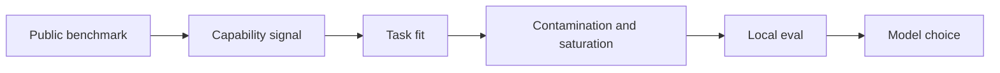

# Benchmark Literacy

> Topic package — Domain 6 · Roadmap Week 17.
> Depth goal: build production-grade LLM evaluation habits: clear datasets, trustworthy metrics, statistical guardrails, and shipping decisions that survive contact with real users.

## Source
- Track: LLM Engineering (self-directed, FDE roadmap)
- Slide deck: `07 Resources Library/LLM Engineering/Slides/Lesson_38_Benchmark_Literacy.pptx`
- Hands-on notebook: `07 Resources Library/LLM Engineering/Notebooks/38_Benchmark_Literacy.ipynb` (runs offline)
- Reference reading: MMLU; GSM8K; HumanEval; MT-Bench; BEIR; MTEB; GPQA; SWE-bench; contamination studies
- Builds on: [[02 Literature Notes/LLM Engineering/Eval Fundamentals]] · [[02 Literature Notes/LLM Engineering/Retrieval Evaluation]]
- Date: 2026-07-18

---

## 1. Mental Model

**Benchmarks are maps, not the territory.** They reveal model capabilities under standardized conditions, but they can be saturated, contaminated, gamed, or irrelevant to your product.

Use public benchmarks to shortlist models, then build task-relevant evals for your own users.

> Key intuition: **leaderboards are scouting reports, not shipping gates.**



---

## 2. How It Actually Works

### 6.1 What benchmarks measure
MMLU covers broad academic knowledge; GSM8K math; HumanEval code; MT-Bench chat; BEIR retrieval; MTEB embeddings; GPQA hard science; SWE-bench software issues.

### 6.2 Contamination
If items or close variants appear in training data, scores overstate generalization. Treat surprising jumps cautiously and prefer private holdouts.

### 6.3 Saturation
Near-ceiling benchmarks stop separating useful differences. Leaderboard optimization can improve public scores without improving your workload.

### 6.4 Task relevance
Match input type, output type, tool use, retrieval, latency, cost, and failure severity. A math benchmark may not predict RAG support quality.

### 6.5 Proper use
Use benchmarks for priors and shortlists; final decisions need local golden evals, safety probes, cost/latency tests, and online confirmation.

---

## 3. Implementation

Assumed stack: stdlib + numpy. The snippets are offline and deterministic so they can run in CI before API-backed evaluation. Snippets:
- [[04 Code Snippets/LLM/Benchmark Contamination Probe]]
- [[04 Code Snippets/LLM/Leaderboard Normalization]]

### Benchmark Contamination Probe
N-gram overlap probe for suspected benchmark memorization in local corpora.
```python
def ngrams(text, n=5):
    w=text.lower().split()
    return {tuple(w[i:i+n]) for i in range(max(0, len(w)-n+1))}
def overlap_probe(item, corpus_docs, n=5):
    target=ngrams(item,n); hits=[]
    for name, doc in corpus_docs.items():
        ov=len(target & ngrams(doc,n))
        if ov: hits.append((name, ov))
    return sorted(hits, key=lambda x:x[1], reverse=True)
print(overlap_probe("solve the refund policy word problem carefully", {"doc":"refund policy word problem carefully appears here"}, n=3))
```

### Leaderboard Normalization
Combine benchmark, cost, and latency into task-fit instead of ranking by one public metric.
```python
def task_fit(row, weights):
    return sum(row[k]*w for k,w in weights.items()) / sum(weights.values())
models={"A":{"bench":0.92,"cost":0.40,"latency":0.50},"B":{"bench":0.86,"cost":0.90,"latency":0.85}}
weights={"bench":2,"cost":1,"latency":1}
print(sorted((task_fit(v, weights), k) for k,v in models.items()))
```

---

## 4. Design Decisions & Tradeoffs

| Decision | Guidance |
|---|---|
| **Dataset boundary** | Write down exactly which population the eval represents and which it excludes. |
| **Metric choice** | Prefer deterministic metrics for mechanical properties; use judges only for semantic qualities that require judgment. |
| **Slicing** | Always inspect business-critical, safety-critical, and historically weak slices. |
| **Calibration** | Compare automated scores against human labels before using them as gates. |
| **Thresholds** | Set pass/block/investigate thresholds before looking at the result. |
| **Artifacts** | Persist inputs, outputs, prompts, model versions, scores, and traces for reproducibility. |

---

## 5. Failure Modes & Gotchas

- Treating a polished demo as evidence of reliability.
- Optimizing a proxy metric after it stops matching user value.
- Reporting only an aggregate score while a critical slice fails.
- Changing prompt, model, data, and scorer at once, making regressions uninterpretable.
- Using a judge without bias audits or human calibration.
- Failing to save per-case artifacts, so failures cannot be debugged.

---

## 6. FDE Angle

- A production eval is a client-facing trust artifact, not internal trivia.
- A clear scorecard lets stakeholders decide whether to ship, hold, or rollback.
- Automated evals reduce manual QA and accelerate iteration.
- Deliverable: versioned dataset, runner, metrics, report, and CI gate.

---

## 7. Self-Check

1. Define the behavior being measured and the evidence required.
2. Explain how the dataset, scorer, baseline, and threshold interact.
3. Name slices that could hide severe regressions behind a good average.
4. Describe how you would calibrate the metric against human judgment.
5. State what artifacts are needed to reproduce a run.
6. Translate a score into a shipping decision.

---

## 9. Interview Q&A

**Q: What does "contamination" mean for a benchmark, and why does it make a high score potentially misleading?**
A: Contamination means that the actual benchmark questions (or very close variants of them) ended up somewhere in the model's training data, before the model was ever evaluated on that benchmark. If that happened, a high score on the benchmark isn't necessarily measuring the model's genuine ability to reason through and solve that type of problem — it could instead partly reflect the model having effectively memorized the specific answer during training, the same way a student who got hold of the actual exam questions beforehand would score well without that score actually reflecting real understanding of the material.

This matters because the entire point of a benchmark is to act as a proxy for some genuine underlying capability — "if a model scores well on this math benchmark, that suggests it's genuinely good at this kind of math reasoning, which should generalize to similar problems it hasn't seen before." Contamination breaks this inference: a contaminated high score might reflect memorization of these exact specific questions, which tells you much less (or nothing) about how well the model would actually perform on genuinely novel problems of the same type that it hasn't already seen verbatim or near-verbatim during training.

The practical implication: a surprising, unusually large jump in benchmark performance should be treated with some suspicion rather than taken entirely at face value, and benchmarks held as truly private, held-out test sets (never publicly released, so there's no way they could have ended up in anyone's training data) are more trustworthy specifically because contamination becomes structurally impossible for them.

*One-liner: contamination means the actual benchmark questions (or close variants) leaked into a model's training data, so a high score can partly reflect memorization rather than genuine reasoning ability — which is why a benchmark's score is only a trustworthy proxy for real capability when contamination can be ruled out, and why truly private holdout benchmarks (never publicly released) are more reliable than public ones.*

**Q: What does "benchmark saturation" mean, and why does it make a benchmark less useful for distinguishing between models?**
A: Saturation means that models have gotten good enough at a particular benchmark that most of them now score very close to the maximum possible score — near the ceiling of what the benchmark can even measure. Once this happens, the benchmark stops being able to meaningfully distinguish between models that are actually quite different in real-world capability, because they're all bunched up near the top of the score range, with very little room left for the benchmark to show a real, meaningful difference between them.

Here's the practical consequence: if two models both score 97% and 98% on a saturated benchmark, that 1-point difference might represent a genuinely tiny, inconsequential real-world capability gap — or it might just be noise, since there's so little remaining headroom in the benchmark to meaningfully separate real differences from random variation at that point. Worse, once a benchmark is widely known to be saturated, there's a risk that further "improvements" on it reflect narrow optimization specifically targeting that benchmark's particular quirks and question patterns, rather than genuine, broadly useful capability gains that would actually transfer to real-world tasks.

This is exactly why benchmark scores need to be interpreted with an awareness of where the field currently stands relative to a given benchmark's ceiling — a benchmark that was genuinely discriminating and useful a year ago can become much less informative once most leading models have converged near its top score, which is a real, ongoing concern as model capabilities keep advancing.

*One-liner: saturation means models have converged near a benchmark's maximum possible score, leaving little remaining room to meaningfully distinguish real capability differences — a small score gap on a saturated benchmark may be noise rather than a genuine difference, and continued "improvement" risks reflecting narrow optimization to the benchmark's specific quirks rather than broadly useful capability gains.*

**Q: Why might a model that tops a public benchmark leaderboard still be the wrong choice for your specific product?**
A: A benchmark measures performance on a specific, standardized task type, under specific standardized conditions — but your actual product's real workload is very likely different from that benchmark's specific task shape in ways that genuinely matter, and a benchmark score tells you nothing directly about how a model performs on your particular task shape.

Concretely: a model that's excellent at a math-reasoning benchmark tells you something specific about math reasoning — it doesn't directly tell you how well that same model handles your actual production need, which might be grounded RAG question-answering, or following a specific structured-output contract, or working correctly within your particular tool-calling setup. These are genuinely different skills that a math benchmark simply wasn't designed to measure at all, even if the same underlying model happens to be tested on both. Beyond the task-type mismatch, a leaderboard-topping model might also come with practical tradeoffs a leaderboard entirely ignores — higher cost per token, higher latency, a context window that doesn't fit your needs — all real, relevant factors to an actual production decision that a pure capability leaderboard simply doesn't account for at all.

This is exactly why the practical guidance is to use public benchmarks as a *shortlisting* tool (narrowing a large field of possible models down to a reasonable set of serious candidates worth testing further) rather than as the final decision-maker — the actual final choice should come from evaluating candidates on your own task-relevant golden eval set (as covered in Eval Fundamentals), which directly measures what you actually care about, rather than trusting a benchmark measuring something related but genuinely different.

*One-liner: a benchmark measures a specific task type under specific conditions that likely differ from your product's actual workload, and it ignores practical factors (cost, latency, context fit) a real decision needs — which is why benchmarks are a shortlisting tool to narrow candidates, with the actual final choice made using your own task-relevant eval, not the leaderboard ranking itself.*

**Q: How would you design a quick, practical check for whether your own evaluation data might be contaminated by overlapping with a model's public training data?**
A: The core idea is to check whether suspiciously similar text already exists somewhere in known, likely-training-data sources — if your test item's exact wording (or very close variants of it) appears verbatim in content that's plausibly part of common training corpora, that's a signal worth investigating before trusting a surprisingly strong score on that item as genuine capability.

A practical, deterministic approach: break both your test item and any corpus of suspect documents into overlapping sequences of words (n-grams — say, 5 words at a time), then check how much overlap exists between your test item's n-grams and each document's n-grams. A high degree of overlap between your supposedly novel test item and some known, plausibly-training-data document is a signal that this isn't actually a clean, uncontaminated test — the model might have effectively seen this exact text (or something very close to it) during training, which would make a correct answer on this item less meaningful as evidence of a model's genuine reasoning capability.

This kind of check obviously can't catch every form of contamination (a model could have seen a paraphrased version with no matching n-grams at all, for instance), but it's a useful, cheap first-pass check specifically for the most direct, verbatim-or-near-verbatim kind of contamination, which is also the most common and easiest kind to accidentally introduce when building your own eval set from publicly available source material.

*One-liner: break your test item and suspect documents into overlapping n-grams and measure overlap between them — a high overlap between a supposedly novel test item and known, plausibly-training-data content is a direct signal of likely contamination, catching the most common verbatim-or-near-verbatim case cheaply, even though it won't catch more subtle, paraphrased contamination.*

**Q: What's the right way to actually use public benchmarks when selecting a model for a real product, given everything above?**
A: Use them as a prior — a way to narrow a large field of possible models down to a reasonable shortlist of serious candidates worth investing further evaluation effort in — not as the final, decisive gate for which model actually gets shipped in your product.

The practical sequence: start with relevant public benchmarks (ones that at least loosely relate to your actual task type — a retrieval benchmark if you're building RAG, a coding benchmark if you're building a code assistant) to form an initial shortlist of a handful of models worth considering further, while keeping the contamination and saturation caveats above in mind rather than treating leaderboard rank as gospel. Then, for that shortlist, build and run your own task-relevant golden eval set (as covered in Eval Fundamentals) — testing the actual task shape your product needs, not a generic benchmark's task shape — along with practical checks for cost, latency, and safety behavior specific to your use case. The final decision should come from this task-relevant, locally-run evaluation, informed by (but not dictated by) where each candidate stood on the public benchmarks that helped you form the initial shortlist in the first place.

*One-liner: use public benchmarks to form an initial shortlist of serious candidates (while accounting for contamination/saturation caveats), then make the actual final decision based on your own task-relevant golden eval, cost/latency checks, and safety testing run specifically on your real workload — benchmarks narrow the field, your own local evaluation makes the actual call.*

## 8. Links
- Domain MOC: [[06 Maps of Content/LLM Engineering Concepts]]
- Code: [[04 Code Snippets/LLM/Benchmark Contamination Probe]], [[04 Code Snippets/LLM/Leaderboard Normalization]]
- Distilled: [[03 Permanent Notes/Benchmarks Are Capability Signals Not Shipping Gates]], [[03 Permanent Notes/Leaderboards Mislead When Fit Contamination and Cost Are Ignored]]
- Upstream: [[02 Literature Notes/LLM Engineering/Eval Fundamentals]] · Downstream: [[02 Literature Notes/LLM Engineering/Statistical Rigor in Eval]]
