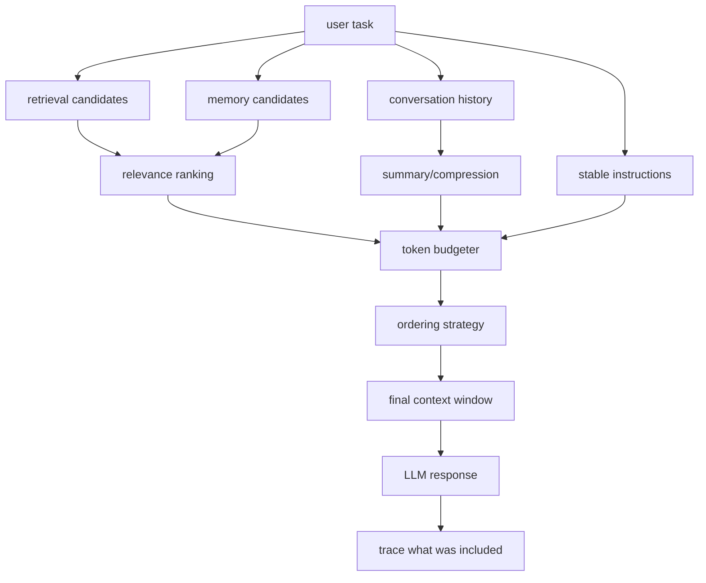

# Context Engineering

> Topic package — Domain 3 · Roadmap Week 15.
> Depth goal: engineer context windows as production inputs: select, order, compress, and budget instructions, conversation state, retrieved evidence, tool results, and memory so the model sees the right information at the right time without drowning in tokens.

## Source
- Track: LLM Engineering (self-directed, FDE roadmap)
- Slide deck: `07 Resources Library/LLM Engineering/Slides/Lesson_16_Context_Engineering.pptx`
- Hands-on notebook: `07 Resources Library/LLM Engineering/Notebooks/16_Context_Engineering.ipynb` (runs offline)
- Reference reading: Liu et al. 'Lost in the Middle' (arXiv:2307.03172); Anthropic long-context and prompt/context guidance; LangChain and LlamaIndex retrieval/context assembly patterns; OpenAI prompt engineering guidance; recent 'context engineering' practice in agent systems
- Builds on: [[02 Literature Notes/LLM Engineering/Reasoning Prompt Patterns]]
- Date: 2026-07-18

---

## 1. Mental Model

**Context engineering is the discipline of deciding what the model is allowed to know right now.** Prompt engineering asks, 'what instruction should I write?' Context engineering asks the bigger production question: which instructions, conversation turns, retrieved documents, tool outputs, memories, schemas, examples, and constraints should be assembled into the finite context window for this call?

The context window is not a hard drive. More tokens can hurt: irrelevant evidence distracts, middle-position facts get ignored, stale memory conflicts with fresh retrieval, and long prompts hide the task. Good context engineering is therefore an optimization problem: maximize relevant signal per token under a budget and an ordering strategy.

> Key intuition: **the model can only reason over the context you assemble — so context assembly is part of the program.** Retrieve less but better, put critical instructions and evidence where attention is strongest, compress aggressively, and treat memory as a source to select from, not a dump to paste.



---

## 2. How It Actually Works

### 3.1 Context is an assembled input, not a bag of text
A production LLM call usually contains stable instructions, task input, prior conversation, retrieved documents, tool results, schema definitions, examples, and memory. Each source has different trust, freshness, and relevance. Context engineering makes those choices explicit: what enters, what is omitted, how it is delimited, and how conflicts are resolved.

### 3.2 Token budgeting is product design
Every context window has a budget. Reserve tokens for the answer and for mandatory instructions before filling with evidence:

$$B_{docs} = B_{window} - B_{system} - B_{task} - B_{history} - B_{answer} - B_{safety}$$

Budgeting is not just cost control; it protects quality. A giant irrelevant context can reduce answer accuracy even if it fits.

### 3.3 Ordering matters: lost in the middle
Liu et al. showed that models often use information near the beginning and end of long contexts better than information buried in the middle. Practical heuristic: put stable instructions first, the current user task last, and the most relevant evidence near boundaries or repeated in a compact synthesis. Do not assume a 200k-token window means all 200k tokens are equally usable.

### 3.4 Retrieval, compression, and relevance filtering
Context assembly is a pipeline: retrieve candidates, filter by relevance, deduplicate, rerank, compress, cite, and then assemble. Compression can be extractive (keep exact spans), abstractive (summarize), or structured (facts table). For high-stakes answers, prefer extractive snippets with citations over lossy summaries.

### 3.5 Memory is not context
Memory is stored state across calls; context is what you include in this call. Treat memory like a database to query, not a transcript to paste. Memory needs freshness, consent, deletion, and conflict rules. A stale user preference should lose to the current instruction; retrieved source-of-record evidence should beat vague memory.

---

## 3. Implementation

Assumed stack: stdlib + numpy — toy context assemblers that rank, budget, compress, and demonstrate lost-in-the-middle risk without external services. Snippets:
- [[04 Code Snippets/LLM/Context Budget Assembler]]
- [[04 Code Snippets/LLM/Lost In The Middle Probe]]

### Context Budget Assembler
Rank context candidates by relevance density and fit them into a fixed token budget.
```python
def token_count(text):
    return len(text.split())

def assemble_context(instructions, task, candidates, budget):
    fixed = token_count(instructions) + token_count(task)
    remaining = budget - fixed
    scored = sorted(candidates, key=lambda c: c["score"] / max(1, token_count(c["text"])), reverse=True)
    chosen = []
    for c in scored:
        n = token_count(c["text"])
        if n <= remaining:
            chosen.append(c); remaining -= n
    body = "\n\n".join(f"[{c['id']}] {c['text']}" for c in chosen)
    return f"{instructions}\n\nEVIDENCE:\n{body}\n\nTASK:\n{task}", chosen

cands = [{"id":"A","score":0.95,"text":"Refunds require receipt ID and payment date."},
         {"id":"B","score":0.40,"text":"Company picnic is Friday with snacks."}]
ctx, chosen = assemble_context("Answer only from evidence.", "How do refunds work?", cands, budget=30)
print([c["id"] for c in chosen])
print(ctx)
```

### Lost In The Middle Probe
Simulate why important evidence buried in the middle of long context is risky.
```python
def position_weight(i, n):
    # Toy U-shaped attention: edges are easier than the middle.
    center = abs((i / max(1, n-1)) - 0.5)
    return 0.5 + center

def score_positions(chunks, keyword):
    n = len(chunks); hits = []
    for i, ch in enumerate(chunks):
        if keyword.lower() in ch.lower():
            hits.append((i, round(position_weight(i, n), 2), ch[:45]))
    return hits

chunks = ["instructions", "irrelevant A", "refund policy: receipt required", "irrelevant B", "user question"]
print(score_positions(chunks, "refund"))
chunks_edge = ["instructions", "refund policy: receipt required", "irrelevant A", "irrelevant B", "user question"]
print(score_positions(chunks_edge, "refund"))
```

---

## 4. Design Decisions & Tradeoffs

| Decision | Guidance |
|---|---|
| **Budget allocation** | Reserve answer and instruction tokens first; spend the remaining budget on highest relevance-density evidence. |
| **Ordering** | Put durable instructions first, current task last, and critical evidence near beginning/end or summarized close to the task. |
| **Compression type** | Use extractive compression for high-stakes grounded answers; abstractive summaries for low-risk context reduction. |
| **Memory inclusion** | Query and select memory; do not paste raw long-term memory. Current user instruction overrides stale memory. |
| **Conflict handling** | State precedence: system rules > current user task > source-of-record retrieval > memory > old chat history. |
| **Traceability** | Log which chunks entered the context so bad answers can be debugged and evals can reproduce context assembly. |

---

## 5. Failure Modes & Gotchas

- Assuming bigger context is always better → irrelevant tokens dilute signal and raise cost.
- Burying the key fact in the middle of a long prompt → lost-in-the-middle failure.
- Mixing untrusted retrieved text with instructions → prompt injection and precedence confusion.
- Summarizing away exact numbers, dates, or legal language → grounded answer becomes unverifiable.
- Pasting all memory into every call → stale/conflicting/private data leaks into unrelated tasks.
- Not tracing included chunks → impossible to debug whether the model or retriever caused the error.

---

## 6. FDE Angle

- Most client RAG failures are context assembly failures, not model failures: wrong chunk, too many chunks, bad order, no refusal.
- A context budget table is a practical stakeholder artifact: instruction/history/retrieval/answer token allocations.
- FDEs can often improve quality faster by reranking and trimming context than by swapping models.
- Deliverable: a reproducible context assembler with chunk traces, budgets, and ordering policy.

---

## 7. Self-Check

1. What is the difference between prompt engineering and context engineering?
2. How would you allocate a 16k token budget among instructions, history, retrieval, and answer?
3. What is lost-in-the-middle and how do you mitigate it?
4. When should you use extractive vs abstractive compression?
5. Why is memory not the same thing as context?
6. What should be logged to debug a bad context-augmented answer?

---

## 9. Interview Q&A

**Q: What's the actual difference between prompt engineering and context engineering?**
A: Prompt engineering is about the wording and structure of the instructions themselves — how do you phrase the task so the model understands exactly what's being asked, what examples make the format clear, what tone or persona to set. It's answering "what should I write."

Context engineering is a bigger, more production-focused question: out of everything that *could* go into this specific call — the stable instructions, the current conversation history, retrieved documents, tool results, stored memories, schema definitions — which of these should actually be included, in what order, compressed how much, for this particular request right now? It's less about how any one piece of text is worded, and more about *curating the entire assembled input* the model will actually see.

Here's a concrete way to see the difference: you could have a perfectly well-written prompt (good prompt engineering) that still fails badly, because the context around it was poorly assembled — too many irrelevant retrieved documents drowning out the one that actually matters, or the single most important fact buried in the middle of a huge context where it's easy to miss. The prompt's wording was never the problem in that case; the problem was *what was allowed into the context window and how it was arranged* — which is a separate, upstream decision from how any individual piece of text is phrased.

*One-liner: prompt engineering is about how you word the instructions; context engineering is about which pieces of information (instructions, history, retrieved documents, memory) get included in the context window at all, and in what order — a well-written prompt can still fail if the surrounding context was poorly selected or assembled.*

**Q: How would you allocate a 16k token budget among instructions, conversation history, retrieved evidence, and the answer?**
A: Start by reserving space for the things that are non-negotiable and fixed in size, before spending anything on the flexible part (retrieved evidence), since that's the one category where you actually have a real choice about how much to include.

First, reserve tokens for your system/instruction content — this is usually fairly small and fixed (maybe 500-1000 tokens), since it rarely changes much call to call. Next, reserve tokens for the model's expected answer — you need to leave enough room in the budget for the response itself, or the model gets cut off mid-answer; for a detailed response this might be 1000-2000 tokens, depending on the task. Then, reserve some budget for conversation history if this is a multi-turn interaction — but this is a good candidate for compression (summarizing older turns) rather than pasting the full raw history, since history tends to grow unboundedly over a long conversation while a budget doesn't.

Whatever's left after these fixed allocations is what you actually have available for retrieved evidence — this is deliberately the *last* thing you size, specifically because it's the one category that's genuinely optional and rankable: you can choose to include more or fewer, higher relevance-density retrieved chunks depending on how much room remains, rather than instructions or the answer, which don't have that same flexibility. For a 16k window, a reasonable split might look like roughly 1k for instructions, 2k reserved for the answer, 2-3k for compressed history, leaving somewhere around 10-11k for the actual retrieved evidence — but the exact numbers always depend on the specific task; the real discipline is reserving the fixed, mandatory pieces *first*, then letting the flexible evidence budget be whatever's genuinely left over, rather than the other way around.

*One-liner: reserve tokens for the fixed, non-negotiable pieces first — instructions, the expected answer length, and (compressed) history — then let whatever's left over be the retrieved-evidence budget, since evidence is the one category where you can genuinely choose how much to include based on what room remains.*

**Q: What is "lost in the middle," and how do you mitigate it?**
A: "Lost in the middle" describes a real, measured pattern in how models use long contexts: information placed near the very beginning or the very end of a long context tends to get used more reliably by the model than information buried somewhere in the middle, even when all of that information is technically present and readable within the context window.

This matters practically because it's tempting to assume that if a fact fits anywhere inside the context window, the model will use it equally well no matter where it sits — but this research shows that assumption is often wrong. A single critical fact buried in the middle of a long block of retrieved documents can get effectively ignored by the model, even though a shorter context with that same fact placed near the edges would have been handled correctly.

The practical mitigation: deliberately control *where* the most important information sits, rather than just *whether* it's included at all. Put stable, foundational instructions near the beginning of the context. Put the actual current user question or task near the very end, right before the model needs to respond to it. For the retrieved evidence itself, try to place the most relevant pieces near these edges (the beginning or end of the evidence block) rather than scattering the best evidence randomly throughout a long middle section — or, for especially critical facts, consider restating or summarizing them again close to the final task, so they're not relying solely on their position deep inside a long block of less important content.

*One-liner: models tend to use information near the beginning or end of a long context more reliably than information buried in the middle — the fix is deliberately placing the most important instructions, evidence, and the current task near those edges, rather than trusting that anything fitting inside the window will be used equally well regardless of position.*

**Q: When should you use extractive compression versus abstractive summarization for context?**
A: These are two very different ways of shrinking a long piece of context down to something smaller, and the right choice depends entirely on how much the exact original wording matters for the task at hand.

Extractive compression keeps the exact original spans of text — picking out and preserving the literal passages that matter most, word for word, rather than rewriting them. Abstractive summarization instead generates a new, shorter piece of text that captures the general gist of the original, in different words — which inherently means some specific details, exact numbers, or precise phrasing can get smoothed over, altered, or lost in the process of rewording.

Use extractive compression whenever the exact original content genuinely matters — anything involving specific numbers, dates, exact legal or contractual language, or anything the model needs to cite or quote precisely. If someone later needs to verify the model's answer against the original source, an extractive snippet lets them check "does the original document actually say this," word for word — an abstractive summary, having been reworded, makes that kind of verification much harder, since you'd be checking whether a paraphrase was itself an accurate paraphrase.

Use abstractive summarization when you're dealing with lower-stakes context reduction, where the general gist is genuinely what matters and exact wording isn't load-bearing — for example, summarizing a long, casual conversation history where you mainly need "what topics has this user already discussed," not the exact phrasing of every prior message.

*One-liner: extractive compression keeps exact original wording (use it whenever precise numbers, dates, legal language, or verifiable citations matter); abstractive summarization rewrites content more compactly but can lose exact details (use it for lower-stakes context like casual conversation history, where the general gist is enough).*

**Q: Why is memory not the same thing as context?**
A: Context is what actually gets included in *this one specific model call* — the text the model sees right now, assembled fresh for this particular request. Memory is persistent state that exists *across* many separate calls over time — things the system has learned or stored about a user or situation that could, potentially, be pulled into some future context, but isn't automatically part of every single call just because it exists in storage somewhere.

The key distinction is that memory should be treated like a database you selectively *query* when it's relevant, not a transcript you blindly paste into every context wholesale. If you just dump all of a user's stored memory into every single call regardless of relevance, you run into real problems: stale information (a preference the user stated months ago that's no longer true) can directly conflict with what's actually true right now, private or sensitive information that isn't relevant to the current task gets exposed to a context where it doesn't belong, and the context window fills up with content that isn't actually useful for answering the current question.

This is why memory needs its own separate handling: freshness rules (how old is this memory, is it still likely accurate), selection logic (is this specific memory actually relevant to the current task, or just along for the ride), and conflict precedence (if a stored memory disagrees with the user's current, explicit instruction, the current instruction should win — a memory saying "this user prefers short answers" shouldn't override them explicitly asking for a detailed one right now). Treating memory as a selectively-queried source, rather than an always-included dump, is what keeps it useful instead of becoming a source of stale, conflicting, or inappropriately-exposed information.

*One-liner: context is what's actually assembled into this one specific call; memory is persistent state stored across many calls that should be selectively queried for relevance, not automatically pasted into every context — treating memory as an always-included dump risks stale information conflicting with the present, irrelevant content crowding the context, and private information leaking into situations where it doesn't belong.*

**Q: What should be logged to debug a bad context-augmented answer?**
A: When an answer comes back wrong, the critical diagnostic question is: did the model fail to reason well given good information, or was it never actually given the right information to begin with? You can't answer that question at all unless you have a record of exactly what the model actually saw for that specific call.

At minimum, you need to log: which specific chunks or documents were retrieved as candidates in the first place (before any filtering), which of those candidates actually made it into the final assembled context (after ranking, filtering, and budget constraints), the order they were placed in, and any compression applied to them (was something summarized, and if so, what did the original say before compression). You'd also want to log the final assembled prompt that was actually sent to the model, not just the pieces that went into it, since the exact way everything was combined together also matters.

With this logged, debugging a bad answer becomes a clear, step-by-step process: first check if the right source document was even retrieved as a candidate at all — if not, the problem is upstream in retrieval, not the model's reasoning. If it was retrieved as a candidate but didn't make it into the final context (perhaps crowded out by the token budget, or filtered out by a relevance threshold), the problem is in the assembly/ranking step. If it *was* included in the final context the model actually saw, and the model still got the answer wrong, *now* you can reasonably suspect the model's reasoning itself, or a lost-in-the-middle positioning issue, rather than a problem with upstream retrieval. Without this full trace, you're left guessing blindly at every single one of these stages, unable to isolate where the real failure actually happened.

*One-liner: log the full set of retrieved candidates, which specific ones made it into the final assembled context (and in what order, with what compression), and the final prompt actually sent — this lets you pinpoint exactly where a bad answer came from (retrieval missed it, assembly dropped it, or the model mishandled it despite having it) instead of guessing blindly across every possible stage.*

## 8. Links
- Domain MOC: [[06 Maps of Content/LLM Engineering Concepts]]
- Code: [[04 Code Snippets/LLM/Context Budget Assembler]], [[04 Code Snippets/LLM/Lost In The Middle Probe]]
- Distilled: [[03 Permanent Notes/Context Assembly Is Part of the Program]], [[03 Permanent Notes/Long Context Does Not Mean Useful Context]]
- Upstream: [[02 Literature Notes/LLM Engineering/Reasoning Prompt Patterns]] · Downstream: [[02 Literature Notes/LLM Engineering/RAG Systems]]
