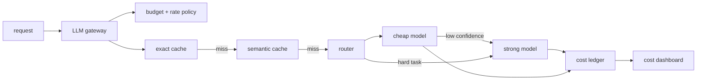

# Cost Architecture (caching, routing, gateway)

> Topic package — Domain 8 · Roadmap Week 22.
> Depth goal: design a cost control plane for LLM applications: measure cost per request, reduce prompt tokens, cache repeated work, route easy tasks to cheaper models, use cascades for confidence, and enforce budgets through a gateway.

## Source
- Track: LLM Engineering (self-directed, FDE roadmap)
- Slide deck: `07 Resources Library/LLM Engineering/Slides/Lesson_47_Cost_Architecture.pptx`
- Hands-on notebook: `07 Resources Library/LLM Engineering/Notebooks/47_Cost_Architecture.ipynb` (runs offline)
- Reference reading: GPTCache; LiteLLM gateway/proxy docs; FrugalGPT: How to Use Large Language Models While Reducing Cost and Improving Performance (Chen et al., arXiv:2305.05176); provider batch API docs; semantic cache and model cascade patterns
- Builds on: [[02 Literature Notes/LLM Engineering/LLM Efficiency]] · [[02 Literature Notes/LLM Engineering/Reasoning Models]]
- Date: 2026-07-18

---

## 1. Mental Model

**LLM cost architecture is yield management: spend strong-model dollars only where they change the outcome.** The bill is not one thing; it is prompt tokens, output tokens, retries, tool calls, embedding calls, evaluation calls, latency-driven overprovisioning, and wasted duplicate work. Cost control is therefore an architecture layer, not a last-minute prompt tweak.

A mature system has a **gateway** that meters usage, enforces budgets, caches exact and semantic repeats, routes by task difficulty, falls back across providers, and records cost per tenant/use case. The cheapest request is one you do not send; the next cheapest is one answered by a small model; the most expensive is a repeated long-context prompt sent to a frontier model because nobody measured it.

> Key intuition: **buy intelligence incrementally.** Cache what repeats, compress what bloats, route what is easy, escalate only when confidence demands it.



---

## 2. How It Actually Works

### 8.1 Meter before optimizing
You cannot optimize a blended monthly bill. Instrument cost per request, tenant, feature, model, prompt version, and route. Include input tokens, output tokens, embeddings, retries, eval calls, and cache misses. Cost dashboards should show p50/p95 cost per request and top cost drivers, not just total spend.

### 8.2 Cache exact and semantic repeats
Exact caches catch identical prompt/template/input combinations. Semantic caches catch paraphrases by embedding the normalized request and retrieving prior answers above a similarity threshold. Exact cache is safer; semantic cache needs TTLs, invalidation by corpus/version, answer provenance, and thresholds to avoid returning stale or wrong answers.

### 8.3 Route by difficulty and value
Model routing sends simple extraction, classification, rewriting, and FAQ tasks to cheap models while reserving strong models for hard reasoning or high-value cases. Routes can be rule-based, classifier-based, confidence-gated, or cascade-based. FrugalGPT-style cascades ask cheaper models first and escalate only when confidence or validation fails.

### 8.4 Reduce tokens deliberately
Prompt-token reduction is architecture work: retrieve fewer/better chunks, summarize conversation state, trim few-shot examples, compress schemas, use smaller context windows, and avoid repeating static instructions. Output-token budgets matter too: ask for concise structured output when downstream code does not need prose.

### 8.5 Centralize policy in a gateway
An LLM gateway (LiteLLM-style) gives one place for provider keys, routing, budgets, retries, fallbacks, logging, model aliases, and per-tenant limits. This avoids every application team reinventing cost controls and creates a single ledger for finance and reliability.

---

## 3. Implementation

Assumed stack: stdlib + numpy — deterministic exact+semantic cache, token/cost ledger, router, and confidence cascade. Snippets:
- [[04 Code Snippets/LLM/Exact and Semantic LLM Cache]]
- [[04 Code Snippets/LLM/Confidence Gated Model Cascade]]

### Exact and Semantic LLM Cache
Combine normalized exact lookup with cosine similarity over toy embeddings.
```python
import numpy as np, re

def norm(text): return re.sub(r"\s+", " ", text.lower()).strip()
def embed(text):
    v = np.zeros(8)
    for ch in norm(text): v[ord(ch) % len(v)] += 1
    return v / (np.linalg.norm(v) + 1e-9)
def cosine(a,b): return float(np.dot(a,b) / ((np.linalg.norm(a)*np.linalg.norm(b)) + 1e-9))

class LLMCache:
    def __init__(self): self.exact, self.semantic = {}, []
    def put(self, prompt, answer):
        self.exact[norm(prompt)] = answer
        self.semantic.append((embed(prompt), answer, prompt))
    def get(self, prompt, threshold=.92):
        key = norm(prompt)
        if key in self.exact: return "exact", self.exact[key]
        scored = [(cosine(embed(prompt), v), ans) for v, ans, _ in self.semantic]
        if scored and max(scored)[0] >= threshold: return "semantic", max(scored)[1]
        return "miss", None

c = LLMCache(); c.put("How do I reset my password?", "Use the reset link.")
print(c.get("how do i reset my password"))
```

### Confidence Gated Model Cascade
Try a cheap model first and escalate to a strong model only when confidence is low.
```python
def cheap_model(task):
    easy = any(w in task.lower() for w in ["classify", "summarize", "extract"])
    return {"model": "cheap", "answer": "draft answer", "confidence": 0.82 if easy else 0.41, "cost": 0.001}

def strong_model(task):
    return {"model": "strong", "answer": "higher confidence answer", "confidence": 0.93, "cost": 0.02}

def cascade(task, threshold=0.75):
    first = cheap_model(task)
    if first["confidence"] >= threshold:
        return first | {"route": "cheap_only"}
    second = strong_model(task)
    second["cost"] += first["cost"]
    return second | {"route": "escalated"}

for task in ["classify ticket sentiment", "solve a multi-step legal reasoning problem"]:
    print(task, "->", cascade(task))
```

---

## 4. Design Decisions & Tradeoffs

| Decision | Guidance |
|---|---|
| **Cache threshold** | Exact cache is safe; semantic cache needs high thresholds, TTLs, and invalidation by corpus/prompt version. |
| **Routing signal** | Start with rules + validation; graduate to learned routers when traffic volume justifies it. |
| **Cascade gate** | Escalate on low confidence, parser failure, policy risk, high user value, or eval-critical intents. |
| **Budget scope** | Enforce budgets by tenant, feature, environment, and model alias, not only global account spend. |
| **Token reduction** | Reduce retrieved chunks and repeated instructions before shrinking useful reasoning context. |
| **Gateway ownership** | Centralize keys, logging, policies, fallbacks, and cost ledger in one LLM gateway. |

---

## 5. Failure Modes & Gotchas

- Optimizing without per-request cost attribution → arguments over anecdotes instead of drivers.
- Semantic cache with loose thresholds → confidently returns the wrong cached answer.
- Caching without prompt/corpus/version keys → stale answers survive data or instruction changes.
- Routing everything to the cheapest model → hidden quality regressions and user escalations.
- Routing everything to the strongest model → margin disappears on easy traffic.
- No gateway → duplicated keys, inconsistent retries, no central budget enforcement.

---

## 6. FDE Angle

- Cost architecture is a client-facing business lever: same product quality at lower gross margin burn.
- A strong FDE can show a before/after cost waterfall: cache hits, routing, token reduction, batch APIs.
- Budget enforcement belongs in architecture, not spreadsheets after the invoice arrives.
- Deliverable: a gateway design with cache policy, router/cascade, model aliases, budget ledger, and eval guardrails.

---

## 7. Self-Check

1. What must be measured before cost optimization is credible?
2. When is semantic caching unsafe, and how do TTL/version keys help?
3. What signals should trigger escalation from cheap to strong models?
4. How does a gateway reduce both cost and operational risk?
5. Name three ways to reduce prompt tokens without harming answer quality.
6. How does FrugalGPT-style cascading differ from static model selection?

---

## 9. Interview Q&A

**Q: What must be measured before cost optimization efforts are actually credible?**
A: Cost per request, broken down by the dimensions that actually matter — by tenant, by feature, by specific model, by prompt version, by route taken (cheap model versus escalated to a strong model) — not just one single, blended total monthly bill number. A single aggregate spend figure tells you that you're spending a certain amount, but nothing about *where* that spend is actually concentrated or *why*.

Here's why this granularity is the necessary starting point, not an optional nice-to-have: without it, any proposed optimization is really just a guess about where the cost is coming from, rather than something backed by actual evidence. "I think caching would save us money" is a hypothesis; "40% of our cost comes from duplicate, cacheable requests in this specific feature" is something you can actually act on with confidence, verify after the fact, and defend with real numbers rather than an anecdote. Per-request cost attribution, including input tokens, output tokens, embedding calls, retries, and eval calls (since all of these contribute real cost, not just the obvious "one model call" line item), is what turns a cost conversation from "arguments over anecdotes" into a conversation grounded in actual, specific cost drivers you can verify and target directly.

*One-liner: cost per request needs to be measured broken down by tenant, feature, model, prompt version, and route — not as one blended total — since without this granularity, any proposed optimization is just a guess about where spend actually comes from, rather than something you can target, verify, and defend with real evidence instead of anecdote.*

**Q: When is semantic caching specifically unsafe, and how do TTLs and version keys address that risk?**
A: Semantic caching works by treating a new request as a "hit" if it's similar enough (by embedding similarity) to some previously-answered request, even if the wording isn't identical — this is powerful because it catches paraphrases an exact-match cache would miss entirely, but it's risky for exactly the same reason: "similar enough by embedding similarity" is not the same guarantee as "actually asking for the identical thing," and a loose similarity threshold can confidently return a cached answer to a genuinely different question that merely happened to embed closely to a previously-cached one.

The specific unsafe scenario: two questions that are subtly different in a way that actually matters (different specific numbers, different time periods, different entities) but that happen to be semantically close enough in embedding space to clear a loosely-set similarity threshold — the cache returns the old, now-wrong answer confidently, with no visible signal to the user or the system that anything went wrong, since the cache mechanism itself has no way to know its threshold was too loose for this particular case.

TTLs (time-to-live, an expiration time on cached entries) address part of this risk — specifically the risk that an answer was correct *when it was cached* but has since gone stale (the underlying facts changed), ensuring a cached answer doesn't get served indefinitely long after it may have stopped being accurate. Version keys address a different, related risk: if the underlying corpus, prompt, or model has changed since an answer was cached, tagging cache entries with the specific version of these things that produced them, and invalidating entries when a tagged version no longer matches current production, ensures a cache entry generated under an old prompt/corpus/model combination doesn't get served under a new, different combination it was never actually validated against.

*One-liner: semantic caching is unsafe when a loose similarity threshold returns a cached answer to a question that's subtly but importantly different from the originally-cached one, confidently and with no visible warning sign — TTLs guard against an answer going stale over time, while version keys (tagging cache entries to the specific prompt/corpus/model version that produced them) guard against serving an old answer under a now-different production configuration it was never actually validated against.*

**Q: What signals should specifically trigger escalation from a cheap model to a strong model in a cascade?**
A: Several distinct signals, each catching a different kind of situation where the cheap model's answer shouldn't be trusted as final, even though using the cheap model by default is the whole point of the cascade's cost savings.

Low confidence from the cheap model itself (the same signal covered in Distillation and Small Models' escalation-routing discussion) — if the cheap model's own output comes with a low confidence score for this specific request, that's a direct signal this particular case may be beyond what the cheap model reliably handles well, even if it performs fine on average. Parser or validation failure — if the cheap model's output fails to parse into the expected structured format, or fails an explicit validation check (as covered in Structured Generation), that's concrete evidence something went wrong, regardless of what confidence score the model itself reported. Policy risk — a request touching a sensitive or high-stakes topic may warrant escalation to the more capable model regardless of the cheap model's confidence, as a matter of policy rather than a measured signal, since the cost of a wrong answer in this category is disproportionately high. High user value — some requests (a high-value customer, a critical business workflow) may be worth escalating to the strong model by default, since the cost of the strong model is small relative to the value of getting this specific interaction right. Eval-critical intents — specific task types that your own evaluation data has shown the cheap model performs poorly on, even if its confidence score doesn't always reflect this known weakness, can be routed to escalation by rule, based on this prior evidence rather than relying solely on the cheap model's own real-time self-assessment.

*One-liner: escalate on low confidence from the cheap model itself, parser/validation failure (concrete evidence of a problem regardless of reported confidence), policy risk (high-stakes topics warranting the stronger model by default), high user value (where the strong model's extra cost is justified by the interaction's importance), and eval-critical intents your own data has shown the cheap model handles poorly — each catches a different reason the cheap model's answer shouldn't be trusted as final.*

**Q: How does a centralized LLM gateway reduce both cost and operational risk at the same time, rather than just being administrative convenience?**
A: Without a gateway, cost controls and operational safeguards (rate limiting, retries, fallback logic, budget enforcement, usage logging) tend to get reinvented independently, inconsistently, by every individual application team that calls an LLM provider directly — some teams might implement careful budget limits and good retry logic, others might not, and there's no single, consistent place where policy is actually enforced across the whole organization.

Centralizing this in a gateway means provider API keys, routing logic, budget limits, retry/fallback behavior, and usage logging all live in one place, enforced consistently for every single call that passes through it, regardless of which application team is making the call. This directly reduces cost risk because budget enforcement becomes a real, structural guarantee (a request genuinely can't exceed a defined budget, rather than relying on every team remembering to implement this themselves) and because cost visibility becomes unified (one ledger showing exactly where spend is going, across every team and feature, rather than scattered, inconsistent logging each team happened to set up on their own). It also directly reduces operational risk: consistent retry and fallback behavior (if one provider is down, failing over to another) is implemented once, correctly, rather than inconsistently across many separate implementations, some of which might handle a provider outage poorly or not at all.

*One-liner: a gateway centralizes provider keys, routing, budgets, retries/fallbacks, and usage logging in one place, enforced consistently for every call — rather than each application team independently (and inconsistently) reinventing these controls — which directly reduces cost risk (budget enforcement becomes a real structural guarantee, not something each team has to remember) and operational risk (consistent, correctly-implemented retry/fallback behavior, rather than scattered implementations of varying quality).*

**Q: Name three ways to reduce prompt tokens without harming answer quality, and explain why each one specifically avoids cutting something that matters.**
A: First: retrieve fewer, better-ranked chunks rather than a larger number of loosely-relevant ones (covered in Advanced Retrieval and Context Engineering) — this specifically avoids harming quality because the goal isn't just "use fewer tokens," it's "use only the tokens that actually carry genuine signal," and a well-tuned retrieval/reranking pipeline is specifically designed to keep the high-value evidence while cutting the padding, rather than cutting evidence indiscriminately.

Second: summarize or compress older conversation history rather than keeping the full raw transcript of a long conversation (covered in Context Engineering) — this specifically avoids harming quality because older conversational turns typically carry much less marginal value to the *current* question than the most recent exchanges do; summarizing captures the gist of what's needed for continuity while dropping the verbatim detail of exchanges that are no longer directly relevant to resolving the current turn.

Third: trim repeated, static instructions and bloated few-shot examples rather than resending the full, verbose system instructions and every example on every single call — this specifically avoids harming quality because static instructions and examples are, by definition, the same content repeated on every call; reducing verbosity here (tighter wording, fewer but better-chosen examples) doesn't remove any information the model hasn't already effectively "seen" many times before in a session, unlike cutting genuinely novel, query-specific content.

Each of these targets *redundant or lower-marginal-value* tokens specifically — padding, repetition, lower-relevance content — rather than cutting genuinely novel, high-signal content the model actually needs to answer well, which is exactly why they reduce token count without a corresponding quality cost.

*One-liner: retrieve fewer but better-ranked chunks (cutting low-relevance padding, not genuine evidence), summarize older conversation history (dropping verbatim detail from lower-marginal-value past turns, not current context), and trim repeated static instructions/bloated few-shot examples (reducing redundant repetition, not novel information) — each targets redundant or lower-value tokens specifically, which is why they cut token count without cutting the signal that actually drives answer quality.*

**Q: How does FrugalGPT-style cascading differ from simply picking one fixed model (static model selection) for all your traffic?**
A: Static model selection means choosing one single model up front and sending *all* your traffic to it, regardless of how easy or hard any individual request actually is — if you chose the strong, expensive model, you're paying its full cost even for trivially easy requests that a much cheaper model could have handled just as well; if you chose the cheap model to save cost, you're risking poor quality on the genuinely hard requests that actually need the stronger model's real capability.

Cascading avoids this all-or-nothing tradeoff by trying the cheap model *first*, on every request, and only escalating to the strong model specifically when the cheap model's result shows a reason not to trust it (the escalation signals covered above — low confidence, validation failure, policy risk, and so on). This means easy requests (likely the large majority of real traffic) get handled cheaply and quickly by the cheap model, while only the genuinely harder or riskier subset of requests actually incur the strong model's higher cost — rather than either paying the strong model's cost for everything, or accepting the cheap model's lower ceiling for everything.

The practical result: cascading can achieve quality close to what the strong model alone would provide, while paying something much closer to the cheap model's cost on average — because most requests never actually need to escalate — which is a meaningfully better cost/quality tradeoff point than either static extreme (all-cheap or all-strong) can offer on its own.

*One-liner: static model selection sends all traffic to one fixed model regardless of difficulty, either overpaying for easy requests or under-serving hard ones; cascading tries the cheap model first on every request and only escalates to the strong model when a specific signal (low confidence, validation failure, policy risk) indicates it shouldn't be trusted — achieving quality close to the strong model alone while paying closer to the cheap model's average cost, since most requests never need to escalate.*

## 8. Links
- Domain MOC: [[06 Maps of Content/LLM Engineering Concepts]]
- Code: [[04 Code Snippets/LLM/Exact and Semantic LLM Cache]], [[04 Code Snippets/LLM/Confidence Gated Model Cascade]]
- Distilled: [[03 Permanent Notes/Spend Strong Model Dollars Only Where They Change Outcomes]], [[03 Permanent Notes/The LLM Gateway Is the Cost Control Plane]]
- Upstream: [[02 Literature Notes/LLM Engineering/Inference and Serving]] · Downstream: [[02 Literature Notes/LLM Engineering/Reliability Patterns]]
