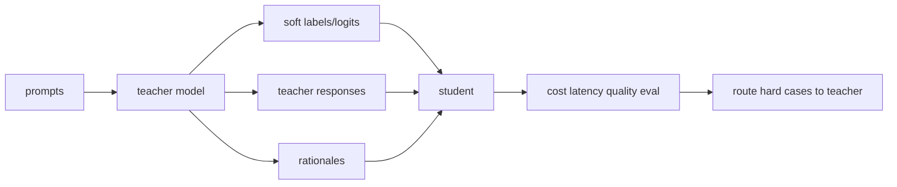

# Distillation & Small-Model Strategies

> Topic package — Domain 7 · Roadmap Week 18.
> Depth goal: implement distillation KL, compare logit/rationale/sequence distillation, and decide when a small model is enough.

## Source
- Track: LLM Engineering (self-directed, FDE roadmap)
- Slide deck: `07 Resources Library/LLM Engineering/Slides/Lesson_42_Distillation_and_Small_Models.pptx`
- Hands-on notebook: `07 Resources Library/LLM Engineering/Notebooks/42_Distillation_and_Small_Models.ipynb` (runs offline)
- Reference reading: Hinton et al. Distilling the Knowledge in a Neural Network (arXiv:1503.02531); Hsieh et al. Distilling Step-by-Step (arXiv:2305.02301); sequence-level knowledge distillation; small language model deployment literature
- Builds on: [[02 Literature Notes/LLM Engineering/Supervised Fine-Tuning]] · [[02 Literature Notes/LLM Engineering/Evaluating LLMs]]
- Date: 2026-07-18

---

## 1. Mental Model

**Distillation is apprenticeship: a small student learns the teacher’s behavior, not just the ground-truth labels.** Teacher probabilities, rationales, or generated sequences provide a richer training signal than one-hot answers.

The product reason is economics: if a smaller model reaches acceptable quality for a narrow workload, it can slash latency and cost.

> Key intuition: **use the big model to manufacture capability, then serve the small model when it is good enough.**



---

## 2. How It Actually Works

### 7.1 Knowledge distillation
A student model learns from a larger teacher through soft targets, logits, rationales, or generated responses. Soft distributions carry information about alternatives, not only the argmax label.

### 7.2 KL objective
Logit distillation often minimizes KL divergence between teacher and student distributions, sometimes with temperature `T` to soften probabilities: `KL(p_teacher^T || p_student^T)`.

### 7.3 Sequence-level distillation
For generative tasks, the teacher produces full target sequences that become SFT data for the student. This is simpler than logit access and works with API teachers.

### 7.4 Distilling step-by-step
Rationales or intermediate explanations can supervise smaller models on reasoning traces, improving sample efficiency when traces are correct and safe to expose.

### 7.5 Small-model strategies
Small models win when latency, cost, privacy, offline deployment, or high-throughput narrow tasks matter. Use routing: small model by default, large model on uncertainty or hard cases.

---

## 3. Implementation

Assumed stack: numpy. Snippets implement KL distillation and a small-model routing policy.
- [[04 Code Snippets/LLM/Distillation KL Between Toy Distributions]]
- [[04 Code Snippets/LLM/Small Model Escalation Router]]

### Distillation KL Between Toy Distributions
Minimize KL from teacher probabilities to student probabilities.
```python
import numpy as np
def softmax(z,T=1):
    z=np.array(z)/T; e=np.exp(z-z.max()); return e/e.sum()
teacher=softmax([4,2,0],T=2); student=softmax([2,1,1],T=2)
kl=float(np.sum(teacher*(np.log(teacher)-np.log(student))))
print(round(kl,4))
```

### Small Model Escalation Router
Route uncertain small-model predictions to a larger teacher.
```python
def route(confidence, risk):
    if risk=="high" or confidence < .72: return "teacher"
    return "student"
for c,r in [(0.9,"low"),(0.6,"low"),(0.8,"high")]: print(c,r,route(c,r))
```

---

## 4. Design Decisions & Tradeoffs

| Decision | Guidance |
|---|---|
| **Teacher signal** | Use logits when available; use sequence outputs when using API teachers. |
| **Temperature** | Higher T reveals dark knowledge among non-argmax classes. |
| **Rationales** | Use only if correct, licensed, and safe to train/serve. |
| **Student size** | Match size to latency and accuracy target. |
| **Routing** | Escalate uncertain or high-risk cases to larger models. |
| **Evaluation** | Measure accuracy per dollar and latency, not accuracy alone. |

---

## 5. Failure Modes & Gotchas

- Student copies teacher hallucinations.
- Synthetic teacher data contaminates evals.
- Over-compressed student fails edge cases.
- Rationales leak hidden or unsafe reasoning.
- Only measuring accuracy ignores latency/cost wins.
- No uncertainty routing forces small model beyond its competence.

---

## 6. FDE Angle

- Distillation turns expensive capability into cheaper repeatable inference.
- Small models can be the correct product even when less capable globally.
- The deliverable is a teacher-data recipe plus student eval and routing thresholds.
- Cost and latency are first-class ML metrics.

---

## 7. Self-Check

1. What information do soft labels contain?
2. Write KL distillation objective.
3. When use sequence-level distillation?
4. Why might rationales help or hurt?
5. When is a small model sufficient?
6. What should trigger escalation?

---

## 9. Interview Q&A

**Q: What information do soft labels (teacher probability distributions) contain that a plain one-hot correct answer doesn't?**
A: A one-hot label only tells the student "the correct answer is X" — full certainty on one answer, zero information about anything else. A teacher's full probability distribution tells you something richer: not just what the top answer was, but how confident the teacher was in that answer relative to the alternatives it considered, and specifically which of the *wrong* answers the teacher considered more plausible than others.

This extra information — often called "dark knowledge" — is genuinely useful signal for the student to learn from. If a teacher, when classifying an image, puts 85% probability on "cat" but also assigns meaningfully more probability to "dog" than to "car," that's telling the student something real about which mistakes are more understandable or "close" versus which are wildly off-base — information a plain one-hot label ("the answer is cat") simply doesn't carry at all. Training the student to match this full distribution (not just the single correct answer) teaches it something about the relative structure of the problem — which alternatives are genuinely similar or confusable — rather than just memorizing isolated correct answers with no sense of their relationship to nearby, plausible alternatives.

*One-liner: a one-hot label only says "the answer is X," while a teacher's full probability distribution also reveals how confident it was relative to alternatives and which wrong answers it considered more plausible than others — this "dark knowledge" about the relative structure of plausible mistakes is genuinely useful training signal a one-hot label simply can't carry.*

**Q: Write the KL distillation objective and explain what the temperature parameter actually does to it.**
A: The objective minimizes `KL(p_teacher^T || p_student^T)` — the KL divergence between the teacher's probability distribution and the student's, both computed at some temperature `T`. KL divergence here measures how different the student's distribution is from the teacher's; minimizing it means training the student to produce a distribution that matches the teacher's as closely as possible, not just to get the single top answer right.

Temperature's role, as covered in Decoding and Sampling, is to reshape how peaked or flat a distribution is — dividing logits by a temperature before the softmax. At the normal, unmodified distribution (temperature 1), a confident teacher's probability mass is often very concentrated on the top answer, with the "dark knowledge" about relative ranking among the non-top answers compressed into tiny, hard-to-distinguish probability values. Raising the temperature specifically flattens the distribution, which has the effect of making those small differences among the non-top answers more visible and distinguishable — the useful signal about which wrong answers were "closer" to correct becomes easier for the student to actually learn from, rather than being buried in probabilities so small they're nearly indistinguishable from each other.

So temperature here isn't being used for its usual decoding-time purpose (controlling randomness in generation) — it's being used specifically as a tool to make the teacher's dark knowledge more learnable during distillation, by stretching out the probability differences among the less-likely answers that would otherwise be nearly invisible at the normal, unscaled distribution.

*One-liner: the objective minimizes KL divergence between the teacher's and student's distributions, training the student to match the teacher's full probability spread, not just its top answer — temperature flattens both distributions before this comparison, specifically making the small, otherwise hard-to-distinguish probability differences among non-top answers (the dark knowledge) more visible and learnable for the student.*

**Q: When would you use sequence-level distillation instead of logit-based distillation?**
A: Logit-based distillation requires direct access to the teacher's actual probability distribution over possible outputs at each step — which means you need genuine internal access to the teacher model, not just its final generated text. This works well when you're distilling from a model you actually control or can run with full access, but it's simply not possible with many real teacher models, specifically commercial API-based models (like calling a large frontier model through its API) that only return generated text, never raw logits or probability distributions.

Sequence-level distillation sidesteps this requirement entirely: instead of needing the teacher's internal probability distribution, you just have the teacher generate full, complete output sequences for a set of prompts, and use those generated sequences as training data for a standard supervised fine-tuning process on the student — training the student to imitate these teacher-generated examples the same way you'd train on any other labeled demonstration data (covered in Supervised Fine-Tuning). This is simpler to implement and critically, it works with *any* teacher you can call, including API-only models where you genuinely have no access to internal logits at all.

So the deciding factor: if you have real internal access to the teacher's logits (you're running the teacher model yourself, not just calling an external API), logit distillation can capture richer information (the full dark-knowledge distribution, as above). If your teacher is an API-only model where you only ever see its generated text output, sequence-level distillation is the only option actually available to you, and it's also simply easier to set up even when logit access would technically be possible.

*One-liner: logit-based distillation needs direct access to the teacher's internal probability distributions, which isn't available for API-only teacher models; sequence-level distillation only needs the teacher's generated text output, making it the only viable option for API-based teachers (and simpler to set up generally) at the cost of losing the richer dark-knowledge signal full logit access would provide.*

**Q: Why might distilling rationales (intermediate reasoning explanations) help the student, but also carry a specific risk?**
A: The help: a rationale gives the student not just the final correct answer, but the intermediate reasoning steps that actually led to it — similar to the benefit of chain-of-thought (covered in Reasoning Prompt Patterns), teaching the student *how* to arrive at an answer, not just *what* the answer is. This can genuinely improve how efficiently the student learns from a limited amount of training data, since it's getting a richer training signal (the reasoning process) rather than just a bare final answer with no visibility into how it was derived.

The specific risk: this benefit only holds if the rationale is actually correct and genuinely reflects sound reasoning — if the teacher's rationale is flawed, superficially plausible but actually wrong, or even just an unfaithful post-hoc rationalization (the same faithfulness caveat covered in Reasoning Prompt Patterns' CoT discussion) rather than real reasoning that produced the answer, then training the student on this flawed rationale teaches it to imitate a *bad reasoning pattern*, not just occasionally get an answer wrong. This is a more insidious problem than a simple wrong final answer, since the student is specifically being trained to reproduce an entire flawed reasoning process as if it were a model to imitate, which can actively teach it a systematically bad approach rather than just an isolated factual mistake.

There's also a separate, practical safety/licensing concern worth noting: exposing a teacher's internal rationale to train and potentially serve in a student model needs to be checked for whether that rationale might contain anything unsafe to expose, or anything subject to licensing restrictions the teacher provider might impose on using its outputs this way.

*One-liner: distilling rationales can help the student learn more efficiently from how an answer was derived, not just what it was, similar to chain-of-thought's benefit — but this only helps if the rationale is actually correct and faithful, since training on a flawed or unfaithful rationale teaches the student to imitate a bad reasoning pattern wholesale, a more insidious failure than just an occasional wrong answer, and exposing a teacher's rationale also needs checking for safety and licensing concerns.*

**Q: What specific signals suggest a small (distilled or otherwise compact) model is actually sufficient for a given task?**
A: The deciding factors are about the shape of the actual task and the real product constraints, not about small models being universally "good enough" or "not good enough" in the abstract — it's specifically about whether this particular task's needs line up with what a smaller model can reliably provide.

A narrow, well-bounded task (a specific, limited classification task, a specific narrow extraction task) is a good fit — small models tend to do well on tasks with a bounded, well-defined scope, even if that same small model would struggle on open-ended, broad general-purpose tasks a larger model handles more gracefully. Real product constraints pointing toward a small model: latency requirements that a larger model genuinely can't meet, cost constraints at the volume you're actually operating at (serving a large model at very high request volume can be genuinely expensive in a way a small model wouldn't be), privacy or offline-deployment requirements where you specifically need something that can run locally without calling out to an external large-model API, and high-throughput scenarios where you're processing enormous volumes of a narrow, repetitive task type.

The practical way to actually verify "is a small model sufficient" rather than just assuming it based on these signals: measure it directly — run the small model's actual eval results (accuracy, faithfulness, whatever matters for this task) against your real task-relevant golden eval set (as covered in Eval Fundamentals), and specifically track accuracy *per dollar* and *per unit latency*, not accuracy in isolation — since the whole point of considering a small model is the cost/latency tradeoff, and that tradeoff needs to actually be measured, not assumed.

*One-liner: a small model is a good fit for narrow, well-bounded tasks, and particularly when real constraints (latency, cost at your actual volume, privacy/offline requirements, high-throughput narrow workloads) favor it — verified concretely by measuring the small model's accuracy per dollar and per unit latency against your own task-relevant eval, not just accuracy in isolation, since the whole point is the cost/latency tradeoff, which needs to be actually measured rather than assumed.*

**Q: What should trigger escalating a request from a small model to a larger teacher model, in a routing setup?**
A: Two distinct signals should each independently trigger escalation, since they represent two genuinely different reasons a small model might not be trustworthy enough for a specific request, even if it generally performs well overall.

Low confidence: if the small model's own output for this specific request comes with a low confidence score (however that's measured for the specific task — a low top-probability for a classification task, for instance), that's a direct signal this particular request is one the small model itself is unsure about, even if it generally performs well on similar-looking requests on average. Escalating specifically on low confidence lets you keep the cheap, fast small model as the default for the bulk of requests where it's actually confident, while routing the genuinely harder, more uncertain cases to the more capable (but more expensive) larger model.

High risk/stakes: independent of the small model's own confidence, some requests are simply high-stakes enough (based on their category or content, not based on how confident the small model happens to feel about them) that you want the more capable model handling them regardless — a request involving a safety-sensitive topic, or an action with real financial or legal consequence, might warrant escalation to the larger model even if the small model happened to produce a confident-looking answer, specifically because the cost of a wrong answer in this category is high enough to justify the extra expense of routing to the more capable model as a matter of policy, not just based on uncertainty.

*One-liner: escalate when the small model's own confidence for a specific request is low (it's genuinely unsure, even if it performs well on average) and independently escalate based on a request's inherent risk/stakes category (safety-sensitive or high-consequence requests warrant the more capable model regardless of how confident the small model happens to seem) — these are two separate signals, each worth checking independently.*

## 8. Links
- Domain MOC: [[06 Maps of Content/LLM Engineering Concepts]]
- Code: [[04 Code Snippets/LLM/Distillation KL Between Toy Distributions]], [[04 Code Snippets/LLM/Small Model Escalation Router]]
- Distilled: [[03 Permanent Notes/Distillation Converts Expensive Capability Into Cheap Inference]], [[03 Permanent Notes/Small Models Win When the Task Boundary Is Narrow]]
- Upstream: [[02 Literature Notes/LLM Engineering/Preference Optimization]] · Downstream: [[02 Literature Notes/LLM Engineering/Embedding Model Fine-Tuning]]
