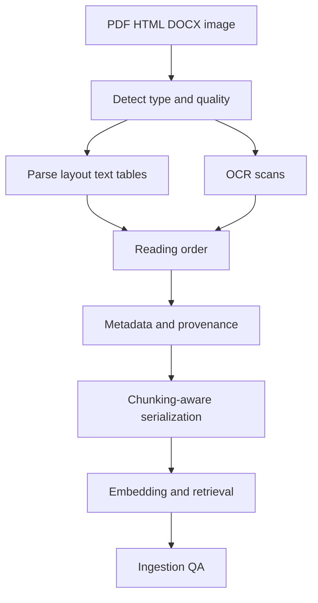

# Document Ingestion & Parsing (PDF/table/OCR)

> Topic package — Domain 10 · Roadmap Weeks 13/20.
> Depth goal: design chunking-aware ingestion pipelines that preserve reading order, layout, tables, OCR confidence, metadata, and provenance so RAG quality is limited by knowledge rather than parsing noise.

## Source
- Track: LLM Engineering (self-directed, FDE roadmap)
- Slide deck: `07 Resources Library/LLM Engineering/Slides/Lesson_51_Document_Ingestion_and_Parsing.pptx`
- Hands-on notebook: `07 Resources Library/LLM Engineering/Notebooks/51_Document_Ingestion_and_Parsing.ipynb` (runs offline)
- Reference reading: unstructured.io documentation; LlamaParse; IBM Docling; Nougat OCR (arXiv:2308.13418); PDF extraction and OCR best practices; table extraction literature
- Builds on: [[02 Literature Notes/LLM Engineering/Chunking Strategies]]
- Date: 2026-07-18

---

## 1. Mental Model

**RAG quality is capped by ingestion quality: if the parser destroys structure, retrieval cannot recover it.** Documents are not plain text; PDFs encode positioned glyphs, HTML encodes hierarchy, DOCX encodes styles, tables encode two-dimensional relationships, and scans require OCR with uncertainty.

The ingestion job is to preserve enough structure for retrieval and grounding: reading order, section hierarchy, table cells, captions, page numbers, metadata, and provenance. Good parsing makes chunks meaningful; bad parsing produces shuffled paragraphs, broken tables, and hallucination-prone context.

> Key intuition: **parse for the downstream chunker and retriever, not for a human-looking text dump.**



---

## 2. How It Actually Works

### 10.1 File-type strategy
PDF, HTML, DOCX, scans, slides, and spreadsheets need different parsers. HTML carries DOM hierarchy; DOCX carries headings/styles; PDFs often only carry coordinates; scanned PDFs need OCR. A production pipeline detects file type, page count, scan ratio, encryption, language, and layout complexity before choosing a parser.

### 10.2 Layout and reading order
PDF extraction often returns text boxes out of human reading order, especially with columns, headers, footers, captions, and sidebars. Reconstruct order using coordinates, page regions, line grouping, and section cues. Reading order errors poison chunks because unrelated text gets embedded together.

### 10.3 Tables and figures
Tables should not be flattened into random text. Preserve rows, columns, headers, units, captions, and page provenance. Common serializations are Markdown tables for LLM readability and JSON/CSV for precise downstream processing. Figures may need captions, OCR, or multimodal embeddings.

### 10.4 OCR and confidence
OCR adds uncertainty: character errors, reading-order mistakes, low-confidence spans, and language/script issues. Store confidence, bounding boxes, page images, and normalization decisions. For critical workflows, route low-confidence pages to human review or higher-quality OCR.

### 10.5 Chunking-aware parsing
Parsing and chunking are coupled. Preserve headings with paragraphs, keep table rows together, avoid splitting definitions from values, attach metadata (doc id, page, section, table id), and evaluate retrieval on answerable questions. Tools such as unstructured.io, LlamaParse, and Docling help, but quality gates still matter.

---

## 3. Implementation

Assumed stack: stdlib. Snippets simulate layout reading-order reconstruction and table serialization. Snippets:
- [[04 Code Snippets/LLM/Layout Reading Order Reconstructor]]
- [[04 Code Snippets/LLM/Table Structure to Markdown]]

### Layout Reading Order Reconstructor
Sort toy layout boxes into human reading order using row grouping and coordinates.
```python
def reading_order(boxes, y_tol=8):
    rows = []
    for b in sorted(boxes, key=lambda x: (x["y0"], x["x0"])):
        placed = False
        for row in rows:
            if abs(row[0]["y0"] - b["y0"]) <= y_tol:
                row.append(b); placed = True; break
        if not placed:
            rows.append([b])
    ordered = []
    for row in rows:
        ordered.extend(sorted(row, key=lambda x: x["x0"]))
    return ordered

boxes = [
    {"text":"Total", "x0":320, "y0":200}, {"text":"Invoice", "x0":40, "y0":40},
    {"text":"Acme", "x0":40, "y0":120}, {"text":"$42", "x0":410, "y0":200},
]
print(" | ".join(b["text"] for b in reading_order(boxes)))
```

### Table Structure to Markdown
Reconstruct table cells into a grid and serialize for LLM-readable chunks.
```python
def reconstruct_table(cells):
    max_r = max(c["row"] for c in cells); max_c = max(c["col"] for c in cells)
    grid = [["" for _ in range(max_c + 1)] for _ in range(max_r + 1)]
    for c in cells:
        grid[c["row"]][c["col"]] = c["text"].strip()
    return grid

def table_to_markdown(grid):
    header = "| " + " | ".join(grid[0]) + " |"
    sep = "| " + " | ".join(["---"] * len(grid[0])) + " |"
    rows = ["| " + " | ".join(r) + " |" for r in grid[1:]]
    return "\n".join([header, sep] + rows)

cells = [{"row":0,"col":0,"text":"Item"},{"row":0,"col":1,"text":"Price"},
         {"row":1,"col":0,"text":"Widget"},{"row":1,"col":1,"text":"$10"}]
print(table_to_markdown(reconstruct_table(cells)))
```

---

## 4. Design Decisions & Tradeoffs

| Decision | Guidance |
|---|---|
| **Parser selection** | Choose per file type and layout complexity; do not use one text extractor for everything. |
| **Serialization** | Use Markdown for LLM-readable tables; JSON/CSV when downstream computation needs precision. |
| **OCR routing** | Record confidence and route low-confidence scans for review or better OCR. |
| **Metadata** | Attach source, page, section, bbox/table id, and parser version to chunks. |
| **Quality gates** | Sample pages, measure empty text, table preservation, reading-order errors, and retrieval hit rate. |
| **Cost tradeoff** | Premium parsers cost more but may save far more by reducing bad RAG answers. |

---

## 5. Failure Modes & Gotchas

- Flattening tables into unreadable token soup.
- Ignoring reading order in multi-column PDFs.
- Dropping page numbers and provenance, making citations impossible.
- Treating OCR output as certain text with no confidence metadata.
- Chunking before preserving headings, sections, and table boundaries.
- No ingestion QA set, so parser regressions silently degrade RAG.

---

## 6. FDE Angle

- Many RAG failures sold as model hallucination are actually ingestion failures.
- Ingestion is a client-visible engineering deliverable: parser choice, QA report, and metadata schema.
- Tables and scanned PDFs are where enterprise RAG complexity becomes real.
- Deliverable: ingestion pipeline with quality metrics and chunking-aware serialization.

---

## 7. Self-Check

1. Why is PDF text extraction harder than HTML extraction?
2. How do reading-order errors affect embeddings and retrieval?
3. When would you serialize a table as Markdown vs JSON?
4. What OCR metadata should be retained?
5. How do parsing and chunking depend on each other?

---

## 9. Interview Q&A

**Q: Why is PDF text extraction harder than HTML extraction?**
A: The core difference is what kind of information each format actually encodes about the text. HTML is built around hierarchy — it explicitly marks what's a heading, what's a paragraph, what's a list item, what nests inside what. This structure is baked directly into the format itself, so extracting it is mostly a matter of reading that structure out.

A PDF, by contrast, mostly just encodes where individual pieces of text are positioned on a page — coordinates for a chunk of text, not "this is a heading" or "this follows that paragraph." It's fundamentally a visual layout format, not a structural one. This means a PDF parser often has to *reconstruct* reading order and structure from scratch, purely by analyzing spatial position — figuring out which text box visually comes "before" another, grouping things into columns, telling headers and footers apart from the actual body content, deciding which caption belongs to which figure — none of which the format tells you directly.

This is exactly why PDF extraction commonly produces text in the wrong order for anything beyond a single simple column — a two-column layout, a sidebar, a header repeated on every page — the PDF has no built-in concept of "this is the main reading flow," so a naive extractor can easily interleave unrelated pieces of text that just happen to sit near each other spatially, purely because of how the page was laid out visually, not because they're actually related in content.

*One-liner: HTML encodes explicit structure and hierarchy that a parser can read directly, while PDFs mostly just encode text position on a page — so PDF extraction has to reconstruct reading order and structure from spatial coordinates alone, which is exactly why multi-column layouts, headers, and sidebars commonly get extracted in the wrong order.*

**Q: How do reading-order errors affect embeddings and retrieval, specifically?**
A: Trace this through what embedding actually does: it takes whatever text ends up in a chunk and compresses it into one vector representing its overall meaning. If reading-order reconstruction failed, a chunk can end up containing pieces of text that were never actually related in the original document — say, a sentence from the main body interleaved with an unrelated caption or a sidebar note that happened to sit at a similar vertical position on the page, purely by visual coincidence.

The embedding model has no way to know this happened — it just embeds whatever text it was given, treating it as one coherent passage even though it's actually a jumbled mix of unrelated content. The resulting vector ends up being some incoherent blend representing neither topic well, which means this chunk is now less likely to be retrieved for a query about either of the topics that got accidentally mixed together — it dilutes the same way an overly large, multi-topic chunk dilutes (as covered in Chunking Strategies), except here the dilution comes from a parsing error rather than a deliberate chunking size choice.

And even in the rarer case where this jumbled chunk somehow *does* get retrieved, the generator now has to read confusing, disjointed text as its "evidence" — at best it has to figure out which parts are actually relevant and ignore the rest, at worst it produces a confused or subtly wrong answer by blending unrelated facts together as if they were connected, since nothing in the text itself signals that they weren't.

*One-liner: reading-order errors mix unrelated text into the same chunk, which produces a diluted, incoherent embedding that's less likely to be retrieved for either original topic — and if it does get retrieved anyway, the generator has to work from genuinely jumbled, disjointed evidence, risking a confused or subtly wrong answer.*

**Q: When would you serialize a table as Markdown versus as JSON/CSV?**
A: The deciding factor is what's actually going to consume this table afterward — a language model reading it as context, or code that needs to compute something with the actual values.

Markdown tables are the right choice when the destination is an LLM's context window for a grounded, read-and-answer task. Markdown's table syntax (pipe-separated columns with a header row) is something LLMs have seen an enormous amount of during training, so they're quite good at reading and reasoning over tables in this format — it preserves the row/column structure visually and semantically, in a format the model can parse naturally as part of reading the surrounding prose.

JSON or CSV is the right choice when something downstream needs to actually *compute* with the table's data programmatically — summing a column, looking up a specific cell by row and column key, feeding it into an actual data-processing pipeline. These formats are precise and structured in a way code can reliably parse without ambiguity, but they're a worse fit for throwing directly into an LLM's context as read-and-reason prose, since they're more verbose and less naturally "readable" as part of a flowing explanation.

The overarching principle that matters more than either specific format: tables are genuinely two-dimensional information (row and column relationships both matter), and whatever serialization you choose has to actually preserve that two-dimensional structure — flattening a table into plain, unstructured paragraph text (losing which value belongs to which row and column) is the failure mode to avoid regardless of which specific serialization you end up picking.

*One-liner: use Markdown tables when an LLM will be reading the table as context for a reasoning/answering task (it's a format LLMs parse naturally); use JSON/CSV when downstream code needs to compute with the actual values precisely — either way, the format must preserve the table's real two-dimensional row/column structure, which flattening into plain paragraph text would destroy.*

**Q: What OCR metadata should be retained, beyond just the extracted text?**
A: OCR is fundamentally an uncertain process — it's a model's best guess at what characters appear in an image, and that guess can be wrong, especially on low-quality scans, unusual fonts, or non-standard layouts. If you only keep the final extracted text and discard everything about *how confident* the OCR was in producing it, you lose the ability to tell the difference between text you can trust and text that might be a misread.

At minimum, retain: a confidence score per span of text (how sure was the OCR engine about this specific piece of text, not just the page as a whole), the bounding box coordinates (where on the original page image this text came from, which lets you go back and visually verify a specific span against the source if something looks wrong later), a reference to the original page image itself (so a human can actually check a low-confidence span against the real scan if needed), and any normalization decisions made along the way (did the OCR pipeline correct or adjust anything automatically, and if so, what was the original raw output before that correction).

Why this matters in practice: for any workflow where getting things exactly right actually matters (financial figures, legal text, medical records), you want the ability to automatically flag and route low-confidence spans for human review or a higher-quality OCR pass, rather than treating every character OCR produced as equally certain, true text. Without retained confidence scores, you have no systematic way to even know which parts of your corpus might contain OCR errors in the first place — you're trusting all of it equally, which is exactly the wrong assumption for a process that's inherently uncertain.

*One-liner: retain per-span confidence scores, bounding box locations, a reference to the original page image, and any normalization decisions — without this, you can't distinguish trustworthy OCR text from a likely misread, and you lose the ability to systematically flag low-confidence spans for review in workflows where accuracy genuinely matters.*

**Q: How do parsing and chunking depend on each other?**
A: These aren't two independent steps that happen to run one after another — the quality of parsing directly determines what chunking even has to work with, which means a failure in parsing can't be fixed by a smarter chunking strategy downstream.

Think about what chunking actually needs in order to do its job well: it needs to know where natural boundaries are (paragraph breaks, section headings, table edges) so it can cut text in sensible places rather than mid-sentence or mid-table-row; it needs headings and their associated content to stay recognizably connected, so a chunker can attach the right section label as metadata; it needs tables to arrive already reconstructed as coherent two-dimensional structures, not already-flattened, scrambled text, since chunking can't un-flatten a table that parsing already destroyed.

If parsing already discarded this structure — flattened a table into disconnected prose, lost which heading a paragraph belonged to, produced text in the wrong reading order — chunking has no way to recover any of it. A chunker operating on already-degraded input can only make decisions based on what structure survived parsing; it can't reconstruct headings, table boundaries, or correct reading order that parsing already lost. This is exactly why these two steps need to be designed together, with parsing specifically aware of what the downstream chunker will need, rather than parsing optimized only for "looks readable to a human" and chunking bolted on afterward as a separate, disconnected step.

*One-liner: chunking can only work with whatever structure parsing preserved — if parsing already flattened tables, lost heading associations, or scrambled reading order, chunking has no way to recover any of that afterward, which is why parsing needs to be designed specifically with the downstream chunker's needs in mind, not just to "look readable."*

## 8. Links
- Domain MOC: [[06 Maps of Content/LLM Engineering Concepts]]
- Code: [[04 Code Snippets/LLM/Layout Reading Order Reconstructor]], [[04 Code Snippets/LLM/Table Structure to Markdown]]
- Distilled: [[03 Permanent Notes/RAG Quality Is Capped by Ingestion Quality]], [[03 Permanent Notes/Tables Are Two Dimensional Evidence Not Paragraphs]]
- Upstream: [[02 Literature Notes/LLM Engineering/Chunking Strategies]] · Downstream: [[02 Literature Notes/LLM Engineering/Multimodal AI]]
