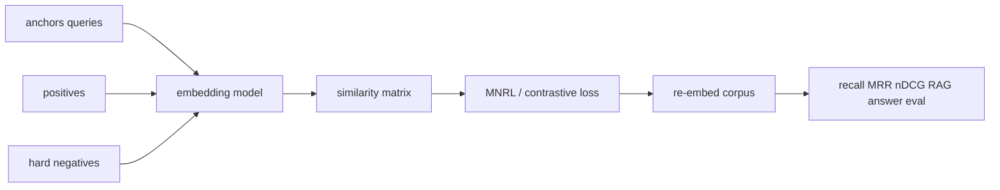

# Embedding-Model Fine-Tuning

> Topic package — Domain 7 · Roadmap Week 18.
> Depth goal: implement in-batch contrastive loss, build triplet data with hard negatives, and evaluate retrieval gains for domain RAG.

## Source
- Track: LLM Engineering (self-directed, FDE roadmap)
- Slide deck: `07 Resources Library/LLM Engineering/Slides/Lesson_43_Embedding_Model_Fine-Tuning.pptx`
- Hands-on notebook: `07 Resources Library/LLM Engineering/Notebooks/43_Embedding_Model_Fine-Tuning.ipynb` (runs offline)
- Reference reading: Sentence-BERT (Reimers and Gurevych, arXiv:1908.10084); SimCSE; sentence-transformers training docs; Multiple Negatives Ranking Loss; contrastive learning literature
- Builds on: [[02 Literature Notes/LLM Engineering/Embeddings]] · [[02 Literature Notes/LLM Engineering/RAG Pipeline Fundamentals]]
- Date: 2026-07-18

---

## 1. Mental Model

**Embedding fine-tuning teaches distance: matching query-document pairs should be near, non-matches should be far.** The model is not generating answers; it is shaping the geometry used by retrieval.

The best training signal is contrastive and domain-specific: anchors, positives, and hard negatives that look plausible but are wrong.

> Key intuition: **a retriever is a ranking model in vector clothing** — tune it with ranking evidence and evaluate ranking metrics.



---

## 2. How It Actually Works

### 7.1 Contrastive objective
Embedding fine-tuning pulls semantically matching pairs together and pushes non-matches apart. The batch often supplies negatives for free: every other positive in the batch is a negative.

### 7.2 Triplets and hard negatives
Triplet data `(anchor, positive, negative)` teaches ranking. Hard negatives are plausible but wrong documents; they create stronger retrievers than random negatives.

### 7.3 MNRL
Multiple Negatives Ranking Loss applies cross-entropy over the similarity matrix so each anchor selects its paired positive among in-batch negatives.

### 7.4 Domain adaptation
Tune embeddings when the off-the-shelf model misses domain vocabulary, abbreviations, product names, legal clauses, code symbols, or local relevance criteria.

### 7.5 Evaluation
Use retrieval metrics such as recall@k, MRR, nDCG, and downstream answer quality. A lower contrastive loss is meaningless if retrieval does not improve.

---

## 3. Implementation

Assumed stack: numpy. Snippets implement MNRL and hard-negative mining.
- [[04 Code Snippets/LLM/In Batch Negative Contrastive Loss]]
- [[04 Code Snippets/LLM/Hard Negative Miner for Retrieval]]

### In Batch Negative Contrastive Loss
Compute MNRL-style cross entropy over a cosine similarity matrix.
```python
import numpy as np
def normalize(x): return x/np.linalg.norm(x,axis=1,keepdims=True)
A=normalize(np.array([[1,0],[0,1],[1,1.]],float)); P=normalize(np.array([[.9,.1],[.1,.9],[.8,.7]],float))
sim=A@P.T; exp=np.exp(sim/.1); prob=exp/exp.sum(1,keepdims=True); loss=-np.log(np.diag(prob)).mean(); print(round(float(loss),3))
```

### Hard Negative Miner for Retrieval
Select the most similar non-positive document as a hard negative.
```python
import numpy as np
scores=np.array([[.9,.7,.2],[.1,.8,.75]])
positives=[0,1]
for i,row in enumerate(scores):
    row=row.copy(); row[positives[i]]=-1
    print("hard negative", int(row.argmax()))
```

---

## 4. Design Decisions & Tradeoffs

| Decision | Guidance |
|---|---|
| **Pair source** | Mine positives from clicks, citations, QA pairs, or expert labels. |
| **Negatives** | Use hard negatives after a random-negative baseline. |
| **Similarity** | Cosine with normalized vectors is the common default. |
| **Batch size** | Larger batches provide more in-batch negatives. |
| **Validation** | Evaluate with frozen corpora and query sets. |
| **RAG impact** | Measure whether retriever gains improve final grounded answers. |

---

## 5. Failure Modes & Gotchas

- Random negatives make the task too easy.
- False negatives push actually relevant documents away.
- Train/test leakage inflates retrieval metrics.
- Optimizing embedding loss without recall gains.
- Changing embedding model without re-indexing vectors.
- Ignoring downstream RAG answer quality.

---

## 6. FDE Angle

- Retriever tuning is often cheaper than fine-tuning the generator.
- Embedding improvements are measurable with recall@k and MRR.
- Hard negative mining is the main practical lever.
- Ship with re-indexing and rollback plans.

---

## 7. Self-Check

1. What are in-batch negatives?
2. Why are hard negatives useful?
3. Write MNRL over a similarity matrix.
4. When tune embeddings for RAG?
5. Why re-index after changing embeddings?
6. Which retrieval metrics matter?

---

## 9. Interview Q&A

**Q: What are "in-batch negatives," and why does this give you negatives "for free"?**
A: In a training batch, you have several (anchor, positive) pairs — a query and its genuinely matching document, for several different queries at once. The key insight: for any given anchor in the batch, every *other* pair's positive document (the one belonging to a different query) is, almost certainly, not actually relevant to this anchor's query — it's a legitimate negative example (something that shouldn't match this particular query), even though nobody explicitly labeled it as a negative for this specific anchor.

This means you get a large set of negative examples essentially without any extra labeling cost — you only had to collect genuine (anchor, positive) pairs, and the negatives for any given anchor come automatically from the rest of the batch, just by the fact that those other documents belong to different queries. With a batch of size `N`, each anchor gets `N-1` negatives "for free," just from how the batch happens to be composed — no separate negative-mining or labeling step is strictly required to get this base layer of negative examples.

*One-liner: in-batch negatives are the other pairs' positive documents within the same training batch, which serve as negative examples for any given anchor simply because they belong to a different query — this gives you N-1 negatives per anchor for a batch of size N, entirely free of any extra labeling effort, since you only needed to collect genuine positive pairs in the first place.*

**Q: Why do hard negatives produce a stronger retriever than random negatives?**
A: A random negative (an arbitrary, unrelated document) is almost always trivially easy for the model to distinguish from the true positive — if a query is about refund policies and the random negative is about an unrelated topic like shipping schedules, there's little genuine discriminative learning happening, since the model barely has to learn anything subtle to correctly separate these two.

A hard negative is specifically chosen to be a document that's *superficially similar or plausible* but actually wrong — something that shares surface-level similarity with the true positive (similar vocabulary, similar general topic) without actually being the correct answer to the specific query. Training against hard negatives forces the model to learn the more subtle, genuinely discriminating features that distinguish a truly relevant document from a merely similar-looking one — exactly the skill a retriever actually needs at real query time, since real queries in production often do retrieve several superficially similar candidates, and the retriever's whole job is correctly distinguishing the genuinely relevant one from these plausible-but-wrong alternatives.

Training exclusively on random negatives risks the model learning a shortcut — distinguishing obviously unrelated documents is easy, but that easy skill doesn't transfer to the harder, more realistic task of distinguishing subtly different, genuinely confusable candidates, which is exactly the situation real retrieval needs to handle well.

*One-liner: random negatives are trivially easy to distinguish from a true positive, teaching the model little real discrimination — hard negatives are superficially similar but actually wrong, forcing the model to learn the subtler features that genuinely distinguish relevant from merely similar-looking documents, which is exactly the harder, more realistic distinction a retriever actually needs to make at real query time.*

**Q: Write the MNRL (Multiple Negatives Ranking Loss) objective over a similarity matrix, and explain what it's actually optimizing.**
A: Given a batch of anchors and their corresponding positives, first compute a full similarity matrix: every anchor's embedding compared (via cosine similarity or dot product) against every positive's embedding in the batch — not just each anchor against its own matching positive, but against all of them. This produces an `N × N` matrix of similarity scores, where `N` is the batch size.

The objective then treats this exactly like a classification problem: for each anchor (each row of the matrix), the correct "class" is its own true matching positive (the diagonal entry of that row), and all the other positives in that row are the in-batch negatives (covered above). Apply softmax across each row (turning the similarity scores into a probability distribution over "which positive does this anchor actually match"), and compute cross-entropy loss specifically against the correct diagonal entry — training the model to assign the highest probability specifically to each anchor's own true positive, relative to all the in-batch negatives it's being compared against in that same row.

What this is actually optimizing: it's directly training the embedding space so that an anchor's true positive ends up with meaningfully higher similarity than every other document it's being compared against in the batch — exactly the ranking behavior retrieval actually needs (the true match should outrank the alternatives), computed efficiently across an entire batch of examples at once using a single similarity matrix and a standard cross-entropy loss, rather than needing separate, explicit negative examples labeled one at a time.

*One-liner: MNRL computes a full anchor-by-positive similarity matrix across the batch, then applies cross-entropy loss treating each anchor's own true positive as the correct "class" among all other in-batch positives (acting as negatives) in that row — directly training the embedding space so each anchor's true match scores meaningfully higher than every alternative it's compared against, which is exactly the ranking behavior real retrieval needs.*

**Q: When does it make sense to fine-tune an embedding model for RAG, rather than just using an off-the-shelf one?**
A: The deciding signal is whether your specific domain has vocabulary, terminology, or relevance patterns that a general-purpose, off-the-shelf embedding model (trained on broad, general text) genuinely struggles to capture well — not whether fine-tuning is theoretically possible, since it's a real, non-trivial investment of effort and data collection that should be justified by a genuine gap.

Concretely, this becomes worth doing when your corpus is full of domain-specific vocabulary a general model wasn't trained to understand well — specialized abbreviations, product names unique to your business, legal or medical terminology with precise meanings, code symbols and identifiers — where a general-purpose model's learned sense of "similar meaning" doesn't actually line up well with what's genuinely relevant in your specific domain. It's also worth considering when your notion of "relevant" itself is domain-specific in a way a general model wouldn't naturally capture — your users' actual definition of what counts as a good match for a given query might depend on domain-specific relevance criteria a general-purpose model's broad training never specifically learned.

The practical way to actually verify this is worth doing, rather than assuming it: measure your off-the-shelf model's actual retrieval performance (recall@k, MRR, as covered in Retrieval Evaluation) on your own task-relevant golden eval set first — if it's already performing well, fine-tuning adds real cost and complexity (collecting training pairs, hard-negative mining, retraining, re-indexing your entire corpus) for a problem that might not actually exist in practice for your specific case.

*One-liner: fine-tune an embedding model specifically when your corpus has domain vocabulary or relevance patterns a general-purpose model genuinely struggles with — verified by first measuring the off-the-shelf model's actual retrieval performance on your own golden eval set, since fine-tuning is real added cost and complexity (data collection, hard-negative mining, full re-indexing) that should be justified by a measured gap, not assumed by default.*

**Q: Why does re-indexing become necessary after fine-tuning (or otherwise changing) an embedding model?**
A: This is the exact same consequence covered in Embeddings and Embedding Model Selection, applied specifically to the fine-tuning case: a fine-tuned embedding model is, functionally, a different model from whatever model (or starting checkpoint) was used to embed your existing corpus — even though it started from the same base, the fine-tuning process has changed its learned weights, which means it now places text into a somewhat different vector space than it did before fine-tuning.

Because of this, the vectors already stored in your index — generated by the model *before* fine-tuning — are no longer guaranteed to be comparable to new vectors generated by the fine-tuned model. Comparing an old, pre-fine-tuning vector against a new, post-fine-tuning query vector gives you a similarity score that doesn't actually reflect genuine semantic similarity in any consistent space — the same fundamental problem as embedding your corpus and your queries with two genuinely different models. So the entire corpus needs to be re-embedded using the newly fine-tuned model, and the index rebuilt from these new vectors, before the fine-tuned model can actually be used in production — you can't just swap in the fine-tuned model for new queries while leaving the old, pre-fine-tuning vectors sitting in the index unchanged.

*One-liner: a fine-tuned embedding model places text into a somewhat different vector space than it did before fine-tuning, so existing vectors generated by the pre-fine-tuning model are no longer reliably comparable to new vectors from the fine-tuned model — requiring the entire corpus to be re-embedded and the index rebuilt before the fine-tuned model can actually be used in production, exactly the same re-embedding requirement as switching to a completely different embedding model.*

**Q: Which specific retrieval metrics matter for evaluating whether embedding fine-tuning actually worked, and why not just check if the contrastive loss went down?**
A: A lower contrastive training loss only tells you the model got better at the specific, narrow training objective it was being directly optimized against — distinguishing each training batch's positives from its in-batch negatives. It doesn't directly tell you whether this translates into genuinely better real-world retrieval performance on your actual task, which is a related but distinct thing to measure.

The actual metrics that matter are the real retrieval metrics covered in Retrieval Evaluation — recall@k (does the right document actually get found in the top-k results), MRR (does it get ranked early when it is found), and potentially NDCG if you have graded relevance judgments — measured on your own held-out, task-relevant golden evaluation set, comparing the fine-tuned model's actual retrieval performance against the baseline (pre-fine-tuning) model's performance on that exact same evaluation set. And ideally, going one step further: measuring whether this improved retrieval actually translates into better final RAG answer quality (covered in Groundedness and Faithfulness), since the whole point of improving retrieval is to improve the final answers users actually see — a retrieval improvement that doesn't move the needle on final answer quality is a weaker result than one that clearly does.

The core discipline: training loss is an internal, proxy signal specific to the training process itself — it can improve while real-world retrieval performance stays flat or even regresses in some edge cases (for instance, if fine-tuning slightly degraded performance on some query type that wasn't well-represented in the fine-tuning data, even while loss improved on the training distribution it was actually trained on). Only measuring the actual downstream retrieval metrics on a genuine, held-out eval set tells you whether the fine-tuning effort actually achieved its real goal.

*One-liner: a lower contrastive training loss only confirms the model improved at its narrow training objective, not that real-world retrieval actually got better — the metrics that matter are recall@k, MRR, and ideally downstream RAG answer quality, measured on a genuine held-out golden eval set comparing the fine-tuned model against the pre-fine-tuning baseline, since training loss can improve while real retrieval performance stays flat or regresses on cases underrepresented in the fine-tuning data.*

## 8. Links
- Domain MOC: [[06 Maps of Content/LLM Engineering Concepts]]
- Code: [[04 Code Snippets/LLM/In Batch Negative Contrastive Loss]], [[04 Code Snippets/LLM/Hard Negative Miner for Retrieval]]
- Distilled: [[03 Permanent Notes/Embedding Fine Tuning Teaches Retrieval Geometry]], [[03 Permanent Notes/Hard Negatives Make Retrievers Smarter]]
- Upstream: [[02 Literature Notes/LLM Engineering/Embeddings]] · Downstream: [[02 Literature Notes/LLM Engineering/Synthetic Data Generation]]
