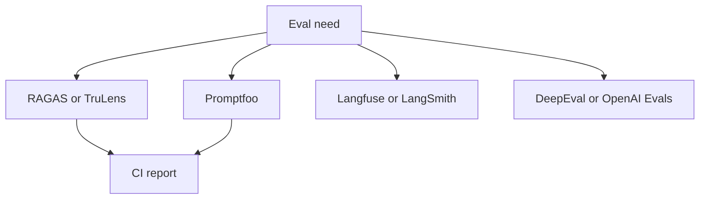

# Eval Framework Literacy (RAGAS, DeepEval, Promptfoo)

> Topic package — Domain 6 · Roadmap Week 17.
> Depth goal: build production-grade LLM evaluation habits: clear datasets, trustworthy metrics, statistical guardrails, and shipping decisions that survive contact with real users.

## Source
- Track: LLM Engineering (self-directed, FDE roadmap)
- Slide deck: `07 Resources Library/LLM Engineering/Slides/Lesson_37_Eval_Framework_Literacy.pptx`
- Hands-on notebook: `07 Resources Library/LLM Engineering/Notebooks/37_Eval_Framework_Literacy.ipynb` (runs offline)
- Reference reading: RAGAS docs; DeepEval docs; Promptfoo docs; Langfuse; TruLens; OpenAI Evals; LangSmith docs
- Builds on: [[02 Literature Notes/LLM Engineering/Eval Fundamentals]] · [[02 Literature Notes/LLM Engineering/Retrieval Evaluation]]
- Date: 2026-07-18

---

## 1. Mental Model

**Eval frameworks are toolboxes, not substitutes for deciding what quality means.** RAGAS emphasizes RAG metrics; DeepEval offers test abstractions; Promptfoo is strong for prompt regression and CI; Langfuse and LangSmith connect traces to evals; TruLens focuses on feedback functions.

Pick the framework that matches your system boundary.

> Key intuition: **frameworks automate plumbing; you still own rubric, dataset, and gate.**



---

## 2. How It Actually Works

### 6.1 Selection criteria
Ask what artifact you evaluate: prompts, RAG answers, traces, agents, datasets, or experiments. Check local runners, CI output, custom metrics, and lock-in.

### 6.2 RAGAS and TruLens
RAGAS provides faithfulness, answer relevance, context precision, and recall. TruLens emphasizes feedback functions over instrumented traces.

### 6.3 DeepEval and OpenAI Evals
DeepEval gives unit-test-like LLM assertions. OpenAI Evals popularized JSONL datasets, eval classes, and repeatable harness patterns.

### 6.4 Promptfoo
Promptfoo fits prompt/model/provider comparison, assertions, red-team plugins, and CI gates close to pull requests.

### 6.5 Langfuse and LangSmith
Trace platforms close the loop from production failures to curated datasets, especially for chains and agents.

---

## 3. Implementation

Assumed stack: stdlib + numpy. The snippets are offline and deterministic so they can run in CI before API-backed evaluation. Snippets:
- [[04 Code Snippets/LLM/Eval Framework Selection Matrix]]
- [[04 Code Snippets/LLM/CI Eval Gate]]

### Eval Framework Selection Matrix
Score frameworks against requirements instead of adopting by hype.
```python
frameworks={"RAGAS":{"rag":3,"ci":2,"traces":1},"Promptfoo":{"rag":1,"ci":3,"traces":1},"Langfuse":{"rag":2,"ci":2,"traces":3}}
def rank(needs):
    rows=[]
    for name,caps in frameworks.items(): rows.append((sum(needs.get(k,0)*caps.get(k,0) for k in needs), name))
    return sorted(rows, reverse=True)
print(rank({"rag":3,"ci":2,"traces":1}))
```

### CI Eval Gate
Framework-agnostic gate that fails builds on metric regressions.
```python
def ci_gate(report, thresholds):
    failures=[]
    for metric, minimum in thresholds.items():
        value=report.get(metric)
        if value is None or value < minimum: failures.append(f"{metric}={value} below {minimum}")
    return {"pass": not failures, "failures": failures}
print(ci_gate({"faithfulness":0.82,"answer_relevance":0.76}, {"faithfulness":0.80,"answer_relevance":0.75}))
```

---

## 4. Design Decisions & Tradeoffs

| Decision | Guidance |
|---|---|
| **Dataset boundary** | Write down exactly which population the eval represents and which it excludes. |
| **Metric choice** | Prefer deterministic metrics for mechanical properties; use judges only for semantic qualities that require judgment. |
| **Slicing** | Always inspect business-critical, safety-critical, and historically weak slices. |
| **Calibration** | Compare automated scores against human labels before using them as gates. |
| **Thresholds** | Set pass/block/investigate thresholds before looking at the result. |
| **Artifacts** | Persist inputs, outputs, prompts, model versions, scores, and traces for reproducibility. |

---

## 5. Failure Modes & Gotchas

- Treating a polished demo as evidence of reliability.
- Optimizing a proxy metric after it stops matching user value.
- Reporting only an aggregate score while a critical slice fails.
- Changing prompt, model, data, and scorer at once, making regressions uninterpretable.
- Using a judge without bias audits or human calibration.
- Failing to save per-case artifacts, so failures cannot be debugged.

---

## 6. FDE Angle

- A production eval is a client-facing trust artifact, not internal trivia.
- A clear scorecard lets stakeholders decide whether to ship, hold, or rollback.
- Automated evals reduce manual QA and accelerate iteration.
- Deliverable: versioned dataset, runner, metrics, report, and CI gate.

---

## 7. Self-Check

1. Define the behavior being measured and the evidence required.
2. Explain how the dataset, scorer, baseline, and threshold interact.
3. Name slices that could hide severe regressions behind a good average.
4. Describe how you would calibrate the metric against human judgment.
5. State what artifacts are needed to reproduce a run.
6. Translate a score into a shipping decision.

---

## 9. Interview Q&A

**Q: Why are eval frameworks described as "toolboxes, not substitutes for deciding what quality means"?**
A: A framework like RAGAS or Promptfoo gives you ready-made machinery for running evals efficiently — pre-built metric implementations, a way to run a test suite repeatedly, integration with CI pipelines, convenient ways to compare results across runs. All of this is genuinely useful plumbing that saves real engineering time compared to building it all from scratch.

But none of this plumbing can answer the actual substantive question a team still has to answer for itself: what does "good" actually mean for *this specific product*, on *these specific tasks*? A framework can compute a faithfulness score once you've defined what faithful means for your use case and provided the data to check it against — but it can't tell you what threshold counts as acceptable for your specific product, which specific slices of your traffic matter most, or what tradeoffs between different quality dimensions are actually right for your situation. Adopting a framework doesn't automatically answer any of these judgment calls — you still have to do that thinking yourself, and the framework just gives you convenient tools to execute on the decisions you've already made.

*One-liner: eval frameworks provide ready-made machinery (metric implementations, CI integration, comparison tooling) that saves real engineering effort, but they can't answer the substantive judgment calls — what "good" actually means for your product, what threshold is acceptable, which slices matter most — those decisions still have to be made by the team, with the framework just providing convenient tools to execute on them.*

**Q: What's the core difference between RAGAS/TruLens and Promptfoo, in terms of what they're each built to evaluate?**
A: These target genuinely different parts of an LLM system, which is why the choice between them should follow from what you're actually trying to test, not from which one is more popular or well-known.

RAGAS (and similarly, TruLens's feedback functions) are specifically built around evaluating RAG systems — their core built-in metrics (faithfulness, answer relevance, context precision, context recall, as covered in Groundedness and Faithfulness and Retrieval Evaluation) are all specifically about the relationship between a question, retrieved context, and a generated answer. These tools are the right fit when your evaluation need is fundamentally about assessing a RAG pipeline's retrieval-and-generation quality.

Promptfoo is built around a different need entirely: comparing prompts, models, or providers against each other systematically, running assertion-based checks, and integrating tightly into CI pipelines close to the actual pull-request workflow — it's less about RAG-specific metrics and more about general prompt/model regression testing, the kind of continuous "did this change break anything" checking covered in Prompt Versioning.

So the practical selection question isn't "which tool is better" in the abstract — it's "am I evaluating a RAG pipeline's retrieval-and-grounding quality (reach for RAGAS/TruLens) or am I comparing prompts/models/providers and gating CI on regressions (reach for Promptfoo)" — the right tool follows directly from which of these two different evaluation needs you actually have.

*One-liner: RAGAS and TruLens are built specifically around RAG-pipeline metrics (faithfulness, context precision/recall); Promptfoo is built around comparing prompts/models/providers and gating CI on regressions — the right choice follows from whether you're evaluating a RAG pipeline's retrieval-and-grounding quality or doing general prompt/model regression testing, not from which tool happens to be more popular.*

**Q: What role do trace platforms like Langfuse or LangSmith play, that's different from a metric-focused framework like RAGAS?**
A: Trace platforms solve a different problem: connecting what actually happens in production (real user interactions, with all their real complexity and unpredictability) back to a curated set of test cases you can actually evaluate against — closing the loop between live production behavior and your offline eval suite, rather than just computing a metric on data you already have prepared.

A metric-focused framework like RAGAS assumes you already have your test cases ready (a dataset of questions, context, and answers) and focuses on scoring them well. A trace platform instead focuses on capturing the full, detailed trace of what actually happened during a real production interaction — every model call, every tool call, every retrieved chunk — and making it possible to go from "a real user had a bad interaction in production" to "that bad interaction is now captured as a reusable test case I can add to my golden eval set," the same pattern covered in Prompt Versioning for turning production incidents into permanent regression tests.

This matters especially for more complex systems — chains and agents with many internal steps — where the full trace of what happened at each step is itself valuable, inspectable data that a simple final-input/final-output eval wouldn't capture. Trace platforms are specifically built to make this kind of detailed, multi-step production data usable for ongoing evaluation, which is a genuinely different, complementary role to a metric-computation framework that assumes the test cases are already prepared and ready to score.

*One-liner: trace platforms like Langfuse/LangSmith specifically connect real production behavior to your curated eval suite — capturing detailed multi-step traces from real interactions and making it possible to turn a real production failure into a permanent, reusable test case — which is a different, complementary role to a metric-computation framework like RAGAS that assumes test cases are already prepared and ready to score.*

**Q: What should you check before adopting any eval framework, regardless of which one you're considering?**
A: Several practical questions, beyond just "does it have the metrics I want," since the metrics themselves are often the easiest part to evaluate — the harder, more consequential questions are about fit and long-term cost.

First: what's the actual artifact you need to evaluate — prompts, RAG answers, full agent traces, datasets, experiments — and does this framework's core design actually match that artifact, or would you be forcing your actual evaluation need into a shape the framework wasn't really built for? Second: does it integrate cleanly with your actual CI/deployment pipeline, producing output you can realistically gate a release on, or would you need significant custom glue code to make it fit your workflow? Third: can you define custom metrics specific to your product's actual quality definition, or are you locked into whatever metrics the framework happens to ship with out of the box — if your quality definition is genuinely specific to your domain, a framework that only supports its built-in metrics may not actually serve your real need. Fourth, and often underweighted: what's the actual lock-in cost — how much of your evaluation logic, data format, and workflow becomes tightly coupled to this specific framework's APIs and conventions, such that switching away later (if this framework turns out not to fit as well as hoped) becomes a costly, invasive rewrite rather than a contained change.

*One-liner: check whether the framework's core design actually matches the artifact you need to evaluate (prompts vs RAG answers vs full traces), whether it integrates cleanly with your actual CI pipeline, whether it supports genuinely custom metrics specific to your product rather than locking you into its built-in set, and what the real lock-in cost would be if you ever needed to switch away later.*

**Q: Why might a team need more than one eval tool, rather than picking a single framework for everything?**
A: Because, as covered above, different frameworks are built around genuinely different evaluation needs — a RAG-focused metric framework, a prompt/CI-regression tool, and a production-trace platform are each solving a different piece of the overall evaluation picture, and a single real system often has needs that span more than one of these pieces at once.

A production RAG system, for instance, might genuinely need: RAG-specific metrics (RAGAS-style faithfulness and context precision/recall) to assess retrieval-and-generation quality specifically, a CI-integrated regression tool (Promptfoo-style) to catch prompt or model changes that break previously-passing behavior before they ship, and a trace platform (Langfuse/LangSmith-style) to capture and learn from real production failures, turning them into new permanent test cases over time. Each of these addresses a genuinely different question — "is this RAG pipeline's output well-grounded," "did this specific change break something that used to work," "what's actually happening in production that we should be testing for" — and no single framework, built primarily around one of these three needs, naturally and fully covers the other two as well as a tool specifically built for that purpose would.

The practical implication: rather than searching for one framework that claims to do everything, it's often more effective to pick the right specific tool for each genuinely distinct evaluation need, and accept that a mature evaluation setup may reasonably involve more than one framework working together, each handling the piece it's actually built for.

*One-liner: different frameworks are built around genuinely different evaluation needs (RAG-specific metrics, CI-integrated prompt regression, production-trace capture) — a real system often needs more than one piece of this picture at once, so rather than searching for one framework that does everything, it's often more effective to use the right specific tool for each genuinely distinct need.*

## 8. Links
- Domain MOC: [[06 Maps of Content/LLM Engineering Concepts]]
- Code: [[04 Code Snippets/LLM/Eval Framework Selection Matrix]], [[04 Code Snippets/LLM/CI Eval Gate]]
- Distilled: [[03 Permanent Notes/Eval Frameworks Do Plumbing Not Product Judgment]], [[03 Permanent Notes/Choose Eval Tools by System Boundary]]
- Upstream: [[02 Literature Notes/LLM Engineering/Eval Fundamentals]] · Downstream: [[02 Literature Notes/LLM Engineering/Statistical Rigor in Eval]]
