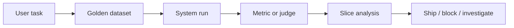

# Eval Fundamentals

> Topic package — Domain 6 · Roadmap Week 17.
> Depth goal: build production-grade LLM evaluation habits: clear datasets, trustworthy metrics, statistical guardrails, and shipping decisions that survive contact with real users.

## Source
- Track: LLM Engineering (self-directed, FDE roadmap)
- Slide deck: `07 Resources Library/LLM Engineering/Slides/Lesson_31_Eval_Fundamentals.pptx`
- Hands-on notebook: `07 Resources Library/LLM Engineering/Notebooks/31_Eval_Fundamentals.ipynb` (runs offline)
- Reference reading: OpenAI Evals; HELM; OpenAI and Anthropic eval guidance; evaluate before you ship
- Builds on: [[02 Literature Notes/LLM Engineering/Prompt Contracts]] · [[02 Literature Notes/LLM Engineering/Retrieval Evaluation]]
- Date: 2026-07-18

---

## 1. Mental Model

**An eval is an executable claim about quality: dataset + scorer + threshold + decision.** A demo shows that a system can work once; an eval harness shows how often it works, for whom, and where it fails.

The core move is to separate the artifact being tested from the measurement system. Golden datasets capture representative tasks and edge cases; offline evals make iteration cheap; online evals confirm user impact.

> Key intuition: **a demo is not proof** — proof starts when the same cases can be rerun, sliced, compared, and gated.



---

## 2. How It Actually Works

### 6.1 What an eval actually is
An eval has four separable pieces: **dataset** cases, **runner** system under test, **scorer** metric/judge/human label, and **decision rule** threshold and escalation. If any piece is implicit, the result is not reproducible.

### 6.2 Offline versus online
Offline evals run on fixed data before shipping; they are cheap, repeatable, and ideal for regression testing. Online evals observe real users through A/B tests, canaries, feedback, and guardrail metrics. You need both.

### 6.3 Reference-based versus reference-free
Reference-based metrics compare to a known answer: exact match, F1, retrieval recall. Reference-free metrics judge properties without a gold answer: groundedness, helpfulness, safety, format validity.

### 6.4 Task metrics versus system metrics
Task metrics answer whether the model did the job. System metrics answer whether the product can operate: latency, cost, refusal rate, tool failure, escalation, and safety triggers.

### 6.5 Building the harness
A harness loads versioned cases, runs the production path, scores deterministically where possible, writes per-case artifacts, summarizes by slice, compares to baseline, and fails CI on thresholds.

---

## 3. Implementation

Assumed stack: stdlib + numpy. The snippets are offline and deterministic so they can run in CI before API-backed evaluation. Snippets:
- [[04 Code Snippets/LLM/Golden Dataset Metric Harness]]
- [[04 Code Snippets/LLM/Eval Slice Gate]]

### Golden Dataset Metric Harness
Minimal reference-based harness with precision, recall, F1, and slice labels.
```python
import numpy as np

def precision_recall_f1(pred, gold):
    pred, gold = set(pred), set(gold)
    tp = len(pred & gold)
    precision = tp / max(1, len(pred))
    recall = tp / max(1, len(gold))
    f1 = 0.0 if precision + recall == 0 else 2 * precision * recall / (precision + recall)
    return precision, recall, f1

def evaluate(rows):
    out = []
    for r in rows:
        p, rec, f1 = precision_recall_f1(r["pred_labels"], r["gold_labels"])
        out.append({"id": r["id"], "slice": r["slice"], "precision": p, "recall": rec, "f1": f1})
    return out

rows = [{"id":"a","slice":"easy","pred_labels":["refund"],"gold_labels":["refund"]},
        {"id":"b","slice":"hard","pred_labels":["refund"],"gold_labels":["escalate"]}]
print(evaluate(rows))
```

### Eval Slice Gate
Convert eval results into an explicit shipping decision with slice thresholds.
```python
from collections import defaultdict

def gate(results, metric="f1", min_overall=0.80, min_slice=0.70):
    overall = sum(r[metric] for r in results) / len(results)
    buckets = defaultdict(list)
    for r in results: buckets[r["slice"]].append(r[metric])
    slices = {k: sum(v)/len(v) for k, v in buckets.items()}
    failures = []
    if overall < min_overall: failures.append(f"overall {overall:.2f} < {min_overall:.2f}")
    failures += [f"slice {k} {v:.2f} < {min_slice:.2f}" for k, v in slices.items() if v < min_slice]
    return {"overall": overall, "slices": slices, "pass": not failures, "failures": failures}

print(gate([{"slice":"easy","f1":1.0},{"slice":"hard","f1":0.5}], min_overall=0.7))
```

---

## 4. Design Decisions & Tradeoffs

| Decision | Guidance |
|---|---|
| **Dataset boundary** | Write down exactly which population the eval represents and which it excludes. |
| **Metric choice** | Prefer deterministic metrics for mechanical properties; use judges only for semantic qualities that require judgment. |
| **Slicing** | Always inspect business-critical, safety-critical, and historically weak slices. |
| **Calibration** | Compare automated scores against human labels before using them as gates. |
| **Thresholds** | Set pass/block/investigate thresholds before looking at the result. |
| **Artifacts** | Persist inputs, outputs, prompts, model versions, scores, and traces for reproducibility. |

---

## 5. Failure Modes & Gotchas

- Treating a polished demo as evidence of reliability.
- Optimizing a proxy metric after it stops matching user value.
- Reporting only an aggregate score while a critical slice fails.
- Changing prompt, model, data, and scorer at once, making regressions uninterpretable.
- Using a judge without bias audits or human calibration.
- Failing to save per-case artifacts, so failures cannot be debugged.

---

## 6. FDE Angle

- A production eval is a client-facing trust artifact, not internal trivia.
- A clear scorecard lets stakeholders decide whether to ship, hold, or rollback.
- Automated evals reduce manual QA and accelerate iteration.
- Deliverable: versioned dataset, runner, metrics, report, and CI gate.

---

## 7. Self-Check

1. Define the behavior being measured and the evidence required.
2. Explain how the dataset, scorer, baseline, and threshold interact.
3. Name slices that could hide severe regressions behind a good average.
4. Describe how you would calibrate the metric against human judgment.
5. State what artifacts are needed to reproduce a run.
6. Translate a score into a shipping decision.

---

## 9. Interview Q&A

**Q: Define the behavior being measured in an eval, and what evidence is actually required to back a claim about it?**
A: An eval is making a specific, checkable claim: "this system does X correctly, this often, for this population of inputs." Each part of that claim needs its own piece of evidence. "This system does X" needs a clear, specific definition of what correct behavior actually looks like for a given input — vague enough that two people might disagree on whether an output "counts" means the eval can't be run consistently. "This often" needs an actual measured rate across real test cases, not an impression from watching a handful of examples work. "For this population" needs the test set to actually represent the inputs the system will really see in production, not an easy or convenient subset that happens to work well.

The evidence required to back this claim, concretely: a labeled dataset of representative cases (including the hard ones, not just the easy ones), a way to score the system's actual output against what correct behavior looks like (deterministic where possible, a calibrated judge where not), and the actual measured results run against that dataset — not a demo of a few hand-picked examples, since a handful of examples chosen because they happened to work well tells you nothing about the rate of success across the real range of inputs the system will actually face.

*One-liner: an eval claims "this system does X correctly, this often, for this population" — each part needs its own evidence: a clear, specific definition of correct behavior, a representative dataset (including hard cases, not just easy ones), and actual measured results against that dataset, not an impression from a handful of hand-picked examples.*

**Q: Explain how the dataset, scorer, baseline, and threshold all interact with each other.**
A: These four pieces work together as a pipeline, and each one depends on the one before it being well-defined — a weakness in any single piece undermines the whole chain's trustworthiness.

The dataset provides the actual test cases — inputs plus, where applicable, what the correct or expected output looks like. The scorer takes the system's actual output for each case and produces a number or judgment about how well it matches what was expected (exact match, F1, a calibrated judge's rating). This produces a raw score for the system under test. The baseline is a reference point — often the previous version of the system, or a simple reference approach — scored the exact same way on the exact same dataset, so you have something meaningful to compare the new score against; a score in isolation ("72% accuracy") is much less informative than a score compared against what came before ("72% versus last version's 68%" tells you something improved, while "72%" alone doesn't tell you if that's good or bad for this specific task). The threshold is the actual decision rule — a specific number (or comparison to baseline) that determines whether this result counts as a pass, a fail, or something that needs human investigation.

The interaction that matters most: these pieces need to stay stable while you're trying to measure whether something specific changed. If you change the dataset, the scorer, and the system under test all at the same time, and the score moves, you have no way to attribute *why* it moved — which of those three changes actually caused the difference. This is why good practice holds the dataset and scorer fixed as a stable measurement instrument, and only varies the system under test (comparing it against the baseline) — isolating what you're actually trying to learn.

*One-liner: the dataset provides test cases, the scorer produces a number from the system's output, the baseline gives a reference point to compare that number against, and the threshold turns the comparison into a pass/fail/investigate decision — holding the dataset and scorer stable while only varying the system under test is what lets you actually attribute a score change to a specific cause, rather than it being ambiguous which of several simultaneous changes caused it.*

**Q: Name slices of an eval that could hide a severe regression behind a good overall average.**
A: An average by definition blends everything together, so a severe problem concentrated in a small subset of cases can get diluted into invisibility by a large number of other cases that are doing fine — the specific subsets worth checking separately are the ones where this dilution risk is highest or the stakes of missing a problem are worst.

Business-critical slices — the specific query types or use cases that matter most to actual revenue or core product value — deserve their own check, since a regression here matters disproportionately more than an equivalent regression on a rarely-used, low-stakes query type, even though an aggregate average would weight them the same. Safety-critical slices — cases involving potentially harmful content, sensitive topics, or situations where a wrong answer carries real risk — need their own check specifically because these are exactly the cases where "mostly fine on average" isn't an acceptable bar; a safety failure on even a small slice can be a serious problem regardless of how well the system performs elsewhere. Historically weak slices — categories that have failed before, or that are known to be harder for the system — deserve ongoing, specific tracking, since these are exactly the areas most likely to regress again, and a prior known weakness silently resurfacing is a particularly costly kind of failure to miss.

The underlying principle: always break down results by slice before trusting an aggregate score, specifically checking the slices where a hidden problem would be most consequential or most likely — an overall average, taken alone, structurally cannot reveal this kind of concentrated, high-stakes failure.

*One-liner: business-critical slices (regressions here matter disproportionately more than their share of overall volume would suggest), safety-critical slices (where "mostly fine on average" isn't acceptable), and historically weak slices (most likely to regress again) can all hide a severe, concentrated problem behind an unremarkable overall average — which is why slice-level breakdown, not just the aggregate score, needs to be checked before trusting a result.*

**Q: How would you calibrate an automated metric (like an LLM judge) against actual human judgment?**
A: Calibration means checking whether the automated metric's scores actually agree with what a human would say, before trusting that metric to make real shipping decisions on its own — an automated scorer that seems reasonable in theory could still systematically diverge from genuine human judgment in practice, and you need to actually verify this rather than assume it.

The concrete process: take a sample of real cases, get genuine human judgments on them (did this output actually satisfy what was being asked, independently rated by a person, not just inferred from the automated metric), and separately run the automated metric on those same exact cases. Then compare: where the automated metric and the human judgment agree, that's evidence the automated metric is a reasonable stand-in, at least for these kinds of cases. Where they disagree, that's a signal worth specifically investigating — is the automated metric systematically too lenient, too harsh, or miscalibrated on some specific category of case (perhaps it handles clear-cut cases well but struggles on ambiguous or borderline ones)?

This calibration shouldn't be a one-time check either — it's worth periodically re-running, since an automated judge's behavior can shift in ways worth re-verifying (if the judge itself is a model, provider-side updates to it could change its behavior without you having explicitly changed anything on your end). The core discipline: never fully trust an automated metric as a hard gate for real shipping decisions until you've actually checked, with real human judgment on a real sample, that it tracks what a human would actually conclude.

*One-liner: calibration means getting genuine human judgments on a sample of real cases, running the automated metric on those same cases, and comparing where they agree versus diverge — investigating any systematic disagreement (too lenient, too harsh, weak on ambiguous cases) before trusting the automated metric as a real shipping gate, and re-checking periodically since an automated judge's behavior can shift over time.*

**Q: What artifacts need to be saved to actually reproduce an eval run later?**
A: Enough that someone could re-run the exact same test, under the exact same conditions, and get a comparable result — or, just as importantly, enough to actually debug a specific failed case after the fact, rather than only knowing the aggregate score changed with no way to see what actually happened on any individual case.

Concretely: the exact dataset version used (which specific cases, in what exact form — datasets can themselves change over time, so you need to know exactly which version produced a given result), the exact system configuration under test (the specific prompt version, the specific model version, any relevant settings — all the things that, per Prompt Versioning, define what was actually running), the per-case inputs and the system's actual raw outputs (not just the final aggregate score — you need the individual results to debug any specific failure), the scores assigned to each individual case, and ideally the full trace of what happened during each case's run if the system under test is itself complex (an agent, a RAG pipeline) with multiple internal steps worth being able to inspect.

Without this full set of artifacts, a regression shows up only as "the aggregate score dropped," with no way to actually look at which specific cases newly failed, what they produced instead of the expected output, or why — turning debugging into guesswork rather than a concrete investigation into specific, inspectable failed cases.

*One-liner: save the exact dataset version, the exact system configuration (prompt/model version and settings), the per-case inputs and raw outputs (not just the aggregate score), individual case scores, and ideally a full execution trace for complex systems — without this, a regression only shows up as an aggregate number dropping, with no way to inspect which specific cases failed or why.*

**Q: How do you translate an eval score into an actual shipping decision?**
A: Through a pre-defined decision rule set *before* you look at the actual result — not by looking at whatever score comes back and then deciding, after the fact, whether it feels good enough to ship, which risks unconsciously rationalizing a borderline result into a pass simply because you already want to ship.

Concretely: before running the eval, define specific thresholds — an overall score below which the change is blocked outright, specific critical slices that must each individually clear their own bar regardless of how the overall average looks (since, as covered above, a good overall average can hide a bad critical-slice regression), and a middle zone where the result isn't a clear pass or a clear fail, but instead triggers human investigation rather than an automatic decision either way. Then, actually run the eval and compare the real result against these pre-committed thresholds: clearly above the bar on both overall and every critical slice → ship; clearly below the bar on either → block, revise, and re-test; genuinely ambiguous or borderline → route to human review rather than letting either an automatic pass or an automatic block make the call on a result that doesn't clearly deserve either outcome.

The core discipline here is the same one that prevents scientific results from being quietly "p-hacked" into the conclusion you wanted — defining your pass/fail bar before you see the result removes the temptation (even unconscious) to adjust your judgment of "good enough" specifically to match whatever result happened to come back.

*One-liner: define overall and critical-slice thresholds before running the eval, then compare the actual result against those pre-committed bars — clearly passing ships, clearly failing blocks, and a genuinely ambiguous result routes to human review — defining thresholds beforehand is what prevents unconsciously rationalizing a borderline result into a pass just because you already wanted to ship.*

## 8. Links
- Domain MOC: [[06 Maps of Content/LLM Engineering Concepts]]
- Code: [[04 Code Snippets/LLM/Golden Dataset Metric Harness]], [[04 Code Snippets/LLM/Eval Slice Gate]]
- Distilled: [[03 Permanent Notes/A Demo Is Not Proof]], [[03 Permanent Notes/An Eval Harness Is a Product Instrument]]
- Upstream: [[02 Literature Notes/LLM Engineering/Prompt Contracts]] · Downstream: [[02 Literature Notes/LLM Engineering/LLM as a Judge]]
