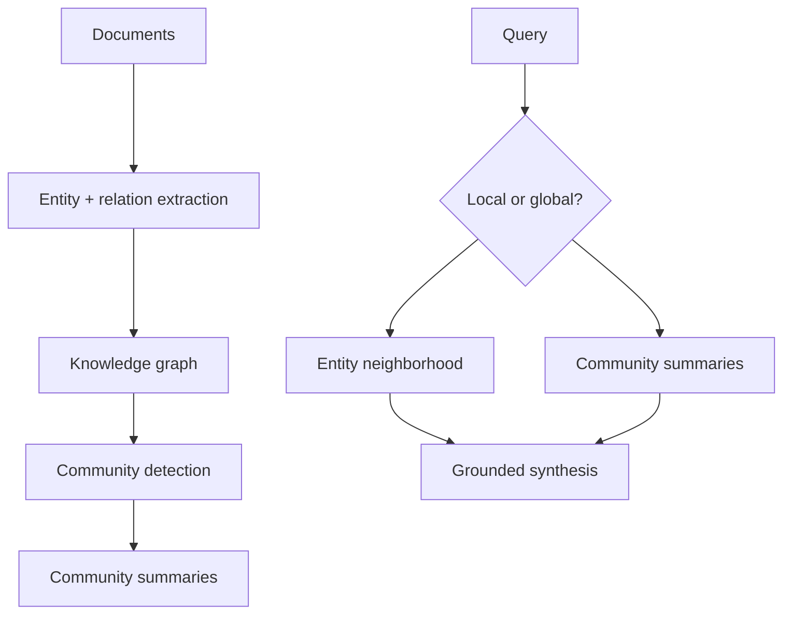

# GraphRAG / Knowledge-Graph RAG

> Topic package — Domain 4 · Roadmap Week 20.
> Depth goal: construct a small knowledge graph from text, retrieve by entities and neighborhoods, summarize communities, and decide when GraphRAG is preferable to pure vector RAG.

## Source
- Track: LLM Engineering (self-directed, FDE roadmap)
- Slide deck: `07 Resources Library/LLM Engineering/Slides/Lesson_20_GraphRAG.pptx`
- Hands-on notebook: `07 Resources Library/LLM Engineering/Notebooks/20_GraphRAG.ipynb` (runs offline)
- Reference reading: Edge et al. From Local to Global: A GraphRAG Approach to Query-Focused Summarization (arXiv:2404.16130); Microsoft GraphRAG docs; Neo4j GraphRAG documentation; knowledge graph extraction literature
- Builds on: [[02 Literature Notes/LLM Engineering/RAG Pipeline Fundamentals]] · [[02 Literature Notes/LLM Engineering/Advanced Retrieval]]
- Date: 2026-07-18

---

## 1. Mental Model

**Vector RAG retrieves similar text; GraphRAG retrieves structured relationships.** It converts documents into entities, relations, claims, and communities so the system can answer questions about connections, neighborhoods, and themes that are not localized in one chunk.

GraphRAG is not a replacement for vector search. It is an additional index over the corpus: entity extraction builds nodes, relation extraction builds edges, community detection creates higher-level summaries, and query mode chooses local neighborhood search or global community synthesis.

> Key intuition: **use vectors for semantic similarity, graphs for relational structure.** GraphRAG shines when the answer lives in connections across documents, not in one nearest chunk.



---

## 2. How It Actually Works

### 4.1 Graph construction
GraphRAG starts by extracting entities (people, orgs, systems, concepts) and relations (uses, owns, causes, depends_on) from chunks. Each node/edge should retain provenance back to source chunks. Extraction quality controls everything downstream; use schemas, canonicalization, and confidence thresholds.

### 4.2 Entity resolution and provenance
Real corpora say `OpenAI`, `Open AI`, and `the vendor`. Entity resolution merges aliases; provenance records where each edge came from. Without provenance, graph answers become uncitable; without resolution, the graph fragments into duplicates.

### 4.3 Communities and summaries
Microsoft GraphRAG popularized community detection plus LLM summaries. Communities group related entities; summaries become high-level retrieval units for broad questions like 'what are the main risks?' This supports global queries that pure nearest-neighbor chunk retrieval often misses.

### 4.4 Local vs global query modes
Local queries start from query entities and traverse neighborhoods for facts about relationships. Global queries search community summaries and aggregate themes across the graph. Many systems combine both with vector retrieval: vectors find relevant text, graph traversal expands relational context.

### 4.5 When graph beats vector RAG
Use GraphRAG when questions ask about relationships, multi-hop dependencies, organizational maps, causal chains, or corpus-level themes. Avoid it for small simple corpora where extraction overhead exceeds benefit. GraphRAG adds pipeline complexity, eval burden, and graph maintenance costs.

---

## 3. Implementation

Assumed stack: stdlib + numpy. Snippets build a tiny graph and query local/global views. Snippets:
- [[04 Code Snippets/LLM/Tiny GraphRAG Index Builder]]
- [[04 Code Snippets/LLM/Local Global GraphRAG Query]]

### Tiny GraphRAG Index Builder
Extract simple entity-relation triples with provenance into an adjacency graph.
```python
from collections import defaultdict

triples = [("RAG", "uses", "retrieval", "doc1"),
           ("GraphRAG", "extends", "RAG", "doc2"),
           ("GraphRAG", "uses", "knowledge graphs", "doc2"),
           ("knowledge graphs", "represent", "relations", "doc3")]

graph = defaultdict(list)
for src, rel, dst, prov in triples:
    graph[src].append({"rel": rel, "dst": dst, "source": prov})

for node, edges in graph.items():
    print(node, "->", edges)
```

### Local Global GraphRAG Query
Choose entity-neighborhood retrieval for local questions and community summaries for global questions.
```python
community = {"rag_methods":"RAG methods combine retrieval indexes with LLM synthesis; GraphRAG adds relations and communities."}
graph = {"GraphRAG":[("extends","RAG","doc2"),("uses","knowledge graphs","doc2")],
         "knowledge graphs":[("represent","relations","doc3")]}

def local(entity):
    return [f"{entity} {rel} {dst} [{src}]" for rel, dst, src in graph.get(entity, [])]

def query(q):
    if "overall" in q or "themes" in q: return community["rag_methods"]
    return "\n".join(local("GraphRAG"))

print(query("How does GraphRAG relate to RAG?"))
```

---

## 4. Design Decisions & Tradeoffs

| Decision | Guidance |
|---|---|
| **Graph schema** | Start with a small relation ontology; unconstrained extraction creates noisy graphs. |
| **Entity resolution** | Canonicalize aliases before community detection or neighborhoods fragment. |
| **Provenance** | Every node/edge/summary should trace back to chunks for citations. |
| **Query mode** | Local for named entities; global for corpus-level themes; combine with vector search when uncertain. |
| **Community summaries** | Regenerate when source graph changes; summaries are derived artifacts. |
| **Adoption threshold** | Use GraphRAG when relation/global questions justify extraction and maintenance cost. |

---

## 5. Failure Modes & Gotchas

- Building a graph with no source provenance, making answers unauditable.
- Letting entity aliases split one real entity into many nodes.
- Using open-ended relation extraction that creates thousands of inconsistent predicates.
- Applying GraphRAG to a tiny FAQ where vector search is enough.
- Answering local factual questions from high-level community summaries only.
- Failing to update summaries after graph changes.

---

## 6. FDE Angle

- GraphRAG is valuable when the stakeholder asks relationship questions: dependencies, ownership, risks, root causes, themes.
- The FDE deliverable is often a graph schema plus an answer trace: entities, edges, communities, source chunks.
- Graph visualizations help explain retrieval failures and build trust.
- Cost/complexity must be justified; not every RAG system needs a knowledge graph.

---

## 7. Self-Check

1. What artifacts does GraphRAG build beyond chunks and vectors?
2. Why is provenance essential for graph edges?
3. Contrast local and global GraphRAG queries.
4. When do community summaries help?
5. Name two cases where vector RAG is simpler and sufficient.

---

## 9. Interview Q&A

**Q: What artifacts does GraphRAG build beyond the chunks and vectors a normal RAG pipeline already has?**
A: Regular vector RAG stops at chunks and their embeddings — pieces of text and the vectors representing their meaning. GraphRAG builds an entirely separate, additional layer on top of that.

First, it extracts entities — specific people, organizations, systems, or concepts mentioned across the documents — each becoming a distinct node. Second, it extracts relations between those entities — connections like "uses," "owns," "depends on," "causes" — each becoming an edge connecting two nodes. Together, these form an actual knowledge graph: a structured map of *how things relate to each other*, not just what each individual piece of text says on its own.

Third, on top of that graph, it runs community detection — grouping together clusters of entities that are closely related to each other — and generates summaries for each of these communities, which become high-level, thematic retrieval units useful for broad questions that span many documents.

So where vector RAG gives you "which chunks of text are semantically similar to this query," GraphRAG additionally gives you "which entities exist, how are they connected to each other, and what are the overarching themes across groups of related entities" — a structural, relational layer that doesn't exist at all in a system that only has chunks and embeddings.

*One-liner: beyond chunks and their embeddings, GraphRAG builds an actual knowledge graph (entities as nodes, relationships between them as edges) plus community summaries (thematic groupings of related entities) — a structural, relational layer that plain vector RAG, which only has semantically-similar text chunks, doesn't have at all.*

**Q: Why is provenance essential for graph edges specifically?**
A: Provenance here means: for every single edge in the graph (every claimed relationship, like "Company A owns Company B"), you also record exactly which source chunk or document that relationship claim actually came from. Without this, a graph edge is just an assertion floating in space with no way to verify or trace where it originated.

Here's why this is especially critical for a graph, compared to plain text chunks: a chunk of retrieved text can usually be directly read and checked against the source document it was pulled from — the text itself largely *is* its own evidence. But a graph edge is a derived, abstracted claim — "owns," "depends on," "causes" — that was extracted and summarized by some process (often an LLM) from the original text, and that abstraction step is exactly where provenance can get lost if you're not deliberate about preserving it. If an edge says "Company A owns Company B" with no trace back to where that claim came from, there's no way for anyone — a user, an auditor, a developer debugging a wrong answer — to go check whether this is actually true, or whether it was a misextraction, a hallucination introduced during the extraction step, or a real but outdated fact.

Without provenance, any answer built using graph edges becomes fundamentally uncitable — you can present a graph-derived answer, but you can't point to "here's the actual passage in the actual document that supports this specific claim," which defeats one of the core value propositions RAG is supposed to deliver in the first place: traceable, source-grounded answers instead of ungrounded assertions.

*One-liner: a graph edge is an abstracted, derived claim (not raw text you can directly check against its source), so without recording exactly which chunk it was extracted from, there's no way to verify the claim or trace it back to real evidence — making any answer built from that edge functionally uncitable, defeating RAG's core value of traceable, source-grounded answers.*

**Q: Contrast local and global GraphRAG query modes.**
A: These two modes exist because questions about a graph genuinely come in two different shapes, and each needs a different part of the graph structure to answer well.

Local queries start from a *specific, named entity* mentioned in the question — "what does Company X depend on?" — and traverse the graph outward from that specific node, following its edges to find directly connected entities and the relationships between them. This is the right mode when the question is asking about a particular thing's direct relationships or immediate neighborhood in the graph — it's narrow and specific, similar in spirit to looking up one entry in a directory and following its cross-references.

Global queries, by contrast, aren't anchored to one specific entity at all — they're asking about broad, corpus-wide themes: "what are the main risks across all of our documents?" or "what are the overarching themes in this body of work?" There's no single entity to start traversing from here, because the question spans the entire graph's structure, not one corner of it. This is exactly what the community summaries exist for — instead of trying to traverse potentially the entire graph node by node (which would be slow and produce an overwhelming amount of raw detail), the system searches across the pre-computed, higher-level community summaries, which already distill "what this cluster of related entities is broadly about" into a compact, readable form.

So the distinction tracks the shape of the question itself: a question anchored to a specific named thing uses local, entity-neighborhood traversal; a question asking about broad, aggregate themes across the whole corpus uses global, community-summary search instead.

*One-liner: local queries start from a specific named entity and traverse its direct graph connections (for questions about one thing's relationships); global queries search pre-computed community summaries instead, since they're asking about broad, corpus-wide themes with no single entity to anchor to — the right mode depends entirely on whether the question is anchored to something specific or asking about the whole corpus.*

**Q: When do community summaries actually help, versus being unnecessary overhead?**
A: Community summaries help specifically on broad, aggregate, "what are the overall themes" style questions — the kind of question where the answer genuinely isn't localized to any single entity or any single document, but instead emerges from patterns across many related entities taken together. "What are the main risk factors across our entire portfolio of documents?" is a good example — no single document or entity fully answers this; it's a synthesis across a cluster of related information, which is exactly what a community summary is built to provide efficiently, without having to re-synthesize that same synthesis from scratch, from raw chunks, every single time someone asks a similar broad question.

They're unnecessary overhead, though, for narrow, specific factual questions — "what does Company X depend on specifically?" This kind of question is better answered by local, entity-neighborhood traversal (as above), or even by plain vector search on the original chunks, since the answer lives in one specific, localized place rather than requiring a corpus-wide synthesis. Using a broad community summary to answer a narrow, specific question risks giving a vague, overly general answer when a precise, specific one was actually available and more appropriate.

The underlying rule: community summaries earn their cost specifically on questions that require synthesizing across many related pieces of information at once — they're wasted effort (and a worse user experience) on narrow, single-entity factual lookups, where the broad summary is actually the wrong level of detail for what's being asked.

*One-liner: community summaries help on broad, synthesis-requiring questions (overall themes, portfolio-wide risks) where no single entity or document has the full answer — they're unnecessary, and can even produce a worse, vaguer answer, for narrow factual questions about one specific entity, which are better answered directly through local graph traversal or plain chunk retrieval.*

**Q: Name two cases where plain vector RAG is simpler and sufficient, without needing GraphRAG.**
A: The first case: a small, relatively simple corpus — something like a short FAQ document or a modest internal wiki. GraphRAG's whole value proposition rests on extracting relationships across many interconnected pieces of information and synthesizing themes across a large body of content — but if the corpus is small enough that a human (or a simple vector search) could reasonably find the right answer directly, the real cost of building and maintaining an entire knowledge-graph extraction pipeline (entity extraction, relation extraction, entity resolution, community detection, and keeping all of it updated as documents change) is pure overhead that doesn't buy you anything you didn't already have with much simpler vector search.

The second case: questions that are fundamentally about finding a single, specific, self-contained piece of information rather than about relationships or corpus-wide themes — "what is our return policy" or "how do I reset my password." These are answered well by a single retrieved chunk that directly contains the answer; there's no relational structure or cross-document synthesis genuinely required to answer them, so a graph's relational capabilities add real engineering complexity without unlocking any actual benefit this specific kind of question would use.

The underlying judgment call in both cases: GraphRAG is specifically justified when your actual questions need relationships, multi-hop reasoning, or corpus-wide thematic synthesis — if the real workload is mostly simple factual lookups answerable from one chunk, the added extraction pipeline, entity resolution work, and ongoing graph maintenance cost is complexity you're paying for without a corresponding real benefit.

*One-liner: vector RAG alone is sufficient for small, simple corpora (where graph extraction/maintenance overhead isn't justified by the corpus size) and for straightforward single-fact lookup questions answerable from one chunk (where there's no real relational or cross-document synthesis need) — GraphRAG earns its complexity specifically when questions genuinely require relationships or corpus-wide themes, not as a default upgrade.*

## 8. Links
- Domain MOC: [[06 Maps of Content/LLM Engineering Concepts]]
- Code: [[04 Code Snippets/LLM/Tiny GraphRAG Index Builder]], [[04 Code Snippets/LLM/Local Global GraphRAG Query]]
- Distilled: [[03 Permanent Notes/GraphRAG Adds a Relationship Index to RAG]], [[03 Permanent Notes/GraphRAG Needs Provenance or It Becomes Uncited Claims]]
- Upstream: [[02 Literature Notes/LLM Engineering/Query Transformation]] · Downstream: [[02 Literature Notes/LLM Engineering/Agentic RAG]]
