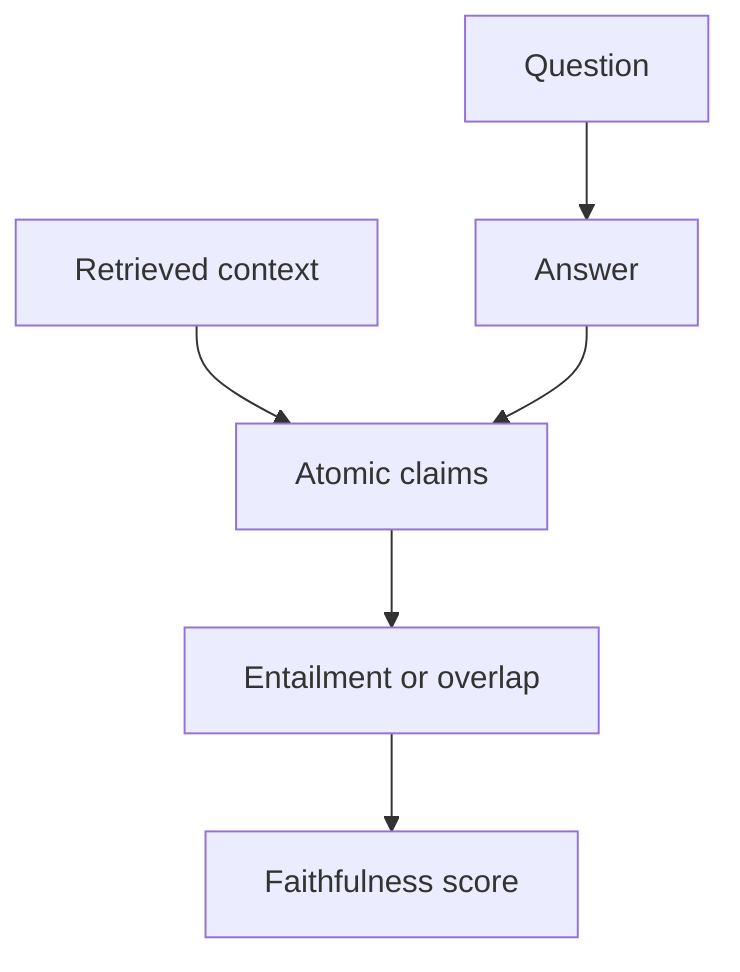

# Groundedness / Faithfulness / Hallucination

> Topic package — Domain 6 · Roadmap Week 17.
> Depth goal: build production-grade LLM evaluation habits: clear datasets, trustworthy metrics, statistical guardrails, and shipping decisions that survive contact with real users.

## Source
- Track: LLM Engineering (self-directed, FDE roadmap)
- Slide deck: `07 Resources Library/LLM Engineering/Slides/Lesson_32_Groundedness_and_Faithfulness.pptx`
- Hands-on notebook: `07 Resources Library/LLM Engineering/Notebooks/32_Groundedness_and_Faithfulness.ipynb` (runs offline)
- Reference reading: RAGAS faithfulness; FactScore; TruLens; SelfCheckGPT; NLI entailment
- Builds on: [[02 Literature Notes/LLM Engineering/Eval Fundamentals]] · [[02 Literature Notes/LLM Engineering/Retrieval Evaluation]]
- Date: 2026-07-18

---

## 1. Mental Model

**Groundedness asks whether each answer claim is supported by provided evidence, not whether the answer sounds plausible.** In RAG, unsupported claims are hallucinations even if true in the world.

Faithfulness is claim-to-context support; answer relevance is question-to-answer usefulness; citation quality is answer-to-source traceability.

> Key intuition: **verify claims against context, not vibes against fluency.**



---

## 2. How It Actually Works

### 6.1 Faithfulness versus relevance
A faithful answer is supported by context; a relevant answer addresses the question. A response can be faithful but useless or relevant but unfaithful, so score both.

### 6.2 Claim-level verification
Split answers into atomic claims and classify each as entailed, contradicted, or not mentioned by retrieved context. FactScore and RAGAS make this decomposition practical.

### 6.3 NLI and overlap proxies
NLI models or judges can estimate entailment, but deterministic lexical overlap, entity support, and contradiction checks are useful offline regression proxies.

### 6.4 Citation checking
Citations must point to spans that actually support the cited claim. Check existence, source id validity, span overlap, and claim coverage.

### 6.5 Hallucination taxonomy
Separate unsupported addition, contradiction, stale fact, missing caveat, and source misattribution because each points to a different fix.

---

## 3. Implementation

Assumed stack: stdlib + numpy. The snippets are offline and deterministic so they can run in CI before API-backed evaluation. Snippets:
- [[04 Code Snippets/LLM/Claim Support Overlap Scorer]]
- [[04 Code Snippets/LLM/Citation Coverage Checker]]

### Claim Support Overlap Scorer
Deterministic claim-to-context support proxy for groundedness regression tests.
```python
import re

def tokens(s): return set(re.findall(r"[a-z0-9]+", s.lower()))
def claim_support(claim, context):
    c, ctx = tokens(claim), tokens(context)
    return len(c & ctx) / max(1, len(c))
def faithfulness(claims, context, threshold=0.6):
    scores = [claim_support(c, context) for c in claims]
    return {"scores": scores, "faithful": sum(s >= threshold for s in scores) / max(1, len(scores))}
print(faithfulness(["refunds allowed within 30 days", "shipping is free"], "refunds are allowed within 30 days with receipt"))
```

### Citation Coverage Checker
Checks whether answer citations cover every claim and point to existing sources.
```python
def citation_coverage(claims, citations, sources):
    ids = set(sources)
    missing = []
    for i, claim in enumerate(claims):
        cited = citations.get(i, [])
        if not cited or not all(c in ids for c in cited): missing.append(claim)
    return {"coverage": 1 - len(missing)/max(1,len(claims)), "missing": missing}
print(citation_coverage(["A","B"], {0:["doc1"], 1:["doc9"]}, {"doc1":"text"}))
```

---

## 4. Design Decisions & Tradeoffs

| Decision | Guidance |
|---|---|
| **Dataset boundary** | Write down exactly which population the eval represents and which it excludes. |
| **Metric choice** | Prefer deterministic metrics for mechanical properties; use judges only for semantic qualities that require judgment. |
| **Slicing** | Always inspect business-critical, safety-critical, and historically weak slices. |
| **Calibration** | Compare automated scores against human labels before using them as gates. |
| **Thresholds** | Set pass/block/investigate thresholds before looking at the result. |
| **Artifacts** | Persist inputs, outputs, prompts, model versions, scores, and traces for reproducibility. |

---

## 5. Failure Modes & Gotchas

- Treating a polished demo as evidence of reliability.
- Optimizing a proxy metric after it stops matching user value.
- Reporting only an aggregate score while a critical slice fails.
- Changing prompt, model, data, and scorer at once, making regressions uninterpretable.
- Using a judge without bias audits or human calibration.
- Failing to save per-case artifacts, so failures cannot be debugged.

---

## 6. FDE Angle

- A production eval is a client-facing trust artifact, not internal trivia.
- A clear scorecard lets stakeholders decide whether to ship, hold, or rollback.
- Automated evals reduce manual QA and accelerate iteration.
- Deliverable: versioned dataset, runner, metrics, report, and CI gate.

---

## 7. Self-Check

1. Define the behavior being measured and the evidence required.
2. Explain how the dataset, scorer, baseline, and threshold interact.
3. Name slices that could hide severe regressions behind a good average.
4. Describe how you would calibrate the metric against human judgment.
5. State what artifacts are needed to reproduce a run.
6. Translate a score into a shipping decision.

---

## 9. Interview Q&A

**Q: What's the difference between faithfulness and answer relevance, and why can an answer be one without the other?**
A: Faithfulness asks whether each claim the answer makes is actually supported by the provided evidence/context — it's a question about the relationship between the *answer* and the *context*, with no reference to the original question at all. Relevance asks whether the answer actually addresses what was asked — a question about the relationship between the *answer* and the *question*, with no reference to the context's content.

Because these are checking two completely different relationships, an answer can score well on one while failing the other. An answer can be faithful but irrelevant: every claim it makes is genuinely supported by the retrieved context, but the answer doesn't actually address the question that was asked — imagine a user asks "what's our refund policy for electronics" and the answer accurately quotes the general refund policy from the context, word for word, correctly, but never actually addresses the electronics-specific part of the question, which also existed somewhere in the context but didn't make it into the answer. Every word of the answer is grounded and true — it's just not what was actually asked for.

Conversely, an answer can be relevant but unfaithful: it directly and clearly addresses exactly what was asked, but makes claims that aren't actually supported by the retrieved context — confidently answering the right question with fabricated or unsupported content. This is exactly the classic hallucination pattern: a fluent, on-topic, seemingly helpful answer that simply isn't grounded in real evidence.

*One-liner: faithfulness checks whether the answer's claims are supported by the context (answer-to-context); relevance checks whether the answer addresses the actual question (answer-to-question) — these are independent checks, so an answer can be faithful but off-topic, or relevant but fabricated, which is why both need to be measured separately rather than assuming one implies the other.*

**Q: Why does claim-level verification (breaking an answer into atomic claims) work better than just checking the whole answer at once?**
A: A typical answer is rarely a single, monolithic true-or-false statement — it's usually a combination of several distinct factual assertions bundled together into one piece of fluent prose. If you try to judge "is this whole answer faithful" as one single yes/no question, you lose the ability to tell *which specific part* of the answer, if any, is actually the problem — a three-sentence answer where two sentences are perfectly grounded and one sentence contains a fabricated detail would be hard to score meaningfully as a single unit, since "mostly faithful" isn't a very actionable verdict.

Breaking the answer down into atomic claims — individual, specific, checkable factual assertions — fixes this. Each claim can be checked independently against the context: is this specific claim entailed by (directly supported by) the context, contradicted by it, or simply not mentioned at all? This gives you a precise, granular result: "4 out of 5 claims in this answer are supported, but claim 3 — the specific number cited — isn't actually present anywhere in the retrieved context" is a far more useful, actionable diagnosis than "this answer is roughly 80% faithful" as an undifferentiated blob.

This granularity matters especially for actually fixing a problem once it's found — knowing precisely which specific claim in an answer is the unsupported one tells you exactly what to investigate (was this chunk missing from retrieval, did the model add something not actually in its context), rather than having to manually reread an entire answer trying to guess where the issue might be.

*One-liner: breaking an answer into individual atomic claims lets you check each one independently against the context (entailed, contradicted, or not mentioned) — this gives a precise, actionable diagnosis of exactly which specific part of an answer is unsupported, rather than one vague aggregate "faithfulness score" for the whole answer that can't tell you where the actual problem is.*

**Q: What's the difference between using an NLI (entailment) model and using lexical overlap as a faithfulness proxy — when would you use the cheaper overlap method?**
A: NLI (natural language inference) models are specifically trained to judge whether one piece of text logically follows from (is entailed by) another — given a claim and a piece of context, an NLI model tries to genuinely determine whether the context actually supports, contradicts, or says nothing about that claim, based on real semantic understanding of what each piece of text actually means. This is a more accurate, more semantically-aware check — it can catch cases where the context supports a claim using different wording than the claim itself uses, or where the context actually contradicts a claim despite sharing some of the same words.

Lexical overlap is a much simpler, cheaper proxy: it just checks how many of the same words appear in both the claim and the context, without any real understanding of meaning. This is obviously a cruder signal — a claim could share many words with the context while actually contradicting it (opposite meaning, same vocabulary), or a claim could be genuinely supported by context that uses entirely different wording to express the same idea, and overlap would miss that support entirely since the words don't literally match.

Despite being cruder, lexical overlap is useful specifically as a cheap, fast, deterministic regression-test proxy — something you can run constantly in CI, on every single prompt change, without the cost and latency of calling an actual NLI model or LLM judge for every single test case. The practical pattern: use the cheap overlap proxy as a fast first-pass signal during continuous, frequent testing (catching gross, obvious regressions quickly and cheaply), and reserve the more expensive, more accurate NLI/judge-based check for less frequent, more careful evaluation passes where the extra cost and latency is worth the added accuracy.

*One-liner: NLI models genuinely assess semantic entailment (does the context's actual meaning support this claim), which is more accurate but costlier to run; lexical overlap just checks shared words, which is cruder (can be fooled by contradicting claims that share vocabulary, or miss support expressed in different words) but cheap enough to run constantly in CI — using overlap as a fast, frequent regression-test proxy and reserving NLI/judges for less frequent, more careful passes is the practical pattern.*

**Q: What specifically needs to be checked for a citation to actually be valid, beyond just "a citation exists"?**
A: Just having *some* citation attached to a claim isn't actually sufficient — a citation can be present and still be wrong in several distinct ways, each of which needs its own specific check.

First: does the cited source actually exist — does the citation point to a real document/chunk ID that's actually part of the real corpus, rather than a fabricated or hallucinated reference that looks like a citation but doesn't correspond to anything real? Second: does the cited source's content actually overlap with and support the specific claim being made — a citation pointing to a real, existing document that happens to be about a completely unrelated topic is technically "a real citation" but doesn't actually support the claim it's attached to. Third: does every claim in the answer that needs support actually have a citation at all — citation *coverage*, checking that claims aren't left uncited entirely, not just that the citations that do exist are individually valid.

Each of these checks catches a different, specific failure: checking source existence catches fabricated citations; checking content overlap/support catches citations that are real but irrelevant to the specific claim; checking coverage catches claims that were never cited in the first place, even if the ones that were cited are individually fine. A citation-checking system that only verifies "the source ID exists somewhere" while skipping the other two checks would miss a real citation pointing to the wrong document, or a claim with no citation at all slipping through unnoticed.

*One-liner: citation validity needs three separate checks — does the cited source actually exist in the real corpus (not fabricated), does its actual content genuinely support the specific claim it's attached to (not just exist but be irrelevant), and does every claim needing support actually have a citation at all (coverage) — each catches a different specific failure a citation-checking system needs to verify independently.*

**Q: Why does it matter to distinguish different types of hallucination (unsupported addition, contradiction, stale fact, missing caveat, source misattribution) rather than treating them all as one category?**
A: Because each of these specific failure types points to a genuinely different root cause, and therefore needs a genuinely different fix — lumping them all together as "hallucination" loses the information you'd actually need to go fix the real underlying problem.

An unsupported addition (the model adds a specific detail that isn't present anywhere in the retrieved context at all) often points to the model's prompt not strongly enough enforcing "only use what's in the context" — a prompt-contract or instruction-strength issue. A contradiction (the answer directly conflicts with something the context actually says) is a more serious failure specifically suggesting the model isn't reliably reading or reasoning over its given context correctly, which might point toward needing a different model, a different prompting approach, or additional verification steps. A stale fact (the answer reflects an older version of information that's since changed) points toward a retrieval-freshness problem — the index might contain outdated documents, or isn't properly prioritizing the most current version of a document when multiple versions exist. A missing caveat (the answer states something as more certain or unconditional than the source actually supports, dropping an important qualifier the source included) suggests the model is oversimplifying nuanced source material. Source misattribution (the answer cites the right fact but attributes it to the wrong specific source) points to a problem specifically in the citation-generation step, separate from whether the underlying claim itself is actually correct.

Without distinguishing these, you'd just see "hallucination rate went up" with no direction on what to actually investigate — a vague, hard-to-act-on signal. With the distinction, you know specifically whether to look at prompt instructions, retrieval freshness, citation logic, or the model's context-reasoning reliability — a genuinely different, specific next step for each category.

*One-liner: each hallucination type points to a different root cause needing a different fix — unsupported additions suggest weak prompt instructions, contradictions suggest poor context reasoning, stale facts suggest a retrieval-freshness problem, missing caveats suggest oversimplification, and source misattribution points to the citation step specifically — lumping them together as one "hallucination rate" loses exactly the information needed to know what to actually go fix.*

## 8. Links
- Domain MOC: [[06 Maps of Content/LLM Engineering Concepts]]
- Code: [[04 Code Snippets/LLM/Claim Support Overlap Scorer]], [[04 Code Snippets/LLM/Citation Coverage Checker]]
- Distilled: [[03 Permanent Notes/Groundedness Is Claim Support Not Fluency]], [[03 Permanent Notes/Faithfulness and Answer Relevance Are Different Metrics]]
- Upstream: [[02 Literature Notes/LLM Engineering/Eval Fundamentals]] · Downstream: [[02 Literature Notes/LLM Engineering/Statistical Rigor in Eval]]
