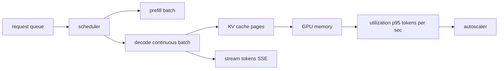

# Inference & Serving (vLLM, TGI, batching, streaming)

> Topic package — Domain 8 · Roadmap Week 22.
> Depth goal: reason about serving throughput, latency, GPU utilization, batching policy, streaming UX, KV-cache pressure, quantization, and autoscaling for self-hosted or managed LLM inference.

## Source
- Track: LLM Engineering (self-directed, FDE roadmap)
- Slide deck: `07 Resources Library/LLM Engineering/Slides/Lesson_46_Inference_and_Serving.pptx`
- Hands-on notebook: `07 Resources Library/LLM Engineering/Notebooks/46_Inference_and_Serving.ipynb` (runs offline)
- Reference reading: vLLM paper: Efficient Memory Management for Large Language Model Serving with PagedAttention (Kwon et al., arXiv:2309.06180); vLLM docs; Hugging Face Text Generation Inference docs; NVIDIA/Triton serving materials; SSE streaming docs
- Builds on: [[02 Literature Notes/LLM Engineering/LLM Efficiency]]
- Date: 2026-07-18

---

## 1. Mental Model

**LLM serving is a queueing and memory-management problem disguised as a model problem.** Once a model is loaded, the hard part is keeping expensive GPUs busy while preserving user-facing latency. Prefill is compute-heavy, decode is memory/KV-cache-heavy, requests have different prompt and output lengths, and each generated token changes the batch.

The winning serving stacks (vLLM, TGI, TensorRT-LLM, managed APIs) combine **continuous batching**, **KV-cache management**, **streaming**, **quantization**, and **autoscaling**. vLLM's PagedAttention treats KV cache like virtual memory pages, reducing fragmentation and enabling high throughput under mixed workloads.

> Key intuition: **a GPU sitting idle is money burning; a user waiting for first token is trust burning.** Serving architecture balances throughput, time-to-first-token, tail latency, and memory headroom.



---

## 2. How It Actually Works

### 8.1 Prefill vs decode
Serving has two different phases. **Prefill** processes the full prompt and builds KV cache; it is parallel and compute-heavy. **Decode** generates one token at a time using the KV cache; it is latency-sensitive and often memory-bandwidth bound. Long prompts stress prefill; many concurrent streams stress decode and KV memory.

### 8.2 Continuous batching
Naive batching waits for a fixed batch to finish together, wasting capacity when requests have variable output lengths. **Continuous batching** inserts new requests as old ones finish at token boundaries, keeping GPU utilization high. The scheduler trades throughput against waiting time: bigger batches improve tokens/sec but can hurt time-to-first-token and p95 latency.

### 8.3 PagedAttention and KV-cache management
vLLM's PagedAttention breaks KV cache into blocks/pages, like an OS memory manager. This reduces fragmentation from variable sequence lengths and lets the server reuse/free blocks efficiently. KV pressure determines maximum concurrency for long context. Once KV memory is exhausted, requests queue or fail.

### 8.4 Streaming and perceived latency
Streaming via Server-Sent Events (SSE) or websockets returns tokens as they are decoded. It does not necessarily reduce total latency, but it improves perceived responsiveness and enables cancellation. Track time-to-first-token separately from total generation latency; users feel TTFT immediately.

### 8.5 Quantization, autoscaling, and right-sizing
Quantized serving can fit larger models or higher concurrency on the same GPU, but quality and kernel support must be validated. Autoscaling should look at queue depth, p95/TTFT, KV-cache utilization, and tokens/sec — not CPU alone. Right-size the model: the cheapest serving win is often using a smaller model for easy traffic.

---

## 3. Implementation

Assumed stack: stdlib + numpy — deterministic simulations for batching, streaming chunks, KV-cache memory, and autoscaling signals. Snippets:
- [[04 Code Snippets/LLM/Continuous Batching Scheduler Simulator]]
- [[04 Code Snippets/LLM/SSE Token Streaming Demo]]

### Continuous Batching Scheduler Simulator
Simulate token-step scheduling where new requests enter as completed ones leave.
```python
from collections import deque

def continuous_batch(requests, max_batch=3):
    queue = deque(dict(id=i, remaining=t) for i, t in requests)
    active, timeline, step = [], [], 0
    while queue or active:
        while queue and len(active) < max_batch:
            active.append(queue.popleft())
        timeline.append((step, [r["id"] for r in active]))
        for r in active: r["remaining"] -= 1
        active = [r for r in active if r["remaining"] > 0]
        step += 1
    return timeline

reqs = [("a", 4), ("b", 2), ("c", 6), ("d", 1), ("e", 3)]
for step, batch in continuous_batch(reqs): print(step, batch)
```

### SSE Token Streaming Demo
Format generated tokens as Server-Sent Event chunks without calling a real model.
```python
import json

def fake_decode(prompt):
    for tok in ["The", " answer", " streams", " token", " by", " token", "."]:
        yield tok

def sse_events(prompt):
    for token in fake_decode(prompt):
        yield "data: " + json.dumps({"token": token}) + "

"
    yield "data: [DONE]

"

for event in sse_events("Explain batching"):
    print(event.strip())
```

---

## 4. Design Decisions & Tradeoffs

| Decision | Guidance |
|---|---|
| **Batch policy** | Use continuous batching for throughput; cap queue wait to protect TTFT and p95. |
| **KV headroom** | Plan concurrency from weights + KV cache, not weights alone; long context changes everything. |
| **Streaming** | Stream for interactive UX and cancellation; measure TTFT separately from total latency. |
| **Quantization** | Validate quality and serving-kernel support before assuming INT4/INT8 wins. |
| **Autoscaling** | Scale on queue depth, KV utilization, TTFT/p95, and tokens/sec, not CPU. |
| **Serving stack** | Use vLLM/TGI unless you have a strong reason to build a scheduler yourself. |

---

## 5. Failure Modes & Gotchas

- Sizing GPUs by model weights only → OOM when KV cache grows with context and concurrency.
- Maximizing throughput while ignoring TTFT → users experience the system as slow.
- Static batches → GPU bubbles when short generations finish early.
- No streaming/cancellation → wasted decode after users navigate away.
- Autoscaling on CPU → GPU queue and KV pressure are invisible.
- Quantizing without eval/kernel benchmarking → lower quality or slower unsupported kernels.

---

## 6. FDE Angle

- Serving is where architecture turns directly into dollars: utilization, latency, and model size drive margin.
- An FDE should be able to explain why vLLM/TGI improves throughput before changing the model.
- Capacity plans must include KV cache, expected prompt/output distributions, and latency SLOs.
- Deliverable: serving design with scheduler, streaming, autoscaling signals, and cost/latency tradeoffs.

---

## 7. Self-Check

1. Why are prefill and decode different bottlenecks?
2. What does continuous batching improve, and what can it hurt?
3. How does PagedAttention reduce KV-cache fragmentation?
4. Why track time-to-first-token separately?
5. Which metrics should drive autoscaling for LLM serving?
6. How does quantization interact with quality and kernel support?

---

## 9. Interview Q&A

**Q: Why are prefill and decode genuinely different bottlenecks, not just two phases of the same work?**
A: Prefill handles the entire input prompt all at once — it processes every token of the prompt in parallel, computing the Key/Value cache for the whole thing in one pass. Because this work is genuinely parallelizable (every prompt token's computation doesn't depend on some other prompt token being computed first, within this one pass), prefill is compute-heavy — it can really use the GPU's raw processing power efficiently, and a longer prompt means proportionally more of this parallel compute work to do.

Decode is structurally different: it generates exactly one new token at a time, and (as covered in Attention Deep-Dive's KV-cache discussion) each new token's generation reuses the cached Key/Value from everything generated so far, computing only a small amount of new work per step. But this per-step work is inherently sequential — you can't compute token 5 before token 4 exists, since token 5 depends on what came before it. This means decode can't take advantage of the same kind of parallelism prefill can; it's bottlenecked instead by how fast you can move the KV cache and weights through memory for each small, sequential step, which (per LLM Efficiency's memory-bandwidth discussion) is a fundamentally different kind of constraint than raw compute throughput.

So a long prompt specifically stresses prefill (lots of parallel compute to do in one pass), while many concurrent, ongoing generation streams specifically stress decode and KV-cache memory (many sequential, memory-bound steps happening across many requests at once) — these are genuinely different resource pressures, which is exactly why a serving system needs to reason about and manage them somewhat separately, rather than treating "inference" as one undifferentiated workload.

*One-liner: prefill processes the whole prompt in one parallel, compute-heavy pass; decode generates one token at a time, sequentially, reusing the cached KV from prior tokens, which is memory-bandwidth-bound rather than compute-bound — a long prompt specifically stresses prefill, while many concurrent generation streams specifically stress decode and KV-cache memory, which is why these need to be managed as genuinely different resource pressures.*

**Q: What does continuous batching actually improve over naive (static) batching, and what's the specific tradeoff it introduces?**
A: Naive batching groups a fixed set of requests together and waits for *all* of them to finish generating before starting the next batch — but requests genuinely vary in how many tokens they need to generate, so some requests in a batch finish much earlier than others. Under naive batching, once a request finishes, its slot in the batch just sits idle, wasting GPU capacity, until the slowest request in that same batch finally finishes too and a whole new batch can start.

Continuous batching fixes this by not waiting for an entire batch to complete together — as soon as any individual request finishes, a new, waiting request is immediately inserted into that now-open slot, at the next token-generation step, rather than waiting for the whole batch to clear first. This keeps the GPU doing useful work almost continuously, rather than having capacity sit idle waiting for the slowest member of a batch.

The tradeoff: a scheduler aggressively maximizing batch size and throughput (packing in as many requests as possible) can end up making individual requests wait longer before their very first token is even generated (time-to-first-token), or experience worse tail latency (p95 response time) — since a request now has to compete for a slot among a potentially larger, more actively-churning pool of concurrent requests. So continuous batching genuinely improves overall throughput (tokens processed per second, system-wide), but a scheduler still has to actively balance this against individual-request latency, rather than treating "maximize batching" as an unconditional win with no downside.

*One-liner: continuous batching inserts new requests into open slots as soon as any request finishes, rather than waiting for a whole fixed batch to complete together — this eliminates the idle GPU capacity naive batching wastes on early-finishing requests, improving overall throughput, but aggressively maximizing batch size can still worsen individual-request time-to-first-token and tail latency, which a scheduler has to actively balance rather than treating more batching as an unconditional win.*

**Q: How does PagedAttention specifically reduce KV-cache fragmentation, using the operating-system memory analogy?**
A: Without this technique, a naive approach to KV-cache memory would reserve one large, contiguous block of memory for each request, sized for its maximum possible sequence length — but different requests have very different actual lengths, and reserving space for the theoretical maximum when the actual need is often much smaller wastes a lot of memory that sits reserved but unused. This is directly analogous to the classic memory-fragmentation problem in operating systems, before virtual memory with paging existed — large, contiguous memory reservations that don't line up well with each other leave unusable gaps between them.

PagedAttention borrows the exact fix operating systems use for this: instead of one giant contiguous block per request, break the KV cache into small, fixed-size blocks (pages), and let each request's actual KV cache be made up of however many of these small pages it genuinely needs right now — not a block reserved up front for some hypothetical maximum length. As a request's sequence grows, it just gets allocated more pages as needed; as a request finishes and its memory is freed, those specific pages become immediately available to be reused by a different request, rather than being tied up in one large, now-partially-empty contiguous block that doesn't fit anything else well.

This is exactly the same conceptual move as an OS's virtual memory paging system — break memory into small, uniformly-sized, independently allocatable/freeable chunks rather than large, fixed, contiguous reservations — and it produces the same benefit here: much less wasted, fragmented memory, and the ability to serve more concurrent requests in the same total amount of GPU memory than a naive, one-contiguous-block-per-request approach would allow.

*One-liner: PagedAttention breaks the KV cache into small, fixed-size pages allocated and freed independently per request — rather than reserving one large contiguous block sized for a request's theoretical maximum length — the same fix operating systems use for memory fragmentation via virtual memory paging, which drastically reduces wasted memory and lets more concurrent requests fit in the same total GPU memory.*

**Q: Why should time-to-first-token (TTFT) be tracked separately from total generation latency, rather than just looking at overall request completion time?**
A: These measure genuinely different things from the user's actual experienced perspective. Total generation latency measures how long the *entire* response takes to fully complete — but a user doesn't experience "nothing" for that entire duration if the response is streamed; they start seeing output the moment the first token arrives, and TTFT specifically measures that initial wait before anything at all becomes visible.

Here's why this distinction matters concretely: a system could have a genuinely fast total generation latency but a slow TTFT (perhaps there's a long queueing delay before processing even starts, even though the actual generation itself, once it begins, is fast) — in this case, the user experiences a long, silent wait before seeing anything, even though the system's "total latency" number looks reasonable. Conversely, a system could have excellent TTFT (the user sees the first token almost immediately) but a longer total generation time for a long response — and because of streaming, this generally *feels* far more responsive to the user than the raw total-time number alone would suggest, since they're actively seeing progress rather than staring at a blank, unresponsive screen.

Since user-perceived responsiveness and trust are disproportionately shaped by that initial wait (per this topic's "a user waiting for first token is trust burning" framing), optimizing only for total latency, without separately tracking and optimizing TTFT specifically, can produce a system that technically performs well on paper but feels sluggish and untrustworthy to actual users in practice.

*One-liner: TTFT measures the initial silent wait before anything is visible, while total latency measures full completion time — these can diverge independently (good total latency with poor TTFT, or vice versa), and since user-perceived responsiveness is disproportionately shaped by that initial wait, tracking only total latency can hide a system that performs fine on paper but feels sluggish and untrustworthy in actual use.*

**Q: Which metrics should actually drive autoscaling decisions for LLM serving, and why is CPU utilization specifically the wrong signal?**
A: CPU utilization is the wrong signal because LLM inference is fundamentally GPU-bound work — the GPU is doing almost all of the actual heavy lifting (the matrix multiplications, the attention computation, the KV-cache management), while the CPU is largely just coordinating, handling requests, and moving data around. A GPU that's genuinely at capacity, fully utilized and under real pressure, can coexist with a CPU that looks almost entirely idle, since the CPU was never actually doing the bottlenecked work in the first place. Scaling decisions based on CPU utilization in this setup would be reading a largely irrelevant signal, potentially failing to scale up even while the actual bottleneck (the GPU and its memory) is under real, growing pressure.

The metrics that actually reflect genuine serving pressure: queue depth (how many requests are waiting to even start being processed — a direct signal that incoming demand is outpacing current serving capacity), KV-cache utilization (how much of the available GPU memory for KV cache is currently in use — directly tied to how many concurrent requests and how much context length the system can currently support before hitting a hard capacity wall), and the actual user-facing performance metrics themselves — TTFT and p95 latency (are users actually experiencing degraded responsiveness right now), and tokens-per-second throughput (is the system's actual generation rate keeping pace with demand). These metrics are directly tied to the actual GPU-bound bottleneck and the actual user experience, which is what autoscaling genuinely needs to react to — CPU utilization simply isn't measuring the part of the system that's actually under strain.

*One-liner: CPU utilization is the wrong autoscaling signal because LLM inference is GPU-bound — a GPU can be genuinely saturated while the CPU looks idle, since the CPU was never doing the bottlenecked work — autoscaling should instead watch queue depth, KV-cache utilization, TTFT/p95 latency, and tokens/sec throughput, since these directly reflect the actual GPU-bound bottleneck and real user-facing performance, which is what scaling decisions genuinely need to react to.*

**Q: Why can't you assume quantization is a free win for serving — what specifically needs to be validated before adopting it?**
A: Quantization (storing weights in fewer bits, as covered in LLM Efficiency) can genuinely reduce memory footprint and sometimes improve throughput on memory-bandwidth-bound workloads — but neither of those benefits is guaranteed to be free or automatic just because you've chosen to quantize; both need to be specifically checked, not assumed.

On the quality side: quantization is inherently a form of lossy compression — representing numbers with fewer bits necessarily discards some precision, and while well-implemented quantization schemes are designed to minimize the real-world impact of this, the actual quality impact genuinely varies by model, by quantization scheme, and by task — some tasks (especially ones requiring precise numerical or logical reasoning) can be more sensitive to this precision loss than others. This needs to be checked directly against your own task-relevant eval set (the same discipline covered throughout the Evaluation domain) rather than assumed to be negligible just because it's "usually fine" in general.

On the serving/performance side: not every serving stack or GPU hardware configuration has equally mature, well-optimized support for every quantization format — a quantization scheme that should theoretically provide a speed benefit can, on a specific combination of hardware and serving software, actually end up slower than the unquantized version, if the underlying compute kernels for that specific quantized format aren't well-optimized on that particular setup. This needs to be directly benchmarked on your actual intended serving stack and hardware, not assumed from quantization's general theoretical benefits, since the real-world performance depends heavily on how mature and optimized the specific implementation actually is for your specific setup.

*One-liner: quantization's benefits aren't automatic — quality impact needs to be checked directly against your own task-relevant eval (since precision loss affects different models and tasks differently), and performance benefit needs to be directly benchmarked on your actual serving stack and hardware (since not every quantization format has equally mature, well-optimized kernel support everywhere, and a theoretically faster format can actually end up slower on a poorly-supported setup).*

## 8. Links
- Domain MOC: [[06 Maps of Content/LLM Engineering Concepts]]
- Code: [[04 Code Snippets/LLM/Continuous Batching Scheduler Simulator]], [[04 Code Snippets/LLM/SSE Token Streaming Demo]]
- Distilled: [[03 Permanent Notes/LLM Serving Is Queueing Plus KV Cache Management]], [[03 Permanent Notes/Streaming Improves Trust Before It Improves Throughput]]
- Upstream: [[02 Literature Notes/LLM Engineering/LLM Efficiency]] · Downstream: [[02 Literature Notes/LLM Engineering/Cost Architecture]]
