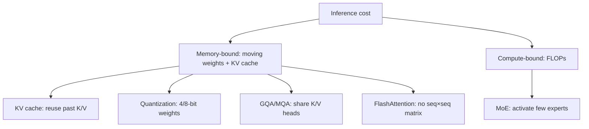

# LLM Efficiency

> Topic package — Domain 2 · Roadmap Week 11.
> Depth goal: understand the techniques that make LLM inference cheap and fast, what each trades off, and how to reason about VRAM and latency for a deployment.

## Source
- Track: LLM Engineering (self-directed, FDE roadmap)
- Slide deck: `07 Resources Library/LLM Engineering/Slides/Lesson_11_LLM_Efficiency.pptx`
- Hands-on notebook: `07 Resources Library/LLM Engineering/Notebooks/11_LLM_Efficiency.ipynb` (runs offline)
- Reference reading: Pope et al. 'Efficiently Scaling Transformer Inference'; Dettmers LLM.int8()/QLoRA; Frantar GPTQ; AWQ; Ainslie GQA (arXiv:2305.13245); Shazeer MQA; Dao FlashAttention (arXiv:2205.14135); Fedus Switch Transformer (MoE)
- Builds on: [[02 Literature Notes/LLM Engineering/Attention Deep-Dive]]
- Date: 2026-07-18

---

## 1. Mental Model

**Inference cost has two enemies — memory and compute — and every efficiency technique attacks one of them.** A deployed LLM is usually *memory-bandwidth bound*: the bottleneck is moving weights and the KV cache in and out of GPU memory, not raw FLOPs. So the big wins come from making things *smaller* (quantization), *reusing* work (KV cache), *reading less* (GQA/MQA, FlashAttention), or *activating less* (MoE).

- **KV cache** — reuse past Keys/Values so each new token is O(seq) not O(seq²). Costs memory.
- **Quantization** — store weights/activations in 8/4 bits instead of 16. ~2-4× smaller, minor quality loss.
- **GQA/MQA** — share K/V heads across query heads → smaller KV cache, faster decode.
- **FlashAttention** — compute attention without materializing the seq×seq matrix → less memory, faster.
- **MoE** — many expert MLPs, route each token to a few → more params, same per-token compute.

> Key intuition: **you're usually memory-bound, so shrink and reuse.** Knowing which lever applies lets you cut cost/latency without retraining.



---

## 2. How It Actually Works

### 2.1 KV cache (the biggest inference-memory cost)
During generation, past tokens' K and V don't change, so cache them. Each new token computes one Query against the cached K/V — turning per-step cost from O(seq²) to O(seq). The cache size is the catch:

$$\text{KV bytes} = 2 \times n_{layers} \times seq \times d_{model} \times \text{bytes} \times batch$$

For long contexts this can exceed the model weights themselves. Shrinking it (GQA, quantized KV) is a major lever.

### 2.2 Quantization
Store weights (and sometimes activations/KV) in fewer bits: FP16 → INT8 (LLM.int8()) or INT4 (GPTQ, AWQ, NF4). Roughly halves or quarters memory and boosts throughput on bandwidth-bound workloads, with small quality loss when done well (per-channel scales, outlier handling). **Post-training quantization** (GPTQ/AWQ) needs no retraining; **QLoRA** fine-tunes on top of a 4-bit base. This is the single most practical lever for fitting a model on cheaper hardware.

### 2.3 GQA / MQA (attention-head sharing)
Multi-Head Attention has one K/V per query head. **Multi-Query Attention (MQA)** uses a *single* shared K/V for all query heads; **Grouped-Query Attention (GQA)** uses a few K/V groups — a middle ground. Both shrink the KV cache and speed up decode with minimal quality loss. LLaMA-2 70B, Mistral, and most modern models use GQA.

### 2.4 FlashAttention
Standard attention materializes the full `seq×seq` score matrix in memory. FlashAttention computes attention in tiles, keeping partial softmax statistics in fast SRAM and never writing the big matrix to HBM. Result: **same math, less memory, ~2-4× faster** for long sequences. It's an implementation optimization — no accuracy tradeoff.

### 2.5 Mixture of Experts (MoE)
Replace the dense MLP with `N` expert MLPs plus a router that sends each token to the top-`k` experts (e.g. 2 of 8). Total parameters balloon (more capacity/knowledge) but **per-token compute stays roughly constant** because only k experts fire. Mixtral, DeepSeek, and others use MoE. Cost: memory to hold all experts, routing complexity, load-balancing.

---

## 3. Implementation

Assumed stack: `numpy` to make the memory math and KV-cache reuse concrete. Snippets:
- [[04 Code Snippets/LLM/KV Cache Memory Estimator]]
- [[04 Code Snippets/LLM/KV Cache Reuse Demo]]

### KV Cache Memory Estimator
Estimate KV-cache size and compare to model weights for a given config.
```python
def kv_cache_gb(n_layers, d_model, seq, batch=1, bytes_per=2, kv_heads=None, n_heads=None):
    # GQA: KV scales with kv_heads/n_heads instead of full d_model
    frac = 1.0 if not (kv_heads and n_heads) else kv_heads / n_heads
    dims = d_model * frac
    total = 2 * n_layers * seq * dims * bytes_per * batch   # 2 = K and V
    return total / 1e9

def weights_gb(n_layers, d_model, vocab, bytes_per=2):
    per = 12 * d_model * d_model
    return (n_layers * per + vocab * d_model) * bytes_per / 1e9

L, d, v = 32, 4096, 32000
print(f"weights (fp16): {weights_gb(L,d,v):.1f} GB")
for seq in (2048, 8192, 32768):
    full = kv_cache_gb(L, d, seq, batch=8)
    gqa  = kv_cache_gb(L, d, seq, batch=8, kv_heads=8, n_heads=32)
    print(f"seq={seq:>6} batch=8  KV(MHA)={full:5.1f}GB  KV(GQA 8/32)={gqa:5.1f}GB")
```

### KV Cache Reuse Demo
Show that caching K/V makes per-step attention O(seq) instead of recomputing O(seq²).
```python
import numpy as np
rng = np.random.RandomState(0)
d = 32
def new_kv(tok): return rng.randn(d), rng.randn(d)   # pretend projections

# Without cache: recompute all K,V every step -> O(t^2) work
def no_cache(tokens):
    work = 0
    for t in range(1, len(tokens)+1):
        for _ in range(t): new_kv(0); work += 1     # rebuild 0..t
    return work

# With cache: only the new token's K,V each step -> O(t)
def with_cache(tokens):
    cache, work = [], 0
    for tok in tokens:
        cache.append(new_kv(tok)); work += 1         # append one
    return work

toks = list(range(200))
print("work no-cache :", no_cache(toks))     # ~ n^2/2
print("work with-cache:", with_cache(toks))  # ~ n
print("speedup ~", no_cache(toks)//with_cache(toks), "x at seq=200")
```

---

## 4. Design Decisions & Tradeoffs

| Decision | Guidance |
|---|---|
| **Fit on smaller GPU** | Quantize (GPTQ/AWQ INT4) first — biggest memory win, minimal quality loss, no retraining. |
| **Long context / big batch** | Use a GQA/MQA model and consider quantized KV cache; KV can dwarf weights. |
| **Latency-critical decode** | GQA + FlashAttention + continuous batching (vLLM); these are additive. |
| **Need max capacity per FLOP** | MoE — more knowledge at constant per-token compute, at the cost of memory. |
| **Quality-sensitive** | Validate quantized model on your eval set; 4-bit sometimes hurts reasoning tasks. |

---

## 5. Failure Modes & Gotchas

- Ignoring KV cache in VRAM planning → OOM at long context even though weights fit.
- Assuming inference is compute-bound → optimizing FLOPs when you're memory-bandwidth bound.
- Aggressive 4-bit quantization without eval → silent quality regression on hard tasks.
- Expecting MoE to be cheaper to *host* — it needs memory for all experts.
- Treating FlashAttention as a quality tradeoff → it's exact, just a faster implementation.
- Forgetting GQA changes the KV-cache size formula (scales with kv_heads, not full d_model).

---

## 6. FDE Angle

- This is the 'why is inference so expensive?' toolkit — you can point to KV cache, precision, or batching and propose a fix.
- Quantization + GQA + vLLM batching routinely cut serving cost several-fold without retraining — a concrete client win.
- VRAM math (weights + KV cache) lets you size hardware and pick between managed APIs and self-hosting.
- Deliverable: a capacity/cost estimate for a deployment, with the efficiency levers you'd apply and their quality risk.

---

## 7. Self-Check

1. Why is LLM inference usually memory-bandwidth bound, not compute bound?
2. Write the KV-cache size formula; when does it exceed the weights?
3. How do MQA and GQA differ, and what do they save?
4. Is FlashAttention a quality tradeoff? Why or why not?
5. How can MoE add parameters without adding per-token compute — and what's the catch?

---

## 9. Interview Q&A

**Q: Why is LLM inference usually memory-bandwidth bound, not compute bound?**
A: Think about what the GPU actually spends its time doing while generating one token at a time. For each new token, the model has to read its entire set of weights (and the growing KV cache) from GPU memory into the chip's fast compute units, do a relatively small amount of math with them, then throw that work away and do it all again for the next token. The amount of math per token is actually fairly small — but the amount of *data that has to move* to do that math is huge, since you're dragging the whole weight set through memory every single step.

Compare that to training, where you process many tokens at once in large batches — the same weights get reused across a big batch of data before moving on, so the cost of moving the weights gets spread across a lot of useful computation. During single-token generation, you don't get that benefit — you're moving the same huge amount of data for a tiny amount of work each time.

This is exactly what "memory-bandwidth bound" means: the GPU's compute units are sitting idle, waiting for data to arrive from memory, rather than being the actual bottleneck themselves. This is why techniques that reduce how much data has to move (smaller weights via quantization, a smaller cache via GQA, avoiding extra memory writes via FlashAttention) help so much more than techniques that would only reduce the amount of math — the math was never really the problem.

*One-liner: generating one token at a time means moving the whole weight set through memory for just a small amount of math each step, so the GPU spends most of its time waiting on data to arrive rather than being limited by how much math it can do — which is why shrinking what has to move (quantization, smaller caches) helps more than cutting raw computation.*

**Q: Write the KV-cache size formula — when does it exceed the model's own weights?**
A: Start from what the cache actually stores: for every layer, for every token processed so far, you keep one Key vector and one Value vector. So the total size is: 2 (for K and V) times the number of layers, times the sequence length, times the model's width, times how many bytes each number takes, times how many requests you're serving at once (the batch size).

The part that matters most here is that this cache grows with *sequence length* and *batch size* — two things that have nothing to do with how big the model itself is. The model's weights are a fixed size no matter what you're doing with the model. But the cache keeps growing the longer the conversation gets and the more requests you're handling simultaneously.

So the cache exceeding the weights isn't some rare edge case — it's just a matter of context length and concurrent users getting large enough. A very long document, or many simultaneous users each with a long conversation, can easily need more memory for the cache alone than the entire model weighs. This is why context length isn't "free" even once a model is loaded and running — every additional token of context costs ongoing memory for as long as that conversation is active, for every active user.

*One-liner: KV cache size is 2 x layers x sequence length x model width x bytes x batch size — since it grows with context length and number of concurrent users rather than model size, a long enough conversation or large enough batch can easily make the cache bigger than the model's own weights.*

**Q: How do MQA and GQA differ, and what do they save?**
A: Standard multi-head attention gives every attention head its own separate Key and Value. That means the KV cache has to store a full, separate set of K/V for every single head — and modern models can have dozens of heads, so this adds up fast.

Multi-Query Attention (MQA) takes this to one extreme: instead of each head having its own K/V, *all* heads share just one single K/V. This shrinks the cache dramatically — instead of, say, 32 separate K/V sets, you store just 1. The tradeoff is a bit of lost quality, since all the heads are now forced to look at the exact same Key/Value information instead of each having its own.

Grouped-Query Attention (GQA) is a middle ground: instead of one shared K/V for everyone, you split heads into a handful of groups (say, 8 groups for 32 heads), and heads within the same group share one K/V. This keeps most of the cache savings of MQA — you still store far fewer K/V sets than one-per-head — while keeping more of the quality benefit of separate heads, since you haven't forced every single head down to the exact same view. This is why most modern large models (LLaMA-2 70B, Mistral, and others) use GQA specifically — it captures most of the memory win with much less quality cost than going all the way to MQA.

*One-liner: MQA shares one Key/Value across all attention heads (biggest cache savings, some quality cost); GQA shares K/V across a handful of groups instead of all heads (most of the savings, much less quality cost) — which is why GQA is the common choice in modern models.*

**Q: Is FlashAttention a quality tradeoff? Why or why not?**
A: No — and this is an important distinction to get right, because it's easy to lump it in with other efficiency tricks that *do* trade away some quality.

Regular attention, as a side effect of how it's normally implemented, builds a full table comparing every word against every other word, and that whole table has to sit in memory at once before you can finish the softmax step on it. For long sequences, that table gets very large, and just moving it in and out of memory is slow.

FlashAttention doesn't change *what* gets computed at all — it computes the exact same mathematical result. What it changes is *how* that computation is organized: instead of building the whole giant table in one go, it processes small chunks at a time, keeping just enough running totals to still get the mathematically correct final answer, and never writes the full giant table out to slower memory at all. The output, bit for bit (aside from ordinary floating-point rounding, same as any reordered calculation), is the same attention result you'd get from the regular approach.

So this is purely an implementation trick — a smarter way to organize the same math so it moves less data around — not a different, approximate version of attention. That's different from something like quantization or MQA, which genuinely do accept a small amount of quality loss in exchange for speed or memory savings.

*One-liner: FlashAttention computes the exact same attention result, just by processing it in smaller chunks and never building the full giant score table in slow memory — it's a smarter way to organize identical math, not an approximation, so there's no quality tradeoff involved.*

**Q: How can Mixture of Experts (MoE) add parameters without adding per-token compute — and what's the catch?**
A: A regular model has one MLP per layer, and every single token has to pass through that one MLP. MoE replaces that one MLP with several separate "expert" MLPs (say, 8 of them) plus a small router that looks at each token and decides which experts should handle it — but critically, it only sends each token to a *few* of those experts (say, 2 out of 8), not all of them.

Here's why that saves compute: even though the model now technically contains 8 experts' worth of parameters, any single token only ever gets processed by 2 of them. So the actual amount of math done per token stays about the same as if there'd only been 2 experts all along — the other 6 simply aren't involved for that particular token. Different tokens can get routed to different pairs of experts, so across many tokens, the model as a whole ends up using all of its knowledge, just never all at once for any single token.

The catch is memory, not compute: even though only 2 experts fire per token, all 8 experts' weights still have to be loaded into memory and ready to go, since you don't know in advance which 2 a given token will need. So MoE models are "cheap" to run per token but "expensive" to simply hold in memory — you need enough memory for every expert, even the ones that happen to go unused for any particular input. There's also added complexity in making sure tokens get routed fairly across experts, so a few experts don't end up overloaded while others sit idle.

*One-liner: MoE swaps one MLP for several expert MLPs plus a router that sends each token to only a few of them, so per-token compute stays low even as total parameters grow — but all the experts still have to sit in memory ready to be used, so MoE saves compute while costing more memory.*

## 8. Links
- Domain MOC: [[06 Maps of Content/LLM Engineering Concepts]]
- Code: [[04 Code Snippets/LLM/KV Cache Memory Estimator]], [[04 Code Snippets/LLM/KV Cache Reuse Demo]]
- Distilled: [[03 Permanent Notes/LLM Inference Is Usually Memory-Bandwidth Bound]], [[03 Permanent Notes/Quantization and GQA Are the Cheapest Serving Wins]]
- Upstream: [[02 Literature Notes/LLM Engineering/Attention Deep-Dive]] · Downstream: [[02 Literature Notes/LLM Engineering/Reasoning Models]]
