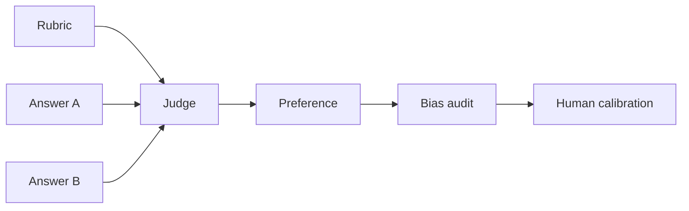

# LLM-as-a-Judge Done Right

> Topic package — Domain 6 · Roadmap Week 17.
> Depth goal: build production-grade LLM evaluation habits: clear datasets, trustworthy metrics, statistical guardrails, and shipping decisions that survive contact with real users.

## Source
- Track: LLM Engineering (self-directed, FDE roadmap)
- Slide deck: `07 Resources Library/LLM Engineering/Slides/Lesson_33_LLM_as_a_Judge.pptx`
- Hands-on notebook: `07 Resources Library/LLM Engineering/Notebooks/33_LLM_as_a_Judge.ipynb` (runs offline)
- Reference reading: Zheng et al. MT-Bench and Chatbot Arena 2306.05685; Liu et al. G-Eval 2303.16634
- Builds on: [[02 Literature Notes/LLM Engineering/Eval Fundamentals]] · [[02 Literature Notes/LLM Engineering/Retrieval Evaluation]]
- Date: 2026-07-18

---

## 1. Mental Model

**An LLM judge is a noisy measuring instrument, not an oracle.** It can scale qualitative evaluation only when the rubric is explicit, outputs are blinded, calibration data exists, and bias is measured.

Pointwise judges assign scores; pairwise judges choose a better answer. Pairwise is often more stable but still vulnerable to position, verbosity, style, and self-preference bias.

> Key intuition: **calibrate, randomize, audit, and never trust one unblinded reading.**



---

## 2. How It Actually Works

### 6.1 Pointwise versus pairwise
Pointwise scoring is easy to aggregate but drifts; pairwise preference is often more reliable for small differences and powers MT-Bench/Chatbot Arena style evaluation.

### 6.2 Rubric design
Define dimensions, anchors, disqualifiers, and examples. Separate correctness, groundedness, safety, and style so the judge does not average incompatible properties.

### 6.3 Biases to audit
Position, verbosity, formatting, and self-preference bias require randomization, answer swapping, length controls, and model diversity.

### 6.4 Calibration against humans
Track agreement, Cohen kappa-like statistics, confusion patterns, and threshold stability on expert-labeled examples.

### 6.5 Judge artifacts
Save judge prompt, rubric version, randomized order, rationale, parsed score, and model version to diagnose judge drift.

---

## 3. Implementation

Assumed stack: stdlib + numpy. The snippets are offline and deterministic so they can run in CI before API-backed evaluation. Snippets:
- [[04 Code Snippets/LLM/Pairwise Judge Calibration Harness]]
- [[04 Code Snippets/LLM/Judge Position Bias Audit]]

### Pairwise Judge Calibration Harness
Compare deterministic simulated judge preferences against human labels.
```python
def simulated_judge(a, b):
    keys = {"supported", "specific", "safe", "concise"}
    sa = sum(k in a.lower() for k in keys); sb = sum(k in b.lower() for k in keys)
    return "A" if sa >= sb else "B"
def accuracy(preds, labels): return sum(p == y for p,y in zip(preds, labels)) / len(labels)
pairs = [("specific supported answer", "vague answer"), ("long unsafe answer", "concise safe answer")]
print(accuracy([simulated_judge(a,b) for a,b in pairs], ["A","B"]))
```

### Judge Position Bias Audit
Swap answer order and count preference patterns that reveal position sensitivity.
```python
def audit_position_bias(judge, pairs):
    biased = 0
    for a,b in pairs:
        if judge(a,b) == judge(b,a): biased += 1
    return biased / max(1, len(pairs))
def always_a(a,b): return "A"
print(audit_position_bias(always_a, [("x","y"),("better","worse")]))
```

---

## 4. Design Decisions & Tradeoffs

| Decision | Guidance |
|---|---|
| **Dataset boundary** | Write down exactly which population the eval represents and which it excludes. |
| **Metric choice** | Prefer deterministic metrics for mechanical properties; use judges only for semantic qualities that require judgment. |
| **Slicing** | Always inspect business-critical, safety-critical, and historically weak slices. |
| **Calibration** | Compare automated scores against human labels before using them as gates. |
| **Thresholds** | Set pass/block/investigate thresholds before looking at the result. |
| **Artifacts** | Persist inputs, outputs, prompts, model versions, scores, and traces for reproducibility. |

---

## 5. Failure Modes & Gotchas

- Treating a polished demo as evidence of reliability.
- Optimizing a proxy metric after it stops matching user value.
- Reporting only an aggregate score while a critical slice fails.
- Changing prompt, model, data, and scorer at once, making regressions uninterpretable.
- Using a judge without bias audits or human calibration.
- Failing to save per-case artifacts, so failures cannot be debugged.

---

## 6. FDE Angle

- A production eval is a client-facing trust artifact, not internal trivia.
- A clear scorecard lets stakeholders decide whether to ship, hold, or rollback.
- Automated evals reduce manual QA and accelerate iteration.
- Deliverable: versioned dataset, runner, metrics, report, and CI gate.

---

## 7. Self-Check

1. Define the behavior being measured and the evidence required.
2. Explain how the dataset, scorer, baseline, and threshold interact.
3. Name slices that could hide severe regressions behind a good average.
4. Describe how you would calibrate the metric against human judgment.
5. State what artifacts are needed to reproduce a run.
6. Translate a score into a shipping decision.

---

## 9. Interview Q&A

**Q: Why is an LLM judge described as "a noisy measuring instrument, not an oracle" — what does that distinction actually change in practice?**
A: An oracle would be a source of ground truth you could simply trust — if it says answer A is better, that's just correct, no further checking needed. A noisy measuring instrument is different: it gives you a *reading*, which is useful information, but one that has its own specific error patterns and biases baked in, the same way a bathroom scale gives you a useful but imperfect reading of your actual weight — you wouldn't treat the scale's number as infallible without ever checking it against a known reference weight.

This distinction changes what you're actually obligated to do before trusting an LLM judge's output. If it were an oracle, you could just take its verdict and act on it directly. Because it's an instrument, you have an obligation to actually characterize its error patterns first — does it have a consistent bias (favoring longer answers regardless of quality, favoring whichever answer appears first), and does it actually agree with real human judgment on cases where you have genuine human labels to check against? Only once you've done this characterization work can you reasonably trust its verdicts, and even then, you trust them as "a calibrated instrument's reading," not as ground truth itself.

*One-liner: an oracle's verdict can simply be trusted; a noisy instrument's reading is useful but needs its specific error patterns (bias, position sensitivity) characterized and checked against real ground truth first — treating an LLM judge as the latter means doing that calibration work before trusting its verdicts, rather than accepting them at face value.*

**Q: What's the difference between pointwise and pairwise judging, and why is pairwise often more reliable for small quality differences?**
A: Pointwise judging asks the model to assign an absolute score to a single answer in isolation — "rate this response from 1 to 10." Pairwise judging instead shows the model two answers side by side and asks it to pick which one is better (or declare a tie) — a relative, comparative judgment rather than an absolute one.

Pairwise tends to be more reliable specifically for small, subtle quality differences because comparing two things side by side is a fundamentally easier judgment task than independently placing each one on an absolute numeric scale. Think about doing this yourself: it's often much easier to look at two similar essays and say "this one is slightly better" than it is to independently assign each one an exact score out of 10 and have those two scores reliably reflect the same small difference you'd notice when looking at them together. Pointwise scores are also prone to drift over time or across different batches — a judge might score the exact same quality of answer slightly differently depending on what else it happened to be scoring recently, since there's no direct anchor or comparison point for an absolute numeric judgment.

The tradeoff: pairwise judging only tells you "A is better than B" — it doesn't directly give you an absolute quality score you could track over time the way a pointwise score would, and comparing many candidates pairwise can require more individual comparisons than just scoring each one once.

*One-liner: pointwise assigns an absolute score to one answer in isolation; pairwise directly compares two answers and picks the better one — pairwise tends to be more reliable for small, subtle differences because relative comparison is an easier, more stable judgment than independently placing each answer on an absolute scale with no direct anchor.*

**Q: What specific biases need to be audited for when using an LLM as a judge, and how do you actually test for each one?**
A: Several documented, specific biases can distort a judge's verdicts in ways that have nothing to do with actual answer quality, and each needs its own specific test to catch.

Position bias: a judge might systematically favor whichever answer happens to be presented first (or second), regardless of actual quality. Test for this by swapping the order of the same pair of answers and checking whether the judge's verdict changes purely because of the swap — if it does, that's evidence of position bias, since the actual quality of the two answers didn't change, only their presentation order did.

Verbosity bias: a judge might systematically favor longer answers, treating length as a proxy for thoroughness or quality even when the extra length doesn't add real value. Test for this by comparing a genuinely correct, concise answer against a longer, padded answer that doesn't actually contain more real substance, checking whether the judge incorrectly favors the longer one on length alone.

Self-preference bias: if the judge model and the model being evaluated are from the same family or provider, the judge might subtly favor outputs that match its own stylistic tendencies, independent of genuine quality. Test for this by comparing judge verdicts across answers from genuinely different model families, checking for a systematic pattern of preferring its own family's outputs. Formatting bias is similar — a judge might prefer answers formatted in a particular way (bullet points, a specific structure) regardless of whether that formatting is actually more correct or helpful for a given task.

*One-liner: audit for position bias (swap answer order on the same pair and check if the verdict flips purely from the swap), verbosity bias (compare a concise correct answer against a padded longer one), self-preference bias (compare verdicts across genuinely different model families), and formatting bias — each needs its own specific test, since none of these show up just from looking at a judge's verdicts in isolation.*

**Q: How do you actually calibrate an LLM judge against real human judgment, and what specifically are you checking for?**
A: This follows the same calibration principle covered in Eval Fundamentals, applied specifically to a judge model rather than to a metric generally: get genuine human judgments on a sample of real cases, run the judge on those same cases, and compare where they agree versus where they diverge.

What you're specifically checking for with an LLM judge, beyond simple agreement rate: confusion patterns — are there particular *types* of cases where the judge and humans systematically disagree (perhaps the judge handles clear-cut quality differences well but struggles specifically on close, ambiguous calls where even humans might disagree with each other)? And statistical measures of agreement that account for chance — a raw percentage agreement can be misleading if, say, 90% of cases have an obvious right answer that both humans and the judge would agree on easily; a measure like Cohen's kappa specifically accounts for how much agreement would be expected purely by chance, giving a more honest picture of how much the judge is actually adding real signal versus just agreeing on the easy cases that barely needed a judge at all.

This calibration should specifically be re-checked over time, not treated as a one-time setup step — a judge's behavior, especially if it's a model that gets provider-side updates you don't control, can shift, which means a calibration that held true months ago might not still hold true now without re-verification.

*One-liner: calibration means comparing the judge's verdicts against real human judgments on the same sample of cases, specifically checking for confusion patterns (what types of cases does it get systematically wrong) and using chance-adjusted agreement measures like Cohen's kappa (rather than raw agreement, which can look falsely strong just from easy, obvious cases) — and re-checking this periodically, since a judge's behavior can shift over time, especially if it's a model you don't fully control the updates to.*

**Q: What judge-specific artifacts need to be saved, beyond the general eval artifacts covered in Eval Fundamentals?**
A: Beyond the standard eval artifacts (dataset version, system config, per-case outputs, scores), a judge-based eval specifically needs: the exact rubric version used (what specific criteria and anchors the judge was instructed to apply — since changing the rubric wording can shift verdicts just as much as changing which model is doing the judging), the randomized presentation order used for each pairwise comparison (so you can later check whether a specific verdict might have been affected by position bias), the judge's actual rationale/reasoning for its verdict (not just the final score or choice — the reasoning is what lets you spot, after the fact, whether the judge's stated reasoning actually matches its verdict, or whether something inconsistent happened), and the specific judge model version used (since, as above, a judge model can itself change behavior over time through provider-side updates, independent of anything you changed).

The reason this extra detail matters specifically for judges: a judge's verdict is itself a kind of output that can be wrong or inconsistent, which means you need enough detail to audit the *judge's own behavior*, not just the thing it was judging — if a judge's verdict looks suspicious later, you want to be able to check whether the rubric was ambiguous, whether position bias might have played a role, whether the judge's own stated reasoning actually supports the verdict it gave, and whether the judge model itself has changed since this run.

*One-liner: beyond standard eval artifacts, judge-based evals need the exact rubric version, the randomized presentation order per comparison, the judge's actual rationale (not just its final verdict), and the specific judge model version — since a judge's own verdict can itself be wrong or inconsistent, and auditing that requires enough detail to check the judge's behavior specifically, not just the thing it judged.*

## 8. Links
- Domain MOC: [[06 Maps of Content/LLM Engineering Concepts]]
- Code: [[04 Code Snippets/LLM/Pairwise Judge Calibration Harness]], [[04 Code Snippets/LLM/Judge Position Bias Audit]]
- Distilled: [[03 Permanent Notes/LLM Judges Are Instruments Not Oracles]], [[03 Permanent Notes/Pairwise Judging Needs Bias Audits]]
- Upstream: [[02 Literature Notes/LLM Engineering/Eval Fundamentals]] · Downstream: [[02 Literature Notes/LLM Engineering/Statistical Rigor in Eval]]
