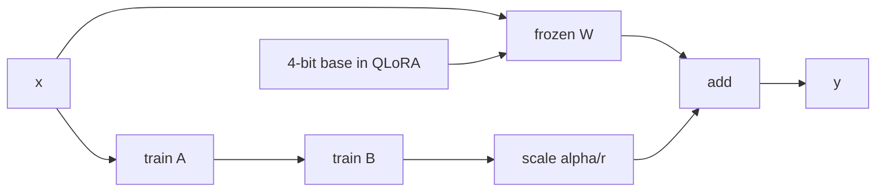

# LoRA / QLoRA / PEFT

> Topic package — Domain 7 · Roadmap Week 18.
> Depth goal: implement LoRA math, choose rank/alpha/target layers, explain QLoRA memory savings, and plan adapter serving.

## Source
- Track: LLM Engineering (self-directed, FDE roadmap)
- Slide deck: `07 Resources Library/LLM Engineering/Slides/Lesson_40_LoRA_QLoRA_PEFT.pptx`
- Hands-on notebook: `07 Resources Library/LLM Engineering/Notebooks/40_LoRA_QLoRA_PEFT.ipynb` (runs offline)
- Reference reading: Hu et al. LoRA (arXiv:2106.09685); Dettmers et al. QLoRA (arXiv:2305.14314); Hugging Face PEFT documentation; bitsandbytes NF4 docs
- Builds on: [[02 Literature Notes/LLM Engineering/Transformer Architecture]] · [[02 Literature Notes/LLM Engineering/Embeddings]] · [[02 Literature Notes/LLM Engineering/Supervised Fine-Tuning]]
- Date: 2026-07-18

---

## 1. Mental Model

**LoRA freezes the big matrix and learns a tiny low-rank patch that steers it.** Instead of updating `W`, train `A` and `B` so the model uses `W + (α/r)BA`.

QLoRA keeps the frozen base in 4-bit quantized form and trains adapters, cutting memory while preserving most fine-tuning quality.

> Key intuition: **fine-tune the direction, not the whole space** — useful task adaptation often lives in a low-dimensional delta.



---

## 2. How It Actually Works

### 7.1 Low-rank update
LoRA freezes a dense matrix `W` and trains `ΔW=(α/r)BA`, where `A` maps into a small rank-r space and `B` maps back. The forward pass is `y=Wx+(α/r)BAx`.

### 7.2 Rank and alpha
Rank controls adapter capacity; alpha controls update scale. More rank increases trainable parameters and overfit risk, so choose with validation curves.

### 7.3 Target modules
Common targets are attention `q_proj` and `v_proj`; larger shifts may also adapt `k/o` and MLP projections. Layer choice is a capacity/latency tradeoff.

### 7.4 QLoRA
QLoRA stores frozen base weights in 4-bit NF4, dequantizes for compute, and trains adapters with optimizer state only for adapter parameters.

### 7.5 Serving adapters
Merge adapters for one task; hot-swap adapters for multiple tenants or domains sharing one base. Version adapters with base checkpoint hashes.

---

## 3. Implementation

Assumed stack: numpy. Snippets implement the LoRA forward pass and parameter accounting.
- [[04 Code Snippets/LLM/LoRA Forward Pass in Numpy]]
- [[04 Code Snippets/LLM/LoRA Parameter Savings Calculator]]

### LoRA Forward Pass in Numpy
Compute `W x + (alpha/r) B A x`.
```python
import numpy as np
rng=np.random.RandomState(0)
W=rng.normal(size=(4,5)); A=rng.normal(scale=.02,size=(2,5)); B=rng.normal(scale=.02,size=(4,2)); x=rng.normal(size=5)
y=W@x+(8/2)*(B@(A@x))
print(np.round(y,3))
```

### LoRA Parameter Savings Calculator
Compare full dense update size with adapter size.
```python
def lora_params(din,dout,r):
    dense=din*dout; adapter=r*(din+dout); return dense,adapter,adapter/dense
for r in [4,8,16,64]:
    print(r, lora_params(4096,4096,r))
```

---

## 4. Design Decisions & Tradeoffs

| Decision | Guidance |
|---|---|
| **Rank** | Start r=8 or 16 and scale only if validation shows under-capacity. |
| **Alpha** | Tune alpha with rank because it changes update magnitude. |
| **Targets** | q/v is cheap; add MLP for larger domain shifts. |
| **QLoRA** | Use when memory is the bottleneck. |
| **Merging** | Merge for one adapter; hot-swap for many. |
| **Metadata** | Record base hash, template, rank, alpha, and target modules. |

---

## 5. Failure Modes & Gotchas

- Training all weights when an adapter would suffice wastes memory.
- High rank on small data overfits.
- Wrong base checkpoint plus adapter silently fails.
- Assuming 4-bit storage removes activation memory needs.
- Targeting too few modules underfits large shifts.
- Serving adapters without routing metadata mixes tenants.

---

## 6. FDE Angle

- PEFT is the practical fine-tuning default under budget constraints.
- Adapters are production artifacts needing versioning and rollback.
- QLoRA can make an otherwise impossible GPU project feasible.
- A good plan includes memory estimate, config, and serving strategy.

---

## 7. Self-Check

1. Write the LoRA equation.
2. What do rank and alpha control?
3. Why does QLoRA save memory?
4. When merge versus hot-swap?
5. What adapter metadata matters?
6. Which layers are common targets?

---

## 9. Interview Q&A

**Q: Write the LoRA equation and explain, in plain terms, what each piece is actually doing.**
A: The equation is `y = Wx + (α/r)BAx`. Start with what a normal (non-LoRA) layer does: `y = Wx` — the input `x` gets multiplied by a big, dense weight matrix `W` to produce the output. Fully fine-tuning this layer would mean directly updating every single number in `W` — for a large matrix, that's a huge number of parameters to update and store.

LoRA's idea: instead of changing `W` itself at all, freeze it completely (it never gets updated during this training), and add a small, separate "patch" on top computed by two new, much smaller matrices. `A` takes the input `x` and compresses it down into a small, low-rank space (rank `r`, a small number you choose, much smaller than the full dimension of `x`). `B` then takes that small, compressed representation and expands it back out into the correct output shape. The product `BAx` is this whole small patch computed on the input, and `α/r` is just a scaling factor that controls how strongly this patch's output actually counts when it's added to the original, frozen output `Wx`.

So the final output is "what the frozen, unchanged original layer would have produced" plus "a small, trainable adjustment, scaled by a factor you control" — only `A` and `B` (much smaller matrices) actually get trained; `W` stays exactly as it was.

*One-liner: `y = Wx + (α/r)BAx` keeps the original large weight matrix `W` completely frozen and unchanged, and adds a small trainable "patch" on top — `A` compresses the input down to a small rank-`r` space, `B` expands it back to the right output shape, and `α/r` scales how strongly this small patch's contribution counts when added to the frozen layer's original output.*

**Q: What do rank and alpha each actually control in a LoRA adapter, and why do they need to be tuned together?**
A: Rank (`r`) controls how much *capacity* the adapter has — it's the size of that small, compressed intermediate space `A` and `B` route information through. A higher rank means the adapter has more room to represent a more complex, more expressive adjustment to the frozen layer's behavior; a lower rank means a simpler, more constrained adjustment with fewer parameters to train. Higher rank also means more trainable parameters overall, which both costs more to train and increases the risk of overfitting if your fine-tuning dataset is small — a higher-capacity adapter can more easily memorize quirks of a small training set rather than learning a generalizable adjustment.

Alpha controls a separate thing: the *scale* of the adapter's contribution — literally, how much the computed patch `BAx` actually counts when added onto the frozen layer's output. A very small alpha means the adapter's patch barely influences the final output at all, even if `A` and `B` have learned something meaningful; a larger alpha means that same learned patch has a much stronger effect on the final output.

These need to be tuned together because they interact directly in the same scaling term `α/r` — a given alpha value means something different depending on what rank it's paired with (the same alpha produces a stronger relative effect at a lower rank than at a higher rank, since the two interact in this specific ratio). So tuning one without considering the other means you can't actually isolate "is my adapter's capacity right" from "is my adapter's effect strength right" — you need to look at them jointly, usually by checking validation performance across a few different rank/alpha combinations, rather than treating either one in isolation.

*One-liner: rank controls the adapter's capacity (how complex an adjustment it can represent, and how much it risks overfitting), alpha controls how strongly that adjustment's effect actually counts in the final output — they need to be tuned together because they interact directly through the same α/r scaling term, so the same alpha value means something different depending on what rank it's paired with.*

**Q: Why does QLoRA save memory specifically — what's actually being compressed, and what isn't?**
A: QLoRA's memory savings come from storing the frozen base model's weights in a much more compact 4-bit format (specifically NF4, a quantization scheme designed to preserve more useful precision than a naive 4-bit encoding would) instead of the usual 16-bit (or higher) precision — since the vast majority of a large model's total size is these frozen base weights, compressing them to a quarter of their usual bit-width produces a large, direct reduction in how much memory is needed just to hold the model.

Here's the specific mechanism that makes this still work for training, not just inference: when the model actually needs to do real computation with these weights (the forward and backward pass), the 4-bit weights get temporarily dequantized back up to a higher precision just for that computation, then the result is used, and the weights go back to being stored in the compact 4-bit form. So the *storage* is compact, even though the actual *computation* still happens at a precision that preserves training quality — this is specifically why QLoRA can achieve large memory savings while still preserving most of regular fine-tuning's quality, rather than genuinely doing all the math in degraded low precision throughout.

What's critically *not* compressed: the small LoRA adapter parameters themselves (`A` and `B`) — these are tiny compared to the frozen base, so there's little memory to be saved by quantizing them, and they need to actually be trained (which requires maintaining optimizer state, gradients, and so on at reasonable precision) in a way the frozen base weights don't. It's also worth remembering that quantizing the stored *weights* doesn't eliminate the separate memory cost of activations (the intermediate values computed during a forward pass) — that's a different memory category entirely, not addressed by weight quantization.

*One-liner: QLoRA stores the frozen base model's weights in compact 4-bit form (most of a large model's total size), dequantizing them temporarily just for actual computation and then returning to 4-bit storage — which is why it saves large amounts of memory while preserving most fine-tuning quality — but the small LoRA adapter parameters themselves aren't compressed this way, and activation memory (a separate cost) isn't addressed by weight quantization at all.*

**Q: When would you merge a LoRA adapter into the base model, versus keep it as a separate, hot-swappable adapter?**
A: Merging means combining the adapter's learned patch directly into the base model's weights, producing one single, unified model that behaves as if it had been fully fine-tuned — the adapter and base are no longer separate pieces you load together, they've been combined into one fixed checkpoint. Hot-swapping means keeping the adapter as its own small, separate file, loaded alongside the unchanged base model at serving time, with the ability to swap in a different adapter for a different task or tenant without touching or duplicating the base model itself.

Merging is the right choice when you genuinely only need one single, fixed task/behavior being served from this model — there's no need for flexibility to switch between different behaviors at serving time, so you might as well combine everything into one simpler, self-contained checkpoint, which can also be marginally simpler and faster to serve since there's no extra adapter-combination step happening at inference time.

Hot-swapping is the right choice specifically when you need to serve *multiple* different behaviors — different tenants each with their own fine-tuned adaptation, or multiple different task-specific adapters — all sharing the exact same underlying frozen base model. Since the base model itself is unchanged and shared, you only need to store one copy of the (large) base model plus many small, cheap adapter files, rather than many separate, fully-merged copies of the entire model (one per tenant/task), which would be enormously wasteful of storage compared to the adapter-based approach.

*One-liner: merge when you only need one single, fixed behavior being served (simpler, no extra combination step at inference) — hot-swap when you need to serve multiple different behaviors (different tenants or tasks) that all share the same underlying base model, since this only requires storing one shared base plus many small, cheap adapter files, rather than many separate fully-merged model copies.*

**Q: What specific metadata matters for a LoRA adapter, and why does mismatching it cause a silent failure rather than an obvious error?**
A: The specific metadata that matters: which exact base model checkpoint this adapter was trained against (including a way to verify it, like a hash), the rank and alpha values used, which specific layers/modules were targeted (`q_proj`, `v_proj`, and so on), and the exact chat template used during training (covered in Supervised Fine-Tuning) if this adapter was trained for a chat-style task.

Here's why mismatching any of this can be silently broken rather than loudly erroring: a LoRA adapter's learned patch is specifically calibrated to steer *this exact base model's* existing weights in a particular useful direction — it was trained assuming a very specific starting point. If you load that same adapter onto a different (even very similar-looking) base model checkpoint, nothing in the loading process necessarily throws an error — the matrix shapes can still match perfectly fine, so the forward pass runs without any crash. But the adapter's learned patch, calibrated for a different base model's specific weight values, can now steer the new, different base model in a nonsensical or meaningless direction, since the patch was never actually computed with reference to *this* particular base model's actual weights. The system runs, produces output, and gives no error — it just silently produces lower-quality or incoherent results, which can be much harder to catch and debug than an outright crash would be.

*One-liner: adapter metadata needs the exact base model checkpoint (with a verifiable hash), rank/alpha, target modules, and chat template — mismatching the base checkpoint specifically is dangerous because the adapter's learned patch is calibrated to that exact base model's weights, and loading it onto a different checkpoint doesn't cause a shape error or crash, it just silently produces a nonsensical or degraded adjustment with no obvious signal that anything went wrong.*

**Q: Why target attention projections (q_proj, v_proj) as the default choice, rather than every layer in the model?**
A: The underlying LoRA idea is that a useful task-specific adjustment often lives in a relatively low-dimensional "direction" within the model's behavior, not something that requires touching every single weight in the entire network — so the practical question becomes which specific layers are the most efficient, highest-leverage places to apply that small adjustment.

Attention's query and value projections are a common, efficient default target because they directly influence *what the model attends to and what information it pulls forward* when processing a sequence — adjusting these specifically can meaningfully reshape how the model routes and weighs information, which is often exactly the kind of behavioral shift a fine-tuning task is trying to achieve, while being a relatively small, targeted set of parameters to adapt compared to adapting every weight matrix in every layer.

For larger, more substantial behavioral shifts — where the small q/v-only adjustment doesn't have enough capacity to capture what's needed — it's reasonable to also target additional layers, like the key/output projections or the MLP layers, trading more trainable parameters (and more compute/memory cost) for more adaptation capacity. This is a direct capacity-versus-cost tradeoff, similar in spirit to the rank tradeoff above — the practical guidance is to start with the cheaper, smaller q/v-only default, and only expand to more target modules if validation results show the smaller adapter genuinely lacks enough capacity for the task at hand, rather than defaulting to the most expensive option from the start.

*One-liner: attention's query/value projections are a common, efficient default LoRA target because adjusting them directly reshapes what the model attends to and pulls forward, achieving meaningful behavioral change with relatively few trainable parameters — larger behavioral shifts may need additional targets (key/output projections, MLP layers) as a direct capacity-for-cost tradeoff, but the practical approach is starting small and expanding only if validation shows genuine under-capacity.*

## 8. Links
- Domain MOC: [[06 Maps of Content/LLM Engineering Concepts]]
- Code: [[04 Code Snippets/LLM/LoRA Forward Pass in Numpy]], [[04 Code Snippets/LLM/LoRA Parameter Savings Calculator]]
- Distilled: [[03 Permanent Notes/LoRA Learns a Low Rank Delta Not a New Model]], [[03 Permanent Notes/Adapters Make Fine Tuning Operationally Modular]]
- Upstream: [[02 Literature Notes/LLM Engineering/Supervised Fine-Tuning]] · Downstream: [[02 Literature Notes/LLM Engineering/Preference Optimization]]
