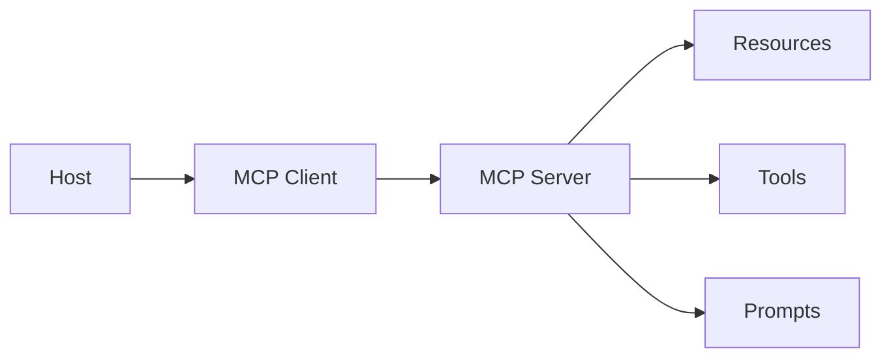

# MCP (Model Context Protocol)

> Topic package — Domain 5 · Roadmap Week 16.
> Depth goal: explain MCP host/client/server architecture, resources/tools/prompts primitives, and why standards matter.

## Source
- Track: LLM Engineering (self-directed, FDE roadmap)
- Slide deck: `07 Resources Library/LLM Engineering/Slides/Lesson_28_Model_Context_Protocol.pptx`
- Hands-on notebook: `07 Resources Library/LLM Engineering/Notebooks/28_Model_Context_Protocol.ipynb` (runs offline)
- Reference reading: Anthropic MCP docs at modelcontextprotocol.io; MCP SDK examples; tool-use architecture patterns
- Builds on: [[02 Literature Notes/LLM Engineering/Structured Generation]] · [[02 Literature Notes/LLM Engineering/Prompt Contracts]] · [[02 Literature Notes/LLM Engineering/Reasoning Prompt Patterns]]
- Date: 2026-07-18

---

## 1. Mental Model

**MCP is a standard protocol for plugging model hosts into external resources, tools, and prompts through servers.** It standardizes context plumbing, not model behavior.



---

## 2. How It Actually Works

### 5.1 Host/client/server
Host owns UX and model loop; clients maintain sessions; servers expose capabilities.

### 5.2 Resources
URI-addressed data such as files, rows, docs, and logs.

### 5.3 Tools
Executable functions with schemas; still need validation and permissions.

### 5.4 Prompts
Reusable templates packaged near data/tools.

### 5.5 Standardization
Avoids custom integration for every host-tool pair.

---

## 3. Implementation

Assumed stack: stdlib + numpy where useful. Snippets:
- [[04 Code Snippets/LLM/Tiny MCP Style Server]]
- [[04 Code Snippets/LLM/MCP Client Call Sketch]]

### Tiny MCP Style Server
Expose resources tools and prompts
```python
class Server:
    resources={"file://note":"hello"}
    tools={"echo":lambda text:text.upper()}
    prompts={"summarize":"Summarize resource"}
    def list(self): return {"resources":list(self.resources),"tools":list(self.tools),"prompts":list(self.prompts)}
print(Server().list())
```

### MCP Client Call Sketch
Invoke a discovered server tool
```python
srv=Server()
def call_tool(name,args):
    if name not in srv.tools: raise ValueError("unknown")
    return srv.tools[name](**args)
print(call_tool("echo", {"text":"mcp"}))
```

---

## 4. Design Decisions & Tradeoffs

| Decision | Guidance |
|---|---|
| **Use MCP** | Reusable external capabilities. |
| **Direct tools** | Simpler for tiny private apps. |
| **Scope** | Least-privilege resources. |
| **Safety** | Protocol is not security. |
| **Version** | Version server capabilities. |

---

## 5. Failure Modes & Gotchas

- Thinking MCP is an agent framework.
- Over-broad resources.
- No permission model.
- No versioning.
- Using MCP when direct function suffices.
- Resource prompt injection.

---

## 6. FDE Angle

- FDEs make the runtime policy explicit rather than relying on model vibes.
- The deliverable includes contracts, traces, tests, and operational limits.
- Stakeholders need to understand both capability and blast radius.
- A small reliable system beats an impressive uncontrolled demo.

---

## 7. Self-Check

1. What is the core abstraction?
2. Where does validation happen?
3. What should be traced?
4. What are the main failure modes?
5. When would you choose the simpler design?

---

## 9. Interview Q&A

**Q: What is the core abstraction MCP provides — what problem does it actually solve?**
A: Before a standard like MCP, connecting a model-powered application (a "host") to some external capability (a tool, a data source) typically meant writing custom, one-off integration code specific to that exact pairing — if you wanted the same host to talk to five different tools, or wanted five different hosts to all be able to use the same tool, you'd often end up writing that integration logic repeatedly, once per pairing, with no shared, reusable structure between any of them.

MCP's core move is standardizing the *plumbing* between hosts and external capabilities — defining a consistent protocol by which any MCP-compatible host can discover and use any MCP-compatible server's resources, tools, and prompts, without needing custom integration code written specifically for that one pairing. A server exposes its capabilities (data it can provide, actions it can perform, reusable prompt templates) through this standard interface, and any host that speaks the same protocol can connect to it and use those capabilities, the same way a USB device works with any computer that has a USB port, without needing a custom driver written for that one specific device-and-computer combination.

Critically, MCP standardizes *how information and capabilities get connected and exposed* — it says nothing about *how the model should behave* once it has access to them. It's infrastructure for plugging things together consistently, not a framework dictating agent behavior or reasoning strategy.

*One-liner: MCP solves the problem of needing custom, one-off integration code for every host-tool pairing — it standardizes the protocol by which any compatible host can discover and use any compatible server's capabilities, the same way USB lets any device work with any compatible computer without a custom driver — but it only standardizes this connection plumbing, not how the model actually behaves or reasons once connected.*

**Q: Where does validation/safety checking happen in an MCP-based system — does MCP itself provide this?**
A: No — and this is one of the most important things to get right about MCP: the protocol standardizes *how* a host discovers and calls a server's tools, but it does not itself provide permission checking, argument validation, or any security guarantee about what happens once a tool is actually called. Validation still has to happen in the same place it always does for any tool call (as covered in Tool and Function Calling) — in your own runtime code, checking arguments, enforcing permissions, and authorizing the action before it's allowed to execute.

Here's the specific risk if this gets conflated: because MCP provides a clean, standardized way to *expose* a server's tools, it can create a false sense that using the protocol itself has somehow handled safety — but MCP is explicitly just the plumbing for discovery and invocation, not a security layer. A server exposing an overly broad, under-scoped tool through MCP is exactly as risky as exposing that same overly broad tool through any other, non-standardized mechanism — the protocol doesn't make a dangerous tool safer, it just makes it easier to discover and connect to.

So the actual security work — least-privilege scoping of what each tool and resource is allowed to do, argument validation, permission checks, audit logging — still has to be designed and implemented by whoever builds the server and the host, exactly as it would for any tool-calling system; adopting MCP doesn't substitute for that work.

*One-liner: MCP standardizes discovery and invocation, but provides no built-in permission checking or validation itself — that work still has to happen in your own server/host code, exactly as with any tool call, and treating "we used MCP" as equivalent to "we handled security" is a real, specific risk the protocol doesn't actually protect against.*

**Q: What should be traced in an MCP-based system?**
A: The same fundamentals as any tool-calling system (name, arguments, result, validation outcome — covered in Tool and Function Calling), plus which specific server and which specific capability (resource, tool, or prompt) was actually involved, since an MCP-based system might be connecting to multiple different servers, each exposing different capabilities, and knowing which one was actually used at each step matters for debugging.

Concretely: which server was connected to, which specific resource was read or which specific tool was called (and with what arguments), what was actually returned, and — importantly — what version of that server's capabilities was in use at the time, since server capabilities can themselves change or be updated over time. Without this level of detail, if something goes wrong, you'd be trying to debug "something failed somewhere in this multi-server, multi-capability system" rather than being able to pinpoint exactly which server, which specific tool or resource, and which version of its capability contract was actually responsible.

*One-liner: trace which specific server and which specific resource/tool/prompt was actually used at each step (alongside the standard tool-call details of arguments, results, and validation outcome), including the server's capability version in use — since MCP systems often connect to multiple servers, pinpointing exactly which one and which capability was involved in a failure matters for debugging.*

**Q: What are the main failure modes specific to adopting MCP?**
A: Treating MCP as if it were an entire agent framework — something that handles reasoning, planning, or agent behavior — is a category error; it's purely a connection and discovery protocol, and expecting it to provide agentic capabilities it was never designed to provide leads to confused architecture decisions. Exposing overly broad resources or tools through an MCP server (the same "do-anything" tool risk covered in Tool and Function Calling) is just as dangerous here as anywhere else — the protocol doesn't make a poorly-scoped capability any safer just because it's exposed in a standardized way.

Having no permission model around what a connected host is actually allowed to access from a given server (covered above) is a direct security risk — MCP itself doesn't enforce this, so skipping it means genuinely relying on nothing to prevent overreach. No versioning of a server's exposed capabilities creates a different kind of problem: if a server's tools or resources change behavior over time with no version markers, a host built against an older assumption about what a tool does can silently start behaving incorrectly once the server's capabilities change underneath it, with no clear signal that anything changed at all.

Reaching for MCP when a simple, direct function call would be entirely sufficient is its own failure mode — adding a protocol layer and its associated discovery/connection overhead for a capability that's only ever going to be used by one specific host, with no genuine need for standardized, reusable discovery across multiple different hosts or tools, is unnecessary complexity. And resource content being treated as trusted instructions rather than as data (the same prompt-injection risk covered in Prompt Contracts) applies just as much to content retrieved through an MCP resource as to any other retrieved content — a resource being delivered through a standardized protocol doesn't make its content any more inherently trustworthy.

*One-liner: the main failure modes are mistaking MCP for an agent framework rather than just connection plumbing, exposing overly broad capabilities through it, having no permission model (MCP doesn't enforce one itself), skipping capability versioning (letting a server silently change behavior underneath a host), reaching for MCP when a simple direct function call would suffice, and treating MCP resource content as trusted instructions rather than untrusted data.*

**Q: When would you choose a direct, simple function call over setting up MCP?**
A: Whenever the actual need is a single host talking to a single, specific capability, with no genuine requirement for that capability to be discoverable and reusable across multiple different hosts, or for that host to flexibly connect to multiple different, independently-maintained servers — in that narrow case, MCP's standardization benefit isn't actually being used, so it's just added protocol overhead without a corresponding payoff.

MCP earns its complexity specifically when you genuinely need the standardization benefit: multiple different hosts need to be able to use the same tool or data source without each needing custom, one-off integration code written specifically for that pairing, or a single host needs to flexibly connect to many different, independently-built servers without needing bespoke integration logic for each one. If you're building one small, private application with one specific, fixed set of tools that will only ever be called by that one application, a direct function call is simpler, has less overhead, and doesn't need the discovery/protocol machinery MCP provides for a reuse scenario that doesn't actually exist in this situation.

*One-liner: choose a direct function call for a single host talking to one specific, fixed capability with no genuine cross-host or cross-server reuse need — MCP earns its protocol overhead specifically when multiple different hosts need to reuse the same capability, or one host needs to flexibly connect to multiple independently-built servers, without custom integration code for each pairing.*

## 8. Links
- Domain MOC: [[06 Maps of Content/LLM Engineering Concepts]]
- Code: [[04 Code Snippets/LLM/Tiny MCP Style Server]], [[04 Code Snippets/LLM/MCP Client Call Sketch]]
- Distilled: [[03 Permanent Notes/MCP Standardizes Context Plumbing]], [[03 Permanent Notes/MCP Servers Package Explicit Capabilities]]
- Upstream: [[02 Literature Notes/LLM Engineering/Structured Generation]] · [[02 Literature Notes/LLM Engineering/Prompt Contracts]] · [[02 Literature Notes/LLM Engineering/Reasoning Prompt Patterns]] · Downstream: [[02 Literature Notes/LLM Engineering/Agent Reliability and Cost]]
