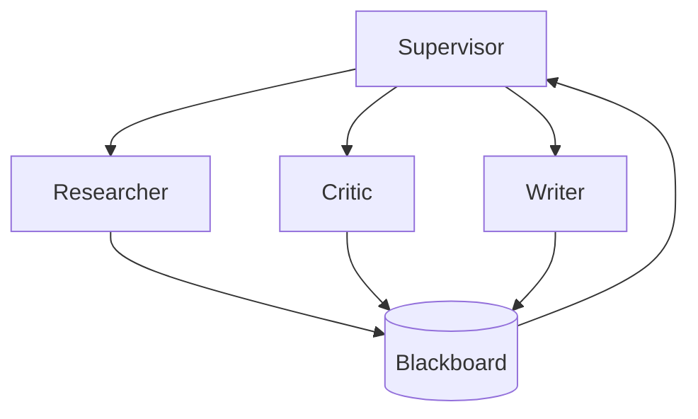

# Multi-Agent Orchestration

> Topic package — Domain 5 · Roadmap Week 16.
> Depth goal: design supervisor-worker, role specialization, handoffs, debate, and blackboard coordination; know when multi-agent hurts.

## Source
- Track: LLM Engineering (self-directed, FDE roadmap)
- Slide deck: `07 Resources Library/LLM Engineering/Slides/Lesson_27_Multi-Agent_Orchestration.pptx`
- Hands-on notebook: `07 Resources Library/LLM Engineering/Notebooks/27_Multi-Agent_Orchestration.ipynb` (runs offline)
- Reference reading: AutoGen (Wu 2308.08155); CrewAI docs; LangGraph multi-agent docs; MetaGPT
- Builds on: [[02 Literature Notes/LLM Engineering/Structured Generation]] · [[02 Literature Notes/LLM Engineering/Prompt Contracts]] · [[02 Literature Notes/LLM Engineering/Reasoning Prompt Patterns]]
- Date: 2026-07-18

---

## 1. Mental Model

**Multi-agent orchestration helps only when role specialization beats coordination overhead.** Supervisors, handoffs, debate, and blackboards coordinate work but add cost and ambiguity.



---

## 2. How It Actually Works

### 5.1 Supervisor-worker
Central routing assigns tasks and decides completion.

### 5.2 Role specialization
Roles need distinct tools, responsibilities, and success criteria.

### 5.3 Handoffs
Transfer ownership with context and acceptance criteria.

### 5.4 Debate
Useful for critique, not a substitute for ground truth.

### 5.5 Blackboard
Shared structured state reduces message spaghetti.

---

## 3. Implementation

Assumed stack: stdlib + numpy where useful. Snippets:
- [[04 Code Snippets/LLM/Supervisor Worker Mini Orchestrator]]
- [[04 Code Snippets/LLM/Multi-Agent Blackboard Store]]

### Supervisor Worker Mini Orchestrator
Dispatch deterministic role workers
```python
def worker(role, task): return f"{role} handled {task}"
trace=[]
for role in ["researcher","critic","writer"]:
    trace.append((role, worker(role,"tools")))
print(trace)
```

### Multi-Agent Blackboard Store
Shared state with provenance
```python
board={"facts":[],"risks":[]}
def post(slot, author, text): board[slot].append({"author":author,"text":text})
post("facts","researcher","schemas matter")
post("risks","critic","coordination cost")
print(board)
```

---

## 4. Design Decisions & Tradeoffs

| Decision | Guidance |
|---|---|
| **Use** | Only for separable roles. |
| **Route** | Centralize ownership. |
| **Handoff** | Include acceptance criteria. |
| **Debate** | Verify with evidence. |
| **State** | Use blackboard schemas. |

---

## 5. Failure Modes & Gotchas

- Agents added for vibes.
- Overlapping roles.
- Circular handoffs.
- Debate without evidence.
- No shared state schema.
- Cost exceeds value.

---

## 6. FDE Angle

- FDEs make the runtime policy explicit rather than relying on model vibes.
- The deliverable includes contracts, traces, tests, and operational limits.
- Stakeholders need to understand both capability and blast radius.
- A small reliable system beats an impressive uncontrolled demo.

---

## 7. Self-Check

1. What is the core abstraction?
2. Where does validation happen?
3. What should be traced?
4. What are the main failure modes?
5. When would you choose the simpler design?

---

## 9. Interview Q&A

**Q: What is the core abstraction behind multi-agent orchestration, and when does it actually earn its cost?**
A: The core idea is splitting one big task across several separately-specialized agents — each with its own distinct role, its own tools, and its own specific responsibility — coordinated through some structure (a supervisor assigning work, agents handing tasks off to each other, or a shared space they all read and write to). Instead of one general-purpose agent trying to do everything, you get several narrower agents, each good at one particular thing.

But this only actually pays off when the specialization genuinely produces better results than one well-built, general agent would — and that's not automatic just because it's possible to split a task up. Coordinating multiple agents is itself real, additional work: agents need to pass context to each other correctly, their outputs need to be reconciled, and the overall system has more moving parts that can go wrong. If a single, well-scoped agent could already do the job well, adding multiple specialized agents on top adds this coordination cost for no corresponding benefit — you're paying more (in complexity, latency, and often direct cost) without actually getting a better result in return.

*One-liner: multi-agent orchestration splits a task across specialized agents with distinct roles and tools, coordinated through some structure — but it only earns its real coordination cost (context handoffs, reconciling outputs, more moving parts to debug) when genuine role specialization actually produces a better result than one well-built general agent would, not just because splitting the task is possible.*

**Q: Where does validation happen in a multi-agent system?**
A: At every single handoff point between agents — whenever one agent's output becomes another agent's input, that transition needs to be checked, not just blindly trusted and passed along.

This matters specifically because multi-agent systems have more of these handoff points than a single-agent system does, and each one is a place where something can silently go wrong: an agent's output might not actually match what the next agent expects as input, or might be incomplete, or might not actually meet whatever "acceptance criteria" the task genuinely required before being considered done. If a handoff isn't validated, the next agent downstream has no way to know it received something less than exactly what it needed — it just proceeds with whatever it was handed, potentially building further work on top of a flawed or incomplete foundation.

The concrete practice this implies: every handoff should include explicit acceptance criteria — specific requirements the output needs to satisfy — checked before the receiving agent actually starts its own work on it, rather than discovered as a confusing downstream failure much later in the process, after several more agents have potentially already built on top of the flawed handoff.

*One-liner: validation happens at every handoff point between agents, checking that one agent's output actually meets explicit acceptance criteria before the next agent builds on it — multi-agent systems have more of these handoff points than single-agent systems, and each unvalidated one is a place a flawed or incomplete result can silently propagate further downstream.*

**Q: What should be traced in a multi-agent system?**
A: Which specific agent did what, in what order, and what got passed between them at each handoff — essentially, the full inter-agent conversation and work history, not just the final combined output.

Concretely: which agent produced which piece of output, what context or task it was given at the start, what it actually handed off to the next agent (and whether that handoff passed its acceptance criteria), and — for blackboard-style coordination specifically — who posted what to the shared state and when. The reason this level of detail matters more here than in a single-agent system: when a multi-agent system produces a bad final result, the problem could have originated with any one of several different agents, or in how information was (or wasn't) correctly passed between them — without a full trace of each agent's individual contribution and each handoff, you have no way to isolate which specific agent or which specific handoff actually introduced the problem, versus agents further downstream that just worked correctly with whatever flawed input they happened to receive.

*One-liner: trace which specific agent produced what, in what order, and exactly what was handed off (and whether it passed acceptance criteria) at each transition — this is what lets you isolate which specific agent or handoff actually introduced a problem in a bad final result, rather than just seeing a flawed combined output with no way to tell where it actually went wrong.*

**Q: What are the main failure modes specific to multi-agent systems?**
A: Adding agents "for vibes" — splitting a task into multiple agents because it feels more sophisticated or impressive, without a genuine reason the specialization would actually help — is the most fundamental failure, since it adds all the real coordination costs without the benefit that's supposed to justify them. Overlapping roles, where two or more agents aren't actually clearly separated in responsibility, create ambiguity about who's actually supposed to do what, which can lead to duplicated work, conflicting outputs, or gaps where each agent assumes the other is handling something that neither actually does.

Circular handoffs — where task ownership bounces back and forth between agents without clear forward progress — can leave a system stuck in a coordination loop that never actually converges on a result, similar in spirit to an agent loop with no step cap, but specifically happening at the inter-agent coordination layer rather than within a single agent's reasoning. Debate between agents without any real external evidence to ground the discussion risks becoming two models confidently disagreeing or agreeing with each other based on nothing but their own internal reasoning — which, as covered in Reasoning Prompt Patterns' reflection question, can look like careful deliberation while not actually converging on anything more correct than either agent started with.

No shared schema for blackboard-style coordination means agents posting to a shared space in inconsistent, unstructured ways — making that shared state hard for other agents to reliably read and act on. And ultimately, if the real coordination cost (latency, token spend, complexity) ends up exceeding whatever value the specialization actually provided, the system has failed its own cost-benefit justification, regardless of how sophisticated the architecture looks.

*One-liner: the main failure modes are adding agents without a genuine specialization benefit, overlapping/ambiguous roles causing duplicated or conflicting work, circular handoffs with no forward progress, debate with no real external evidence to ground it, an unstructured shared-state schema, and overall coordination cost exceeding whatever value the specialization actually provided.*

**Q: When would you choose a single, well-scoped agent over a multi-agent architecture?**
A: By default — multi-agent should be the exception you reach for when there's a clear, demonstrated reason for it, not the starting assumption for any sufficiently complex-sounding task.

A single agent is the right choice whenever one well-designed agent, with a clear scope and the right tools, can already handle the task well — which is more often true than it might initially seem, since a single agent with good tool access and a clear prompt contract can handle a surprising amount of apparent complexity without needing to be artificially split into separate "roles." Reach for multiple agents specifically when you can point to a genuine, concrete reason specialization would help — distinctly different skill sets or tool access needs that don't naturally coexist well in one agent's scope, or a genuine need for one agent to critique or check another's work with real independence (not just the same model talking to itself in a different persona, which risks the same reflection-without-grounding problem covered in Reasoning Prompt Patterns).

The practical discipline: before building a multi-agent system, be able to articulate specifically *why* a single agent wouldn't work as well — if that reason is vague ("it seems like it should be more structured this way") rather than concrete, that's a signal you're adding coordination complexity without a real, demonstrated benefit to justify it.

*One-liner: default to a single, well-scoped agent — it's often more capable of handling apparent complexity than expected — and only move to multi-agent when you can articulate a concrete, specific reason specialization would genuinely help (distinctly different tool/skill needs, a real need for independent critique), not just because the task sounds complex enough to deserve a more elaborate architecture.*

## 8. Links
- Domain MOC: [[06 Maps of Content/LLM Engineering Concepts]]
- Code: [[04 Code Snippets/LLM/Supervisor Worker Mini Orchestrator]], [[04 Code Snippets/LLM/Multi-Agent Blackboard Store]]
- Distilled: [[03 Permanent Notes/Use Multi-Agent Only When Specialization Wins]], [[03 Permanent Notes/Blackboards Turn Agent Chatter Into State]]
- Upstream: [[02 Literature Notes/LLM Engineering/Structured Generation]] · [[02 Literature Notes/LLM Engineering/Prompt Contracts]] · [[02 Literature Notes/LLM Engineering/Reasoning Prompt Patterns]] · Downstream: [[02 Literature Notes/LLM Engineering/Agent Reliability and Cost]]
