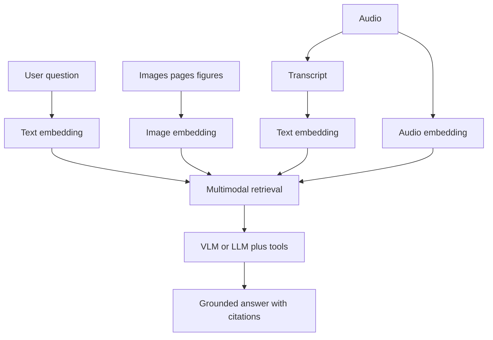

# Multimodal AI (VLMs, image/audio embeddings, multimodal RAG)

> Topic package — Domain 10 · Roadmap Weeks 09/20.
> Depth goal: explain and prototype multimodal systems: CLIP-style alignment, VLM/document VQA, image and audio embeddings, STT/TTS bridges, and multimodal RAG that retrieves evidence across text, images, and transcripts.

## Source
- Track: LLM Engineering (self-directed, FDE roadmap)
- Slide deck: `07 Resources Library/LLM Engineering/Slides/Lesson_52_Multimodal_AI.pptx`
- Hands-on notebook: `07 Resources Library/LLM Engineering/Notebooks/52_Multimodal_AI.ipynb` (runs offline)
- Reference reading: CLIP (Radford et al., arXiv:2103.00020); LLaVA (Liu et al., arXiv:2304.08485); Whisper; GPT-4V-style vision-language model documentation; multimodal RAG papers and system guides
- Builds on: [[02 Literature Notes/LLM Engineering/Embeddings]]
- Date: 2026-07-18

---

## 1. Mental Model

**Multimodal AI turns text, images, audio, and documents into comparable representations so systems can reason over evidence that is not just prose.** CLIP-style models learn an aligned embedding space by pulling matching image-text pairs together and pushing mismatches apart. VLMs add instruction-following and visual reasoning on top of image encoders and language models.

For builders, multimodal usually means three patterns: convert media to text (STT/OCR/captions), embed media directly for retrieval, or ask a VLM to answer using pixels plus text. The architecture depends on latency, cost, evidence requirements, and whether the task needs visual details or only transcripts/captions.

> Key intuition: **multimodal RAG retrieves evidence in the modality where the evidence lives, then grounds the answer in a shared reasoning layer.**



---

## 2. How It Actually Works

### 10.6 CLIP-style contrastive alignment
CLIP trains image and text encoders so matching pairs have high cosine similarity and non-matching pairs have low similarity. This creates a shared embedding space where text can retrieve images and images can retrieve text. The simple math is normalized dot products plus a contrastive loss over batches.

### 10.7 Vision-language models
VLMs such as LLaVA-style systems connect a vision encoder to an LLM instruction-following interface. They can answer questions about images, screenshots, charts, and document pages. GPT-4V-style APIs expose this as image+text input; open systems vary in visual detail, OCR strength, and reasoning reliability.

### 10.8 Audio with STT, TTS, and embeddings
Audio workflows often split into transcription (Whisper-style STT), synthesis (TTS), and audio embeddings for similarity or event detection. For enterprise search, transcripts give cheap text retrieval; audio embeddings help when tone, speaker, music, or acoustic event matters.

### 10.9 Multimodal RAG
A multimodal RAG index may store text chunks, page images, figure crops, captions, OCR, slide thumbnails, and audio transcripts. Retrieval can be late-fusion (rank each modality then merge) or shared-space (one embedding space). Answers need citations that point to pages, frames, timestamps, or image regions.

### 10.10 Failure modes and evaluation
VLMs can misread small text, hallucinate visual details, over-trust captions, and miss spatial relationships. Evaluate with document VQA, chart QA, image retrieval, transcript QA, and human spot checks. Use task-specific thresholds: a legal PDF page needs different accuracy than a creative image search.

---

## 3. Implementation

Assumed stack: numpy. Snippets simulate CLIP-style cosine alignment and multimodal retrieval fusion. Snippets:
- [[04 Code Snippets/LLM/Toy CLIP Cosine Alignment]]
- [[04 Code Snippets/LLM/Multimodal Retrieval Ranker]]

### Toy CLIP Cosine Alignment
Compute cosine similarity between toy image and text vectors to simulate contrastive alignment.
```python
import numpy as np

def normalize(x):
    x = np.asarray(x, dtype=float)
    return x / (np.linalg.norm(x) + 1e-12)

def cosine(a, b):
    return float(np.dot(normalize(a), normalize(b)))

image_vecs = {"dog_photo": [0.9, 0.1, 0.2], "chart": [0.1, 0.9, 0.3]}
text_vecs = {"a dog running": [0.85, 0.05, 0.25], "a revenue chart": [0.05, 0.95, 0.2]}
for img, iv in image_vecs.items():
    best = max(text_vecs, key=lambda t: cosine(iv, text_vecs[t]))
    print(img, "->", best, round(cosine(iv, text_vecs[best]), 3))
```

### Multimodal Retrieval Ranker
Fuse text, image, and audio vector scores with modality weights for multimodal RAG.
```python
import numpy as np

def rank_multimodal(query, items, weights=None):
    weights = weights or {"text": 0.5, "image": 0.5, "audio": 0.0}
    q = {k: np.asarray(v, float) for k, v in query.items()}
    scored = []
    for item in items:
        score = 0.0
        for mod, w in weights.items():
            if mod in q and mod in item:
                a = q[mod] / (np.linalg.norm(q[mod]) + 1e-12)
                b = np.asarray(item[mod], float); b = b / (np.linalg.norm(b) + 1e-12)
                score += w * float(np.dot(a, b))
        scored.append((score, item["id"]))
    return sorted(scored, reverse=True)

items = [{"id":"slide_dog", "text":[.8,.1], "image":[.9,.1]},
         {"id":"slide_sales", "text":[.1,.9], "image":[.2,.8]}]
print(rank_multimodal({"text":[.7,.2], "image":[1,.0]}, items))
```

---

## 4. Design Decisions & Tradeoffs

| Decision | Guidance |
|---|---|
| **Representation** | Use transcripts/captions when text is enough; use image/audio embeddings when modality-specific evidence matters. |
| **Fusion** | Start with late fusion and explicit weights; shared-space retrieval is cleaner but model-dependent. |
| **VLM use** | Use VLMs for visual reasoning, page understanding, screenshots, and document VQA; avoid when captions suffice. |
| **Citations** | Return page, region, timestamp, or frame provenance, not only text chunk ids. |
| **Cost/latency** | Media embeddings and VLM calls are expensive; cache aggressively and precompute indexes. |
| **Evaluation** | Test retrieval and answer quality per modality, including small text, charts, and noisy audio. |

---

## 5. Failure Modes & Gotchas

- Using OCR/captions only when the answer depends on layout or pixels.
- Using VLMs for everything when cheap transcripts would work.
- No provenance for image regions or audio timestamps.
- Assuming CLIP similarity means factual visual reasoning.
- Ignoring accessibility, consent, and privacy in audio/image processing.
- Evaluating only text QA while deploying image or audio retrieval.

---

## 6. FDE Angle

- Multimodal capability differentiates advanced RAG demos from text-only chatbots.
- Clients often have PDFs, slides, screenshots, calls, and diagrams — not clean text corpora.
- The key design call is conversion-to-text versus direct multimodal embedding versus VLM reasoning.
- Deliverable: modality inventory, retrieval architecture, evaluation set, and citation format.

---

## 7. Self-Check

1. What does CLIP-style contrastive alignment learn?
2. When is STT enough versus audio embeddings?
3. How does multimodal RAG cite evidence?
4. What tasks require a VLM rather than captions?
5. Name two multimodal evaluation failure modes.

---

## 9. Interview Q&A

**Q: What does CLIP-style contrastive alignment actually learn?**
A: CLIP learns to place images and text descriptions that genuinely match each other close together in a shared vector space, while pushing images and text that don't match far apart — the result is one embedding space where both images and text can be compared directly against each other, something that doesn't naturally exist otherwise (an image and a sentence don't start out in any comparable numeric format at all).

Here's how training actually achieves this: CLIP is trained on a large number of real (image, caption) pairs. For a batch of these pairs, the model computes an embedding for every image and every text caption, then specifically trains so that each image's embedding has high cosine similarity *only* with its own true matching caption's embedding, and low similarity with every other caption in that batch. This is called a contrastive objective — the model is pushed to pull the one correct pairing together while simultaneously pushing every incorrect pairing apart, for every example in the batch.

The practical result of this training process: once trained, you can take an image you've never seen before, embed it, and a completely different "finding similar" operation now works — you can search for text descriptions whose embeddings land nearby (image-to-text retrieval), or take a text query and find images whose embeddings land nearby (text-to-image retrieval) — all using the same simple nearest-neighbor comparison that works for any embedding space, just now applied across two different modalities that are finally comparable to each other.

*One-liner: CLIP trains image and text encoders together using a contrastive objective — pulling each image's embedding close to its true matching caption and pushing it away from every mismatched caption in the batch — producing one shared embedding space where images and text, which don't naturally start out comparable at all, can now be searched against each other using ordinary nearest-neighbor similarity.*

**Q: When is speech-to-text (STT) transcription enough, versus when do you actually need audio embeddings?**
A: The deciding question: does the *content of what was said* fully capture everything that matters, or does something about *how* it was said (or other non-speech sound) carry meaningful information that text alone would lose?

STT (transcription) is enough when the actual words spoken are what matters — a recorded meeting where you need to search "what did we decide about the budget," a support call where you need the actual customer complaint in text form for keyword or semantic search. Once transcribed, this becomes ordinary text, which means all of the regular text retrieval machinery (embeddings, chunking, vector search) just works on it directly and cheaply — transcripts are a much simpler, cheaper way to make audio searchable than working with audio embeddings directly.

Audio embeddings become necessary specifically when something *beyond the literal words* genuinely matters to the task: detecting tone or emotion in a call (something text alone wouldn't capture, since the same words can be said calmly or angrily), identifying or distinguishing speakers by voice, finding similar-sounding music or detecting specific acoustic events (a specific alarm sound, a particular kind of background noise) where there may not even be any meaningful "words" to transcribe in the first place. In these cases, the actual acoustic signal itself — not just a text transcript of any words present — carries the information you need to search or compare on.

*One-liner: use plain transcription (STT) when the literal words spoken fully capture what matters, since transcripts then let you reuse ordinary, cheap text retrieval — use audio embeddings specifically when something beyond the words themselves matters (tone, speaker identity, music, specific sounds), since that information only exists in the actual acoustic signal, not in a text transcript of any words present.*

**Q: How does multimodal RAG actually cite its evidence, compared to text-only RAG?**
A: Text-only RAG cites evidence using a chunk ID that points back to a specific passage of text in a specific document — "according to [chunk-47]." Multimodal RAG needs to extend this same idea of verifiable provenance to evidence that isn't plain text at all, which means the citation format itself has to be richer and more specific to the type of evidence involved.

For an image or a specific region within an image (say, a specific chart or figure on a page), the citation needs to point to something like the specific page number and the bounding-box region within that page/image — so someone checking the citation can go look at the exact visual area the claim is supposedly based on, not just "somewhere in this document." For audio, the citation needs a timestamp (or a timestamp range) pointing to the specific moment in the recording the claim is grounded in, so someone can jump directly to that point and verify it rather than having to listen to an entire recording to check one claim.

The underlying principle carried over unchanged from text RAG's citation contract: a citation has to let someone independently verify the claim against the actual original source — for multimodal evidence, "the actual original source" might be a specific pixel region on a specific page, or a specific few seconds of an audio recording, rather than a text passage, so the citation format has to carry enough specific location information (page + region, or timestamp) to make that same kind of verification actually possible, rather than falling back to a vague, unverifiable "the document mentioned this somewhere."

*One-liner: multimodal RAG extends text RAG's citation contract (point to something specific and verifiable) to non-text evidence — citing a page number plus a bounding-box region for images/figures, and a specific timestamp for audio — so a citation always lets someone independently verify a claim against the exact original visual or audio source, not just a vague "somewhere in this document."*

**Q: What kinds of tasks genuinely require a vision-language model (VLM), rather than relying on captions or OCR text alone?**
A: The deciding question is whether the task depends on visual details, layout, or spatial relationships that get lost once you reduce an image down to a caption or extracted text — if the answer genuinely requires "looking at" the image itself, rather than just reading a text description derived from it, you need a VLM.

Concretely: document question-answering where the layout itself matters (where on the page is this figure positioned relative to this paragraph, is this specific number in this specific table cell) — a flattened caption or OCR text dump loses the spatial/layout structure the question might actually depend on. Chart and graph question-answering — understanding "which bar is tallest" or "what's the trend direction" requires actually perceiving the visual shape of the chart, not just whatever text labels happened to get OCR'd off of it. Screenshots and UI understanding — answering "where is the submit button" requires visual/spatial perception a caption wouldn't naturally capture. Any task depending on precise spatial relationships between visual elements (is X above Y, is this highlighted in a different color) similarly needs direct visual processing.

By contrast, if a caption or a straightforward OCR text extraction genuinely captures everything that matters for the task — "what does this scanned memo say" where the content *is* just the text, with no meaningful visual/layout dependency — a VLM is unnecessary overhead; a much cheaper pipeline (OCR, then plain text retrieval and reasoning) handles it just as well, and a lot more cheaply and quickly, since VLM calls are typically significantly more expensive and slower than working with plain extracted text.

*One-liner: use a VLM when the task genuinely depends on visual layout, spatial relationships, or details a caption/OCR text extraction would lose (document layout questions, chart/graph reading, screenshot understanding) — if a plain text caption or OCR extraction already captures everything the task needs, a VLM is unnecessary, more expensive overhead for no real benefit.*

**Q: Name two real failure modes to specifically test for when evaluating a multimodal system.**
A: First: VLMs can genuinely misread small or dense text within an image — things like fine print, a crowded table with many small numbers, or compressed, low-resolution screenshots where individual characters are hard to distinguish. This isn't a hypothetical edge case; it's a documented, common failure pattern, which means any evaluation specifically needs test cases with small, dense, or lower-quality visual text — not just clean, high-resolution, easy-to-read images — since a model that performs well on clear, simple images can still fail badly on the messier, more realistic visual content a real production system will actually encounter.

Second: VLMs can hallucinate plausible-sounding visual details that aren't actually present in the image at all — confidently describing something that looks reasonable given the general context of the image, but that doesn't actually appear in it. This is conceptually the same underlying problem as text hallucination (a confident, fluent-sounding claim that isn't actually grounded in the real evidence) — just manifesting in the visual domain instead of the textual one. This means evaluation can't just check "does the output sound plausible and well-formed" — it specifically needs to verify the described visual details genuinely exist in the actual image, which usually means building test cases with known, verified ground truth about exactly what is and isn't actually present in each test image.

*One-liner: test specifically for misreading small or dense text/numbers within images (a documented, common VLM weakness, especially on messier real-world visual content) and for hallucinated visual details that sound plausible but aren't actually present in the image (the visual-domain version of text hallucination) — both require evaluation sets with verified ground truth about exactly what's really in each test image, not just a general plausibility check on the output.*

## 8. Links
- Domain MOC: [[06 Maps of Content/LLM Engineering Concepts]]
- Code: [[04 Code Snippets/LLM/Toy CLIP Cosine Alignment]], [[04 Code Snippets/LLM/Multimodal Retrieval Ranker]]
- Distilled: [[03 Permanent Notes/Multimodal RAG Retrieves Evidence Where It Lives]], [[03 Permanent Notes/CLIP Similarity Is Retrieval Not Visual Truth]]
- Upstream: [[02 Literature Notes/LLM Engineering/Embeddings]] · Downstream: [[02 Literature Notes/LLM Engineering/Document Ingestion and Parsing]]
