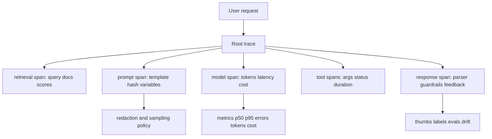

# Observability & Monitoring

> Topic package — Domain 8 · Roadmap Week 22.
> Depth goal: instrument an LLM application end-to-end so prompts, retrieval, model calls, tools, tokens, latency, cost, quality signals, and safety events become measurable without leaking sensitive data.

## Source
- Track: LLM Engineering (self-directed, FDE roadmap)
- Slide deck: `07 Resources Library/LLM Engineering/Slides/Lesson_45_Observability_and_Monitoring.pptx`
- Hands-on notebook: `07 Resources Library/LLM Engineering/Notebooks/45_Observability_and_Monitoring.ipynb` (runs offline)
- Reference reading: LangSmith tracing/evaluation docs; Langfuse observability docs; OpenTelemetry GenAI semantic conventions; Arize Phoenix tracing/evals; OpenLLMetry; provider usage/cost APIs
- Builds on: [[02 Literature Notes/LLM Engineering/RAG Evaluation]] · [[02 Literature Notes/LLM Engineering/Prompt Contracts]]
- Date: 2026-07-18

---

## 1. Mental Model

**LLM observability is flight instrumentation for probabilistic software: every request must leave a trace explaining what the model saw, did, cost, and why it failed.** Traditional monitoring says whether an endpoint is up; LLM monitoring must also answer: which prompt version ran, which chunks were retrieved, how many tokens were spent, whether latency came from retrieval or generation, and whether quality drifted after a model change.

The core object is a **trace**: a tree of spans for ingress, retrieval, reranking, prompt assembly, model calls, tool calls, parsers, validators, and final response. Each span carries model, prompt hash/version, token counts, latency, cost, status, errors, retrieved doc ids, and redacted samples.

> Key intuition: **if you cannot reconstruct the chain of evidence, you cannot debug or improve the system.** Observability turns black-box generations into inspectable production behavior.



---

## 2. How It Actually Works

### 8.1 Trace the whole request graph
Instrument every meaningful operation as a span: request ingress, retrieval, rerank, prompt render, model invocation, tool call, validation, and response. A flat log line cannot explain an agent failure because agent behavior is causal and nested. A trace shows parent-child timing and lets you answer whether the slow part was vector search, a tool timeout, or generation.

### 8.2 Log prompts, completions, tokens, latency, and cost safely
The minimum useful LLM event includes prompt template hash/version, model/provider, input/output token counts, latency, finish reason, status, retry count, and estimated cost. Prompt and completion text are valuable but risky; use sampling, retention limits, redaction, and role-based access. Log templates and variables separately where possible.

### 8.3 Monitor product and system metrics
Dashboards need both service-health and model-health metrics: request volume, error rate, p50/p95/p99 latency, tokens/request, cost/request, cache hit rate, retrieval hit rate, refusal rate, tool failure rate, parser failure rate, and user feedback score. Cost and quality are SLO dimensions alongside availability.

### 8.4 Detect drift with feedback and eval slices
Drift can mean embedding distribution shift, prompt changes, model upgrades, new user intents, stale corpus chunks, degraded retrieval, or changed provider behavior. Track slices by tenant, intent, language, prompt version, model version, and collection. Pair online feedback with offline evals and golden sets.

### 8.5 Make privacy a design constraint
Observability data may combine user messages, retrieved documents, model outputs, tool arguments, and errors. Redact PII before export, store hashes where possible, sample raw payloads, set retention windows, and mark sensitive spans. The goal is debuggability without creating a shadow database of secrets.

---

## 3. Implementation

Assumed stack: stdlib + numpy — a tiny span logger, token/cost accountant, percentile dashboard, and PII-safe event pipeline. Snippets:
- [[04 Code Snippets/LLM/LLM Trace and Cost Ledger]]
- [[04 Code Snippets/LLM/PII Safe LLM Metrics Dashboard]]

### LLM Trace and Cost Ledger
Record nested spans with tokens, latency, errors, and estimated cost.
```python
from dataclasses import dataclass, field
from time import perf_counter

PRICES = {"small": (0.15, 0.60), "strong": (2.50, 10.00)}

@dataclass
class Span:
    name: str
    attrs: dict = field(default_factory=dict)
    children: list = field(default_factory=list)
    start: float = field(default_factory=perf_counter)
    end: float | None = None
    def finish(self, **attrs):
        self.end = perf_counter(); self.attrs.update(attrs); return self
    @property
    def ms(self): return round(((self.end or perf_counter()) - self.start) * 1000, 2)

def cost(model, input_tokens, output_tokens):
    pin, pout = PRICES[model]
    return (input_tokens * pin + output_tokens * pout) / 1_000_000

root = Span("request", {"trace_id": "t-001"})
llm = Span("llm.call", {"model": "small", "prompt_version": "support-v3"})
root.children.append(llm)
llm.finish(input_tokens=820, output_tokens=140, cost_usd=cost("small", 820, 140), status="ok")
root.finish(status="ok")
print(llm.attrs, "latency_ms=", llm.ms)
```

### PII Safe LLM Metrics Dashboard
Compute p50/p95 latency, token usage, cost, and redact sensitive fields before logging.
```python
import re, numpy as np
EMAIL = re.compile(r"[\w.%-]+@[\w.-]+\.[A-Za-z]{2,}")
PHONE = re.compile(r"\d{3}[-.]?\d{3}[-.]?\d{4}")
def redact(text): return PHONE.sub("<PHONE>", EMAIL.sub("<EMAIL>", text))
def summarize(events):
    lat = np.array([e["latency_ms"] for e in events])
    toks = np.array([e["input_tokens"] + e["output_tokens"] for e in events])
    return {"n": len(events), "p50_ms": float(np.percentile(lat, 50)),
            "p95_ms": float(np.percentile(lat, 95)), "error_rate": sum(e["status"] != "ok" for e in events)/len(events),
            "avg_tokens": float(toks.mean()), "total_cost": round(sum(e["cost_usd"] for e in events), 4)}
events = [{"latency_ms": x, "input_tokens": 400+x, "output_tokens": 80, "cost_usd": .001+x/1e7, "status": "ok"} for x in [120,150,180,260,510]]
print(redact("Email me at sri@example.com or 555-123-9999"))
print(summarize(events))
```

---

## 4. Design Decisions & Tradeoffs

| Decision | Guidance |
|---|---|
| **Payload storage** | Store structured metadata by default; sample and redact raw prompts/completions with strict retention. |
| **Trace granularity** | Span every expensive or failure-prone step: retrieval, rerank, prompt, LLM, tool, parser, guardrail. |
| **Metric set** | Track latency, errors, tokens, cost, cache hits, refusals, parser failures, retrieval quality, feedback. |
| **Prompt versions** | Attach prompt/template hash to every call so regressions can be sliced by change. |
| **Feedback loop** | Capture thumbs, edits, escalations, and evaluator labels; join them back to traces. |
| **Vendor choice** | LangSmith/Langfuse/Phoenix are product layers; OpenTelemetry is the portability layer. |

---

## 5. Failure Modes & Gotchas

- Only monitoring HTTP 200s → the service is up while answer quality collapses.
- Logging raw prompts forever → observability becomes an unmanaged PII warehouse.
- No prompt/model version on events → impossible to attribute regressions after a rollout.
- Aggregating averages only → p95/p99 latency and tail failures stay hidden.
- Ignoring retrieved document ids/scores → RAG hallucinations cannot be traced to retrieval.
- Feedback captured outside traces → labels cannot improve prompts, routing, or eval sets.

---

## 6. FDE Angle

- This is the production control plane: traces make LLM applications debug-able, auditable, and optimizable.
- A client deliverable is a dashboard plus trace schema showing latency, cost, quality, and safety slices.
- PII-safe logging is not compliance garnish; it determines whether the org can observe real traffic at all.
- Deliverable: an instrumentation plan with span taxonomy, metrics, retention, redaction, and feedback capture.

---

## 7. Self-Check

1. What attributes belong on every LLM span?
2. Why are p95 latency and cost/request more useful than averages alone?
3. How do you log prompts and completions without creating a PII liability?
4. What is the difference between tracing a RAG call and tracing an agent run?
5. How do feedback and drift detection connect back to traces?
6. When would you prefer OpenTelemetry conventions over a vendor-specific SDK?

---

## 9. Interview Q&A

**Q: What attributes belong on every single LLM span, and why does each one matter for actually debugging a problem later?**
A: Each attribute exists to answer a specific question you'll need to ask when something goes wrong, and missing any one of them leaves a specific gap you can't fill in after the fact.

Model and provider identify exactly which model actually handled this call — necessary since behavior genuinely differs between models and even between versions of the same model. Prompt template hash/version (covered in Prompt Versioning) identifies exactly which version of the prompt was used — without this, you can't tell whether a regression came from a prompt change or something else. Input/output token counts and estimated cost let you reconstruct exactly what this call cost, both for billing accuracy and for diagnosing an unexpectedly expensive request. Latency tells you how long this specific step took, which — when spans are properly nested — lets you tell whether an overall slow request came from retrieval, generation, a tool call, or something else specifically, rather than just knowing the whole thing was slow. Status and finish reason tell you whether the call actually succeeded, failed, or was cut off (e.g., hit a token limit) — critical for distinguishing "the model produced a bad answer" from "the call never actually completed properly." Retry count reveals whether this call needed multiple attempts, which is itself useful signal about reliability. And redacted samples (not raw, unredacted content) let you actually look at what happened for debugging, without creating the PII exposure risk covered later in this topic.

Without any one of these, a specific class of question becomes unanswerable later — missing the prompt version means you can't attribute a regression to a prompt change; missing cost means you can't diagnose a billing spike; missing nested latency means you can't tell which specific step was actually slow.

*One-liner: each span attribute (model/provider, prompt version, token counts/cost, latency, status/finish reason, retry count, redacted samples) answers a specific debugging question — missing any one of them leaves a specific, unfillable gap later, like being unable to attribute a regression to a prompt change, diagnose a cost spike, or identify which specific step in a request was actually slow.*

**Q: Why are p95 latency and cost-per-request more useful than looking at averages alone?**
A: An average blends together every single request, including the easy, fast, cheap ones and the rare, slow, expensive ones — and because there are usually far more easy requests than hard ones, the average can look perfectly healthy even while a meaningful fraction of real users are having a genuinely bad experience, simply because their bad experiences get diluted into invisibility by the much larger number of fine ones.

p95 latency specifically measures "how slow is the request at the 95th percentile" — in other words, how bad is the experience for the worst 5% of requests, which an average completely hides. If your average latency looks great but your p95 is terrible, that means a real, non-trivial fraction of your actual users are experiencing significant slowness, even though the headline average number looks fine — and that slow 5% is exactly the group most likely to churn, complain, or lose trust in the system, which an average alone would never surface as a problem worth investigating.

The same principle applies to cost per request: an average cost can look perfectly reasonable while a specific subset of requests (an unusually long conversation, a retry storm, a particularly verbose generation) are individually costing far more than typical — and if you're only watching the average, this concentrated cost driver stays invisible until it's already caused a real, noticeable budget problem. Looking at the distribution (percentiles, and specifically investigating what's driving the tail) is what actually reveals these concentrated problems that an average, by its very nature, is designed to smooth over and hide.

*One-liner: an average blends easy and hard requests together, hiding a real problem affecting a meaningful minority of users behind a large number of fine ones — p95 latency and cost specifically reveal how bad the tail actually is (the worst 5% of requests), which is exactly where real user pain and concentrated cost drivers tend to live, invisible to an average alone.*

**Q: How do you log prompts and completions in a way that's actually useful for debugging, without creating a PII liability?**
A: The core principle: default to storing structured metadata (model, version, token counts, latency, status — everything covered in the first question) for every single request, since this is genuinely low-risk and highly useful — but treat the actual raw prompt/completion *text* as sensitive, high-risk content that needs deliberate, careful handling rather than being logged in full, indefinitely, by default.

Concretely: sample raw text rather than logging it for every single request (storing full text for, say, 1% of traffic, or specifically for traces flagged as problematic, rather than all traffic unconditionally) — this preserves enough real examples to debug from, without creating a comprehensive archive of every single user interaction's full content. Redact obvious PII patterns (emails, phone numbers, and similar) before anything gets stored or exported, reducing the sensitivity of whatever is retained. Set explicit, enforced retention windows on anything containing raw text, so sensitive content doesn't accumulate indefinitely just because nobody explicitly decided to delete it. Apply role-based access control specifically to raw-text fields, so only people who genuinely need to see actual user content for debugging purposes can access it, rather than it being broadly visible to anyone with general dashboard access. And where feasible, log templates and the variables that filled them in *separately*, rather than only the fully-rendered final text — this can let you debug template-level issues using the (less sensitive) template structure, without needing the fully-populated, potentially-sensitive text for every single case.

*One-liner: log structured metadata for every request by default (low-risk, high-value), but treat raw prompt/completion text as sensitive — sampling it rather than logging all of it, redacting obvious PII patterns before storage, enforcing retention windows, restricting access via role-based controls, and where possible logging templates and variables separately from fully-rendered text — preserving real debugging value without creating an unmanaged, ever-growing archive of sensitive user content.*

**Q: What's the key difference between tracing a simple RAG call and tracing a full agent run?**
A: A simple RAG call has a relatively fixed, predictable shape: retrieve, assemble context, generate an answer — a known, bounded sequence of steps that happens once per request, making the trace structure itself fairly simple and predictable to design ahead of time.

An agent run (covered throughout the Agents domain) is structurally different: it's a variable-length loop that can take a different number of steps on every single run, potentially calling different tools in a different order each time, with the actual sequence of what happens only becoming known as the agent reasons through the task live — you can't know in advance exactly how many spans a given agent run will produce, or which specific tools it will call, the way you could reasonably predict a simple RAG call's shape ahead of time.

This means an agent trace needs to capture not just "what happened" at each individual step (which a RAG trace also needs), but the full *sequence and reasoning* behind why the agent took each specific action, in what order, and specifically why it eventually stopped (covered in Agent Loops and Planning and Agent Reliability and Cost) — since debugging an agent failure often means understanding not just "which single step failed" but "why did the agent's sequence of decisions, taken together across several steps, lead to this specific wrong place," which requires visibility into the agent's evolving reasoning across the whole run, not just a single request's fixed set of sub-steps.

*One-liner: a simple RAG call has a fixed, predictable trace shape (retrieve, assemble, generate, once per request); an agent run is a variable-length loop whose exact sequence of steps and tool calls is only known as it actually happens — so an agent trace needs to capture the full sequence and reasoning behind each decision and why the loop eventually terminated, since debugging an agent failure often requires understanding a chain of decisions across many steps, not just one fixed step.*

**Q: How do feedback signals and drift detection connect back to the trace data covered here?**
A: Feedback (thumbs up/down, user edits, escalations, as covered in Online Evaluation) is only genuinely useful for improving the system if it can be joined back to the exact trace that produced the interaction being rated — without this link, a piece of feedback is just a floating number with no way to know what prompt version, what retrieved documents, or what model actually produced the interaction that feedback is about.

When feedback is captured and explicitly linked to its originating trace, it becomes something you can actually act on: you can look at every trace that received negative feedback and check what they have in common — did they all use a particular prompt version, did they all retrieve from a particular stale document, did they disproportionately route through a particular model — turning scattered individual feedback signals into an actual, investigable pattern tied to specific, concrete system components.

Drift detection works the same way, at a broader scale: it means slicing aggregated trace data by dimensions like prompt version, model version, tenant, or intent, and watching whether quality or behavior is shifting within any specific slice over time — this can only happen if every trace actually carries these dimensions as structured metadata (covered in the first question), letting you compare "traces using prompt v1.2" against "traces using prompt v1.3" and see if something shifted, rather than only seeing an undifferentiated, un-sliceable blob of aggregate metrics with no way to connect a detected shift back to a specific, actionable cause.

*One-liner: feedback is only actionable when it's explicitly linked back to the specific trace that produced the rated interaction, turning scattered ratings into patterns tied to specific prompt versions, retrieved documents, or models — drift detection works the same way, slicing trace data by dimensions like prompt/model version to spot a shift within a specific slice, which requires every trace to actually carry this metadata, or a detected shift has no way to connect back to a specific, actionable cause.*

**Q: When would you prefer OpenTelemetry's standard conventions over a vendor-specific observability SDK?**
A: OpenTelemetry conventions are a standardized, vendor-neutral way of structuring trace data — using it means your instrumentation isn't tightly coupled to any one specific observability platform's proprietary format, which matters specifically when you want the flexibility to switch observability vendors later, or to send the same trace data to multiple different backends simultaneously, without having to re-instrument your entire application for each one.

A vendor-specific SDK (tightly integrated with one specific platform like LangSmith or Langfuse) often provides more convenient, polished, out-of-the-box features specifically tailored to LLM application patterns — richer built-in visualizations, LLM-specific conveniences that a general-purpose standard might not provide as smoothly. This convenience is genuinely valuable, but it comes with a real lock-in cost: your instrumentation code becomes specifically coupled to that one vendor's SDK and data model, making a future switch to a different platform a more invasive rewrite rather than a more contained configuration change.

The practical tradeoff: if you're confident in a specific vendor long-term, or need their specific polished features more than you value platform-neutrality, the vendor-specific SDK's convenience may be worth the coupling. If you want to preserve the option to switch observability platforms later, or need to support multiple backends simultaneously (perhaps different parts of an organization use different tools), OpenTelemetry's standard conventions are the better foundation — the same general tradeoff covered in Eval Framework Literacy's lock-in-cost discussion, just applied here specifically to observability tooling rather than evaluation tooling.

*One-liner: OpenTelemetry provides vendor-neutral, portable trace conventions that avoid lock-in to one specific observability platform, at the cost of potentially less polished, LLM-specific convenience than a tightly-integrated vendor SDK provides — prefer OpenTelemetry when preserving the ability to switch platforms or support multiple backends matters more than a specific vendor's out-of-the-box convenience features.*

## 8. Links
- Domain MOC: [[06 Maps of Content/LLM Engineering Concepts]]
- Code: [[04 Code Snippets/LLM/LLM Trace and Cost Ledger]], [[04 Code Snippets/LLM/PII Safe LLM Metrics Dashboard]]
- Distilled: [[03 Permanent Notes/LLM Observability Starts With Traces Not Logs]], [[03 Permanent Notes/PII Safe Telemetry Is a Product Requirement]]
- Upstream: [[02 Literature Notes/LLM Engineering/RAG Evaluation]] · Downstream: [[02 Literature Notes/LLM Engineering/Inference and Serving]]
