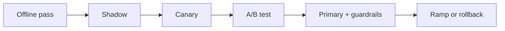

# Online Evaluation (A/B, live feedback)

> Topic package — Domain 6 · Roadmap Week 17.
> Depth goal: build production-grade LLM evaluation habits: clear datasets, trustworthy metrics, statistical guardrails, and shipping decisions that survive contact with real users.

## Source
- Track: LLM Engineering (self-directed, FDE roadmap)
- Slide deck: `07 Resources Library/LLM Engineering/Slides/Lesson_34_Online_Evaluation.pptx`
- Hands-on notebook: `07 Resources Library/LLM Engineering/Notebooks/34_Online_Evaluation.ipynb` (runs offline)
- Reference reading: Ron Kohavi controlled experiments; experimentation platform best practices; product analytics guardrails
- Builds on: [[02 Literature Notes/LLM Engineering/Eval Fundamentals]] · [[02 Literature Notes/LLM Engineering/Retrieval Evaluation]]
- Date: 2026-07-18

---

## 1. Mental Model

**Online evaluation measures what happens when real users meet the system, but it must be instrumented like an experiment, not watched like a dashboard.** A/B tests estimate causal impact; canaries limit blast radius; feedback channels reveal failures offline labels missed.

Online eval confirms candidates after offline regression, safety, and quality gates.

> Key intuition: **ship evidence gradually: shadow, canary, A/B, then ramp.**



---

## 2. How It Actually Works

### 6.1 A/B basics
Randomly assign users or sessions, define primary metric, guardrails, duration, and exclusions before launch. LLM products need explicit and implicit signals.

### 6.2 Canary and shadow
Shadow mode runs invisibly; canary exposes a small percentage. These stages catch latency, cost, tool, safety, and logging failures.

### 6.3 Feedback signals
Thumbs, retries, edits, copy events, abandonment, escalation, and comments are noisy labels that need bias-aware interpretation.

### 6.4 Guardrail metrics
Track latency, cost, safety triggers, refusal rate, support contacts, retrieval failures, and complaints. A win that breaks safety is not a win.

### 6.5 Sample-ratio mismatch
SRM means observed allocation differs from expected allocation, often due to logging, eligibility, bot, or bucketing bugs; pause interpretation.

---

## 3. Implementation

Assumed stack: stdlib + numpy. The snippets are offline and deterministic so they can run in CI before API-backed evaluation. Snippets:
- [[04 Code Snippets/LLM/AB Test Mean Difference CI]]
- [[04 Code Snippets/LLM/Sample Ratio Mismatch Check]]

### AB Test Mean Difference CI
Compute treatment-control lift with a confidence interval.
```python
import math

def mean_ci(control, treatment, z=1.96):
    nc, nt = len(control), len(treatment)
    mc, mt = sum(control)/nc, sum(treatment)/nt
    vc = sum((x-mc)**2 for x in control)/(nc-1)
    vt = sum((x-mt)**2 for x in treatment)/(nt-1)
    se = math.sqrt(vc/nc + vt/nt)
    diff = mt - mc
    return diff, (diff - z*se, diff + z*se)
print(mean_ci([0,1,1,0,1], [1,1,1,0,1]))
```

### Sample Ratio Mismatch Check
Chi-square SRM check for expected assignment proportions.
```python
def srm_chi_square(observed, expected_props):
    total = sum(observed)
    exp = [total * p for p in expected_props]
    return sum((o-e)**2/e for o,e in zip(observed, exp))
print(srm_chi_square([5010,4990], [0.5,0.5]))
print(srm_chi_square([5600,4400], [0.5,0.5]))
```

---

## 4. Design Decisions & Tradeoffs

| Decision | Guidance |
|---|---|
| **Dataset boundary** | Write down exactly which population the eval represents and which it excludes. |
| **Metric choice** | Prefer deterministic metrics for mechanical properties; use judges only for semantic qualities that require judgment. |
| **Slicing** | Always inspect business-critical, safety-critical, and historically weak slices. |
| **Calibration** | Compare automated scores against human labels before using them as gates. |
| **Thresholds** | Set pass/block/investigate thresholds before looking at the result. |
| **Artifacts** | Persist inputs, outputs, prompts, model versions, scores, and traces for reproducibility. |

---

## 5. Failure Modes & Gotchas

- Treating a polished demo as evidence of reliability.
- Optimizing a proxy metric after it stops matching user value.
- Reporting only an aggregate score while a critical slice fails.
- Changing prompt, model, data, and scorer at once, making regressions uninterpretable.
- Using a judge without bias audits or human calibration.
- Failing to save per-case artifacts, so failures cannot be debugged.

---

## 6. FDE Angle

- A production eval is a client-facing trust artifact, not internal trivia.
- A clear scorecard lets stakeholders decide whether to ship, hold, or rollback.
- Automated evals reduce manual QA and accelerate iteration.
- Deliverable: versioned dataset, runner, metrics, report, and CI gate.

---

## 7. Self-Check

1. Define the behavior being measured and the evidence required.
2. Explain how the dataset, scorer, baseline, and threshold interact.
3. Name slices that could hide severe regressions behind a good average.
4. Describe how you would calibrate the metric against human judgment.
5. State what artifacts are needed to reproduce a run.
6. Translate a score into a shipping decision.

---

## 9. Interview Q&A

**Q: Why does online evaluation need to be "instrumented like an experiment, not watched like a dashboard"?**
A: Watching a dashboard means looking at how a metric moves after a change ships and informally attributing that movement to the change — but a metric can move for all sorts of reasons that have nothing to do with your change: a seasonal shift in user behavior, an unrelated change shipping elsewhere in the product at the same time, random day-to-day fluctuation that would have happened anyway. Without a proper experimental design, you have no principled way to separate "this metric moved because of my change" from "this metric moved for some completely unrelated reason that just happened to coincide."

Instrumenting it like an experiment means deliberately building in the structure that lets you make that separation: randomly assigning users to a treatment group (who see the change) and a control group (who don't), at the same time, under the same external conditions — so any difference between the two groups can be attributed to the actual change, since everything else about their circumstances (the time period, external events, seasonal effects) was genuinely the same for both groups. This randomization is what gives you a causal claim ("this change caused this effect") rather than just an observed correlation ("this metric happened to move after we shipped something").

*One-liner: watching a dashboard shows a metric moving, but can't tell you whether your change caused that movement or something unrelated did — proper experimental instrumentation (randomized treatment and control groups, under the same conditions, at the same time) is what actually lets you attribute an observed effect specifically to your change, rather than to a coincidental, unrelated cause.*

**Q: What's the purpose of shadow mode and canary deployment, and why run them before a full A/B test?**
A: Both exist to catch problems at progressively larger, but still limited and recoverable, scales — before a change is exposed to enough real users that a serious problem would cause real, widespread harm.

Shadow mode runs the new system alongside the existing production system, processing the same real traffic, but its output is never actually shown to real users — it's purely observed and logged. This catches a specific category of problems safely: does the new system crash, time out, cost much more than expected, or behave unexpectedly on genuinely real production traffic patterns — all without any real user ever being affected by a problem, since nothing it produces actually reaches anyone.

Canary deployment is the next step up: expose the new system to a small percentage of real traffic, where its output *does* actually reach real users this time, but only a small, limited fraction of them. This catches problems shadow mode can't, specifically because now the output is actually being used and genuinely experienced by real people — but the blast radius of any problem discovered here is deliberately kept small, since only a small percentage of users were exposed, rather than everyone.

Running a full A/B test immediately, without these earlier stages, means the first time you'd discover a basic problem (a crash, a safety issue, an unexpectedly broken cost profile) is at a scale where it's already affecting a large, meaningful fraction of real users — rather than catching that same problem earlier, in shadow mode or canary, where the actual exposure and resulting harm was deliberately kept minimal. The staged approach (shadow, then canary, then full A/B) is specifically about catching cheap, easy-to-catch problems early at low cost, before committing to a larger-scale, full experiment.

*One-liner: shadow mode runs the new system on real traffic with no user ever seeing its output (catching crashes, cost, and behavior problems with zero user impact); canary exposes output to a small percentage of real users (catching problems that only show up once output is actually used, but with limited blast radius) — both exist specifically to catch basic problems cheaply and safely before committing to a full-scale A/B test where a problem would affect far more real users.*

**Q: Why are explicit feedback signals (thumbs up/down, ratings) considered "noisy labels," and what does that imply about how to use them?**
A: Explicit feedback is genuinely useful signal, but it's not a clean, unbiased measurement of actual answer quality the way a carefully-labeled eval dataset is — it reflects real human reactions, but those reactions are shaped by all sorts of factors beyond pure quality, and in a systematically biased way, not just randomly noisy.

Concretely: only a small, self-selected fraction of users bother to leave any feedback at all, and the users who do bother are often systematically different from the overall user population — people having an unusually bad experience are often more motivated to leave negative feedback than an average or satisfied user is to leave positive feedback, which skews what you actually observe. The same underlying answer quality can also get different feedback depending on factors unrelated to the answer's actual correctness — how the question was framed, the user's mood, unrelated frustration with some other part of the product bleeding into the feedback given to this specific interaction.

What this implies practically: explicit feedback shouldn't be treated as if it were a clean, representative, unbiased measurement the way a properly-constructed eval dataset is — it needs to be interpreted with this systematic bias in mind, ideally combined with other signals (implicit behavior like retry rate or abandonment, offline eval results, guardrail metrics) rather than trusted entirely on its own as the sole source of truth about quality. A sudden shift in the rate of thumbs-down feedback is a signal worth investigating, not a number to be taken completely at face value as "exactly this percentage of users are now dissatisfied."

*One-liner: explicit feedback is real but systematically biased — it's self-selected (motivated-but-unhappy users disproportionately leave it) and affected by factors unrelated to actual answer quality — which means it should be interpreted as one noisy signal to investigate further and combine with other signals, not trusted on its own as a clean, representative measurement of quality.*

**Q: Why can "a win on the primary metric" still be the wrong decision to ship, and what role do guardrail metrics play?**
A: A primary metric measures the one specific thing you're optimizing for in this particular experiment — but a system has many other properties that matter, and improving the primary metric doesn't guarantee those other properties haven't gotten worse in the process. A change could genuinely improve your primary metric while simultaneously making the system noticeably slower, more expensive to run, less safe, or causing more users to need human support — and if you only looked at the primary metric, you'd ship a change that's actually a net negative once you account for everything that actually matters, not just the one thing you happened to be measuring most closely.

Guardrail metrics exist specifically to catch this — a separate, deliberately-tracked set of metrics (latency, cost, safety-trigger rate, refusal rate, support-contact rate, and similar) that aren't the primary thing you're trying to improve, but that you're explicitly committing to *not* let get meaningfully worse, regardless of how good the primary metric's improvement looks. The practical rule: a genuine win on the primary metric that comes paired with a guardrail metric moving in a clearly bad direction is not actually a win overall — it's a tradeoff that needs real human judgment about whether the primary-metric gain is actually worth whatever guardrail cost it came with, not an automatic ship decision just because the one metric you were watching most closely happened to improve.

*One-liner: improving the primary metric doesn't guarantee other important properties (safety, cost, latency, support burden) haven't gotten worse in the process — guardrail metrics are explicitly tracked specifically to catch this, and a primary-metric win paired with a guardrail moving in a bad direction is a real tradeoff requiring human judgment, not an automatic ship decision.*

**Q: What is sample-ratio mismatch (SRM), and why does it mean you should pause interpreting the experiment's results rather than just proceeding?**
A: Sample-ratio mismatch means the actual observed split of users between your treatment and control groups doesn't match what you intended — you set up a 50/50 split, but you're actually observing something like 56/44 in practice. This isn't just a minor cosmetic imbalance to shrug off — it's a direct signal that something is likely broken in how the experiment itself is set up, which calls into question whether the comparison between groups is even valid at all.

Here's why this is so serious: proper randomization — users being assigned to treatment or control with genuinely equal probability, independent of anything else about them — is the entire foundation that makes an A/B test's causal claim valid in the first place. If the actual observed ratio differs meaningfully from the expected ratio, that's evidence the randomization itself didn't actually happen the way you assumed — perhaps a logging bug is undercounting one group, perhaps a bot-filtering rule is inadvertently excluding more of one group than the other, perhaps a bucketing/assignment bug is systematically steering certain kinds of users toward one group more than the other. Any of these would mean the two groups aren't actually comparable anymore — they might differ systematically in ways that have nothing to do with the treatment itself, which breaks the core assumption the whole experiment's causal interpretation depends on.

This is exactly why the correct response to detecting SRM isn't to simply note it and interpret the results anyway — it's to pause and investigate the actual cause of the mismatch first, since any results computed on top of a broken, non-random split can't be trusted to actually reflect the treatment's real effect, regardless of how the numbers happen to look.

*One-liner: SRM means the actual observed group split doesn't match the intended split, which is a direct signal that randomization itself likely broke (a logging, bot-filtering, or bucketing bug) — since a valid A/B comparison fundamentally depends on proper randomization, any result computed on top of a detected SRM can't be trusted, which is why the correct response is to pause and investigate the root cause, not interpret the numbers anyway.*

## 8. Links
- Domain MOC: [[06 Maps of Content/LLM Engineering Concepts]]
- Code: [[04 Code Snippets/LLM/AB Test Mean Difference CI]], [[04 Code Snippets/LLM/Sample Ratio Mismatch Check]]
- Distilled: [[03 Permanent Notes/Online Eval Needs Causal Design Not Dashboard Watching]], [[03 Permanent Notes/Guardrail Metrics Define Safe Experimentation]]
- Upstream: [[02 Literature Notes/LLM Engineering/Eval Fundamentals]] · Downstream: [[02 Literature Notes/LLM Engineering/Statistical Rigor in Eval]]
