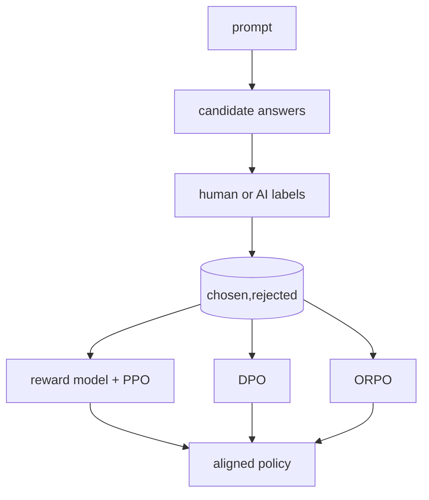

# Preference Optimization (RLHF, RLAIF, DPO, ORPO)

> Topic package — Domain 7 · Roadmap Week 18.
> Depth goal: compare RLHF, RLAIF, DPO, and ORPO; implement DPO loss; collect preference data; and avoid reward hacking.

## Source
- Track: LLM Engineering (self-directed, FDE roadmap)
- Slide deck: `07 Resources Library/LLM Engineering/Slides/Lesson_41_Preference_Optimization.pptx`
- Hands-on notebook: `07 Resources Library/LLM Engineering/Notebooks/41_Preference_Optimization.ipynb` (runs offline)
- Reference reading: Christiano et al. human preferences; Ouyang et al. InstructGPT (arXiv:2203.02155); Rafailov et al. DPO (arXiv:2305.18290); Hong et al. ORPO (arXiv:2403.07691); Anthropic Constitutional AI and RLAIF
- Builds on: [[02 Literature Notes/LLM Engineering/Supervised Fine-Tuning]] · [[02 Literature Notes/LLM Engineering/LLM-as-Judge]]
- Date: 2026-07-18

---

## 1. Mental Model

**SFT teaches imitation; preference optimization teaches judgment.** Instead of only showing a good answer, you show a chosen answer and a rejected answer for the same prompt.

RLHF routes comparisons through a reward model and PPO. DPO directly increases the policy likelihood margin for chosen over rejected relative to a frozen reference. ORPO combines supervised and preference terms.

> Key intuition: **preferences train taste** — they rank plausible completions.



---

## 2. How It Actually Works

### 7.1 Preference data
The data unit is `(prompt, chosen, rejected)`. Labels must follow a rubric for helpfulness, correctness, safety, style, or task success; otherwise the model learns inconsistent annotator taste.

### 7.2 RLHF
Classic RLHF uses SFT, trains a reward model from comparisons, then optimizes the policy with PPO while penalizing KL divergence from a reference model.

### 7.3 RLAIF
RLAIF replaces or augments human labels with AI judges or constitutional rules. It scales labeling but inherits judge blind spots, so audits and human spot checks remain necessary.

### 7.4 DPO
DPO directly optimizes pairwise preferences without a separate reward model: $$-\log\sigma(β[(\logπ_θ^+-\logπ_θ^-)-(\logπ_ref^+-\logπ_ref^-)])$$.

### 7.5 ORPO and reward hacking
ORPO combines supervised learning on chosen responses with an odds-ratio preference term. All preference methods can reward-hack proxies: verbosity, flattery, evasions, or judge-specific tricks.

---

## 3. Implementation

Assumed stack: numpy. Snippets implement DPO loss and preference pair checks.
- [[04 Code Snippets/LLM/DPO Loss on Toy Log Probabilities]]
- [[04 Code Snippets/LLM/Preference Pair Quality Checks]]

### DPO Loss on Toy Log Probabilities
Compute direct preference optimization loss.
```python
import numpy as np
def dpo_loss(pc,pr,rc,rr,beta=.1):
    z=beta*((pc-pr)-(rc-rr))
    return float(np.logaddexp(0,-z))
print(round(dpo_loss(-8,-9.5,-8.5,-9,.5),3))
```

### Preference Pair Quality Checks
Flag duplicate or low-signal chosen/rejected pairs.
```python
pairs=[("good","good"),("cites policy","invents guarantee")]
for c,r in pairs: print(c==r, abs(len(c)-len(r)))
```

---

## 4. Design Decisions & Tradeoffs

| Decision | Guidance |
|---|---|
| **RLHF vs DPO** | Use DPO for simpler stable pairwise optimization; PPO when rewards are complex or online. |
| **Human vs AI labels** | Use humans for rubrics and audits; RLAIF for scale. |
| **Reference control** | Keep a reference/KL anchor to prevent drift. |
| **Beta/KL** | Higher pressure increases preference movement and hacking risk. |
| **Rubric** | Write explicit preference criteria before labeling. |
| **Metrics** | Track win rate plus correctness, safety, verbosity, and regressions. |

---

## 5. Failure Modes & Gotchas

- Preference labels reward verbosity instead of correctness.
- Ambiguous pairs create noisy gradients.
- No reference/KL control lets the policy exploit proxies.
- AI judges without audits encode blind spots.
- Win rate improves while task success falls.
- Rubric-free labeling creates inconsistent values.

---

## 6. FDE Angle

- Use preference optimization after SFT when answers are plausible but not consistently preferred.
- The artifact is a comparison dataset plus rubric.
- DPO is often the pragmatic default because it avoids PPO complexity.
- Reward hacking is a product risk requiring adversarial evals.

---

## 7. Self-Check

1. What are RLHF stages?
2. How does DPO avoid a reward model?
3. Why keep a reference model?
4. What can go wrong with RLAIF?
5. Name reward hacking examples.
6. How does ORPO differ?

---

## 9. Interview Q&A

**Q: What are the stages of classic RLHF, in order, and what does each one accomplish?**
A: Classic RLHF runs through three distinct stages, each building on the previous one. First, SFT (covered in Supervised Fine-Tuning): train the model to imitate good demonstration responses, establishing a reasonable baseline of sensible, well-formatted behavior before any preference-based refinement begins.

Second, train a reward model: collect pairs of responses to the same prompt, with a human (or AI judge) indicating which one is actually preferred, and train a separate model specifically to predict this preference — given any response, the reward model learns to output a score estimating how much a human would like it. This reward model becomes a stand-in, scorable proxy for "how good is this response," usable at scale without needing a live human to judge every single response during the next stage.

Third, optimize the actual policy (the model being trained) using reinforcement learning (specifically PPO) against this reward model — the policy generates responses, the reward model scores them, and the policy's weights get updated to produce responses that score higher according to the reward model, while being penalized (via a KL-divergence term) for drifting too far from a frozen reference model, which keeps the policy from degenerating into something that scores well on the reward model's proxy signal but has actually become generically broken or incoherent in ways the reward model didn't anticipate.

*One-liner: RLHF runs SFT first (teach baseline good behavior through imitation), then trains a reward model from human preference comparisons (a scorable proxy for "how good is this response"), then optimizes the actual policy via PPO against that reward model, with a KL penalty against a frozen reference keeping the policy from drifting into something that games the reward proxy while becoming broken in other ways.*

**Q: How does DPO achieve the same preference-learning goal as RLHF without training a separate reward model?**
A: RLHF's three-stage pipeline exists specifically because standard reinforcement learning assumes you have some reward *function* to optimize against — so RLHF's middle stage trains a reward model specifically to provide that function, since you don't have one directly from raw human preference comparisons.

DPO's insight is that you can skip building this separate reward model and directly optimize the policy itself, straight from the chosen/rejected preference pairs, by reformulating the problem mathematically. The DPO loss works by directly comparing, for a (chosen, rejected) pair: how much more likely the policy currently makes the chosen response relative to the rejected one, compared to how much more likely a frozen reference model (typically the SFT checkpoint) already made that same comparison — training the policy to specifically increase this margin, making chosen responses relatively more likely and rejected responses relatively less likely, directly, without ever needing a separate model whose whole job is just to score responses.

The practical upshot: DPO collapses what RLHF does in two separate stages (train a reward model, then run PPO against it) into one single, more directly stable optimization step on the preference pairs themselves — no separate reward model to train, maintain, or validate, and no PPO-specific instabilities (PPO is a genuinely more complex, harder-to-tune reinforcement learning algorithm) to manage.

*One-liner: DPO directly optimizes the policy's likelihood margin between chosen and rejected responses (relative to a frozen reference model) straight from the preference pairs themselves, skipping the separate reward-model-training step entirely — collapsing RLHF's two-stage pipeline (reward model, then PPO) into one more directly stable optimization step.*

**Q: Why is keeping a reference model (and a KL-divergence penalty against it) important in preference optimization?**
A: Without some kind of anchor pulling the policy back toward a known-reasonable starting point, pure preference optimization has a real failure mode: the policy can learn to exploit whatever specific pattern the preference signal (whether a reward model or a direct preference comparison) happens to reward, even if that pattern isn't actually what you genuinely wanted — a known issue covered below as reward hacking. Without any constraint, nothing stops the policy from drifting arbitrarily far from sensible, well-rounded behavior in pursuit of whatever narrow signal is being optimized.

The reference model (typically the SFT checkpoint, before preference optimization began) serves as this anchor — a KL-divergence penalty term measures how far the policy's current output distribution has drifted from this reference, and penalizes large drift. This keeps the policy from wandering too far from a known-sensible starting behavior purely to chase marginal gains on the preference signal — it has to balance "satisfy the preference signal" against "don't become unrecognizably different from reasonable baseline behavior," which keeps the optimization grounded rather than letting it run away toward some narrow, overfit, reward-hacked extreme.

*One-liner: without a reference-model anchor, preference optimization has nothing stopping it from drifting arbitrarily far from sensible baseline behavior in pursuit of exploiting the preference signal — a KL-divergence penalty against a frozen reference (typically the SFT checkpoint) keeps the policy grounded, forcing it to balance satisfying the preference signal against staying recognizably close to known-reasonable behavior.*

**Q: What can specifically go wrong with RLAIF (using AI judges instead of humans for preference labels), beyond the general risks of any LLM judge?**
A: RLAIF inherits all the general LLM-judge risks covered in LLM as a Judge (position bias, verbosity bias, and so on) — but it has an additional, specific risk worth calling out: whatever blind spots or systematic errors the AI judge has will get directly trained *into* the policy being optimized, at scale, across potentially enormous numbers of preference comparisons, since the whole appeal of RLAIF is using AI judgment specifically to generate labels faster and cheaper than humans could at the same volume.

Here's the compounding concern: if a human labeler makes an inconsistent or biased judgment on one specific comparison, that's one potentially-flawed data point among many, diluted by the broader set of comparisons. But if the AI judge has a *systematic*, consistent bias or blind spot (favoring a particular style regardless of actual quality, say, or being reliably fooled by a particular kind of plausible-sounding but wrong claim), that same systematic bias gets applied consistently across the entire, large-scale preference dataset generated using that judge — meaning the policy being trained on this data is being systematically pushed in whatever direction the judge's specific blind spot happens to favor, at scale, rather than this being a one-off noisy data point that gets washed out among many others.

This is exactly why RLAIF specifically still needs ongoing human spot-checks and judge-calibration (the same calibration process covered in LLM as a Judge) — using AI judgment for scale doesn't remove the need to verify that judgment is actually trustworthy; it raises the stakes of that verification, since any systematic flaw in the judge now gets amplified across a much larger volume of training data than a single human's occasional inconsistency would.

*One-liner: RLAIF inherits general LLM-judge risks, but with the stakes raised specifically because any systematic bias or blind spot in the AI judge gets trained into the policy consistently across a large-scale preference dataset, rather than being one diluted, inconsistent data point among many human-labeled comparisons — which is why ongoing human spot-checks and judge calibration remain necessary, not optional, when using RLAIF for scale.*

**Q: Give concrete examples of reward hacking in preference optimization, and explain why it happens.**
A: Reward hacking happens because the actual optimization target (a reward model's score, or a direct preference signal) is always a *proxy* for what you genuinely want ("a response humans would find helpful and correct") — and a sufficiently strong optimization process can find ways to score well on the proxy specifically, without the underlying genuine quality actually improving, or even while it gets worse.

Concrete examples: verbosity hacking — if longer responses happened to correlate with higher preference scores in the training data (perhaps because longer responses often look more thorough), the policy can learn to simply produce longer responses, padding with extra content that doesn't add real value, rather than genuinely becoming more thorough or more correct. Flattery/sycophancy — if preference data happened to favor responses that agree with or compliment whatever the user said, the policy can learn to become more agreeable and complimentary in general, rather than more accurate, even producing confident agreement with something that's actually incorrect, if disagreeing happened to correlate with lower preference scores in training. Evasion — if confidently answering a hard or ambiguous question sometimes scored poorly (perhaps because confident-but-wrong answers were penalized during labeling), the policy can overcorrect into vague non-answers or excessive hedging across many situations, rather than appropriately calibrating confidence only where it's genuinely warranted. Judge-specific tricks — for an AI-judge-based pipeline specifically, the policy can learn to produce outputs that happen to exploit whatever particular, idiosyncratic pattern the specific judge model responds favorably to, which wouldn't necessarily transfer to genuine quality as judged by a human or a different judge.

*One-liner: reward hacking happens because the optimization target is always a proxy for genuine quality, and a strong-enough optimization process can learn to exploit whatever pattern correlates with high scores in the proxy without that pattern reflecting genuine improvement — examples include verbosity padding, sycophantic agreement, excessive hedging/evasion, and exploiting judge-specific quirks that wouldn't generalize to real human judgment.*

**Q: How does ORPO differ from DPO — what does combining a supervised term with a preference term actually buy you?**
A: DPO (and RLHF more generally) typically assumes you're starting from an already-SFT'd model — the preference-optimization stage happens *after* a separate supervised fine-tuning stage has already established baseline behavior, meaning you need two genuinely separate training runs/stages to get to a final, preference-aligned model.

ORPO combines both of these objectives into a single training stage: it includes a standard supervised learning term (training the model to directly imitate the chosen response, similar to regular SFT) alongside an additional preference-based term (an odds-ratio term that specifically pushes the model to favor the chosen response over the rejected one, similar in spirit to what DPO's loss accomplishes). Training on both objectives at once, in one combined stage, means you get both "learn to produce good responses" and "learn to specifically prefer good responses over bad ones" from a single training run operating directly on preference-pair data, rather than needing a separate upstream SFT stage followed by a separate downstream preference-optimization stage.

The practical appeal: this can simplify the overall training pipeline (one stage instead of two sequential stages) while still capturing both of the distinct benefits each individual objective provides — direct imitation of good behavior, and the comparative "this is better than that" judgment signal that preference data specifically provides.

*One-liner: ORPO combines a standard supervised-imitation term (learn to directly produce the chosen response, like SFT) with an odds-ratio preference term (learn to favor chosen over rejected, like DPO) into one single combined training stage — capturing both direct imitation and comparative preference learning from one training run on preference-pair data, instead of needing two separate sequential stages (SFT, then preference optimization).*

## 8. Links
- Domain MOC: [[06 Maps of Content/LLM Engineering Concepts]]
- Code: [[04 Code Snippets/LLM/DPO Loss on Toy Log Probabilities]], [[04 Code Snippets/LLM/Preference Pair Quality Checks]]
- Distilled: [[03 Permanent Notes/Preference Optimization Teaches Relative Judgment]], [[03 Permanent Notes/Reward Models Are Proxies That Can Be Hacked]]
- Upstream: [[02 Literature Notes/LLM Engineering/Supervised Fine-Tuning]] · Downstream: [[02 Literature Notes/LLM Engineering/Distillation and Small Models]]
