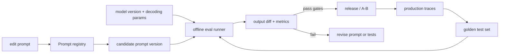

# Prompt Versioning & Regression Testing

> Topic package — Domain 3 · Roadmap Week 15.
> Depth goal: operate prompts like production code — version them semantically, store them in a registry, regression-test them against golden cases, and safely roll prompt/model changes through CI and A/B evaluation.

## Source
- Track: LLM Engineering (self-directed, FDE roadmap)
- Slide deck: `07 Resources Library/LLM Engineering/Slides/Lesson_14_Prompt_Versioning.pptx`
- Hands-on notebook: `07 Resources Library/LLM Engineering/Notebooks/14_Prompt_Versioning.ipynb` (runs offline)
- Reference reading: promptfoo docs (LLM evals and prompt regression testing); LangSmith and Langfuse prompt management; DSPy (programmatic prompt optimization); 'prompts are code' production practices; OpenAI and Anthropic model versioning guidance
- Builds on: [[02 Literature Notes/LLM Engineering/Prompt Contracts]]
- Date: 2026-07-18

---

## 1. Mental Model

**A prompt is a deployable artifact, not a sticky note in the codebase — every production prompt needs a version, test suite, and release process.** Once a prompt controls user-facing behavior, changing a word can be equivalent to changing application logic: it can break JSON, shift tone, leak policy, increase refusals, or silently degrade accuracy.

Versioning turns prompt changes from folklore into engineering. A registry records the prompt text, parameters, model pin, owner, changelog, expected schema, and eval set. Regression tests compare candidate behavior against golden examples before the new prompt is allowed into production.

> Key intuition: **prompt changes are code changes with probabilistic outputs.** Use semantic versions to communicate intent, golden tests to catch regressions, and model+prompt pinning so you can reproduce yesterday's behavior tomorrow.



---

## 2. How It Actually Works

### 3.1 Prompts deserve semantic versions
Semantic versioning is a communication contract for behavior:
- **PATCH** (`1.2.3 -> 1.2.4`): typo, formatting clarification, no intended behavior change.
- **MINOR** (`1.2 -> 1.3`): improved behavior for existing inputs, compatible schema.
- **MAJOR** (`1.x -> 2.0`): output schema, task boundary, refusal policy, or tool contract changes.

Because outputs are probabilistic, semver is about *intended compatibility* plus measured regression risk, not mathematical guarantees.

### 3.2 The prompt registry is the source of truth
A registry should store more than a text blob: prompt id, semver, system/developer/user template, schema, examples, owner, changelog, linked model version, decoding params, eval set id, and rollout state. LangSmith/Langfuse-style prompt management exists because the worst production prompt is the one pasted into three services with no provenance.

### 3.3 Golden tests turn taste into gates
A golden set is a curated suite of inputs with expected properties: exact JSON fields, rubric scores, required citations, forbidden claims, or canonical labels. It should include normal cases, adversarial cases, null-context cases, and prior incidents. The test set is never 'complete'; it is the living memory of what must not break.

### 3.4 Diff outputs, not just prompt text
Text diffs show *what you changed*; output diffs show *what changed in behavior*. For structured tasks, compute exact-match and schema-valid rates. For generated text, compare rubric scores, embedding-free lexical overlap, policy flags, length, refusal rate, and citation coverage. A simple weighted score is often enough for CI:

$$score = 0.45\,accuracy + 0.25\,schema + 0.20\,grounding - 0.10\,cost$$

### 3.5 Pin prompt and model versions together
A prompt is calibrated to a model, tokenizer, decoding profile, and tool surface. Swapping `gpt-4.1` to `gpt-4.1-2026-05-01` or changing temperature can break a formerly stable prompt. Production traces should record `prompt_id@version`, `model`, `temperature`, tool schema version, and retrieval config so regressions are reproducible.

---

## 3. Implementation

Assumed stack: stdlib — a tiny prompt registry plus a deterministic regression harness that simulates CI without calling real models. Snippets:
- [[04 Code Snippets/LLM/Prompt Registry With Semantic Versions]]
- [[04 Code Snippets/LLM/Golden Prompt Regression Harness]]

### Prompt Registry With Semantic Versions
Store prompts as immutable versioned artifacts with model and eval metadata.
```python
from dataclasses import dataclass

@dataclass(frozen=True)
class PromptVersion:
    prompt_id: str
    version: str
    template: str
    model: str
    temperature: float
    schema: str
    eval_set: str
    changelog: str

class PromptRegistry:
    def __init__(self): self._items = {}
    def publish(self, p: PromptVersion):
        key = (p.prompt_id, p.version)
        if key in self._items: raise ValueError(f"already published: {key}")
        self._items[key] = p
    def get(self, prompt_id, version):
        return self._items[(prompt_id, version)]

reg = PromptRegistry()
reg.publish(PromptVersion("support_triage", "1.2.0", "Classify: {ticket}",
                          "fake-model-2026-07", 0.0, "{label,priority}",
                          "triage_gold_v3", "Add billing edge cases"))
print(reg.get("support_triage", "1.2.0"))
```

### Golden Prompt Regression Harness
Compare two prompt versions over a golden set and fail CI on behavior regressions.
```python
def fake_model(prompt_version, case):
    text = case["input"].lower()
    if "refund" in text or "invoice" in text: label = "billing"
    elif "error" in text or "crash" in text: label = "bug"
    else: label = "other"
    if prompt_version.endswith("bad") and "refund" in text: label = "other"
    return {"label": label}

def run_regression(version, golden):
    rows, ok = [], 0
    for case in golden:
        pred = fake_model(version, case)
        passed = pred["label"] == case["expected"]
        ok += int(passed); rows.append((case["id"], passed, pred["label"], case["expected"]))
    return ok / len(golden), rows

golden = [{"id":"g1","input":"Refund my invoice","expected":"billing"},
          {"id":"g2","input":"App crashes with error 500","expected":"bug"}]
score, rows = run_regression("support_triage@1.3.0", golden)
print("score", score, "pass", score >= 0.95, rows)
```

---

## 4. Design Decisions & Tradeoffs

| Decision | Guidance |
|---|---|
| **Version granularity** | Version the prompt contract, not every runtime input. Template, schema, examples, refusal policy, and model pin are release artifacts. |
| **Semver bump** | Patch for wording with no intended behavior change; minor for compatible quality improvements; major for schema/task/refusal/tool changes. |
| **Golden set design** | Use high-signal cases: common paths, edge cases, prior bugs, adversarial examples, and null-context refusals. |
| **Pass gates** | Block release on schema failures, safety regressions, critical case failures, or statistically meaningful score drops. |
| **A/B strategy** | Use offline regression first, then small traffic split with pinned prompt/model versions and production trace labels. |
| **Registry location** | Centralize in a prompt registry or versioned package; never let teams paste divergent prompt strings into services. |

---

## 5. Failure Modes & Gotchas

- Editing a prompt inline in production with no version bump → impossible rollback and no root-cause trail.
- Testing only happy-path examples → the first edge case becomes a production incident.
- Changing the model while keeping the same prompt version → you cannot tell whether the regression was model or prompt.
- Relying on exact text match for long-form answers → false failures; use task-specific rubrics/properties.
- Letting golden tests fossilize bad behavior → review and retire stale expectations.
- A/B testing before offline gates pass → users become your regression suite.

---

## 6. FDE Angle

- Clients trust AI systems more when prompt changes have release notes, owners, and rollback paths.
- A golden set built from real support tickets or analyst tasks is a concrete FDE deliverable.
- Prompt CI gives product teams a safe way to improve behavior without fear of silent regressions.
- Deliverable: a prompt registry entry plus CI report showing old vs new prompt/model performance.

---

## 7. Self-Check

1. What belongs in a prompt registry entry beyond the prompt text?
2. When should a prompt change be major vs minor vs patch?
3. Why must prompt and model versions be pinned together?
4. How would you design a golden set for a support-triage prompt?
5. Why is output diffing more important than prompt-text diffing?
6. What gates should block a prompt release in CI?

---

## 9. Interview Q&A

**Q: What belongs in a prompt registry entry, beyond just the prompt text?**
A: Think about what you'd actually need if something broke in production and you had to figure out exactly what was running, reproduce it, and roll it back safely — the prompt text alone can't answer any of that.

You need the exact model it was paired with (and its specific version, since even a minor model update can change behavior), the decoding settings used (like temperature — randomness settings genuinely change output, so they're part of "what was actually running"), the expected output schema (what fields, what types), any few-shot examples bundled with it (since examples teach behavior just as much as the instructions do), an owner (who do you ask when something's wrong), a changelog (what changed and why, compared to the last version), and a reference to the specific golden test set this version was validated against.

The reason all of this belongs together, as one package: a prompt's actual behavior isn't determined by its text alone — it's determined by the *combination* of the text, the model, the decoding settings, and the examples, all together. If you only version the text and let the model or temperature drift independently somewhere else in your system, you lose the ability to say "this exact combination is what we tested and approved" — you could end up in a state where the prompt text is the version you tested, but it's secretly running against a different model than it was validated with.

*One-liner: a registry entry needs the model version, decoding settings, output schema, examples, owner, changelog, and linked test set alongside the prompt text — because a prompt's actual behavior comes from all of these together, not the text in isolation, so they need to be versioned and reproducible as one package.*

**Q: When should a prompt change be versioned as major, minor, or patch?**
A: This mirrors how software versioning works, adapted to the fact that a prompt's output is probabilistic rather than exactly predictable — so the question becomes "how much is the *intended* behavior changing," not "did the exact wording change."

A patch is for changes with no intended behavior difference at all — fixing a typo, rewording something for clarity without changing what it's asking the model to do. The expectation is that a patch shouldn't change how the system behaves on real inputs; it's cleanup, not a behavior change.

A minor version bump is for changes that improve behavior while staying compatible with everything downstream — say, adding a clarifying instruction that makes the model handle an edge case slightly better, without changing the output schema or what tasks the prompt handles. Existing code that consumes this prompt's output shouldn't need to change at all.

A major version bump is for anything that changes the actual contract — a different output schema (a renamed or newly required field), a different task scope (the prompt now handles cases it didn't before, or stops handling ones it used to), a changed refusal policy, or a different tool-calling contract. These are breaking changes from the point of view of anything downstream that depends on this prompt's exact behavior — similar to a breaking API change, where callers might need to update their own code to keep working correctly.

*One-liner: patch = wording-only change with no intended behavior difference; minor = a compatible behavior improvement that doesn't change the schema or task scope; major = anything that changes the actual contract (schema, task scope, refusal policy, tool contract) — a breaking change for anything depending on this prompt.*

**Q: Why must the prompt version and model version be pinned together?**
A: Because a prompt's behavior was only ever validated against one specific model — its wording, its examples, even subtle assumptions about how that particular model interprets instructions were all tuned and tested against that exact model. Swap in a different model (even a newer version of the "same" model family) without updating anything else, and you're now running an untested combination — the prompt might behave completely differently against this new model's own learned behaviors, quirks, and training.

Here's the real danger if you don't pin them together: if something goes wrong in production — the model starts refusing more often, or output quality drops — and you don't have a clear record of exactly which model version was paired with exactly which prompt version at that moment, you have no way to tell whether the regression came from a change to the prompt, a silent update to the model (which providers do push periodically), or some combination of both. You end up debugging blind, guessing at the cause instead of being able to directly compare "prompt v1.2 + model v2026-05 (known good)" against "prompt v1.2 + model v2026-07 (new, suspect)."

Pinning them together as one recorded unit — logging both the prompt version and the exact model version on every production call — means that when something breaks, you can look at the trace and know precisely which combination produced it, and you can roll back to a prior known-good combination with confidence, rather than guessing which half of the system actually changed.

*One-liner: a prompt is only validated against one specific model, so swapping the model without re-validating means running an untested combination — pinning and logging both versions together is what lets you tell, after a regression, whether the prompt or the model actually changed, instead of debugging blind.*

**Q: How would you design a golden test set for a support-triage prompt?**
A: Start from what this prompt actually needs to get right in practice, then build test cases that specifically probe those requirements — not just a handful of easy, obvious examples.

First, include the common, everyday cases — the bulk of real traffic this prompt will see, covering each of the categories it's meant to classify (billing issues, technical bugs, general questions, and so on), so you know the basic, expected behavior works.

Second, include edge cases — ambiguous tickets that could plausibly belong to more than one category, oddly-worded or very short tickets, tickets in a different language if that's realistic traffic, and tickets with genuinely insufficient information to classify confidently (this is exactly where the refusal path should kick in, if the contract has one).

Third, include cases built directly from prior incidents — any time this prompt has actually misclassified something in production and someone had to notice and fix it, that exact case should become a permanent entry in the golden set. This is critical: without this, a bug that was already found and fixed once can silently resurface in a future prompt change, because nothing in the test set would have caught it a second time.

Fourth, include adversarial cases — tickets that try to manipulate the classification, for instance a ticket containing text designed to look like an instruction to the model rather than a genuine customer complaint, testing whether the prompt's guardrails actually hold up.

Each of these should have a clearly defined expected outcome (the correct label, or an explicit refusal where that's the right answer), so that running the regression harness gives an unambiguous pass or fail, not something requiring human judgment every time.

*One-liner: cover common everyday cases, ambiguous/edge cases (including where refusal is the correct answer), every prior real-world misclassification turned into a permanent regression test, and adversarial cases probing the guardrails — each with a clear expected outcome so the test suite can be checked automatically, not by eye.*

**Q: Why is diffing outputs more important than diffing the prompt text itself?**
A: Diffing the text tells you what you *changed* — it shows you literally which words are different between two prompt versions. But it tells you nothing about what actually *happens* as a result of that change, and that gap matters a lot with a probabilistic system.

Here's the core problem: prompts don't behave like regular code, where a given input always produces exactly the same output through a fixed, traceable set of rules you could read and verify yourself. A tiny wording change — even something that looks, to a human reading the text diff, like a harmless clarification — can shift model behavior in ways that are genuinely hard to predict just by reading the new text. The only way to actually know whether a change made things better, worse, or just different is to run both versions against the same set of real inputs and compare what they *produce* — the actual outputs, not the instructions that generated them.

This is why a regression harness runs both the old and new prompt version against the same golden set and compares the resulting outputs — checking things like: did the output still validate against the schema, did a rubric score for quality stay the same or drop, did the refusal rate change, did specific known-correct answers change to something different. This output-level comparison is what actually tells you whether behavior regressed — a clean-looking wording change can still produce worse real outputs, and a messy-looking wording change can sometimes produce better ones; you can't reliably know which until you've actually measured the outputs themselves.

*One-liner: a text diff only shows you what you changed in the wording, not what that change actually does to behavior — since prompts are probabilistic rather than deterministic, the only reliable way to know if a change helped or hurt is to run both versions against the same golden set and compare the actual outputs produced, not the words that produced them.*

**Q: What gates should block a prompt release in CI?**
A: Think of these as the automated checks that have to pass before a new prompt version is allowed to replace the current one in production — the same idea as tests blocking a code merge, just measuring different things.

A schema failure should always block release — if the new version's output doesn't reliably validate against the required structure, nothing downstream can safely consume it, so this is a hard, non-negotiable gate. A safety regression should also always block — if the new version starts producing policy violations, unsafe content, or anything the old version correctly avoided, that's not something you ship and fix later; it blocks immediately. A failure on any of the critical, known cases in the golden set (especially ones built from prior real incidents) should block release — these specifically exist to prevent an old bug from quietly resurfacing, so a failure here is a direct signal that's happening.

Beyond these hard blocks, a statistically meaningful drop in the overall quality score — not just noise from natural variation, but a real, measurable regression across the golden set as a whole — should also block release, even if no single hard rule technically failed, since an overall quality decline is still a real problem worth catching before it reaches users.

The underlying principle across all of these: failing any of these gates means the change doesn't go live yet — it goes back for revision, exactly the same discipline as a failing test suite blocking a code deployment.

*One-liner: block release on schema-validation failures, safety regressions, failures on critical/incident-derived golden cases, or a statistically meaningful overall quality score drop — any of these failing means the change goes back for revision instead of reaching production, the same discipline as a failing test suite blocking a code deploy.*

## 8. Links
- Domain MOC: [[06 Maps of Content/LLM Engineering Concepts]]
- Code: [[04 Code Snippets/LLM/Prompt Registry With Semantic Versions]], [[04 Code Snippets/LLM/Golden Prompt Regression Harness]]
- Distilled: [[03 Permanent Notes/Prompts Need Semantic Versions]], [[03 Permanent Notes/Prompt Evals Are Regression Tests]]
- Upstream: [[02 Literature Notes/LLM Engineering/Prompt Contracts]] · Downstream: [[02 Literature Notes/LLM Engineering/Reasoning Prompt Patterns]]
