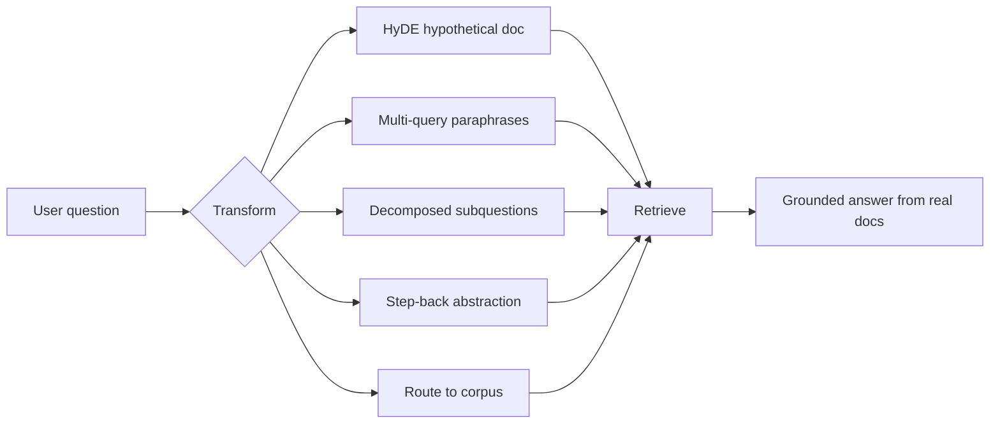

# Query Transformation (HyDE, multi-query, routing)

> Topic package — Domain 4 · Roadmap Week 19.
> Depth goal: implement query transformations that improve retrieval recall and source selection: hypothetical document embeddings, multi-query expansion, decomposition, step-back prompting, and rule/model-based routing.

## Source
- Track: LLM Engineering (self-directed, FDE roadmap)
- Slide deck: `07 Resources Library/LLM Engineering/Slides/Lesson_19_Query_Transformation.pptx`
- Hands-on notebook: `07 Resources Library/LLM Engineering/Notebooks/19_Query_Transformation.ipynb` (runs offline)
- Reference reading: Gao et al. HyDE (arXiv:2212.10496); Zheng et al. Step-Back Prompting (arXiv:2310.06117); LangChain query transformation docs; LlamaIndex query routing and query engine docs
- Builds on: [[02 Literature Notes/LLM Engineering/RAG Pipeline Fundamentals]] · [[02 Literature Notes/LLM Engineering/Advanced Retrieval]] · [[02 Literature Notes/LLM Engineering/Prompt Contracts]]
- Date: 2026-07-18

---

## 1. Mental Model

**Retrieval quality is often limited less by the index than by the query you send to it.** Users ask underspecified, conversational, multi-hop, or vocabulary-mismatched questions; query transformation creates better search probes before hitting the retriever.

Transformations are controlled forms of expansion. HyDE invents a plausible answer document and embeds that; multi-query sends several paraphrases; decomposition turns one hard question into subquestions; step-back asks for the broader principle; routing chooses the right corpus/tool. Each increases recall but can also introduce drift.

> Key intuition: **do not retrieve with the user's raw words when the retrieval problem is really several better search problems.** Transform the query, retrieve broadly, then answer only from real evidence.



---

## 2. How It Actually Works

### 4.1 Why transform queries
Raw user questions are optimized for conversation, not search. They omit nouns from prior context, use synonyms the corpus does not use, pack multiple intents into one sentence, or ask at the wrong abstraction level. Query transformation makes the retrieval request more like the documents you hope to find.

### 4.2 HyDE
Hypothetical Document Embeddings ask an LLM to draft a plausible answer passage, then embed that passage instead of (or alongside) the short query. The generated text may be factually wrong; its purpose is to land near relevant documents in embedding space. The final answer must still be grounded only in retrieved real documents.

### 4.3 Multi-query expansion
Multi-query sends several paraphrases or facet-specific queries and unions/fuses results. It improves recall when corpora use varied terminology. Use deduplication and RRF to merge results; otherwise expansion can flood the reranker with redundant or off-topic candidates.

### 4.4 Decomposition and step-back
Decomposition splits multi-hop questions into answerable subquestions. Step-back prompting asks a more general question first (principles, definitions, policies) and retrieves background context. These are useful when direct retrieval misses because the exact final answer is distributed across documents.

### 4.5 Routing
Routing chooses which source, retriever, or tool to call: policies vs tickets, SQL vs vector, docs vs code, current vs archive. Routing can be rule-based, embedding-based, or LLM-classified, but it must expose confidence and fallback to broad search when uncertain.

---

## 3. Implementation

Assumed stack: stdlib + numpy. Snippets simulate HyDE/multi-query and routing offline. Snippets:
- [[04 Code Snippets/LLM/HyDE and Multi Query Expander]]
- [[04 Code Snippets/LLM/Rule Based Query Router]]

### HyDE and Multi Query Expander
Generate deterministic pseudo-HyDE text and paraphrase probes for broader retrieval.
```python
def hyde(query):
    return f"A technical answer about {query}: definitions, mechanism, tradeoffs, and examples."

def multi_query(query):
    return [query, f"definition and mechanism of {query}", f"failure modes and implementation details for {query}"]

q = "how does MMR improve RAG retrieval"
print("HyDE:", hyde(q))
print("queries:")
for x in multi_query(q): print("-", x)
```

### Rule Based Query Router
Route transformed questions to specialized retrievers with an uncertainty fallback.
```python
ROUTES = {"policy":["refund","compliance","policy"],
          "code":["stacktrace","function","class","api"],
          "metrics":["revenue","count","dashboard","sql"]}

def route(query):
    q = query.lower()
    scores = {name: sum(term in q for term in terms) for name, terms in ROUTES.items()}
    best, score = max(scores.items(), key=lambda x: x[1])
    return best if score else "general"

for q in ["refund policy", "function stacktrace", "monthly revenue", "what is RAG"]:
    print(q, "->", route(q))
```

---

## 4. Design Decisions & Tradeoffs

| Decision | Guidance |
|---|---|
| **Use HyDE** | Good for short/vague semantic queries; avoid when hallucinated details could dominate exact retrieval. |
| **Use multi-query** | Good when terminology varies; fuse and deduplicate aggressively. |
| **Use decomposition** | Use for multi-hop questions where one retrieved chunk cannot answer everything. |
| **Use step-back** | Use when the direct question needs general principles or definitions first. |
| **Routing confidence** | Route only when confident; otherwise search broad or multiple sources. |
| **Answer grounding** | Never answer from generated transformations; only from retrieved real documents. |

---

## 5. Failure Modes & Gotchas

- Letting a HyDE hallucination become evidence in the final answer.
- Generating too many query variants and destroying latency/precision.
- Decomposing simple questions into unnecessary subqueries.
- Routing to one narrow source with no fallback.
- Failing to deduplicate expanded retrieval results.
- Evaluating only final answers and never measuring transformed-query recall.

---

## 6. FDE Angle

- Query transformation is the fastest fix when users and documents use different vocabulary.
- It is also a governance concern: generated search probes must not become cited evidence.
- A good FDE exposes the transformation trace so misses are debuggable.
- Deliverable: a query-planning layer with expansion, routing, fusion, and a fallback policy.

---

## 7. Self-Check

1. Why can HyDE improve embedding retrieval even if its generated text is false?
2. How do multi-query expansion and RRF fit together?
3. When should a question be decomposed?
4. What is step-back prompting retrieving that direct search may miss?
5. How should a router behave when confidence is low?

---

## 9. Interview Q&A

**Q: Why can HyDE improve embedding retrieval even if the generated hypothetical text is factually wrong?**
A: This only makes sense once you remember what embedding similarity actually measures: how similar two pieces of text are in *style, vocabulary, and structure* — not whether either piece of text is true. A short, vague user question and a detailed, well-written document that actually answers it often look quite different in embedding space, purely because a question and an answer are written in very different styles — a question is often short and underspecified, while the documents you're searching for are usually longer, more detailed, declarative passages.

HyDE works around this mismatch by having an LLM first draft a hypothetical answer — a passage that's *written in the style of an actual answer*, even though the LLM is essentially guessing at the specifics. This generated passage is then embedded instead of, or alongside, the original short query. Because this hypothetical answer is structured and worded much more like a real document in the corpus (even if some specific facts in it are wrong), its embedding tends to land closer, in vector space, to the real, correct documents that would actually answer the question — simply because they share more stylistic and structural similarity than the original short question did.

The crucial safeguard here: the hypothetical document is only ever used as a *search probe* — a way to generate a better-positioned vector to search with — it is never itself presented as evidence or cited in the final answer. The final answer still has to be grounded only in the real documents that got retrieved as a result of this improved search, not in anything the hypothetical document itself claimed, since that hypothetical text might be entirely fabricated.

*One-liner: embedding similarity measures stylistic/structural closeness, not truth — a hypothetical answer, even with wrong facts, is written more like a real document than a short question is, so embedding it lands closer to the real correct documents in vector space; the hypothetical text is only ever a search probe, never cited as evidence in the actual answer.*

**Q: How do multi-query expansion and Reciprocal Rank Fusion fit together?**
A: Multi-query expansion solves a specific problem: a single way of phrasing a question might miss documents that use different terminology for the same underlying concept — the corpus might say "cancel," your user asked about "terminate," and a single query using only one of these words could miss documents using the other. Multi-query expansion addresses this by generating several different phrasings or facet-specific variants of the same underlying question, and running retrieval separately for each one.

But this immediately creates a new problem: you now have several separate ranked lists of results — one per query variant — and you need a way to combine them into one single, final ranked list to actually use. This is exactly where RRF comes in, and it fits naturally for the same reason it works for combining dense and lexical retrieval (covered in Advanced Retrieval): RRF combines ranked lists based on rank position rather than raw scores, so it doesn't matter that these several query variants might have produced scores on different scales, or even used entirely different retrieval mechanisms — RRF just needs the rank order from each list, and combines documents that showed up strongly (ranked near the top) across multiple query variants into one unified, fused ranking.

So the two techniques are complementary stages of the same overall problem: multi-query expansion generates more, differently-worded search attempts to improve the chance of finding the right documents under varied terminology, and RRF is the mechanism that merges all those separate attempts back into one coherent final list, without needing to worry about calibrating scores across what could be many different query variants.

*One-liner: multi-query expansion generates several differently-worded search attempts to catch documents using varied terminology, and RRF is the natural way to merge the resulting multiple ranked lists back into one final ranking — since RRF works from rank position rather than raw scores, it doesn't need any calibration across however many query variants were generated.*

**Q: When should a question actually be decomposed into subquestions, rather than searched directly as one query?**
A: The signal to look for is whether answering the question genuinely requires connecting *multiple, separate* pieces of information that are unlikely to all live in any single retrieved chunk — this is often called a multi-hop question, since answering it requires hopping across more than one distinct piece of evidence.

Take a question like "did the company that acquired our main competitor in 2023 also raise prices that year?" Answering this actually requires first figuring out *which* company acquired the competitor (one fact, likely in one document), and then separately figuring out whether *that specific company* raised prices in 2023 (a different fact, likely in a completely different document). A single search using the whole original question as-is is unlikely to retrieve a chunk that directly answers this combined question, because no single document is likely to contain both connected facts together — the question spans information that lives in genuinely separate places.

Decomposition breaks this into separate subquestions — "which company acquired our main competitor in 2023" and then, using that answer, "did [that company] raise prices in 2023" — each of which *is* individually a reasonable, single-document-answerable search query on its own. If, on the other hand, a question can plausibly be answered by a single well-matched chunk already (a simple factual lookup, even if the question is phrased in a complex-sounding way), decomposing it anyway just adds unnecessary extra retrieval calls and latency for no real benefit — decomposition should be reserved specifically for genuinely multi-hop questions, not applied reflexively to anything that merely sounds complicated.

*One-liner: decompose when a question requires connecting multiple separate facts that are unlikely to live in any single document (a genuine multi-hop question) — if a single chunk could plausibly answer it directly, decomposing anyway just adds unnecessary retrieval calls and latency for no real benefit.*

**Q: What is step-back prompting retrieving that a direct search might miss?**
A: Step-back prompting is based on the idea that answering a specific question sometimes genuinely requires first understanding a more general principle, definition, or policy that the specific question itself doesn't directly ask about — but which is necessary background for interpreting the specific answer correctly.

Take a question like "can I get a refund for this specific order placed 35 days ago?" A direct search using exactly this question might retrieve something narrowly matching "this order" or "35 days" if such a specific passage happens to exist, but it might completely miss the actual relevant document — the general refund policy itself, which states something like "refunds are only available within 30 days of purchase." That general policy document doesn't mention "35 days" or this specific order at all, so a narrow, literal search for the specific question might not surface it, even though it's exactly the information needed to actually answer the question correctly.

Step-back prompting addresses this by first asking a broader, more general version of the question — "what is the refund policy?" rather than "can I get a refund for this specific 35-day-old order?" — retrieving that general background context first. This general document (the policy stating a 30-day window) is exactly what's needed to correctly reason about the specific case (35 days > 30 days, so no, this isn't eligible) — information a narrowly-phrased direct search might have missed entirely, because the specific question's exact wording doesn't match the general policy document's wording.

*One-liner: step-back prompting first asks a more general version of the question (the underlying principle, definition, or policy) rather than the narrow specific question directly, which surfaces general background documents a narrowly-worded direct search might miss — background that's often exactly what's needed to correctly reason about the specific case.*

**Q: How should a query router behave when its confidence in choosing a source is low?**
A: It should fall back to a broader search rather than committing confidently to a single, possibly-wrong source — the whole point of exposing a confidence signal in the first place is so the system can actually act differently when that confidence is low, instead of routing blindly every time regardless of how uncertain the decision actually was.

Here's the failure mode this specifically guards against: if a router is forced to always pick exactly one specific source (say, "policy documents" versus "code documentation" versus "support tickets") with no way to express uncertainty, a genuinely ambiguous or unusual question gets routed to whichever source scored marginally highest, even if that margin was small and the router was essentially guessing. If that guess happens to be wrong, the entire rest of the pipeline searches in the wrong place, retrieves nothing truly relevant, and the user gets a bad or empty answer — not because the information wasn't somewhere in the system, but because routing confidently sent the search to the wrong corpus entirely.

The better design: have the router expose an actual confidence score or margin, not just a single hard decision, and define a clear threshold below which the router doesn't commit to one narrow source at all — instead, it falls back to searching more broadly (multiple sources, or a general/default corpus) rather than betting everything on an uncertain single choice. This trades off a bit of efficiency (a broader search is somewhat more expensive than a single, correctly-targeted one) for significantly more robustness on exactly the ambiguous, unusual queries where a wrong, overconfident routing decision would otherwise completely derail the rest of the pipeline.

*One-liner: a router should expose a real confidence score, not just force a single hard choice — below some confidence threshold, it should fall back to a broader, multi-source search rather than committing to one specific source based on an uncertain guess, since a wrong confident routing decision sends the entire rest of the pipeline searching in the wrong place.*

## 8. Links
- Domain MOC: [[06 Maps of Content/LLM Engineering Concepts]]
- Code: [[04 Code Snippets/LLM/HyDE and Multi Query Expander]], [[04 Code Snippets/LLM/Rule Based Query Router]]
- Distilled: [[03 Permanent Notes/Query Transformation Turns One Bad Search Into Several Better Searches]], [[03 Permanent Notes/Routing Is Retrieval Source Selection Not Answering]]
- Upstream: [[02 Literature Notes/LLM Engineering/Advanced Retrieval]] · Downstream: [[02 Literature Notes/LLM Engineering/GraphRAG]]
