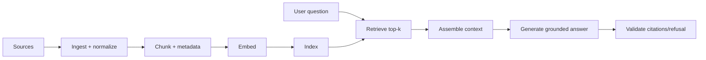

# RAG Pipeline Fundamentals

> Topic package — Domain 4 · Roadmap Weeks 13/17.
> Depth goal: build and reason about a full retrieval-augmented generation pipeline — ingest -> chunk -> embed -> index -> retrieve -> assemble -> generate -> cite — and choose RAG vs fine-tuning vs long-context deliberately.

## Source
- Track: LLM Engineering (self-directed, FDE roadmap)
- Slide deck: `07 Resources Library/LLM Engineering/Slides/Lesson_17_RAG_Pipeline_Fundamentals.pptx`
- Hands-on notebook: `07 Resources Library/LLM Engineering/Notebooks/17_RAG_Pipeline_Fundamentals.ipynb` (runs offline)
- Reference reading: Lewis et al. Retrieval-Augmented Generation (arXiv:2005.11401); Anthropic Contextual Retrieval; Pinecone RAG guide; LlamaIndex RAG docs; LangChain RAG docs
- Builds on: [[02 Literature Notes/LLM Engineering/Vector Search]] · [[02 Literature Notes/LLM Engineering/Embeddings]] · [[02 Literature Notes/LLM Engineering/Prompt Contracts]]
- Date: 2026-07-18

---

## 1. Mental Model

**RAG turns an LLM from a closed-book guesser into an open-book reader with a retrieval system in front of it.** The model still generates language, but the product's knowledge boundary moves from model weights to an external corpus that can be updated, filtered, cited, and evaluated.

A production RAG system is not just 'put top-k chunks in the prompt'. It is a chain of lossy transformations: documents become chunks, chunks become embeddings, indexes approximate nearest neighbors, retrievers select evidence, assemblers spend context budget, and the generator must cite only what it used. Most failures are pipeline failures before they are model failures.

> Key intuition: **retrieve the smallest sufficient evidence set, then make the LLM read it under a citation contract.** RAG quality is bounded by retrieval recall, context assembly, and refusal behavior — not by prompt cleverness alone.



---

## 2. How It Actually Works

### 4.1 The retrieve-then-read pattern
RAG decomposes question answering into two jobs: **retrieval** finds candidate evidence and **reading/generation** synthesizes an answer. This is powerful because the retriever can be cheap, inspectable, and updateable while the LLM handles language and reasoning. The system should refuse when retrieval returns no relevant evidence; otherwise the generator is being asked to answer closed-book.

### 4.2 Ingest, chunk, metadata
Ingestion is where documents are normalized, de-duplicated, permission-tagged, and split into chunks. Chunking is a recall/precision tradeoff: small chunks retrieve precisely but may lack context; large chunks preserve context but dilute embeddings. Metadata (source, date, owner, ACL, section path) is not bookkeeping — it enables filtering, citations, freshness, and deletion.

### 4.3 Embeddings and indexes
Embedding maps text into vectors where semantic neighbors are close. The index (FAISS/HNSW/vector DB) makes nearest-neighbor search fast. Embeddings are not truth detectors: they optimize similarity, not answerability. Store both the vector and enough raw text/metadata to support later citation and re-ranking.

### 4.4 Context assembly and citation contracts
The assembler decides which retrieved chunks fit in the prompt, how to order them, and how to label them. Use stable chunk IDs and source labels; require the answer to cite those IDs. A good contract says: answer only from context, cite every factual claim, and return `insufficient_context` when evidence is missing.

### 4.5 RAG vs fine-tuning vs long-context
Use **RAG** for changing/private/factual knowledge with citations. Use **fine-tuning** for behavior, style, format, or domain skill that should live in weights. Use **long-context** when the working set is small enough to pass directly and retrieval would risk dropping key evidence. These are complements: many systems use RAG plus a tuned model and long-context windows.

---

## 3. Implementation

Assumed stack: stdlib + numpy. Snippets implement a deterministic offline mini-RAG and a citation-aware assembler. Snippets:
- [[04 Code Snippets/LLM/Offline Mini RAG Pipeline]]
- [[04 Code Snippets/LLM/Citation Aware Context Assembler]]

### Offline Mini RAG Pipeline
A tiny deterministic RAG pipeline: chunk, embed, retrieve, assemble, and answer from evidence.
```python
import hashlib, numpy as np

def embed(text, dim=32):
    v = np.zeros(dim)
    for tok in text.lower().split():
        h = int(hashlib.md5(tok.encode()).hexdigest(), 16)
        v[h % dim] += 1.0
    return v / (np.linalg.norm(v) + 1e-9)

docs = {"d1":"RAG retrieves external evidence before generation.",
        "d2":"Fine-tuning changes model behavior and style.",
        "d3":"Citations bind generated claims to retrieved chunks."}
index = [(k, text, embed(text)) for k, text in docs.items()]

def retrieve(question, k=2):
    q = embed(question)
    scored = [(float(q @ vec), doc_id, text) for doc_id, text, vec in index]
    return sorted(scored, reverse=True)[:k]

def answer(question):
    hits = retrieve(question)
    evidence = "\n".join(f"[{doc_id}] {text}" for _, doc_id, text in hits)
    return f"Context:\n{evidence}\n\nAnswer: use retrieved evidence and cite chunk ids."

print(answer("Why use citations in RAG?"))
```

### Citation Aware Context Assembler
Pack retrieved chunks into a bounded context with stable source labels for grounded generation.
```python
def assemble(hits, max_chars=220):
    blocks, used = [], 0
    for score, chunk_id, text in hits:
        block = f"[{chunk_id} score={score:.2f}] {text}"
        if used + len(block) > max_chars:
            continue
        blocks.append(block); used += len(block)
    instructions = "Answer only from context. Cite chunk ids like [d1]. Refuse if missing."
    return instructions + "\n\n<context>\n" + "\n".join(blocks) + "\n</context>"

hits = [(0.91, "policy-7", "Refunds require a receipt within 30 days."),
        (0.63, "policy-2", "Store credit may be issued after 30 days.")]
print(assemble(hits))
```

---

## 4. Design Decisions & Tradeoffs

| Decision | Guidance |
|---|---|
| **Chunk size** | Start around paragraph/section boundaries; tune by recall and answer faithfulness, not aesthetics. |
| **Top-k** | Retrieve generously enough for recall, then compress/rerank; too small hides evidence, too large distracts. |
| **Metadata** | Store source, section, timestamp, ACL, and version; future filtering/citation depends on it. |
| **Generation contract** | Answer only from context, cite chunk IDs, and refuse when evidence is insufficient. |
| **RAG vs fine-tune** | RAG for knowledge; fine-tune for behavior/style; long-context for small bounded corpora. |
| **Freshness** | Plan re-indexing, deletion, and document versioning from day one. |

---

## 5. Failure Modes & Gotchas

- Chunking by fixed characters that splits tables, headings, or code blocks.
- No document IDs in the prompt, making citations impossible to verify.
- Treating top semantic match as proof of answerability.
- Stuffing too many chunks into context until the model ignores the key evidence.
- Skipping ACL/metadata filters and leaking private documents.
- Using RAG when the requirement is behavioral consistency that fine-tuning would solve better.

---

## 6. FDE Angle

- RAG is the default enterprise LLM architecture because knowledge changes faster than model weights.
- The FDE deliverable is a traceable pipeline: question -> retrieved chunks -> cited answer -> logs/eval.
- Stakeholders trust cited answers more than fluent answers; citations are product UX, not decoration.
- Most RAG debugging is data plumbing: chunk boundaries, filters, stale indexes, and missing refusal paths.

---

## 7. Self-Check

1. List every stage from ingest to cited answer.
2. Why does chunking affect both recall and faithfulness?
3. What must be stored in metadata for citations and permissions?
4. When would you choose fine-tuning instead of RAG?
5. What should the generator do when retrieval evidence is weak?

---

## 9. Interview Q&A

**Q: List every stage from ingest to a cited answer in a RAG pipeline.**
A: Walk through the full journey a piece of information takes, from raw document to something the user actually sees, since each stage is a place something can go wrong.

First, ingestion: raw source documents get pulled in, normalized (consistent formatting), de-duplicated, and tagged with permissions (who's allowed to see this). Second, chunking: documents get split into smaller pieces, each one carrying metadata like its source, section, and timestamp. Third, embedding: each chunk gets converted into a vector that captures its meaning. Fourth, indexing: these vectors get stored in a structure (like an ANN index) that supports fast similarity search at query time.

Then, at the moment a user actually asks a question: fifth, retrieval — the user's question gets embedded too, and the index is searched for the most similar chunks, returning a set of candidates. Sixth, assembly — the retrieved candidates get selected, ordered, and packed into the model's context window, along with instructions about how to use them (answer only from this evidence, cite your sources). Seventh, generation — the model actually produces an answer, grounded in that assembled context. Eighth, and often skipped in simplified descriptions: validation — checking that the generated answer actually cites real chunk IDs that were genuinely provided, and that it correctly refused if the evidence was insufficient, rather than just trusting that the model followed instructions perfectly.

*One-liner: ingest (normalize, dedupe, tag permissions) → chunk (split, attach metadata) → embed (text to vector) → index (store for fast search) → retrieve (find relevant chunks for a query) → assemble (select, order, pack into context) → generate (produce a grounded answer) → validate (check citations are real and refusals happened when they should have).*

**Q: Why does chunking affect both retrieval recall and answer faithfulness?**
A: Chunking size sits at the center of a real tension, because it's simultaneously the unit the retriever searches over *and* the unit the generator has to actually ground its answer in — and these two roles pull in opposite directions.

For recall: if chunks are too large, each one tries to represent many different ideas at once, and its embedding ends up being a kind of average across all of them — this dilutes how strongly it matches any one specific, narrow question, so a chunk containing the right answer might not even get retrieved because its overall "vibe" doesn't match the query sharply enough. If chunks are too small, a piece of information that would answer the question might get split across multiple chunks, with no single chunk containing the complete picture needed.

For faithfulness: even if the right chunk does get retrieved, if it's too small, it might be missing the surrounding context needed to actually understand or correctly use the information (a sentence like "this cut costs by 40%" is ambiguous without knowing what "this" refers to) — and a model forced to answer from incomplete, decontextualized evidence either has to guess, or produces an answer that sounds grounded but is actually working from a fragment that doesn't fully support it.

So chunk size genuinely affects both ends of the pipeline at once: too large hurts whether the right evidence gets *found* at all (recall), and too small (or badly bounded) hurts whether the found evidence is actually *sufficient* for a faithful, well-grounded answer once it's used. There's no universal "right" size — it's a tradeoff tuned against your specific content and measured against real recall and faithfulness metrics, not picked by feel.

*One-liner: chunk size affects recall because overly large chunks dilute embeddings (hurting whether the right chunk gets found) and affects faithfulness because overly small or badly-bounded chunks can lack the context needed to ground a correct answer once found — it's a genuine tradeoff, tuned against real metrics, not a single universally-correct number.*

**Q: What must be stored in metadata to support citations and access permissions?**
A: Think about what you'd need to answer two very different questions later: "where did this specific piece of information actually come from" (for citations) and "is this specific user even allowed to see this" (for permissions) — metadata needs to carry enough to answer both.

For citations, you need at minimum: a stable, unique identifier for each chunk (so an answer can reference "according to [chunk-47]" and that reference can actually be traced back to something real), the original source document it came from, and ideally the specific section or location within that document (so a human checking the citation can quickly find the relevant passage, not just know which document it's somewhere in). A timestamp is also valuable here — knowing when this information was captured helps judge whether it's still likely to be current.

For permissions, you need: an owner or access-control identifier attached to each chunk (which user, team, or tenant is allowed to see this specific piece of content), and this has to be checked as a genuine pre-filter at retrieval time (as covered in Vector Search), not as an afterthought applied only to the final generated answer.

Without this metadata captured at ingestion time, you lose the ability to do either of these things later — a citation becomes just "the model said so" with no way to verify it against a real source, and access control becomes something you'd have to reconstruct after the fact (if it's even possible at all) rather than something enforced cleanly at the point of retrieval.

*One-liner: metadata needs a stable chunk ID, the source document, section/location, and a timestamp (for verifiable citations), plus an owner/access-control tag that gets enforced as a genuine pre-filter at retrieval time (for permissions) — without capturing this at ingestion, neither citations nor access control can be done reliably later.*

**Q: When would you choose fine-tuning instead of RAG?**
A: The deciding question is: is the gap you're trying to close about *knowledge* (facts the model doesn't currently have) or about *behavior* (how the model acts, even on things it already knows how to do)?

RAG is the right tool for knowledge gaps — information that's private to your organization, changes frequently, or needs to be traceable back to a specific source (for compliance or trust reasons). RAG solves this well because the knowledge lives in an external, updatable corpus rather than being baked into the model's weights — update a document, and the next query sees the update immediately, with no retraining needed.

Fine-tuning is the right tool when the gap is about *behavior* rather than knowledge — things like: the model should consistently respond in a specific tone or format, it should reliably use tools in a particular style, or it needs a specialized skill that's less about "knowing a fact" and more about "doing a task in the house style." This kind of thing is hard to achieve reliably just by stuffing instructions into a prompt every time — fine-tuning actually bakes the desired behavior into the model's weights, so it shows up consistently without needing to be re-explained in every single prompt.

A good way to tell them apart in practice: if the fix would be "add this document to the knowledge base," that's RAG's job. If the fix would be "the model needs to consistently behave differently across many different inputs, not just know one more fact," that's fine-tuning's job. Many real production systems end up using both together — a fine-tuned model (for consistent behavior and style) that also has RAG (for current, traceable, cite-able knowledge) layered on top.

*One-liner: choose RAG when the problem is a knowledge gap (private, frequently-changing, or citation-requiring information) — choose fine-tuning when the problem is a behavior gap (consistent tone, format, or specialized skill that needs to be baked into how the model acts, not just one more fact it needs to know) — many systems genuinely need both together.*

**Q: What should the generator do when retrieval evidence is weak or insufficient?**
A: It should explicitly refuse to answer confidently, rather than doing its best to produce something that sounds complete and correct anyway — this is one of the most important, and most often missing, pieces of a well-designed RAG system.

Here's the failure this is specifically guarding against: if a prompt's contract effectively demands an answer no matter what, and the retrieved evidence doesn't actually support a confident answer, the model's only way to comply with that demand is to fill the gap with something plausible-sounding but not actually grounded in the evidence — this is a very specific, common, and avoidable cause of hallucination in RAG systems, not a mysterious model failure.

The fix, covered in Prompt Contracts, is building an explicit, legitimate refusal path directly into the output format itself — something like returning `{"answer": null, "reason": "insufficient_context"}` — paired with clear instructions telling the model exactly when to use it (when retrieval returned no relevant chunks, or when the retrieved chunks don't actually address the specific question being asked). This turns "the system doesn't have enough information" from a scenario that forces fabrication into a legitimate, expected, and honestly communicated outcome — which is a far better user experience than a confident-sounding answer that turns out to be wrong.

*One-liner: the generator should explicitly refuse (using a built-in, legitimate refusal path in its output contract) rather than fabricate a confident-sounding answer when retrieved evidence doesn't actually support one — this turns "not enough information" into an honest, expected outcome instead of a forced hallucination.*

## 8. Links
- Domain MOC: [[06 Maps of Content/LLM Engineering Concepts]]
- Code: [[04 Code Snippets/LLM/Offline Mini RAG Pipeline]], [[04 Code Snippets/LLM/Citation Aware Context Assembler]]
- Distilled: [[03 Permanent Notes/RAG Is Retrieve Then Read With a Citation Contract]], [[03 Permanent Notes/RAG Fine Tuning and Long Context Solve Different Problems]]
- Upstream: [[02 Literature Notes/LLM Engineering/Vector Search]] · Downstream: [[02 Literature Notes/LLM Engineering/Advanced Retrieval]]
