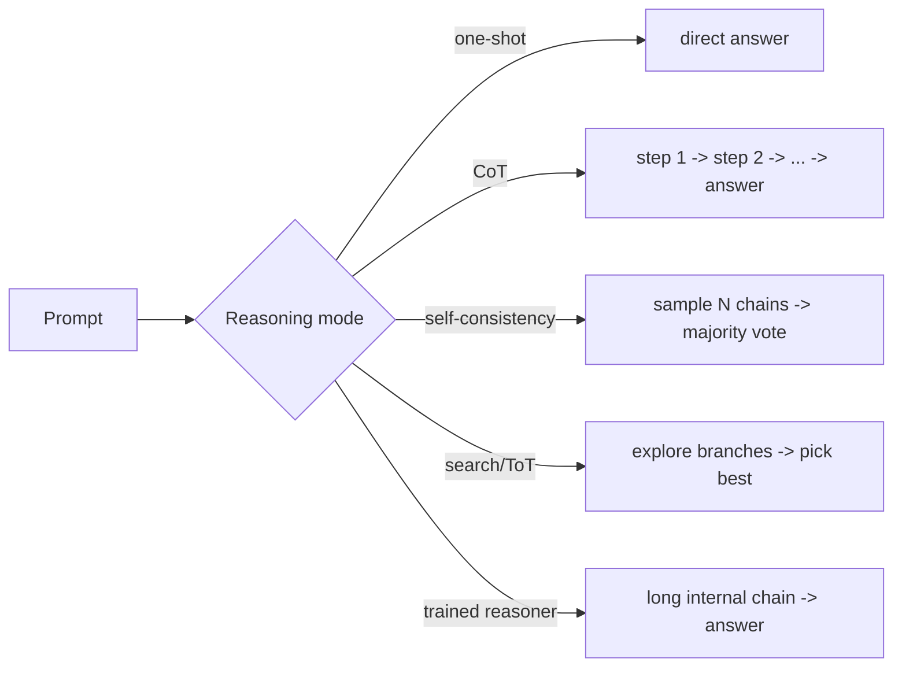

# Reasoning Models & Test-Time Compute

> Topic package — Domain 2 · Roadmap Weeks 11/16.
> Depth goal: understand what 'reasoning models' actually are, how test-time compute (CoT, self-consistency, search) buys accuracy, and when it's worth the cost.

## Source
- Track: LLM Engineering (self-directed, FDE roadmap)
- Slide deck: `07 Resources Library/LLM Engineering/Slides/Lesson_12_Reasoning_Models.pptx`
- Hands-on notebook: `07 Resources Library/LLM Engineering/Notebooks/12_Reasoning_Models.ipynb` (runs offline)
- Reference reading: Wei et al. 'Chain-of-Thought Prompting' (arXiv:2201.11903); Wang et al. 'Self-Consistency' (arXiv:2203.11171); OpenAI o1/o3 system cards; DeepSeek-R1 (arXiv:2501.12948); Snell et al. 'Scaling test-time compute'; Yao 'Tree of Thoughts'
- Builds on: [[02 Literature Notes/LLM Engineering/Decoding and Sampling]]
- Date: 2026-07-18

---

## 1. Mental Model

**Reasoning models trade inference-time compute for accuracy: instead of answering in one shot, they 'think' — generating intermediate steps — before committing.** A standard LLM maps prompt → answer in a single forward pass budget. A reasoning approach spends *more tokens/compute at inference* to search over or unfold a solution, which reliably improves hard, multi-step tasks (math, code, planning).

Two ways to get it:
1. **Prompted reasoning** — chain-of-thought, self-consistency, tree-of-thoughts on a normal model. Cheap to adopt, works today.
2. **Trained reasoners** — models RL-trained to produce long internal chains before answering (o1/o3, DeepSeek-R1). The 'thinking' is learned, often hidden, and much stronger.

> Key intuition: **more thinking time = more accuracy, up to a point.** Test-time compute is a *dial* you can trade against latency and cost — the newest scaling axis beyond just bigger models.



---

## 2. How It Actually Works

### 2.1 Chain-of-thought (CoT)
Prompting the model to 'think step by step' makes it emit intermediate reasoning before the final answer. This dramatically improves multi-step arithmetic/logic because each step conditions the next (the model can offload working memory into the token stream). Zero-shot CoT ('Let's think step by step') and few-shot CoT (worked examples) are the base techniques.

### 2.2 Self-consistency
Instead of one greedy chain, **sample many CoT chains** (temperature>0) and take the **majority-vote answer**. Different reasoning paths that converge on the same answer are more likely correct. It trades N× compute for a solid accuracy bump on reasoning benchmarks — a clean example of spending test-time compute.

### 2.3 Search: tree-of-thoughts & beam over reasoning
Generalize CoT from a single chain to a **tree**: generate multiple candidate next-steps, score/evaluate them (self-eval or a verifier), and expand the promising branches (BFS/DFS/beam). More expensive, but strong on puzzles/planning where you must backtrack. This is explicit search over reasoning states.

### 2.4 Trained reasoning models (o1/R1)
The frontier shift: **RL-train the model to reason**. Using outcome rewards (did it get the right answer?) and long CoT, models learn to plan, check, and backtrack internally, producing very long 'thinking' traces before a concise answer. o1/o3 and DeepSeek-R1 show large gains on math/code. The reasoning tokens are compute you pay for (and often can't see), and quality scales with how long the model is allowed to think.

### 2.5 Test-time compute scaling & when it's worth it
Recent results: for a fixed model, *spending more inference compute* (longer chains, more samples, search+verifier) can beat using a much larger model. But it's not free — latency and token cost rise, and easy tasks get no benefit (sometimes worse). The skill is **matching compute to difficulty**: cheap one-shot for easy calls, reasoning for the hard minority.

---

## 3. Implementation

Assumed stack: `numpy`/stdlib to simulate self-consistency and a compute-vs-accuracy tradeoff. Snippets:
- [[04 Code Snippets/LLM/Self-Consistency Majority Vote]]
- [[04 Code Snippets/LLM/Match Test-Time Compute to Difficulty]]

### Self-Consistency Majority Vote
Sample N reasoning chains and majority-vote the final answer.
```python
from collections import Counter

def self_consistency(reason_once, prompt, n=5):
    # reason_once(prompt) -> (chain_text, final_answer)
    answers = []
    for _ in range(n):
        _, ans = reason_once(prompt)
        answers.append(ans)
    vote = Counter(answers).most_common(1)[0]
    return vote[0], vote[1] / n            # answer, agreement fraction

# demo: a noisy 'reasoner' right 60% of the time
import random; random.seed(0)
def noisy_reasoner(prompt):
    ans = 42 if random.random() < 0.6 else random.choice([41, 43, 44])
    return "...steps...", ans

ans, agree = self_consistency(noisy_reasoner, "what is 6*7?", n=15)
print(f"majority answer={ans}  agreement={agree:.0%}")   # majority recovers 42
```

### Match Test-Time Compute to Difficulty
Route easy queries to one-shot, hard queries to expensive reasoning — a cost gate.
```python
def solve(query, difficulty_fn, cheap_solve, reason_solve, threshold=0.5):
    d = difficulty_fn(query)               # 0..1 estimated difficulty
    if d < threshold:
        return cheap_solve(query), "cheap-1shot", 1
    return reason_solve(query), "reasoning", 10   # ~10x tokens

def difficulty(q):    # toy: longer / has 'prove'/'why' -> harder
    hard = any(w in q.lower() for w in ("prove", "why", "derive", "plan"))
    return 0.9 if hard else 0.2

cheap = lambda q: "quick answer"
reason = lambda q: "answer after long chain-of-thought"
for q in ["What is the capital of France?", "Prove sqrt(2) is irrational"]:
    ans, mode, cost = solve(q, difficulty, cheap, reason)
    print(f"[{mode:>10} cost~{cost:>2}x] {q}")
```

---

## 4. Design Decisions & Tradeoffs

| Decision | Guidance |
|---|---|
| **Easy / factual queries** | One-shot, temperature=0. Reasoning adds cost and can hurt. |
| **Hard multi-step (math, code, planning)** | CoT at minimum; self-consistency or a trained reasoner for the hardest. |
| **Need verifiable answers** | Search + a verifier/self-eval, or self-consistency voting. |
| **Prompted vs trained reasoner** | Prompted CoT works on any model today; trained reasoners (o1/R1) are stronger but pricier/slower. |
| **Budget-bound** | Route by estimated difficulty; don't pay reasoning cost on the easy majority. |
| **Latency-sensitive UX** | Reasoning traces add seconds; stream or pre-compute, or cap thinking length. |

---

## 5. Failure Modes & Gotchas

- Using a reasoning model for everything → high latency and token bills on trivial calls.
- Trusting a fluent CoT as proof of correctness → the chain can be plausible but wrong (unfaithful reasoning).
- Self-consistency with temperature=0 → all chains identical, no benefit; you need diverse samples.
- Exposing hidden reasoning tokens to users or logs when the provider forbids it.
- Assuming more thinking always helps → easy tasks plateau or regress; match compute to difficulty.
- Ignoring that reasoning tokens count as (often billed) output.

---

## 6. FDE Angle

- Test-time compute is a cost/accuracy dial you can present to clients: 'we can be 8% more accurate on hard tickets for 10× the tokens on that 5% of traffic.'
- Difficulty-routing (cheap model for easy, reasoner for hard) is a concrete cost-architecture pattern.
- You can explain why an o1-style model is slow/expensive and when it's justified vs a RAG+CoT pipeline.
- Deliverable: a routing policy that reserves expensive reasoning for queries that actually need it, with measured accuracy/cost.

---

## 7. Self-Check

1. Why does chain-of-thought help multi-step tasks?
2. How does self-consistency turn compute into accuracy, and why does it need temperature>0?
3. What's the difference between prompted reasoning and a trained reasoning model?
4. When does spending more test-time compute NOT help?
5. Design a difficulty-routing policy; what do you measure to tune the threshold?

---

## 9. Interview Q&A

**Q: Why does chain-of-thought help with multi-step tasks?**
A: Think about what a model actually has to work with: whatever it's already written down. Normally, a model has to produce the final answer in one single step, using only its internal, hidden processing to get there — and for anything that takes several logical steps (a multi-step math problem, planning out code), that's asking a lot to happen invisibly, all at once, with no way to check intermediate work.

Chain-of-thought changes this by having the model write out its intermediate steps as actual text, one at a time, before giving the final answer. Here's why that helps: once step 1 is written down as real tokens, step 2 gets to "see" it as part of the input — the model can refer back to it just like it would refer to anything else in the prompt. This means the model doesn't have to hold the whole multi-step problem in its head at once; it can offload partial progress into the visible text and build on it piece by piece, the same way a person solving a math problem writes down intermediate steps instead of trying to do it all in their head.

This especially helps because each step is an easier sub-problem than the whole thing. "What's 47 times 23" is hard to do in one leap, but "break it into 47×20 plus 47×3, then add them" turns one hard step into several easy ones — and writing each easy step down lets the next step build on a correct, visible intermediate result instead of guessing the whole answer at once.

*One-liner: writing out intermediate steps lets each step build on the actual visible result of the step before it, turning one hard all-at-once answer into several easier steps the model can check and build on — much like a person writing down their work instead of doing it all in their head.*

**Q: How does self-consistency turn compute into accuracy, and why does it need temperature>0?**
A: Start with the idea behind it: if you ask the same hard question several different ways and most of the answers agree, that agreement is itself evidence the answer is probably right — even if any single attempt could have gone wrong along the way.

Self-consistency applies exactly that idea to a single model. Instead of generating just one chain-of-thought and trusting it, you generate several *different* chains for the same question, and then take whichever final answer shows up most often across them — a majority vote. The reasoning behind this: a wrong answer usually comes from some mistake somewhere in a specific chain of reasoning, and different sampled chains are likely to make *different* mistakes (if they make any at all). But if most of the independent chains happen to land on the same final answer anyway, despite following different paths, that's a strong sign the answer is actually correct rather than a coincidence of one lucky guess.

Here's why it needs temperature greater than 0: at temperature=0, the model is being as deterministic as possible — it always picks its single most likely next word at every step. That means every "sample" you generate at temperature=0 would just produce the exact same chain and the exact same answer every time, since there's no randomness to produce a different path. You'd be doing extra work for zero extra information — all N votes would just be duplicates of the same one attempt. You need some randomness (temperature>0) so the model can actually explore genuinely different reasoning paths across samples — that diversity is the entire point, since agreement across different paths is what gives you the confidence signal in the first place.

*One-liner: self-consistency samples several different reasoning chains and takes whichever final answer wins the majority vote, on the idea that agreement across independently-wrong-in-different-ways attempts is evidence of correctness — but this only works with temperature above 0, since at temperature=0 every "sample" would just be an identical copy of the same one chain.*

**Q: What's the difference between prompted reasoning and a trained reasoning model?**
A: The difference is whether the "thinking" behavior was added through instructions at the time you use the model, or built into the model itself during training.

Prompted reasoning (like chain-of-thought) works on basically any existing model — you just ask it, in the prompt, to "think step by step" or show its work. The model was never specifically trained to reason this way; it's simply following an instruction, using reasoning-like patterns it happened to pick up from its training data. This is cheap to try (it's just a prompt change) and works today on almost any model, but the quality of the reasoning is only as good as what the model can produce when merely asked nicely.

A trained reasoning model (like OpenAI's o1/o3 or DeepSeek-R1) is different: these models go through an extra training stage specifically designed to make them good at reasoning. They're trained using reinforcement learning, where the model is rewarded based on whether it actually arrived at the correct final answer — and through that training, the model learns, on its own, to produce long internal reasoning traces, check its own work, and backtrack when something looks wrong, without being told to do any of that through a prompt. This "thinking" is baked into the model's learned behavior, often happens automatically without being asked, and is frequently hidden from the user entirely (you just see the final answer). These models tend to be noticeably stronger on genuinely hard problems, but they're also slower and more expensive to run, since all that extra internal reasoning is still compute you're paying for.

*One-liner: prompted reasoning (CoT) is just asking an existing model to show its steps, which is cheap and works everywhere but only as good as what a model will produce when asked — a trained reasoning model has reasoning built in through dedicated training, producing stronger (but slower, pricier) results, often with hidden internal reasoning you never directly see.*

**Q: When does spending more test-time compute NOT help?**
A: The short answer: when the task was never actually hard in the first place.

All of these techniques — longer chains of thought, sampling many attempts and voting, searching over different reasoning branches — exist to help with problems that genuinely benefit from extra steps, extra attempts, or extra exploration. A genuinely hard multi-step math problem benefits from this, because there's real room for a longer, more careful process to catch mistakes a quick, one-shot answer would make.

But an easy question — "what's the capital of France," or a simple factual lookup — doesn't have multiple steps to get right or wrong. The model either already knows the answer directly or it doesn't, and no amount of "thinking longer" creates information that wasn't already there. In these cases, extra reasoning steps add cost and latency for literally zero accuracy benefit — and in some cases can even make things slightly worse, since a longer, more elaborate response gives more opportunities for the model to second-guess a correct, simple answer into something more complicated and wrong.

This is exactly why matching the amount of reasoning to the actual difficulty of the task matters: spend the extra compute only on the subset of questions that are genuinely hard enough to benefit from it, and let easy questions go through cheaply and quickly.

*One-liner: extra test-time compute only helps when a task genuinely has room for multi-step improvement — easy, single-fact questions get no benefit (and sometimes get worse) from extra "thinking," so reasoning effort should be matched to actual task difficulty, not applied uniformly to everything.*

**Q: Design a difficulty-routing policy — what would you measure to tune the threshold?**
A: Think of this as a cost-control system: you want expensive, slow reasoning only for the questions that actually need it, and a cheap, fast path for everything else.

The basic design: first, estimate how hard a given query is — this could be something simple like checking for keywords that tend to signal a hard, multi-step task ("prove," "why," "plan"), or something more sophisticated like a small classifier trained on examples of easy vs. hard queries. Based on that difficulty estimate, route the query down one of two paths: below some threshold, send it to the cheap, one-shot, low-latency path; above the threshold, send it to the expensive reasoning path (chain-of-thought, self-consistency, or a trained reasoning model).

The hard part is picking where to set that threshold, and that's where measurement comes in. You'd want to track, for queries near the threshold on both sides: accuracy (did routing this query to the cheap path or the expensive path actually get the right answer), cost (how many tokens or how much compute did each path use), and latency (how long did the user wait). The goal is to find the threshold that avoids two failure modes: setting it too low, so you're paying reasoning-level cost and latency on easy queries that didn't need it, or setting it too high, so you're sending genuinely hard queries down the cheap path and getting wrong answers. In practice, this means running both paths on a labeled set of queries with known correct answers, measuring where the cheap path starts failing, and setting the threshold just above that point — then re-checking it periodically, since what counts as "easy" can shift as your actual traffic changes.

*One-liner: estimate each query's difficulty (keywords, or a trained classifier), route below-threshold queries to a cheap one-shot path and above-threshold queries to expensive reasoning, and tune the threshold by measuring accuracy, cost, and latency on both paths against a labeled test set — catching the point where the cheap path starts failing.*

## 8. Links
- Domain MOC: [[06 Maps of Content/LLM Engineering Concepts]]
- Code: [[04 Code Snippets/LLM/Self-Consistency Majority Vote]], [[04 Code Snippets/LLM/Match Test-Time Compute to Difficulty]]
- Distilled: [[03 Permanent Notes/Test-Time Compute Is a New Scaling Axis]], [[03 Permanent Notes/Match Compute to Difficulty]]
- Upstream: [[02 Literature Notes/LLM Engineering/Decoding and Sampling]] · Related: [[02 Literature Notes/LLM Engineering/Reasoning Prompt Patterns]]
