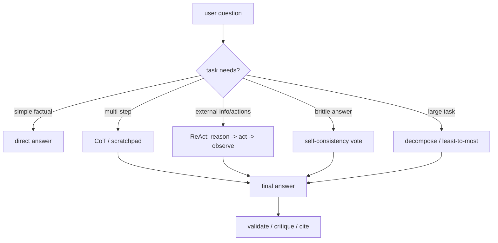

# Reasoning Prompt Patterns (CoT, ReAct, self-consistency)

> Topic package — Domain 3 · Roadmap Week 15.
> Depth goal: choose and implement reasoning prompt patterns deliberately: zero/few-shot CoT, ReAct, self-consistency, self-refine/reflexion, least-to-most, decomposition, and plan-then-execute, with clear tradeoffs around cost, latency, tool use, and faithfulness.

## Source
- Track: LLM Engineering (self-directed, FDE roadmap)
- Slide deck: `07 Resources Library/LLM Engineering/Slides/Lesson_15_Reasoning_Prompt_Patterns.pptx`
- Hands-on notebook: `07 Resources Library/LLM Engineering/Notebooks/15_Reasoning_Prompt_Patterns.ipynb` (runs offline)
- Reference reading: Wei et al. Chain-of-Thought Prompting (arXiv:2201.11903); Yao et al. ReAct (arXiv:2210.03629); Wang et al. Self-Consistency (arXiv:2203.11171); Shinn et al. Reflexion; Zhou et al. Least-to-Most Prompting; Anthropic and OpenAI reasoning prompt guidance
- Builds on: [[02 Literature Notes/LLM Engineering/Prompt Versioning]]
- Date: 2026-07-18

---

## 1. Mental Model

**Reasoning prompt patterns are control-flow templates for spending more computation on harder tasks.** A plain prompt asks for an answer in one pass; a reasoning pattern structures intermediate work: think step-by-step, decompose the problem, call tools, sample multiple paths, critique the result, or execute a plan.

The patterns are not magic. They trade tokens, latency, and sometimes privacy for better search through the model's latent solution space. They help most when the task requires multi-step inference, tool grounding, or brittle arithmetic/logical decisions; they help least when the model already knows a direct answer or when hidden reasoning becomes unfaithful post-hoc rationalization.

> Key intuition: **reasoning prompts are compute-allocation strategies.** Use CoT for multi-step inference, ReAct when the model must inspect the world with tools, self-consistency when one path is unreliable, and decomposition when the task is too large for one pass.



---

## 2. How It Actually Works

### 3.1 Chain-of-thought and scratchpads
Chain-of-thought (CoT) prompts encourage intermediate reasoning, often improving arithmetic, symbolic, and multi-hop tasks. In production, prefer a **private scratchpad + concise final answer** pattern rather than exposing raw reasoning. Few-shot CoT examples can teach the style; zero-shot phrases like 'think step by step' are weaker but cheap. The caveat: the displayed rationale can be unfaithful — a plausible explanation does not prove the model actually used it.

### 3.2 ReAct interleaves reasoning and tools
ReAct structures an agent loop: **Thought → Action → Observation → Thought → ... → Final**. It is useful when the answer depends on external state: retrieval, calculators, databases, browsers, or application tools. The prompt pattern must constrain tool names, arguments, stopping rules, and observation handling; otherwise ReAct becomes an expensive hallucination loop.

### 3.3 Self-consistency samples multiple paths
Self-consistency (Wang et al.) samples multiple reasoning traces and chooses the majority or highest-scoring final answer. It improves tasks where one greedy chain is brittle, but cost scales roughly linearly with samples:

$$cost pprox n_{samples} 	imes (prompt\ tokens + reasoning\ tokens + answer\ tokens)$$

Use it for high-value decisions, not every chat turn.

### 3.4 Decomposition: least-to-most and plan-then-execute
Least-to-most prompting decomposes a hard problem into easier subproblems and solves them sequentially. Plan-then-execute separates strategy from execution: first create a plan, then run each step, then synthesize. This helps with long tasks, code generation, data analysis, and workflows where a single pass forgets constraints. The risk is plan lock-in: a bad early decomposition can steer every later step wrong.

### 3.5 Reflection, refinement, and verifier loops
Self-refine/reflexion patterns ask the model to critique an answer and revise it, often using explicit feedback from tests, validators, or tool outcomes. They work best when the critique has ground truth (unit test failure, schema error, retrieved evidence). Pure 'criticize yourself' can produce verbose churn without improving correctness. Prefer verifier-grounded reflection over vibes.

---

## 3. Implementation

Assumed stack: stdlib — deterministic fake reasoning, fake tools, voting, and ReAct loops that demonstrate the control flow offline. Snippets:
- [[04 Code Snippets/LLM/Self Consistency Voting Simulator]]
- [[04 Code Snippets/LLM/ReAct Loop With Fake Tools]]

### Self Consistency Voting Simulator
Sample several deterministic pseudo-reasoning paths and vote on the final answer.
```python
from collections import Counter

def fake_reasoning_path(question, seed):
    # Simulates noisy reasoning: two paths get it right, one path makes an arithmetic slip.
    numbers = [int(x) for x in question.split() if x.isdigit()]
    answer = sum(numbers)
    if seed % 3 == 0: answer += 1
    return {"trace": f"add {numbers}", "answer": answer}

def self_consistency(question, samples=7):
    paths = [fake_reasoning_path(question, s) for s in range(samples)]
    vote = Counter(p["answer"] for p in paths).most_common(1)[0]
    return vote[0], paths

answer, paths = self_consistency("What is 12 plus 30 plus 5?", samples=7)
print("voted answer:", answer)
print("all answers:", [p["answer"] for p in paths])
```

### ReAct Loop With Fake Tools
A minimal Thought/Action/Observation loop using local deterministic tools.
```python
def calculator(expr):
    allowed = set("0123456789+-*/() ")
    if not set(expr) <= allowed: raise ValueError("unsafe expression")
    return eval(expr, {"__builtins__": {}}, {})

def fake_react(question):
    transcript = []
    transcript.append(("Thought", "Need exact arithmetic, use calculator."))
    expr = question.replace("What is", "").replace("?", "")
    transcript.append(("Action", f"calculator({expr!r})"))
    obs = calculator(expr)
    transcript.append(("Observation", str(obs)))
    transcript.append(("Final", f"The answer is {obs}."))
    return transcript

for kind, text in fake_react("What is 18 * (7 + 5)?"):
    print(f"{kind}: {text}")
```

---

## 4. Design Decisions & Tradeoffs

| Decision | Guidance |
|---|---|
| **Direct vs reasoning** | Use direct prompts for simple factual/formatting tasks; add reasoning only when errors show multi-step difficulty. |
| **Visible vs private reasoning** | For production UX, keep scratchpads private and return concise answers, citations, or checked summaries. |
| **ReAct boundary** | Use ReAct only when tools or external observations are required; otherwise it adds latency and failure modes. |
| **Self-consistency budget** | Reserve voting for high-value/brittle tasks; choose sample count by marginal accuracy per dollar. |
| **Decomposition** | Use least-to-most or plan-then-execute for long tasks; validate the plan before execution. |
| **Reflection** | Prefer verifier/test/evidence-grounded critique over generic self-critique. |

---

## 5. Failure Modes & Gotchas

- Adding 'think step by step' to every prompt → needless cost, latency, and sometimes worse answers.
- Exposing raw chain-of-thought to users → confusing UX and potential leakage; return concise rationale instead.
- Using ReAct without strict tool schemas and stop rules → tool hallucinations and infinite loops.
- Self-consistency with identical deterministic settings → no diversity, just repeated cost.
- Treating model rationales as proof of faithfulness → plausible reasoning can be post-hoc.
- Reflection loops without external signal → verbose self-confirmation rather than correction.

---

## 6. FDE Angle

- Reasoning patterns are a cost/quality lever you can expose as tiers: fast, careful, verified.
- In client workflows, ReAct is often the bridge from chatbot to useful agent because it lets the model inspect systems of record.
- A good FDE turns vague 'make it reason better' feedback into pattern selection plus eval evidence.
- Deliverable: a routing matrix that maps task classes to direct, CoT, ReAct, self-consistency, or decomposition prompts.

---

## 7. Self-Check

1. When does CoT help, and what is the faithfulness caveat?
2. What are the steps in a ReAct loop, and why are tool schemas necessary?
3. Why does self-consistency improve brittle tasks, and what is the cost model?
4. How do least-to-most and plan-then-execute differ from a single long prompt?
5. When is reflection useful vs performative?
6. Design a routing rule for direct vs careful vs tool-using prompts.

---

## 9. Interview Q&A

**Q: When does chain-of-thought help, and what is the faithfulness caveat?**
A: CoT helps whenever a task genuinely needs multiple logical steps to get right — multi-step arithmetic, multi-hop reasoning (where the answer to one part depends on first figuring out something else), or any problem where jumping straight to a final answer in one shot is asking the model to do too much invisible work at once. Writing out intermediate steps lets each step build on the actual, visible result of the step before it, rather than trying to hold the whole problem in its head at once.

The faithfulness caveat is important and often overlooked: just because a model *shows* a chain of reasoning doesn't guarantee that reasoning is what actually *produced* the final answer. A model can generate a chain of thought that looks completely plausible and logical, arrive at an answer, and that written-out reasoning can still be a post-hoc rationalization — a story constructed to sound like it justifies the answer, rather than genuinely being the process that determined it. This matters practically: you can't treat a fluent, well-structured chain of reasoning as *proof* that the final answer is correct or that the model "really understood" the problem — the reasoning trace is suggestive evidence, not a verified audit trail of what actually happened inside the model.

*One-liner: CoT helps on genuinely multi-step tasks by letting the model build on visible intermediate results instead of jumping straight to an answer — but a fluent-looking chain of reasoning isn't proof the model actually used that reasoning to get there, since it can be a plausible-sounding rationalization rather than a real audit trail.*

**Q: What are the steps in a ReAct loop, and why are tool schemas necessary?**
A: ReAct structures an agent's behavior as a repeating cycle: Thought (reason about what's needed next), Action (call a specific tool with specific arguments), Observation (see what that tool actually returned), and then loop back to Thought again — using that real observation to decide the next step — until the model decides it has enough to give a Final answer.

The reason this loop is useful: each Observation grounds the next Thought in something real and external, rather than the model just continuing to reason based only on its own assumptions. If a tool call returns "there is no such customer ID," the next Thought has genuine, verified information to work with, instead of the model guessing or hallucinating what the answer to that lookup might have been.

Tool schemas are necessary because this loop hands real control over to the model to decide which tools to call and with what arguments — and without strict rules about what tools exist and what valid arguments to them look like, this becomes a serious liability rather than a useful capability. Without a schema constraining exactly which tool names are legitimate and what arguments they accept, the model can simply hallucinate a tool that doesn't exist, or call a real tool with malformed or nonsensical arguments — and your system either has to reject this gracefully or risks it happening silently. A tight schema (specific tool names, specific argument types, specific stopping conditions for when to give a Final answer) turns this from "the model might ask for anything" into "the model can only ever ask for a small, well-defined set of valid actions," which is what keeps a ReAct loop a controlled, useful tool rather than an open door to errors or runaway behavior.

*One-liner: ReAct cycles through Thought (reason), Action (call a tool), Observation (see the real result), repeating until a Final answer — grounding each step in real external information rather than assumption; tool schemas are necessary because without strict constraints on valid tool names and arguments, the model can hallucinate nonexistent tools or malformed calls instead of staying within a safe, well-defined set of real actions.*

**Q: Why does self-consistency improve brittle tasks, and what's the cost model?**
A: Self-consistency helps specifically on tasks where a single reasoning attempt is "brittle" — meaning it's genuinely easy for one pass to make a small mistake somewhere along a multi-step chain, and that one mistake derails the whole final answer, even though the model is broadly capable of getting the task right most of the time. By sampling several independent reasoning attempts and taking whichever final answer shows up most often, you're relying on the idea that different sampled attempts are likely to make *different* mistakes (if any at all) — so genuine agreement across several independent attempts is much stronger evidence of correctness than trusting any single attempt alone.

The cost model here is straightforward and important to internalize: cost scales roughly linearly with how many samples you take. If one reasoning attempt costs a certain number of tokens (prompt plus the reasoning trace plus the final answer), running self-consistency with 7 samples costs roughly 7 times that — you're paying for every single attempt, not just the final chosen one.

This is exactly why self-consistency isn't something you'd apply to every single interaction — the practical rule is to reserve it for high-value, genuinely brittle decisions where getting the answer right is worth paying several times the cost of a single attempt, and to skip it for routine, low-stakes requests where a single pass is reliable enough on its own and the extra cost buys little real benefit.

*One-liner: self-consistency improves brittle multi-step tasks because different sampled reasoning attempts tend to make different mistakes, so agreement across several of them is stronger evidence than any single attempt alone — but cost scales roughly linearly with the number of samples, which is why it's reserved for high-value decisions rather than applied to every request.*

**Q: How do least-to-most prompting and plan-then-execute differ from just writing one single long prompt?**
A: A single long prompt asks the model to handle an entire complex task in one continuous pass — reason through everything, keep every constraint and intermediate requirement in mind at once, and produce a complete final result, all without ever writing down or checking any intermediate state along the way. For sufficiently large or multi-part tasks, this asks a lot to go right silently, with no checkpoint to verify things are on track partway through.

Least-to-most prompting breaks a hard problem into a sequence of genuinely easier subproblems, and solves them one at a time, in order — each subproblem's solution becomes available as context for solving the next one. This is different from one long prompt because each step is now a smaller, more manageable piece of reasoning with its own visible intermediate result, rather than one enormous reasoning task attempted all at once.

Plan-then-execute separates the work into two distinct phases: first, generate an explicit plan (what are the steps, in what order), and only afterward actually carry out each step of that plan, finally synthesizing the results together. This is different from a single long prompt because the plan itself becomes a visible, inspectable artifact you (or the system) can check *before* any actual execution happens — if the plan is clearly wrong or missing something, you catch that early, rather than only discovering a flawed approach after the model has already generated a complete, but subtly broken, final answer.

Both approaches share the same underlying benefit over one long prompt: breaking a big task into visible, separately-checkable pieces, rather than hoping a single long reasoning pass gets every part right simultaneously with no intermediate checkpoint. The risk that comes with both, though, is "plan lock-in" — if the very first decomposition or plan is itself flawed, every subsequent step inherits that flaw, since later steps are built on top of an early decision that was never actually validated.

*One-liner: least-to-most solves a hard problem as a sequence of easier subproblems building on each other's visible results, and plan-then-execute separates planning from execution so the plan can be checked before any work happens — both break a big task into checkable, intermediate pieces instead of one long uninterrupted pass, at the risk that a flawed early decomposition or plan can steer every later step wrong.*

**Q: When is reflection (self-critique and revision) genuinely useful, versus just performative?**
A: The deciding factor is whether the critique step has access to real, external ground truth to check against — or whether it's just the model judging its own work using nothing but its own internal sense of whether something "looks right."

Reflection is genuinely useful when the critique is grounded in something verifiable and external: a unit test that actually fails or passes, a schema validator that concretely flags what's wrong, retrieved evidence that directly contradicts a claim the model made. In these cases, "critique and revise" has real, checkable information driving the revision — the model isn't just guessing whether its answer was good, it's responding to a specific, verifiable signal that something was actually wrong, and that signal can genuinely guide a real improvement.

Reflection becomes performative — looking like careful, diligent work while adding little real value — when the "critique" is just the model being asked to look at its own answer again and judge whether it seems correct, with no external check involved at all. In this case, the model is using the same knowledge and the same blind spots it already had when it produced the original answer in the first place — there's no new, external information entering the process to actually catch what it missed. This often produces verbose-looking self-confirmation (the model elaborately reassuring itself its answer was fine) rather than any genuine correction, since nothing new was introduced that could reveal an actual mistake.

*One-liner: reflection is genuinely useful when the critique is grounded in something real and external (a failing test, a validator, contradicting evidence) that can actually reveal a mistake — it becomes performative busywork when the model is just re-judging its own answer with no new external signal, since it has no way to catch an error using the same knowledge that produced the error in the first place.*

**Q: Design a routing rule for when to use direct answers, CoT, or tool-using (ReAct) prompts.**
A: The underlying principle for any routing decision like this: match the amount of reasoning effort (and the techniques that provide it) to what the specific task actually needs — not applying the same heavy-handed approach to every request regardless of its difficulty.

Route to a direct, one-shot answer when the task is simple and factual — something the model either already knows directly or doesn't, where no amount of extra reasoning steps would reveal information that wasn't already available. Adding CoT here only adds cost and latency with no real benefit, and can occasionally even make a simple, correct answer worse by inviting unnecessary second-guessing.

Route to CoT when the task requires multiple internal reasoning steps, but all the information needed is already available to the model without needing to look anything up externally — multi-step arithmetic, logical deduction, connecting several pieces of information already present in the prompt. This is the right tool when the problem is "think harder," not "go look something up."

Route to ReAct (tool-using) specifically when the task depends on external, outside information or real actions that the model cannot possibly know on its own — looking something up in a live system, performing an action with real side effects, checking current data. The deciding signal here isn't "is this hard," it's "does answering this correctly require looking at something outside the model's own existing knowledge."

A simple, practical routing rule following this logic: check first whether the task needs external information or actions at all — if yes, route to ReAct regardless of how conceptually simple the task might otherwise seem. If no external information is needed but the task clearly requires multiple reasoning steps, route to CoT. Otherwise, route to a direct answer.

*One-liner: route to direct answers for simple, already-known facts with no benefit from extra reasoning; route to CoT when a task needs several internal reasoning steps but no outside information; route to ReAct whenever the task genuinely depends on external, outside information or real actions — checking "does this need to look outside the model's own knowledge" first, before considering how conceptually hard the task is.*

## 8. Links
- Domain MOC: [[06 Maps of Content/LLM Engineering Concepts]]
- Code: [[04 Code Snippets/LLM/Self Consistency Voting Simulator]], [[04 Code Snippets/LLM/ReAct Loop With Fake Tools]]
- Distilled: [[03 Permanent Notes/Reasoning Patterns Are Compute Allocation Strategies]], [[03 Permanent Notes/ReAct Turns Reasoning Into Tool Grounded Control Flow]]
- Upstream: [[02 Literature Notes/LLM Engineering/Prompt Versioning]] · Downstream: [[02 Literature Notes/LLM Engineering/Context Engineering]]
