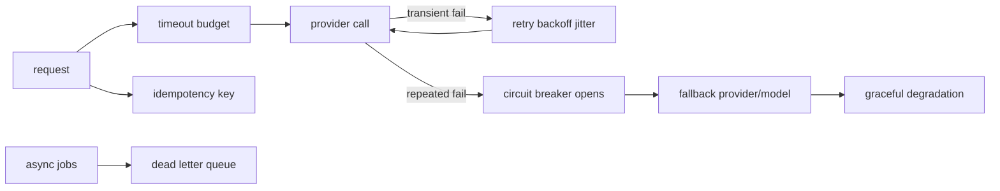

# Reliability Patterns (retries, fallbacks, circuit breakers)

> Topic package — Domain 8 · Roadmap Week 22.
> Depth goal: design LLM applications that survive provider errors, rate limits, slow responses, malformed outputs, tool failures, and partial outages using bounded retries, fallbacks, circuit breakers, queues, and degradation paths.

## Source
- Track: LLM Engineering (self-directed, FDE roadmap)
- Slide deck: `07 Resources Library/LLM Engineering/Slides/Lesson_48_Reliability_Patterns.pptx`
- Hands-on notebook: `07 Resources Library/LLM Engineering/Notebooks/48_Reliability_Patterns.ipynb` (runs offline)
- Reference reading: Resilience engineering patterns; circuit breaker pattern (Nygard); provider rate-limit/status documentation; AWS architecture backoff and jitter guidance; queue/dead-letter reliability patterns
- Builds on: [[02 Literature Notes/LLM Engineering/Structured Generation]] · [[02 Literature Notes/LLM Engineering/Cost Architecture]]
- Date: 2026-07-18

---

## 1. Mental Model

**Reliability is controlling failure blast radius, not pretending failures will stop.** LLM applications depend on remote model providers, vector stores, tools, parsers, and user-specific data. Any of them can be slow, rate-limited, malformed, or unavailable. The architecture must decide what to retry, what to abandon, what to degrade, and when to stop making things worse.

The reliability stack is layered: strict **timeouts** bound waiting; **retries with exponential backoff and jitter** handle transient failures; **fallbacks** switch models/providers or simpler behavior; **circuit breakers** stop hammering unhealthy dependencies; **idempotency** prevents duplicate side effects; **dead-letter queues** preserve failed async work for repair.

> Key intuition: **every LLM call needs an escape plan.** The best systems fail smaller, cheaper, and more honestly.



---

## 2. How It Actually Works

### 8.1 Timeouts and budgets
Every external call needs a deadline shorter than the user's patience and the upstream request timeout. Split the budget across retrieval, model call, tools, and validation. Without timeouts, retries stack up, queues grow, and a partial provider slowdown becomes a system-wide outage.

### 8.2 Retries with exponential backoff and jitter
Retries are for transient failures: 429s, 5xxs, dropped connections, and occasional timeouts. They are not for deterministic validation failures or unsafe requests. Use exponential backoff with jitter to avoid synchronized retry storms, cap attempts, and respect provider `Retry-After` headers.

### 8.3 Fallback models and graceful degradation
Fallbacks can switch provider, region, model size, or product behavior. A support bot might fall back from answer generation to retrieval-only snippets; an agent might disable tool execution and ask the user to retry. Degradation should be explicit in the UX and safe: better a partial answer than a fabricated one.

### 8.4 Circuit breakers and rate-limit handling
Circuit breakers stop sending traffic to a dependency after repeated failures, then probe it later in half-open state. This protects latency, cost, and providers. Rate-limit handling should combine client-side quotas, token buckets, backpressure, and queueing rather than blind retries.

### 8.5 Idempotency and async recovery
If a retry can trigger side effects — sending email, creating tickets, charging accounts, writing memory — require idempotency keys. Async jobs should go through queues with retry counts and dead-letter queues so failures are inspectable and replayable rather than silently lost.

---

## 3. Implementation

Assumed stack: stdlib + numpy — deterministic simulations for retry schedules, fallback routing, circuit breaker states, rate-limit handling, and dead-letter queues. Snippets:
- [[04 Code Snippets/LLM/Retry Backoff With Jitter Simulator]]
- [[04 Code Snippets/LLM/Circuit Breaker State Machine]]

### Retry Backoff With Jitter Simulator
Generate bounded exponential backoff delays without actually sleeping.
```python
import random

def retry_schedule(base=0.2, factor=2.0, cap=3.0, attempts=5, seed=7):
    rng = random.Random(seed)
    delays = []
    for i in range(attempts):
        raw = min(cap, base * (factor ** i))
        jitter = rng.uniform(0, raw * 0.25)
        delays.append(round(raw + jitter, 3))
    return delays

def call_with_retries(outcomes):
    delays = retry_schedule(attempts=len(outcomes))
    for i, ok in enumerate(outcomes):
        if ok: return {"attempt": i+1, "slept_seconds": round(sum(delays[:i]), 3), "status": "ok"}
    return {"attempt": len(outcomes), "slept_seconds": round(sum(delays[:-1]), 3), "status": "failed"}

print(retry_schedule())
print(call_with_retries([False, False, True]))
```

### Circuit Breaker State Machine
Open after repeated failures, block calls, then probe with half-open recovery.
```python
class CircuitBreaker:
    def __init__(self, failure_threshold=3, reset_after=2):
        self.threshold = failure_threshold; self.reset_after = reset_after
        self.failures = 0; self.state = "closed"; self.opened_at = None
    def allow(self, tick):
        if self.state == "open" and tick - self.opened_at >= self.reset_after:
            self.state = "half_open"; return True
        return self.state != "open"
    def record(self, ok, tick):
        if ok:
            self.failures = 0; self.state = "closed"; self.opened_at = None
        else:
            self.failures += 1
            if self.failures >= self.threshold:
                self.state = "open"; self.opened_at = tick

cb = CircuitBreaker()
for tick, ok in enumerate([False, False, False, True, True, False]):
    print(tick, "allow", cb.allow(tick), "state", cb.state)
    if cb.allow(tick): cb.record(ok, tick)
```

---

## 4. Design Decisions & Tradeoffs

| Decision | Guidance |
|---|---|
| **Retry scope** | Retry transient 429/5xx/timeouts; do not retry deterministic schema, policy, or validation failures blindly. |
| **Timeout budget** | Set per-step deadlines inside the overall user-facing SLO; leave room for fallbacks. |
| **Fallback order** | Prefer equivalent provider/model, then smaller model, then retrieval-only or honest degradation. |
| **Circuit threshold** | Open fast enough to protect the system, but probe half-open to recover automatically. |
| **Idempotency** | Require idempotency keys for any retryable side effect or tool action. |
| **Async failures** | Use queues and DLQs for offline work; never drop failed generations silently. |

---

## 5. Failure Modes & Gotchas

- Infinite or unbounded retries → retry storm, higher cost, worse outage.
- No jitter → every client retries at the same time and amplifies rate limits.
- Retrying non-idempotent tool calls → duplicate emails, tickets, charges, or writes.
- No circuit breaker → unhealthy provider consumes all latency budget and threads.
- Fallback silently changes behavior → users trust an answer that came from degraded mode.
- Async jobs fail without DLQ → invisible data loss and no replay path.

---

## 6. FDE Angle

- Reliability patterns convert provider instability into bounded, explainable product behavior.
- A client deliverable should include timeout budgets, retry matrix, fallback tree, and circuit-breaker thresholds.
- Idempotency is especially important for agents because retries can repeat real-world side effects.
- Deliverable: a resilience design that states what fails open, what fails closed, and what degrades.

---

## 7. Self-Check

1. Which failures should be retried, and which should not?
2. Why does jitter matter in retry backoff?
3. What are the closed, open, and half-open circuit breaker states?
4. How do fallbacks differ from graceful degradation?
5. Why do agent tool calls require idempotency keys?
6. What belongs in a dead-letter queue record?

---

## 9. Interview Q&A

**Q: Which kinds of failures should actually be retried, and which should never be retried?**
A: The deciding test: would trying the exact same request again, unchanged, have a real chance of succeeding this time, given that nothing about the request itself has changed? Transient failures pass this test — a 429 (rate limit) or a 5xx (server error) or a dropped connection or an occasional timeout often reflect a temporary condition (momentary provider load, a brief network hiccup) that may well have cleared up by the time you retry — the exact same request, sent again a moment later, has a genuine chance of succeeding where it just failed.

Deterministic failures fail this test completely — if a request failed because it was malformed, violated a validation rule, or was correctly refused as unsafe or out of policy, sending the *exact same* request again will produce the *exact same* failure every single time, since nothing about the underlying reason for the failure has changed. Retrying this kind of failure isn't just wasted effort — it's actively counterproductive, burning real time and cost on attempts that are structurally guaranteed to fail identically, rather than addressing the actual problem (which requires fixing the request itself, not resending it unchanged).

*One-liner: retry transient failures (429s, 5xxs, dropped connections, occasional timeouts) where the exact same request plausibly succeeds on a later attempt because the underlying condition was temporary — never retry deterministic failures (malformed requests, validation failures, correct policy refusals), since resending the identical request will produce the identical failure every time, wasting cost and time on an attempt that's structurally guaranteed to fail again.*

**Q: Why does jitter matter in a retry backoff schedule — what specifically goes wrong without it?**
A: Imagine many clients all happen to fail at roughly the same moment — perhaps because a provider had a brief, genuine outage affecting everyone simultaneously. Without jitter, every one of those clients, using the exact same deterministic backoff schedule, would retry at exactly the same calculated delay — meaning they'd all come back and hit the provider again at precisely the same moment, in a synchronized wave.

This synchronized wave is itself a real problem: it creates a sudden, sharp spike in retry traffic hitting the provider all at once, right as the provider may still be recovering from whatever caused the original failures — this spike can itself overwhelm the provider further, triggering more failures, which then leads to another synchronized retry wave at the next backoff interval, and the cycle can continue, essentially turning what might have been a brief, recoverable blip into a sustained, self-reinforcing "retry storm" that makes the underlying problem worse rather than letting it recover naturally.

Jitter breaks this synchronization by adding a small amount of randomness to each client's actual retry delay, so instead of every client retrying at exactly the same calculated moment, their retries get spread out over a small window of time instead — avoiding the synchronized spike entirely, and instead presenting the recovering provider with a smoother, more gradual trickle of retry traffic it has a much better chance of actually handling successfully.

*One-liner: without jitter, many clients failing simultaneously would all retry at the exact same calculated delay, creating a synchronized spike of retry traffic that can overwhelm a provider still recovering from the original failure and trigger a repeating retry storm — jitter adds randomness to each client's actual delay, spreading retries out over time instead of a sharp synchronized spike, giving the provider a smoother, more recoverable trickle of traffic instead.*

**Q: What do the closed, open, and half-open states of a circuit breaker each actually mean?**
A: Closed is the normal, default state — requests flow through to the dependency as usual, and the circuit breaker is just quietly watching for failures without intervening, the same way a closed electrical circuit lets current flow normally.

Open is triggered once failures cross some threshold (say, several failures in a row, or a high failure rate over a recent window) — in this state, the circuit breaker actively *stops* sending requests to the dependency at all, failing them immediately (or routing to a fallback) without even attempting the call. This matters because once a dependency is genuinely struggling, continuing to hammer it with more requests doesn't help it recover — it can make things worse, and it also wastes your own system's time and resources waiting on calls that are likely to fail anyway. Opening the circuit protects both sides: the struggling dependency gets some relief from load, and your own system stops burning latency budget on calls unlikely to succeed.

Half-open is a deliberate, cautious probing state the breaker enters after some cooldown period has passed since it opened — instead of either fully resuming normal traffic (which risks immediately overwhelming a dependency that hasn't actually recovered yet) or staying open forever (which would mean never automatically recovering even once the dependency genuinely becomes healthy again), half-open allows a small, limited number of test requests through to check whether the dependency has actually recovered. If these test requests succeed, the breaker transitions back to closed (resuming normal traffic); if they fail again, it goes back to open for another cooldown period before trying again.

*One-liner: closed is normal operation (requests flow through, failures are just being watched); open is triggered after repeated failures and actively blocks all requests to protect both the struggling dependency and your own system's resources; half-open is a cautious recovery-probing state entered after a cooldown, letting a small number of test requests through to check if the dependency has actually recovered before resuming full normal traffic.*

**Q: How do fallbacks differ from graceful degradation, and why does the distinction matter for user trust?**
A: A fallback means switching to a different, roughly equivalent path when the primary one fails — switching to a different model provider, a different region, or a smaller model, while still attempting to deliver essentially the same kind of complete answer or behavior the user originally expected. The underlying capability is roughly preserved, just delivered through an alternate route.

Graceful degradation is a deliberate, more explicit step down in capability or richness — rather than trying to deliver an equivalent experience through an alternate route, the system consciously offers a reduced, honestly-labeled version of the behavior: a support bot that can't currently generate a full synthesized answer falling back to showing raw retrieved snippets instead, or an agent that temporarily disables tool execution and asks the user to retry manually rather than silently attempting (and potentially failing at) the full agentic behavior.

The distinction matters directly for trust because of how each failure mode should be communicated and handled. A fallback, if it genuinely delivers an equivalent experience, might reasonably be invisible to the user — they got what they expected, just via a different underlying path. But degradation changes what the user is actually getting, and doing this silently — having the user believe they're getting the full, normal experience when they're actually getting a reduced one — risks a user trusting an answer or behavior that's actually coming from a compromised, lower-capability mode without knowing it. This is exactly why degradation should be explicit in the UX (the user should know when they're seeing a reduced-capability response) — "a partial, honestly-labeled answer" is a legitimate degraded state to be in; "a user confidently trusting a degraded answer because they don't know it's degraded" is the actual failure mode to avoid.

*One-liner: a fallback switches to an equivalent alternate path (different provider/model) while still trying to deliver the same kind of complete experience; graceful degradation is a deliberate, honestly-labeled step down in capability — the distinction matters because silently degrading without telling the user risks them trusting a reduced-capability answer as if it were the full, normal experience, which is the actual trust failure to avoid, not the degradation itself.*

**Q: Why do agent tool calls specifically require idempotency keys, more so than a typical read-only API call might?**
A: Idempotency means that performing the same action multiple times produces the same result as performing it once — a property that matters enormously whenever retries are involved, since a retry is, by definition, an attempt to redo something that may have already partially happened.

Read-only operations (looking something up, retrieving data) are naturally idempotent already — running the same lookup twice just gives you the same information twice, with no real-world side effect from the repetition, so retrying one safely is rarely a concern. Agent tool calls are a different situation specifically because many of the actions an agent might take have genuine, real-world side effects — sending an email, creating a support ticket, charging a payment, writing to a durable memory store. If a tool call like this fails in a way that's ambiguous (did it actually fail before taking effect, or did it actually succeed but the response back to the agent got lost or timed out, making it *look* like a failure even though the action already happened), and the agent's retry logic simply tries the exact same action again without any idempotency protection, you risk the action genuinely happening twice — a real customer getting charged twice, two duplicate emails being sent, two duplicate tickets being created — a tangible, user-visible problem, not just a wasted, harmless retry.

An idempotency key solves this by attaching a unique identifier to a specific logical action, such that if the same idempotency key is seen again (because of a retry), the receiving system can recognize "I've already processed this exact action" and either return the original result without repeating the side effect, or safely no-op, rather than blindly executing the side effect a second time.

*One-liner: read-only operations are naturally safe to retry since repeating them has no real-world side effect, but agent tool calls often do have genuine side effects (sending an email, charging a payment) — if a tool call's failure is ambiguous (did it actually fail, or did the response just get lost after it succeeded) and gets retried without protection, the action can genuinely happen twice; an idempotency key lets the receiving system recognize a repeated action and avoid executing the side effect a second time.*

**Q: What specifically needs to be captured in a dead-letter queue record, and why is this more than just "save the failed message"?**
A: A dead-letter queue exists to preserve work that failed in a way that couldn't be automatically resolved (exhausted its retry budget, or hit a non-retryable error) — but just saving the raw failed message alone isn't enough to actually make that failure recoverable or debuggable later; you need enough context to understand and potentially replay it.

A genuinely useful DLQ record needs: the original request/payload itself (so the work can actually be re-attempted later, not just acknowledged as having failed), the specific error or failure reason (so a human investigating it knows *why* it ended up here, rather than having to re-run it blind to find out), the retry count and history (so you know this genuinely exhausted its retry budget rather than failing on a first attempt, which might suggest a different, more fundamental problem), a timestamp (for triaging how long this has been sitting unresolved), and enough identifying metadata (which tenant, which feature, which prompt/model version was involved) to actually investigate the failure's broader pattern or context, rather than treating it as an isolated, context-free incident.

Without this level of detail, a dead-letter queue becomes just a pile of opaque failed messages nobody can confidently act on — you'd know *that* something failed, but not *why*, not whether it's safe to simply retry as-is, and not whether this specific failure is part of a broader pattern worth investigating more deeply. The whole point of a DLQ is making a failure *inspectable and replayable*, not just *not silently lost* — and that requires this richer context, not just the bare original message.

*One-liner: a DLQ record needs the original payload (to actually replay the work), the specific failure reason (to understand why without re-running blind), retry history (to confirm it genuinely exhausted retries rather than failing immediately), a timestamp, and identifying metadata (tenant, feature, prompt/model version) — without this, a DLQ is just a pile of opaque failed messages, not the inspectable, replayable record it's actually meant to be.*

## 8. Links
- Domain MOC: [[06 Maps of Content/LLM Engineering Concepts]]
- Code: [[04 Code Snippets/LLM/Retry Backoff With Jitter Simulator]], [[04 Code Snippets/LLM/Circuit Breaker State Machine]]
- Distilled: [[03 Permanent Notes/Every LLM Call Needs an Escape Plan]], [[03 Permanent Notes/Retries Need Jitter and Idempotency]]
- Upstream: [[02 Literature Notes/LLM Engineering/Cost Architecture]] · Downstream: [[02 Literature Notes/LLM Engineering/LLM Security]]
