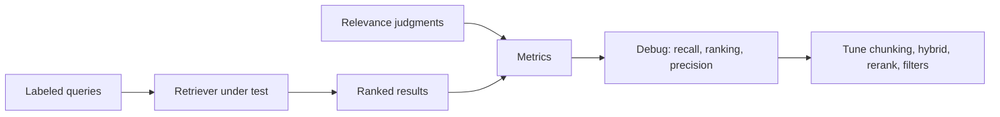

# Retrieval Evaluation (recall@k, MRR, NDCG)

> Topic package — Domain 4 · Roadmap Weeks 14/17.
> Depth goal: build a labeled retrieval evaluation set, compute core IR metrics (recall@k, precision@k, hit rate, MRR, NDCG), and connect them to RAGAS-style context precision/recall.

## Source
- Track: LLM Engineering (self-directed, FDE roadmap)
- Slide deck: `07 Resources Library/LLM Engineering/Slides/Lesson_22_Retrieval_Evaluation.pptx`
- Hands-on notebook: `07 Resources Library/LLM Engineering/Notebooks/22_Retrieval_Evaluation.ipynb` (runs offline)
- Reference reading: TREC evaluation methodology; BEIR benchmark; RAGAS retrieval/context precision and recall metrics; Manning et al. Introduction to Information Retrieval; NDCG literature
- Builds on: [[02 Literature Notes/LLM Engineering/RAG Pipeline Fundamentals]] · [[02 Literature Notes/LLM Engineering/Advanced Retrieval]]
- Date: 2026-07-18

---

## 1. Mental Model

**You cannot debug RAG by reading final answers only; retrieval needs its own test set and metrics.** If the correct evidence never reaches the prompt, no generator prompt can reliably fix the answer. Retrieval evaluation isolates the search component.

The core artifact is a labeled set of queries with relevant document/chunk IDs. Metrics then answer different questions: hit rate asks whether any relevant item appears, recall@k asks how many relevant items are found, precision@k asks how much of the context is useful, MRR rewards early first hits, and NDCG rewards graded relevance near the top.

> Key intuition: **evaluate retrieval like search, then evaluate generation like grounded synthesis.** RAG quality is a product of both.



---

## 2. How It Actually Works

### 4.1 Labeled eval sets
A retrieval eval set contains realistic user queries plus relevant chunk/document IDs. Start with 30-100 high-value questions from logs, SMEs, support tickets, and failure cases. Include negative/ambiguous queries and multi-relevant queries. Keep judgments at the same granularity the retriever returns.

### 4.2 Hit rate, precision, recall
Hit rate@k is 1 if any relevant doc appears in top-k. Precision@k is relevant retrieved / k. Recall@k is relevant retrieved / total relevant. For RAG, recall@k often matters first: the generator cannot cite evidence it never sees. Precision matters because irrelevant context distracts and wastes budget.

### 4.3 MRR and NDCG
MRR measures how early the first relevant result appears: $$MRR=rac{1}{|Q|}\sum_q rac{1}{rank_q}$$. NDCG handles graded relevance and rank positions: highly relevant results near the top are rewarded more than weakly relevant results lower down.

### 4.4 Context precision/recall
RAGAS-style metrics evaluate the assembled context, not just raw retrieval. Context recall asks whether the answer-required facts are present; context precision asks whether retrieved context is mostly useful. These bridge IR metrics and generation faithfulness.

### 4.5 Iterating with metrics
Use metrics diagnostically. Low recall suggests chunking, expansion, hybrid search, or higher candidate k. Low MRR suggests reranking. Low precision suggests filters, reranking, or smaller final k. Always segment by query type, source, tenant, language, and freshness.

---

## 3. Implementation

Assumed stack: stdlib + numpy. Snippets compute IR metrics and run a tiny eval harness. Snippets:
- [[04 Code Snippets/LLM/Retrieval Metrics From Judgments]]
- [[04 Code Snippets/LLM/Labeled Retrieval Eval Harness]]

### Retrieval Metrics From Judgments
Compute hit rate, precision@k, recall@k, MRR, and DCG/NDCG from ranked results.
```python
import math

def metrics(ranked, relevant, k=3):
    top = ranked[:k]
    rel_top = [d for d in top if d in relevant]
    hit = 1.0 if rel_top else 0.0
    precision = len(rel_top) / k
    recall = len(rel_top) / max(1, len(relevant))
    rr = next((1/(i+1) for i,d in enumerate(ranked) if d in relevant), 0.0)
    return {"hit":hit, "precision":precision, "recall":recall, "mrr":rr}

print(metrics(["d2","d1","d3"], {"d1","d4"}, k=3))
```

### Labeled Retrieval Eval Harness
Run a retriever over a small labeled set and aggregate metrics by query.
```python
def evaluate(cases, retriever, k=3):
    totals = {"hit":0, "precision":0, "recall":0, "mrr":0}
    for q, relevant in cases:
        ranked = retriever(q)
        m = metrics(ranked, relevant, k)
        for key in totals: totals[key] += m[key]
        print(q, ranked[:k], m)
    return {key: val/len(cases) for key, val in totals.items()}

cases = [("refund", {"policy"}), ("shipping", {"ship"})]
def toy(q): return ["policy","faq","ship"] if q == "refund" else ["faq","ship","policy"]
print(evaluate(cases, toy, 3))
```

---

## 4. Design Decisions & Tradeoffs

| Decision | Guidance |
|---|---|
| **Judgment granularity** | Label at chunk or document granularity matching retriever output; mismatches distort metrics. |
| **Primary metric** | Use recall@k for evidence availability; use MRR/NDCG for ranking quality; use precision for context noise. |
| **Eval size** | Start small but realistic; grow with production failures and log sampling. |
| **k values** | Report multiple k values: candidate k, rerank k, and final context k. |
| **Segmentation** | Break down by source, language, query type, tenant, and freshness. |
| **Generation link** | Do not infer answer quality from retrieval metrics alone; pair with faithfulness evals. |

---

## 5. Failure Modes & Gotchas

- Using final answer accuracy to debug retrieval without seeing ranked evidence.
- Labeling only one relevant document when several chunks are valid.
- Evaluating on synthetic queries that do not resemble user logs.
- Reporting recall@50 when the prompt only receives top-5.
- Ignoring permissions/freshness filters in the eval harness.
- Optimizing aggregate metrics while one critical query segment regresses.

---

## 6. FDE Angle

- Retrieval eval is the fastest way to make RAG debugging objective.
- A labeled eval set becomes a regression suite for chunking, embeddings, rerankers, and filters.
- Clients understand examples; engineers need metrics. Provide both per-query traces and aggregate scores.
- Deliverable: a repeatable eval harness with fixed queries, judgments, metrics, and failure slices.

---

## 7. Self-Check

1. Define hit rate@k, precision@k, and recall@k.
2. Why is recall@k often the first RAG retrieval metric?
3. What does MRR reward?
4. When is NDCG better than binary recall?
5. How do context precision and context recall connect retrieval to generation?

---

## 9. Interview Q&A

**Q: Define hit rate@k, precision@k, and recall@k.**
A: All three look at the same raw ingredient — the top-k retrieved results for a query, compared against which results were actually labeled relevant ahead of time — but each one asks a genuinely different question about that comparison.

Hit rate@k asks the simplest, most binary question: did *any* relevant result show up at all, anywhere in the top-k? It's a yes/no per query — either at least one relevant item made it into the top-k, or none did. It doesn't care how many relevant items there were in total, or how high up the relevant one ranked — just whether retrieval found at least something useful.

Precision@k asks: out of the k results you actually returned, what fraction were genuinely relevant? If you retrieved 5 results and 3 were actually relevant, precision@5 is 3/5 = 0.6. This measures how much of what you handed over was actually useful, versus noise — a low precision means you're burying good results among a lot of irrelevant ones.

Recall@k asks the opposite direction: out of *all* the relevant documents that exist for this query (however many that is), what fraction did you actually manage to retrieve within your top-k? If there were 4 truly relevant documents total, and your top-k only contained 2 of them, recall@k is 2/4 = 0.5. This measures how complete your retrieval was — a low recall means genuinely relevant evidence exists but your search missed it entirely.

*One-liner: hit rate@k is binary — did any relevant result appear at all; precision@k is "of what you retrieved, how much was actually relevant" (noise control); recall@k is "of everything that's actually relevant, how much did you find" (completeness) — three different questions about the same top-k results.*

**Q: Why is recall@k often treated as the first, most important RAG retrieval metric to check?**
A: Think about what happens downstream if recall is low: the generator — the part of the system that actually writes the final answer — can only ever work with whatever evidence made it into its context window. If the one document that actually contains the correct answer never even made it into the top-k retrieved results, there is absolutely nothing the generator can do to produce a correct, grounded answer — no amount of clever prompting, no better model, no smarter generation strategy can conjure up evidence the retrieval step never surfaced in the first place.

This is why recall gets checked first, before precision or ranking-quality metrics: it's asking the most fundamental possible question — did the right information even make it into the candidate pool at all? If recall is low, you already know the problem is upstream, in retrieval itself (chunking, embedding, search strategy), and no amount of fixing the generation side of things will help, because the generator was never given a fair chance to answer correctly in the first place.

Precision and ranking metrics (like MRR) matter too, but they're answering a different, somewhat secondary question — *given* that the right evidence was found somewhere in your results, how cleanly and how prominently was it actually presented? That's a real and important question, but it's moot if the answer to the more basic question — was it found at all — is no.

*One-liner: recall@k matters first because a generator can only ever work with evidence that actually made it into its context — if the correct document never appeared in the top-k results at all, no amount of better prompting or generation can fix that, so low recall points to an upstream retrieval problem that generation-side fixes simply can't address.*

**Q: What does MRR (Mean Reciprocal Rank) specifically reward?**
A: MRR specifically rewards getting the *first* relevant result to appear as early (as close to rank 1) as possible — it's measuring ranking quality at the very top, not overall completeness.

For a single query, "reciprocal rank" is just `1 / (the rank position of the first relevant result)`. If the first relevant result appears at rank 1 (the very top), that's `1/1 = 1.0` — a perfect score for this query. If the first relevant result only shows up at rank 4, that's `1/4 = 0.25` — a much lower score, even if that same relevant result eventually did appear somewhere in your top-k. Averaging this value across all your test queries gives you the overall MRR.

Notice what this metric does and doesn't care about: it only cares about *where the first relevant hit shows up* — it completely ignores whether there were other relevant results further down the list, and it ignores how many total relevant documents exist for that query. This makes MRR specifically useful for diagnosing *ranking quality at the top* — if recall@k shows the right documents are generally being found somewhere within your top-k, but MRR is still low, that's telling you the relevant results are showing up, just not early enough — which points specifically toward a reranking problem (the initial retrieval found the right things, but didn't sort them well), rather than a retrieval-recall problem (finding the right things in the first place).

*One-liner: MRR rewards how early the first relevant result appears, averaged across queries — it ignores everything about how many relevant results exist total or where lower-ranked relevant results sit, which makes it specifically useful for diagnosing ranking/reranking quality, separate from whether the right documents were found at all (recall's job).*

**Q: When is NDCG a better metric to use than plain binary recall?**
A: Plain recall treats relevance as strictly binary — a document is either relevant or it isn't, with no concept of "somewhat relevant" or "extremely relevant." For many real retrieval scenarios, this is too coarse: some retrieved documents are only tangentially related to the query, while others are a perfect, ideal match — and treating both the same way (just "relevant: yes") loses real, useful information about the quality of the match.

NDCG (Normalized Discounted Cumulative Gain) is designed specifically for situations with *graded* relevance judgments — where your labels aren't just "relevant" or "not relevant," but something like a 0-3 scale (0 = irrelevant, 1 = somewhat relevant, 2 = relevant, 3 = highly relevant, for example). NDCG rewards not just finding relevant documents, but finding the *most highly* relevant documents, and specifically rewards them more when they appear *near the top* of the ranking rather than further down — a highly-relevant document at rank 1 contributes much more to the score than the same highly-relevant document buried at rank 10, and a moderately-relevant document is worth less than a highly-relevant one even at the same rank position.

So the deciding factor for reaching for NDCG instead of plain recall: do you actually have graded relevance judgments to work with (varying degrees of "how relevant" rather than a flat yes/no), and do you care about rewarding the *best* matches specifically appearing *near the top* of the ranking, not just whether a merely-adequate match showed up somewhere in the top-k at all? If your judgments really are just binary and you only care about presence-within-top-k, plain recall or hit rate is simpler and sufficient — NDCG earns its added complexity specifically when relevance quality and precise ranking position both genuinely matter.

*One-liner: use NDCG when you have graded relevance judgments (varying degrees of "how relevant," not just yes/no) and you specifically care about rewarding the most relevant results appearing near the top of the ranking — plain recall treats all relevant results as equally good regardless of degree or position, which is simpler but loses that extra signal.*

**Q: How do context precision and context recall connect retrieval metrics to generation quality?**
A: These RAGAS-style metrics sit at the junction between "did the retriever find the right raw documents" (classic IR metrics like recall@k) and "did the final generated answer actually use evidence well" (generation-side faithfulness metrics) — they evaluate the *assembled context* specifically, which is the actual bridge between those two stages.

Context recall asks: of all the specific facts actually needed to correctly answer this question, how many of them are present somewhere in the assembled context the generator was actually given? This is subtly different from classic document-level recall@k — it's not just asking "was the right document found," it's asking "did the final, assembled context (after chunking, filtering, and packing into the prompt) actually retain the specific facts needed," which can diverge from document-level recall if, say, the right document was found but got truncated or its key fact got cut off during assembly.

Context precision asks: of everything that's actually in the assembled context, how much of it was genuinely useful and relevant to answering the question, versus padding that took up space without contributing anything? This connects directly to generation quality because irrelevant context doesn't just sit there harmlessly — it can dilute the model's attention (as covered in "lost in the middle," under Context Engineering) and actively make a correct answer less likely, not just waste token budget.

Together, these two metrics sit specifically between pure IR metrics (which only look at raw retrieved documents, before any assembly or filtering) and pure generation-faithfulness metrics (which only look at the final answer text) — they're evaluating the actual intermediate artifact, the assembled context, which is exactly what determines whether the generator even has a fair chance at producing a correct, well-grounded answer.

*One-liner: context recall checks whether the specific facts needed to answer the question actually survived into the final assembled context (not just whether the right document was found); context precision checks how much of that assembled context was actually useful versus diluting padding — together they evaluate the intermediate artifact (the assembled context) that sits between raw retrieval and the final generated answer, bridging IR metrics and generation faithfulness.*

## 8. Links
- Domain MOC: [[06 Maps of Content/LLM Engineering Concepts]]
- Code: [[04 Code Snippets/LLM/Retrieval Metrics From Judgments]], [[04 Code Snippets/LLM/Labeled Retrieval Eval Harness]]
- Distilled: [[03 Permanent Notes/Retrieval Needs Its Own Evaluation Set]], [[03 Permanent Notes/Recall MRR and Precision Diagnose Different Retrieval Failures]]
- Upstream: [[02 Literature Notes/LLM Engineering/Agentic RAG]] · Downstream: [[02 Literature Notes/LLM Engineering/Vector Database Landscape]]
