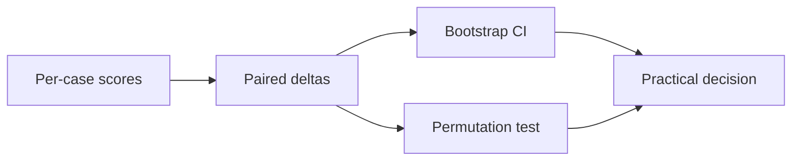

# Statistical Rigor in Eval

> Topic package — Domain 6 · Roadmap Week 17.
> Depth goal: build production-grade LLM evaluation habits: clear datasets, trustworthy metrics, statistical guardrails, and shipping decisions that survive contact with real users.

## Source
- Track: LLM Engineering (self-directed, FDE roadmap)
- Slide deck: `07 Resources Library/LLM Engineering/Slides/Lesson_36_Statistical_Rigor_in_Eval.pptx`
- Hands-on notebook: `07 Resources Library/LLM Engineering/Notebooks/36_Statistical_Rigor_in_Eval.ipynb` (runs offline)
- Reference reading: Efron bootstrap; paired permutation tests; statistics for ML evaluation
- Builds on: [[02 Literature Notes/LLM Engineering/Eval Fundamentals]] · [[02 Literature Notes/LLM Engineering/Retrieval Evaluation]]
- Date: 2026-07-18

---

## 1. Mental Model

**An eval score is an estimate with uncertainty, not a fact carved into stone.** Small datasets, stochastic decoding, correlated examples, and multiple slices can make tiny differences meaningless.

Use paired tests on shared cases, bootstrap intervals for uncertainty, and practical significance thresholds for shipping.

> Key intuition: **do not ship on a decimal point without an uncertainty story.**



---

## 2. How It Actually Works

### 6.1 Sample size
More cases reduce uncertainty, but diversity matters as much as count. Estimate minimum detectable effect and prioritize high-variance slices.

### 6.2 Bootstrap CIs
Bootstrap resamples cases with replacement to approximate uncertainty around means, medians, and slice metrics without strong distribution assumptions.

### 6.3 Paired tests
When systems answer the same examples, compare per-example deltas; paired bootstrap and sign-flip tests remove between-example variance.

### 6.4 Multiple comparisons
If you inspect many slices, some look significant by luck. Correct, confirm on holdout, or treat discoveries as hypotheses.

### 6.5 Generation variance
Temperature, seeds, serving changes, and judge nondeterminism add variance. Use temperature zero or repeated samples and report variance sources.

---

## 3. Implementation

Assumed stack: stdlib + numpy. The snippets are offline and deterministic so they can run in CI before API-backed evaluation. Snippets:
- [[04 Code Snippets/LLM/Bootstrap Confidence Interval]]
- [[04 Code Snippets/LLM/Paired Permutation Test]]

### Bootstrap Confidence Interval
Nonparametric bootstrap CI for an eval metric.
```python
import numpy as np

def bootstrap_ci(x, stat=np.mean, B=5000, alpha=0.05, seed=0):
    rng=np.random.RandomState(seed); x=np.asarray(x,float)
    vals=[stat(rng.choice(x, size=len(x), replace=True)) for _ in range(B)]
    return np.quantile(vals, [alpha/2, 1-alpha/2])
print(bootstrap_ci([1,0,1,1,0,1]))
```

### Paired Permutation Test
Sign-flip permutation test for paired eval deltas.
```python
import numpy as np

def paired_signflip_pvalue(delta, B=10000, seed=0):
    rng=np.random.RandomState(seed); delta=np.asarray(delta,float); obs=abs(delta.mean())
    null=[abs((delta*rng.choice([-1,1], len(delta))).mean()) for _ in range(B)]
    return (np.sum(np.asarray(null)>=obs)+1)/(B+1)
print(paired_signflip_pvalue([0.1,0.0,0.2,-0.1,0.05]))
```

---

## 4. Design Decisions & Tradeoffs

| Decision | Guidance |
|---|---|
| **Dataset boundary** | Write down exactly which population the eval represents and which it excludes. |
| **Metric choice** | Prefer deterministic metrics for mechanical properties; use judges only for semantic qualities that require judgment. |
| **Slicing** | Always inspect business-critical, safety-critical, and historically weak slices. |
| **Calibration** | Compare automated scores against human labels before using them as gates. |
| **Thresholds** | Set pass/block/investigate thresholds before looking at the result. |
| **Artifacts** | Persist inputs, outputs, prompts, model versions, scores, and traces for reproducibility. |

---

## 5. Failure Modes & Gotchas

- Treating a polished demo as evidence of reliability.
- Optimizing a proxy metric after it stops matching user value.
- Reporting only an aggregate score while a critical slice fails.
- Changing prompt, model, data, and scorer at once, making regressions uninterpretable.
- Using a judge without bias audits or human calibration.
- Failing to save per-case artifacts, so failures cannot be debugged.

---

## 6. FDE Angle

- A production eval is a client-facing trust artifact, not internal trivia.
- A clear scorecard lets stakeholders decide whether to ship, hold, or rollback.
- Automated evals reduce manual QA and accelerate iteration.
- Deliverable: versioned dataset, runner, metrics, report, and CI gate.

---

## 7. Self-Check

1. Define the behavior being measured and the evidence required.
2. Explain how the dataset, scorer, baseline, and threshold interact.
3. Name slices that could hide severe regressions behind a good average.
4. Describe how you would calibrate the metric against human judgment.
5. State what artifacts are needed to reproduce a run.
6. Translate a score into a shipping decision.

---

## 9. Interview Q&A

**Q: Why does a bootstrap confidence interval matter for an eval score, rather than just trusting the raw average?**
A: A raw average from a limited test set is a single number, but it's actually an *estimate* of the true underlying quality, based on whatever specific sample of cases happened to be in your test set — and a different, equally valid sample of cases could easily have produced a somewhat different average, purely by chance. Treating that one number as if it were an exact, certain fact ignores this real sampling uncertainty entirely.

A bootstrap confidence interval directly addresses this by simulating "what if I'd had a slightly different sample" — it repeatedly resamples your actual test cases (with replacement, meaning the same case can be picked more than once in a given resample) and recomputes the metric on each resampled set, building up a distribution of plausible values the true metric could take. The resulting interval (say, "72% ± a range from 68% to 76%") tells you not just a single point estimate, but how much that estimate could reasonably vary given the amount and nature of the data you actually have.

Why this matters concretely: if a new prompt version scores 73% and the old one scored 71%, that 2-point difference might look like real improvement — but if the confidence interval for each score is, say, plus or minus 5 points, that 2-point difference is comfortably within the range of noise you'd expect even if nothing actually changed. Without the confidence interval, you'd have no way to tell a genuine improvement apart from random sampling noise that happened to land slightly favorably.

*One-liner: a raw average is a point estimate based on whatever specific sample you happened to test on, and a bootstrap confidence interval reveals how much that estimate could plausibly vary by chance — without it, a small score difference between two versions can look like real improvement when it's actually well within the range of noise you'd expect even with no real change at all.*

**Q: Why are paired tests preferred over comparing independent averages when evaluating two systems?**
A: When both systems being compared are run on the exact same set of test cases, you have more information available than just "system A's average score" versus "system B's average score" compared independently — you actually know, for every single case, how each system did on *that specific case*, which lets you compute a per-case difference (a "paired delta") rather than throwing that case-level pairing away and just comparing two separate aggregate numbers.

Here's why this matters: some test cases are inherently harder than others, independent of which system is being tested — a genuinely ambiguous or tricky case might make both systems score lower on it, while an easy case makes both score higher, regardless of which system you're testing. This case-to-case variation is a real source of noise. If you just compare two independent averages, this per-case variation gets mixed in as noise affecting both averages separately. But if you compute the paired difference for each case (system A's score minus system B's score, on that exact same case), the parts of each score that are due to the case's inherent difficulty — not actually due to which system is better — largely cancel out, since both systems faced that same difficulty on that same case. What's left in the paired delta is a cleaner signal, more specifically isolating the actual difference between the two systems, with much of the case-level noise removed.

This is why paired statistical tests (like a paired bootstrap or a sign-flip permutation test, both covered in this topic) are specifically designed to work on these per-case deltas, rather than on the two systems' raw independent scores — they're extracting a more precise, lower-noise comparison from data that already has this useful pairing structure available.

*One-liner: when both systems are tested on the exact same cases, computing per-case paired deltas and analyzing those directly cancels out the noise from cases being inherently harder or easier (which affects both systems' scores on that case equally) — leaving a cleaner signal that more precisely isolates the actual difference between the two systems, compared to just comparing their two independent aggregate averages.*

**Q: What's the "multiple comparisons" problem in eval slicing, and how do you guard against it?**
A: If you check many different slices of your data for a "significant" improvement or regression, some of them will look significant purely by random chance, even if nothing genuinely different is happening in that slice — this isn't a hypothetical risk, it's a predictable, almost mathematical consequence of running many separate statistical checks.

Here's the intuition: imagine flipping a coin 20 times and checking if it looks "unusually biased" — with enough separate checks (20 different slices, 20 different coin-flip sequences), purely by chance, some of them will look surprising even though the coin is perfectly fair every time. The same thing happens with eval slices: if you check 30 different slices of your data for a statistically significant change, it would be genuinely surprising if *none* of them showed an apparently significant result purely by chance, even if the system's actual behavior on every single slice was identical to before.

Guarding against this means not treating every slice that happens to look significant as automatically a real, trustworthy finding. A few practical approaches: apply a statistical correction that accounts for how many separate comparisons you're making (adjusting the significance bar upward as you check more slices, making it harder for noise alone to clear the bar); confirm any interesting finding on a separate, fresh holdout set of data before fully trusting it (if it was real, it should show up again on new data; if it was just noise, it likely won't repeat); or, more simply, treat any single slice's "significant" finding as a hypothesis worth further investigation, not a settled, proven fact, until it's been checked again independently.

*One-liner: checking many slices for significance means some will look significant purely by chance, even with no real underlying change — the multiple-comparisons problem — guarded against by statistically correcting for how many comparisons you made, confirming any interesting finding on a fresh holdout set before trusting it, or treating a single slice's result as a hypothesis to verify rather than a proven fact.*

**Q: What sources of variance specifically need to be controlled for when comparing two LLM-based systems, beyond the underlying prompt/model difference you're actually trying to measure?**
A: Several real sources of randomness exist in LLM systems that have nothing to do with the actual quality difference between two versions you're trying to compare, and if left uncontrolled, they add noise that can swamp or distort the real signal you're actually looking for.

Generation randomness itself — if decoding uses temperature above 0, the exact same prompt and model can produce genuinely different outputs on different calls, purely from sampling randomness, not from any actual difference in the system. Serving-side variance — as covered in Decoding and Sampling, floating-point non-associativity and production batching variability can shift outputs slightly even at temperature=0, in ways entirely unrelated to the actual prompt or model difference being tested. Judge nondeterminism — if you're using an LLM judge to score outputs (covered in LLM as a Judge), the judge itself introduces its own layer of potential randomness and inconsistency on top of whatever randomness already exists in the system being judged.

The practical mitigations: use temperature=0 (or as close to deterministic as reasonably possible) specifically when running comparisons, to minimize generation-level randomness as a confound; where some randomness is unavoidable, run repeated samples for the same input and average or otherwise account for that variance explicitly, rather than trusting a single run's result; and explicitly report what sources of variance were present and how they were controlled for, so anyone reading the comparison understands exactly what noise sources were and weren't accounted for in the stated result.

*One-liner: generation randomness (temperature above 0), serving-side nondeterminism (floating-point/batching variance even at temperature=0), and judge nondeterminism (if using an LLM judge) all add noise unrelated to the actual system difference being measured — controlled for by using near-deterministic decoding during comparisons, running repeated samples where randomness is unavoidable, and explicitly reporting what variance sources were and weren't accounted for.*

**Q: Why should sample size and slice diversity both matter, not just the raw count of test cases?**
A: More test cases generally reduce uncertainty in your estimate — intuitively, averaging over more examples smooths out noise from any single unusual case. But raw count alone doesn't guarantee a trustworthy result if those additional cases are all very similar to each other, or all drawn from the same easy, common scenario rather than genuinely covering the range of situations the real system will actually face.

Here's the concrete risk: 500 test cases that are all minor variations of the same easy, common query type gives you high confidence about performance on that one narrow scenario — but tells you essentially nothing reliable about performance on the harder, rarer, or more unusual cases that didn't make it into the test set at all, no matter how large that number 500 looks. A smaller but genuinely diverse set of 100 cases, deliberately including hard cases, edge cases, and different query types, can actually give you a more trustworthy, more representative picture of real-world performance than a much larger but narrow, homogeneous set.

This is why the practical guidance is to prioritize diversity, specifically in high-variance or known-difficult slices, rather than just chasing a larger overall count — a bigger number of similar easy cases creates a false sense of statistical confidence about a system's overall real-world readiness, when what you actually have high confidence about is just the one easy scenario those cases all represent.

*One-liner: more cases reduce noise in an estimate, but only for whatever scenario those cases actually represent — a large but narrow, homogeneous test set gives false confidence about overall readiness, while a smaller but genuinely diverse set (deliberately including hard and edge cases) gives a more trustworthy picture of real-world performance, which is why diversity matters as much as raw count.*

## 8. Links
- Domain MOC: [[06 Maps of Content/LLM Engineering Concepts]]
- Code: [[04 Code Snippets/LLM/Bootstrap Confidence Interval]], [[04 Code Snippets/LLM/Paired Permutation Test]]
- Distilled: [[03 Permanent Notes/Eval Scores Need Uncertainty Intervals]], [[03 Permanent Notes/Paired Tests Beat Independent Averages for LLM Evals]]
- Upstream: [[02 Literature Notes/LLM Engineering/Eval Fundamentals]] · Downstream: [[02 Literature Notes/LLM Engineering/Statistical Rigor in Eval]]
