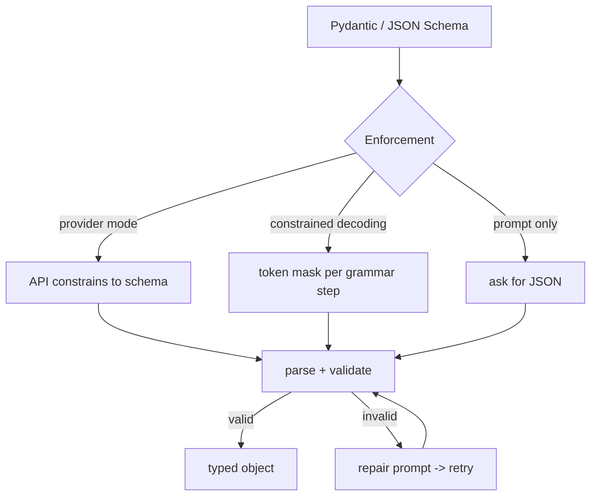

# Structured / Constrained Generation

> Topic package — Domain 2 · Roadmap Weeks 11/15.
> Depth goal: understand JSON mode, function-calling schemas, grammar/constrained decoding, and validate-and-repair loops — enough to guarantee parseable output in production.

## Source
- Track: LLM Engineering (self-directed, FDE roadmap)
- Slide deck: `07 Resources Library/LLM Engineering/Slides/Lesson_10_Structured_Generation.pptx`
- Hands-on notebook: `07 Resources Library/LLM Engineering/Notebooks/10_Structured_Generation.ipynb` (runs offline)
- Reference reading: OpenAI structured outputs / function calling docs; Outlines (Willard & Louf, arXiv:2307.09702); jsonformer; llguidance/guidance; Pydantic docs; BNF grammars in llama.cpp
- Builds on: [[02 Literature Notes/LLM Engineering/Decoding and Sampling]]
- Date: 2026-07-18

---

## 1. Mental Model

**Free-text LLM output is unreliable to parse; structured generation forces the output to conform to a schema so downstream code can trust it.** There are three levels of guarantee, from weakest to strongest:

1. **Prompt-and-pray** — ask for JSON in the prompt, then validate and retry. Works ~90% of the time.
2. **Provider structured mode / function calling** — the API constrains output to your JSON Schema. Strong, easy, but provider-specific.
3. **Constrained decoding** — at each step, mask out any token that would violate the grammar/schema, so *only* valid strings are reachable. 100% valid by construction.

> Key intuition: **don't parse hope — constrain generation.** The reliable pattern is a schema (Pydantic/JSON Schema) + a mechanism to enforce it (provider mode or grammar) + a validate/repair fallback. Structured output is what turns an LLM into an API you can build on.



---

## 2. How It Actually Works

### 2.1 Define the schema first
Start from a typed contract, not a prose description. A Pydantic model *is* a JSON Schema:

```python
from pydantic import BaseModel
class Invoice(BaseModel):
    vendor: str
    total: float
    line_items: list[str]
```

The schema is the single source of truth: it drives the prompt, the provider constraint, and post-hoc validation. This ties structured generation to the **prompt contract** idea.

### 2.2 Provider structured mode & function calling
Modern APIs accept a JSON Schema (`response_format` / tool `parameters`) and *guarantee* the output parses against it (OpenAI "Structured Outputs", tool calls). Under the hood they do constrained decoding. This is the easiest strong guarantee — use it when your provider supports it. Function/tool calling is the same mechanism aimed at 'which function + what arguments'.

### 2.3 Constrained decoding (grammars)
The strongest, provider-agnostic method: convert the schema to a **finite-state machine / grammar**, and at each decode step **set the logits of any token that can't legally come next to −∞**. The model literally cannot produce invalid output. Libraries: Outlines, guidance, jsonformer, llama.cpp GBNF. Cost: some latency + engineering; benefit: 100% structural validity, even from small local models.

### 2.4 Validate-and-repair
Regardless of method, always parse into the typed model and validate (types, ranges, enums, required fields). On failure, **repair**: feed the error back ("your JSON failed: <error>, return corrected JSON") and retry with a bounded number of attempts. This catches semantic errors constraints can't (e.g., total ≠ sum of line items).

### 2.5 Decoding settings for structure
Use **temperature=0**. Randomness only introduces schema-risk and non-determinism with no benefit for extraction/tools. Keep max_tokens generous enough to finish the object (truncation mid-JSON is a common, silent failure).

---

## 3. Implementation

Assumed stack: `pydantic`, plus a validate/repair loop that works with any model. Snippets:
- [[04 Code Snippets/LLM/Validate and Repair Loop for JSON Output]]
- [[04 Code Snippets/LLM/Constrained Decoding with a Token Mask]]

### Validate and Repair Loop for JSON Output
Provider-agnostic: parse into a Pydantic model, repair on failure, bounded retries.
```python
import json
from dataclasses import dataclass

# stand-in for pydantic to keep this runnable anywhere
@dataclass
class Invoice:
    vendor: str
    total: float
    line_items: list

def validate(raw: str) -> Invoice:
    data = json.loads(raw)                     # raises on bad JSON
    assert isinstance(data["vendor"], str)
    assert isinstance(data["total"], (int, float))
    assert isinstance(data["line_items"], list)
    # semantic check a schema can't express:
    assert data["total"] >= 0, "total must be non-negative"
    return Invoice(**data)

def generate_structured(call_model, prompt, max_retries=3):
    err = None
    for attempt in range(max_retries):
        msg = prompt if err is None else (
            f"{prompt}\n\nYour previous output was invalid: {err}\n"
            "Return ONLY corrected JSON.")
        raw = call_model(msg)                  # your LLM call (temperature=0)
        try:
            return validate(raw)
        except Exception as e:
            err = str(e)
    raise ValueError(f"failed after {max_retries} attempts: {err}")
```

### Constrained Decoding with a Token Mask
Toy grammar-constrained decoder: only tokens legal in the current state are sampled.
```python
import numpy as np
# Minimal illustration: generate a boolean JSON value {"ok": true|false}
# States define which token IDs are legal; illegal logits -> -inf.
VOCAB = ['{', '"ok"', ':', 'true', 'false', '}']
TRANSITIONS = {0:[0], 1:[1], 2:[2], 3:[3,4], 4:[5]}  # state -> legal token idxs

def constrained_decode(logits_fn):
    out, state = [], 0
    order = [0,1,2,3,4]              # positions to fill
    for step in order:
        logits = logits_fn(out).astype(float)
        legal = TRANSITIONS[step]
        mask = np.full_like(logits, -np.inf)
        mask[legal] = logits[legal]  # keep only legal tokens
        tok = int(mask.argmax())     # greedy over legal tokens
        out.append(tok)
    return "".join(VOCAB[t] for t in out)

# fake model: prefers 'false' at the value step
def fake_logits(prefix): 
    z = np.zeros(len(VOCAB)); z[4] = 5; z[3] = 3; return z
print(constrained_decode(fake_logits))   # always valid: {"ok":false}
```

---

## 4. Design Decisions & Tradeoffs

| Decision | Guidance |
|---|---|
| **Enforcement level** | Use provider structured mode when available; constrained decoding for local/OSS models or provider-agnostic guarantees; prompt+validate as a floor. |
| **Schema source** | Define once in Pydantic/JSON Schema; reuse for prompt, constraint, and validation. |
| **Temperature** | 0 for structured extraction/tools — no upside to randomness. |
| **Repair retries** | Bounded (2-3). Feed the exact validation error back; give up loudly, don't loop forever. |
| **Semantic vs structural** | Constraints guarantee structure; keep explicit semantic checks (sums, ranges, enums) in code. |
| **max_tokens** | Set high enough to finish the object; mid-JSON truncation is a silent failure. |

---

## 5. Failure Modes & Gotchas

- Parsing free text with regex instead of enforcing a schema → brittle, breaks on the first odd output.
- temperature>0 for extraction → intermittent schema breaks that are hard to reproduce.
- No max_tokens headroom → truncated JSON that 'sometimes' fails.
- Trusting structure to imply correctness → valid JSON with wrong values (need semantic checks).
- Unbounded repair loops → cost blowups; always cap retries.
- Markdown-fenced JSON (```json ... ```) not stripped before json.loads → parse error.

---

## 6. FDE Angle

- Structured output is what turns an LLM demo into an integrable API — this is the enabling skill for the capstone's 'return structured JSON, validate schema'.
- You can promise a client 'the output will always parse' only if you use provider mode or constrained decoding — know the difference.
- The schema is the contract between the AI and the rest of the system; own it in code, version it.
- Deliverable: a generation function that returns a typed object or raises — never a raw string downstream.

---

## 7. Self-Check

1. Name the three levels of structural guarantee and their tradeoffs.
2. How does constrained decoding make invalid output impossible?
3. Why keep semantic validation even with a perfect structural constraint?
4. What decoding temperature for extraction, and why?
5. Design a validate-and-repair loop; when does it give up?

---

## 9. Interview Q&A

**Q: Name the three levels of structural guarantee and their tradeoffs.**
A: Think of these as three different ways to answer "how sure am I this output will parse?" — each one trading effort for a stronger guarantee.

The weakest is prompt-and-pray: you ask the model nicely in the prompt to "return JSON," then check if it worked and retry if not. This works most of the time with a good model, but "most of the time" isn't good enough for something running unattended in production — some small percent of calls will come back broken, and at scale that adds up to real failures.

The middle option is using your provider's built-in structured output or function-calling mode. You give it a JSON Schema, and the API itself guarantees the result matches that schema — it's not just asking nicely anymore, it's enforced on the provider's side. This is strong and easy to use, but it only works if your provider actually offers this feature, and you're relying on their implementation.

The strongest is constrained decoding: at each step of generation, you block every token that would break the schema, so the model is literally only allowed to pick from valid options. This guarantees valid output no matter which model you're using, even a small local one that wasn't specifically trained for structured output. The cost is it takes more engineering to set up and can add a bit of latency.

*One-liner: prompt-and-pray just hopes it works; provider structured mode has the API enforce it for you; constrained decoding blocks bad tokens at the source so invalid output genuinely can't happen — each step trades more setup effort for a stronger guarantee.*

**Q: How does constrained decoding make invalid output impossible, mechanically?**
A: Remember that at every single step, a language model doesn't just output a word — it outputs a score for every possible next token, and then picks one (usually the highest-scoring one). Constrained decoding works by stepping in right before that pick happens.

Here's the trick: based on how much of the schema has been written so far, only some tokens are actually legal next. If you're generating `{"vendor": "Acme", "total":` the very next token has to be something that could start a number — it can't legally be a letter or a closing brace yet. Constrained decoding tracks this using something like a state machine built from the schema, and at each step, it takes every token that would break the rules at this exact point and sets its score to negative infinity before the model picks anything.

Since a model (almost) never selects a token with a score of negative infinity, this doesn't just make bad output unlikely — it makes it mathematically unreachable. The model could "want" to say something invalid, but that option simply isn't offered to it at that step. This is different from relying on the model to have learned good JSON habits — this works even on a model that's never heard of JSON, because the enforcement happens outside the model's own judgment.

*One-liner: before each token is picked, every token that would break the schema right now gets its score set to negative infinity, so the model is never actually offered the option to produce invalid output — it's blocked at the source, not hoped away.*

**Q: Why keep semantic validation even with a perfect structural constraint?**
A: Because "valid JSON" and "correct JSON" are two completely different things, and constrained decoding only guarantees the first one.

Constrained decoding (or any of the three guarantee levels) only checks shape: are the right fields there, are they the right types, does it parse. It has no idea whether the actual *values* make sense. Take an invoice object with `vendor`, `total`, and `line_items`. A perfectly well-formed JSON object could have `total: 500` while the line items actually add up to 300 — that's completely valid JSON, with completely wrong data. No schema constraint catches that, because checking "does the total match the sum of line items" isn't a structural rule, it's a business rule specific to your data.

This is exactly why you still need a separate validation step in your own code, after parsing: check ranges (is a percentage between 0 and 100), check cross-field relationships (does this total match that sum), check business rules that no generic schema language can express. Structural guarantees and semantic correctness solve two different problems, and skipping the second one because you solved the first is a common, costly mistake.

*One-liner: a schema only checks shape (right fields, right types) — it has no idea if the actual values are correct, so semantic checks (does this total match the sum of these line items) have to live separately in your own code, no matter how strong your structural guarantee is.*

**Q: What decoding temperature would you use for extraction, and why?**
A: Think about what temperature actually buys you: some chance of picking a different, lower-probability token instead of the model's top choice. For something creative, that's often good — it adds variety. For extraction, there's no such benefit, because there's no "more interesting" version of a correctly-extracted number or field — there's just the correct value and everything else, which is wrong.

So any randomness here is pure downside. At temperature above 0, there's a real, if small, chance the model picks the wrong value purely due to random sampling, even though it "knew" the right one and would have picked it at temperature=0. There's no corresponding upside to offset that risk, unlike with chat or creative writing, where an unusual word choice might genuinely read better.

So the answer is temperature=0 — always have the model pick its single most confident answer at each step. Combined with max_tokens set high enough to let the whole object finish (truncating a JSON object partway through is a quiet, very common failure that's easy to miss in testing but shows up in production).

*One-liner: temperature=0, because extraction has no "more interesting but still correct" alternative output — any randomness only adds a chance of picking the wrong value with zero benefit in return.*

**Q: Design a validate-and-repair loop — when does it give up?**
A: Walk through what the loop actually needs to handle. First, call the model and get raw text back. Try to parse it into your typed structure (for example, a Pydantic model) and run your checks — both structural (right types) and semantic (values make sense, like a total that isn't negative).

If that fails, don't just retry blindly with the same prompt — that often produces the exact same mistake again. Instead, feed the specific error back to the model: "your last output failed because X, please return corrected JSON" — giving it the actual reason makes it much more likely to fix the real problem instead of guessing differently at random. Then try again.

Crucially, this loop needs a hard limit on how many times it retries — say, 3 attempts. Without a cap, a model that's stuck in a bad pattern (maybe it keeps making the same mistake no matter what you tell it) could retry forever, burning cost and time for no benefit. Once the limit is hit, the loop should fail loudly — raise a clear error saying it couldn't get valid output after N tries — rather than silently returning something broken or looping without end. A clear, visible failure is much easier to debug and handle than a silent one.

*One-liner: call the model, validate structurally and semantically, and on failure feed the exact error back and retry — but cap retries at a small fixed number and fail loudly once that cap is hit, so a stuck model can't loop forever.*

## 8. Links
- Domain MOC: [[06 Maps of Content/LLM Engineering Concepts]]
- Code: [[04 Code Snippets/LLM/Validate and Repair Loop for JSON Output]], [[04 Code Snippets/LLM/Constrained Decoding with a Token Mask]]
- Distilled: [[03 Permanent Notes/Constrain Generation Dont Parse Hope]], [[03 Permanent Notes/Structural Validity Is Not Semantic Correctness]]
- Upstream: [[02 Literature Notes/LLM Engineering/Decoding and Sampling]] · Related: [[02 Literature Notes/LLM Engineering/Prompt Contracts]]
