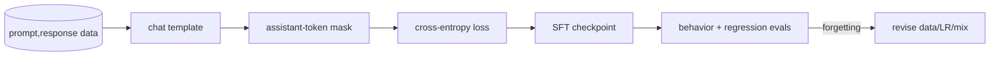

# Supervised Fine-Tuning & Instruction Tuning

> Topic package — Domain 7 · Roadmap Week 18.
> Depth goal: decide when SFT is the right lever, curate prompt-response data, apply chat templates and assistant-only loss masking, and avoid catastrophic forgetting.

## Source
- Track: LLM Engineering (self-directed, FDE roadmap)
- Slide deck: `07 Resources Library/LLM Engineering/Slides/Lesson_39_Supervised_Fine-Tuning.pptx`
- Hands-on notebook: `07 Resources Library/LLM Engineering/Notebooks/39_Supervised_Fine-Tuning.ipynb` (runs offline)
- Reference reading: Ouyang et al. InstructGPT (arXiv:2203.02155); Wei et al. FLAN instruction tuning; Zhou et al. LIMA (arXiv:2305.11206); Hugging Face TRL SFTTrainer docs
- Builds on: [[02 Literature Notes/LLM Engineering/RAG Pipeline Fundamentals]] · [[02 Literature Notes/LLM Engineering/Prompt Contracts]]
- Date: 2026-07-18

---

## 1. Mental Model

**SFT is behavioral cloning for language models: the model learns what a good answer looks like from demonstrations.** It does not reliably install fresh facts; it changes the response policy — tone, format, tool discipline, refusals, and task procedure.

Instruction tuning is broad SFT over many tasks and natural-language commands. The leverage is data quality: clean, representative examples produce more useful behavior than giant noisy dumps.

> Key intuition: **fine-tune behavior, retrieve knowledge** — curate the behavior you want and mask the tokens you do not want to train.



---

## 2. How It Actually Works

### 7.1 The supervised objective
SFT continues next-token training on demonstrations. The target is the assistant response, not the entire chat transcript: $$L=-\sum_{t\in assistant}\log p_\theta(y_t|x,y_{<t})$$. System and user tokens provide context; assistant tokens provide supervision.

### 7.2 Instruction tuning
Instruction tuning is SFT over many natural-language tasks and answer styles. InstructGPT showed the value of demonstrations plus preferences, FLAN showed task-mixture generalization, and LIMA showed that a small set of carefully selected examples can create strong assistant behavior.

### 7.3 Chat templates
A chat template serializes roles into tokens. Training and serving must use the same template, EOS markers, and assistant prefix; otherwise the model learns one interface and is deployed behind another.

### 7.4 Data quality over quantity
Clean, diverse, policy-compliant examples beat large noisy dumps. Remove duplicates, stale answers, boilerplate, hidden chain-of-thought you cannot serve, and examples unlike production traffic.

### 7.5 SFT versus RAG and prompting
Use prompting when the behavior is easy to specify at inference. Use [[02 Literature Notes/LLM Engineering/RAG Pipeline Fundamentals]] when answers need fresh facts or citations. Use SFT when stable repeated behavior or format discipline is the bottleneck.

---

## 3. Implementation

Assumed stack: stdlib + numpy. Snippets cover the core implementation details: chat serialization and assistant-only loss.
- [[04 Code Snippets/LLM/Chat Template and Assistant Loss Mask]]
- [[04 Code Snippets/LLM/Assistant Only Cross Entropy]]

### Chat Template and Assistant Loss Mask
Serialize role messages and mark only assistant tokens as supervised targets.
```python
def render_chat(messages):
    tokens, mask = [], []
    for m in messages:
        text = f"<{m['role']}> " + m['content'].strip() + " <eos>"
        toks = text.split()
        tokens.extend(toks)
        mask.extend([m['role'] == 'assistant'] * len(toks))
    return tokens, mask

msgs = [{'role':'user','content':'Define SFT'}, {'role':'assistant','content':'SFT imitates demonstrations.'}]
print(list(zip(*render_chat(msgs))))
```

### Assistant Only Cross Entropy
Compute loss only on assistant positions.
```python
import numpy as np
def masked_ce(log_probs, labels, mask):
    idx = np.array(mask, dtype=bool)
    return float((-log_probs[np.arange(len(labels))[idx], np.array(labels)[idx]]).mean())
log_probs = np.log(np.array([[.7,.3],[.4,.6],[.2,.8]]))
print(round(masked_ce(log_probs, [0,1,1], [False, True, True]), 3))
```

---

## 4. Design Decisions & Tradeoffs

| Decision | Guidance |
|---|---|
| **SFT vs prompting** | Prompt first; fine-tune only when the same behavioral failure recurs. |
| **SFT vs RAG** | Behavior belongs in weights; changing knowledge and provenance belong in retrieval. |
| **Loss mask** | Mask system/user tokens and train only assistant targets. |
| **Dataset size** | Start with hundreds or thousands of excellent rows before chasing scale. |
| **Forgetting control** | Use low learning rates, early stopping, and regression evals. |
| **Template governance** | Version the chat template with the adapter/checkpoint. |

---

## 5. Failure Modes & Gotchas

- Training on noisy scraped conversations makes the model imitate noise.
- Forgetting prompt-token masking causes role echoing and prompt reconstruction.
- Using SFT as a knowledge upload creates stale untraceable facts.
- Template mismatch between training and inference breaks role behavior.
- Overfitting a tiny style set causes catastrophic forgetting.
- Watching only train loss misses policy, style, and task regressions.

---

## 6. FDE Angle

- Fine-tuning is a product-behavior lever, not a magic memory implant.
- A credible deliverable includes dataset card, train/val split, template, and evals.
- Most SFT incidents trace to data curation, masking, or template drift.
- Choose SFT only after a prompt/RAG baseline proves the gap is behavioral.

---

## 7. Self-Check

1. Which tokens contribute to SFT loss?
2. Why does dataset quality dominate quantity?
3. When is RAG better than SFT?
4. What is a chat-template mismatch?
5. How do you detect catastrophic forgetting?
6. What did InstructGPT, FLAN, and LIMA demonstrate?

---

## 9. Interview Q&A

**Q: Which tokens actually contribute to the SFT loss, and why does that specific choice matter?**
A: Only the assistant's response tokens contribute to the training loss — the system prompt and user message tokens are present in the training example (the model still reads and conditions on them), but no loss is computed on them, meaning the model isn't directly trained to reproduce them.

Here's why this split matters: the goal of SFT is to teach the model how to *respond well*, given some context — not to teach it to predict or reproduce the context itself. If you trained on all tokens equally, the model would also be getting loss signal pushing it to accurately predict the user's own message and the system prompt's own wording, which isn't actually the behavior you're trying to install — the user's message is an input, not a model behavior to imitate, and training the model to reproduce it is solving a problem you don't actually have. It can also lead to a specific, observable failure mode: a model trained this way can start literally echoing back the prompt or user message as part of its response, since it got real training signal rewarding it for correctly predicting those tokens too.

By masking the loss to only the assistant's tokens, the model is specifically and only trained to get better at producing a good *response*, given whatever context it's shown — which is the actual behavior SFT is meant to install.

*One-liner: only assistant-response tokens contribute to the SFT loss — system/user tokens are read as context but never trained on directly — because training on all tokens equally would push the model to also learn to reproduce the user's own message, which isn't the target behavior and can cause the model to literally echo back prompts instead of properly responding to them.*

**Q: Why does dataset quality dominate dataset quantity for SFT, rather than "more examples is always better"?**
A: SFT is behavioral cloning — the model learns to imitate whatever pattern of behavior its training examples demonstrate, for better or worse. If the training data contains noisy, inconsistent, or low-quality examples (sloppy answers, inconsistent formatting, policy violations that slipped through), the model doesn't somehow "average out" the noise and learn only the good parts — it genuinely learns to imitate whatever pattern of behavior is actually present in the data, noise included, the same way a student imitating a flawed worked example will tend to reproduce those same flaws, not spontaneously correct them.

This is exactly the finding LIMA specifically demonstrated (mentioned in this topic's source reading) — a relatively small number of carefully selected, high-quality examples produced strong, well-behaved assistant behavior, comparable to or better than training on a much larger but noisier dataset. More examples only helps if those additional examples are actually adding more of the *correct* behavior pattern — more noisy or inconsistent examples just reinforces more noise and inconsistency, diluting the clean signal rather than strengthening it. This is why the practical guidance is to start with a smaller set of genuinely excellent, carefully curated examples rather than immediately reaching for the largest dataset you can assemble, since a large but noisy dataset can actively train the model into a worse behavior pattern than a smaller but clean one would.

*One-liner: SFT is behavioral cloning, so the model learns to imitate whatever pattern is actually present in the training data, noise and inconsistency included, not just the "good parts" — which is why a smaller set of carefully curated, high-quality examples (as LIMA specifically demonstrated) can produce better behavior than a much larger but noisier dataset, since more noisy examples just reinforces more noise rather than strengthening a clean signal.*

**Q: When is RAG a better lever than SFT for a given problem — what's the deciding question?**
A: The deciding question, covered in RAG Pipeline Fundamentals' RAG-vs-fine-tuning comparison, is whether the actual gap is about *knowledge* (facts the model doesn't currently have access to) or about *behavior* (how the model acts, even on things it already has access to).

SFT changes the model's response policy — its tone, its format discipline, how it follows instructions, how it handles refusals — but it's genuinely unreliable as a way to install new factual knowledge, and critically, any facts it does pick up during fine-tuning become baked into the model's weights with no traceability back to a source and no way to update them later except by fine-tuning again from scratch. RAG, by contrast, is specifically built for knowledge that's external, frequently changing, or needs citation back to a real source — update a document, and the next query sees the update immediately, with full traceability to exactly which document supported the answer.

So if the actual gap is "the model doesn't know about this specific, changing fact" — reach for RAG, since it handles freshness and citation in a way SFT structurally can't. If the actual gap is "the model knows the relevant facts (perhaps via RAG already) but keeps responding in the wrong format, tone, or with inconsistent tool-use discipline" — that's a behavioral gap, and SFT is the right lever, since behavior is exactly what SFT is built to reliably shift.

*One-liner: the deciding question is knowledge versus behavior — RAG is right when the gap is about facts that are external, changing, or need citation (since SFT can't reliably install facts and provides no traceability or update path); SFT is right when the model already has access to the right information but needs a different consistent response policy (tone, format, procedure), which is exactly what SFT reliably shifts.*

**Q: What is a chat-template mismatch, and why does it specifically break role behavior rather than just slightly degrading quality?**
A: A chat template is the specific, exact way role-structured messages (system, user, assistant) get serialized into the literal token sequence the model actually sees and was trained on — specific delimiter tokens, specific ordering, specific end-of-sequence markers. The model learns its behavior (including how to correctly distinguish "this is an instruction" from "this is what I should say next") specifically in relation to this exact token pattern, not some abstract, template-independent notion of "roles."

A mismatch happens when the model is trained using one specific template, but served (used in production) with a different one — different delimiter tokens, a different ordering, a missing or different end-of-sequence marker. This isn't merely a subtle quality degradation — it can genuinely break the model's ability to correctly interpret which part of its input is an instruction and which part is where it should generate its own response, since the model was never actually trained on this particular token pattern it's now being fed at inference time. The model is encountering an input shape it has no learned behavior for, rather than just a slightly unusual version of something it has learned.

This is exactly why chat templates need to be versioned and tracked together with the specific model checkpoint or adapter they were trained with (the same discipline as pairing a prompt version with a specific model version, covered in Prompt Versioning) — the template isn't a cosmetic formatting detail, it's load-bearing infrastructure the model's entire learned role-behavior depends on matching exactly between training and serving.

*One-liner: a chat template mismatch means the model is served using a different exact token serialization (delimiters, ordering, end markers) than it was actually trained on — this doesn't just slightly degrade quality, it can break role-behavior entirely, since the model never learned to correctly interpret this specific, different input pattern, which is why templates need to be versioned and matched exactly between training and serving.*

**Q: How would you actually detect catastrophic forgetting after a fine-tuning run?**
A: Catastrophic forgetting means the model, in the process of learning the new behavior you fine-tuned it for, lost some capability it previously had — and the specific risk with only watching the training loss during fine-tuning is that training loss only measures how well the model is learning to imitate the *new* fine-tuning data; it tells you nothing at all about whether the model got worse at anything else it used to be able to do.

Detecting this requires running the fine-tuned model against a broader regression eval — not just the fine-tuning task's own held-out validation set, but a separate suite covering the model's general capabilities and any other specific behaviors that mattered before this fine-tuning run (following the same "prior incidents become permanent regression tests" principle covered in Prompt Versioning and Red-Teaming). If training loss on the fine-tuning task looks great, but scores on this broader regression suite have dropped compared to the pre-fine-tuned model, that's a direct signal of forgetting — the model improved at the narrow thing you trained it on while genuinely regressing on other things you weren't specifically watching.

The practical mitigations, once forgetting is detected (or to reduce the risk of it in the first place): use a lower learning rate (making smaller, more conservative updates to the model's weights, reducing how much the new training can disrupt previously-learned behavior), stop training earlier rather than training for longer than necessary, and mix in some of the original general-capability data alongside the new fine-tuning-specific data, so the model continues seeing examples of the behavior you don't want it to forget throughout training, not just examples of the new behavior.

*One-liner: catastrophic forgetting can't be detected from training loss alone, since that only measures the new task — you need a broader regression eval suite covering general capabilities and other previously-important behaviors, run before and after fine-tuning, to catch a case where the model improved on the narrow new task while genuinely regressing elsewhere; mitigations include lower learning rates, earlier stopping, and mixing in some original-capability data during training.*

**Q: What did InstructGPT, FLAN, and LIMA each specifically demonstrate about instruction tuning?**
A: Each paper established a different, specific piece of what makes instruction tuning actually work well in practice, and together they cover data source, data breadth, and data quality as three separate levers.

InstructGPT specifically demonstrated the value of combining human demonstrations (showing the model concrete examples of good responses) with human preference data (showing the model which of several candidate responses humans actually preferred) — establishing that both "here's what a good answer looks like" and "here's which answer is better than another" are genuinely useful, complementary training signals, not just one or the other.

FLAN specifically demonstrated that training across a *mixture* of many different task types, phrased as natural-language instructions, produces a model that generalizes well to new, unseen task types it wasn't explicitly trained on — the breadth and diversity of the task mixture itself was a key lever, not just the total volume of training data.

LIMA specifically demonstrated the data-quality point covered above — that a relatively small number of carefully selected, high-quality examples can produce strong, well-behaved assistant behavior, directly challenging the assumption that you need massive volumes of training data to get good instruction-following behavior, and reinforcing that curation quality is often a bigger lever than raw dataset size.

*One-liner: InstructGPT showed that demonstrations plus preference data are both valuable, complementary training signals; FLAN showed that training across a diverse mixture of task types produces generalization to new, unseen tasks; LIMA showed that a small set of carefully curated, high-quality examples can produce strong behavior — together establishing that data source diversity, task breadth, and data quality are each independently important levers for instruction tuning.*

## 8. Links
- Domain MOC: [[06 Maps of Content/LLM Engineering Concepts]]
- Code: [[04 Code Snippets/LLM/Chat Template and Assistant Loss Mask]], [[04 Code Snippets/LLM/Assistant Only Cross Entropy]]
- Distilled: [[03 Permanent Notes/SFT Is Behavioral Cloning for Language Models]], [[03 Permanent Notes/Fine Tune Behavior Retrieve Knowledge]]
- Upstream: [[02 Literature Notes/LLM Engineering/Prompt Contracts]] · Downstream: [[02 Literature Notes/LLM Engineering/LoRA QLoRA PEFT]]
