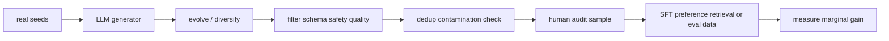

# Synthetic Data Generation

> Topic package — Domain 7 · Roadmap Week 18.
> Depth goal: design synthetic-data pipelines for SFT/eval/retrieval, apply quality filtering and dedup, and manage licensing and contamination risks.

## Source
- Track: LLM Engineering (self-directed, FDE roadmap)
- Slide deck: `07 Resources Library/LLM Engineering/Slides/Lesson_44_Synthetic_Data_Generation.pptx`
- Hands-on notebook: `07 Resources Library/LLM Engineering/Notebooks/44_Synthetic_Data_Generation.ipynb` (runs offline)
- Reference reading: Wang et al. Self-Instruct (arXiv:2212.10560); Evol-Instruct / WizardLM; Alpaca; synthetic data for distillation; data contamination and deduplication literature
- Builds on: [[02 Literature Notes/LLM Engineering/Supervised Fine-Tuning]] · [[02 Literature Notes/LLM Engineering/Evaluating LLMs]]
- Date: 2026-07-18

---

## 1. Mental Model

**Synthetic data is a factory, not free truth.** LLMs can generate examples at scale, but every generated row is only as good as the seed, prompt, teacher, filters, and audit loop.

Self-Instruct creates new tasks and answers; Evol-Instruct makes tasks harder; distillation uses a stronger teacher to label data for a smaller model. The value comes from coverage plus governance.

> Key intuition: **generate broadly, filter ruthlessly, track provenance always.**



---

## 2. How It Actually Works

### 7.1 Synthetic data role
LLMs can generate training prompts, responses, preferences, rationales, negatives, and eval cases. Synthetic data is a multiplier, not a substitute for quality control.

### 7.2 Self-Instruct
Self-Instruct bootstraps instruction data by asking a model to create tasks, filter them, and generate responses. Alpaca popularized this recipe for instruction tuning.

### 7.3 Evol-Instruct
Evol-Instruct mutates simple instructions into harder, more constrained, multi-step tasks. It expands coverage when seed tasks are too shallow.

### 7.4 Filtering and dedup
Filter for validity, safety, licensing, contamination, diversity, and near-duplicates. Synthetic data should be scored and sampled, not blindly appended.

### 7.5 Uses and risks
Synthetic data can support SFT, preference data, retriever pairs, red-team tests, and evals. Risks include model collapse, benchmark contamination, license violations, and amplifying teacher biases.

---

## 3. Implementation

Assumed stack: stdlib + numpy. Snippets implement deterministic filtering/dedup and a contamination check.
- [[04 Code Snippets/LLM/Synthetic Data Filter and Deduper]]
- [[04 Code Snippets/LLM/Synthetic Eval Contamination Check]]

### Synthetic Data Filter and Deduper
Filter rows by quality score and remove normalized duplicates.
```python
rows=[{"prompt":"Summarize X","answer":"A", "score":.9},{"prompt":"summarize x ","answer":"A","score":.8},{"prompt":"","answer":"bad","score":.2}]
seen=set(); kept=[]
for r in rows:
    key=(r["prompt"].strip().lower(), r["answer"].strip().lower())
    if r["score"]>=.7 and key[0] and key not in seen:
        seen.add(key); kept.append(r)
print(kept)
```

### Synthetic Eval Contamination Check
Catch generated training rows that overlap with held-out eval prompts.
```python
train_prompts={"define sft","write refund email","summarize x"}
eval_prompts={"define sft","hard legal question"}
leak=train_prompts & eval_prompts
print("leaks", leak)
assert not ({"write refund email"} & eval_prompts)
```

---

## 4. Design Decisions & Tradeoffs

| Decision | Guidance |
|---|---|
| **Seed quality** | Start from real user/task seeds when possible. |
| **Generator** | Use a teacher whose license and behavior are acceptable. |
| **Filtering** | Apply schema checks, dedup, safety filters, and human audits. |
| **Diversity** | Track coverage by task type, difficulty, domain, and style. |
| **Contamination** | Never train on data derived from held-out eval answers. |
| **Mixing** | Blend synthetic with real data and monitor marginal gains. |

---

## 5. Failure Modes & Gotchas

- Blindly trusting generated labels imports teacher errors.
- Near-duplicate synthetic rows inflate dataset size without coverage.
- Synthetic evals leak into training and destroy measurement.
- Licensing terms forbid derivative training use.
- Generated data is too easy, causing shallow instruction following.
- Repeated self-training amplifies model biases and collapse.

---

## 6. FDE Angle

- Synthetic data is often the fastest way to expand coverage after real seeds expose gaps.
- The real deliverable is a generation-and-filtering pipeline, not a raw dump.
- Data provenance and licensing are product requirements.
- Hold-out eval hygiene matters more when the model can generate benchmark-like data.

---

## 7. Self-Check

1. What did Self-Instruct contribute?
2. How does Evol-Instruct change task coverage?
3. Why is dedup necessary?
4. What is contamination?
5. When use synthetic data for evals?
6. How do licensing constraints affect generated data?

---

## 9. Interview Q&A

**Q: What did Self-Instruct actually contribute as a technique, and why was that valuable?**
A: Before this kind of approach, building an instruction-tuning dataset largely meant humans manually writing out instructions and their corresponding good responses — a genuinely labor-intensive, slow, and expensive process to scale up to the volume of diverse examples instruction tuning benefits from.

Self-Instruct's contribution was a bootstrapping recipe: start from a small seed set of real, human-written instruction examples, then use a model itself to generate many *new* instruction-task examples (new tasks, new instructions, new corresponding responses), filter these generated examples for quality, and use the surviving, filtered set as training data. This turned instruction-dataset creation from "humans write every single example by hand" into "humans provide a smaller seed set, and a model generates a much larger volume of additional examples following that same general pattern, with filtering catching the generated examples that are bad."

The value: this made it dramatically cheaper and faster to assemble a large, diverse instruction-tuning dataset, without needing proportionally more human labor for every single additional example — Alpaca's popularization of this exact recipe demonstrated it could produce a surprisingly capable instruction-following model from using this bootstrapped approach, rather than needing an enormous hand-curated dataset built entirely from scratch.

*One-liner: Self-Instruct bootstrapped instruction-dataset creation by using a model to generate new instruction-task examples from a small human-written seed set, filtering the generated examples for quality — turning dataset creation from "humans hand-write every example" into "a model generates volume, filtering catches the bad ones," which dramatically cut the human labor needed to assemble a large, diverse instruction-tuning dataset.*

**Q: How does Evol-Instruct change task coverage compared to Self-Instruct's basic bootstrapping?**
A: Self-Instruct's basic approach generates new tasks that are broadly similar in nature and difficulty to the seed examples it started from — it expands the *number* of examples, but doesn't necessarily push the *difficulty* or complexity of those examples meaningfully beyond what the seeds already represented, since the newly generated tasks tend to resemble the style and complexity level of whatever seeded them.

Evol-Instruct specifically targets this gap: instead of just generating more tasks at roughly the same difficulty level, it takes existing instructions and deliberately *mutates* or evolves them into harder, more constrained, more multi-step versions — adding additional requirements, combining multiple sub-tasks into one more complex task, adding specific constraints the original simpler instruction didn't have. This specifically expands coverage along the difficulty/complexity axis, which matters because if your seed tasks (and Self-Instruct's generated variations on them) are all relatively shallow or simple, a model trained only on this data risks being well-prepared for easy instructions but poorly prepared for the harder, more complex, multi-step instructions it will likely also encounter in real use.

*One-liner: where Self-Instruct generates more tasks broadly similar in difficulty to its seeds, Evol-Instruct specifically mutates existing instructions into harder, more constrained, multi-step versions — deliberately expanding coverage along the difficulty axis, which matters because training only on shallow seed-level tasks leaves a model poorly prepared for the harder, more complex instructions it will likely encounter in real use.*

**Q: Why is deduplication specifically necessary for synthetic data, beyond just the dataset looking tidier?**
A: When a model generates many synthetic examples, it has a real tendency to produce near-duplicate rows — slightly different wording around the same essential task and answer — especially when generating a large volume from a relatively narrow set of seed prompts or patterns. If these near-duplicates aren't caught and removed, your dataset can grow large in raw row count while not actually growing in genuine *coverage* — you end up with, say, 10,000 rows that really only represent a few hundred genuinely distinct task patterns, repeated with minor surface variations many times over.

This matters for training specifically because it distorts what the model actually learns to prioritize: if a particular pattern happens to be heavily over-represented through many near-duplicate rows (purely because the generation process happened to produce many slight variants of it), the model's training ends up implicitly weighting that pattern much more heavily than its actual importance would warrant, relative to other, less-duplicated but equally or more important patterns that only appear once or twice. Beyond training distortion, having many near-duplicate rows also wastes storage and compute during training for no corresponding benefit in genuine diversity.

Deduplication (checking for exact or near-exact matches, often by normalizing text and comparing, or using similarity thresholds for near-duplicates rather than only exact string matches) directly addresses this — ensuring the dataset's actual row count reflects genuine, distinct coverage, rather than inflated volume from repeated near-identical examples.

*One-liner: synthetic generation tends to produce near-duplicate rows (slightly different wording around the same essential task), which inflates row count without actually adding genuine coverage — left unfiltered, this distorts training by implicitly over-weighting whatever pattern happened to get duplicated many times, which is why deduplication (catching both exact and near-exact matches) is necessary to ensure the dataset's size actually reflects real, distinct diversity.*

**Q: What specifically counts as "contamination" in the context of synthetic data generation, and why is it a distinct, specific risk here?**
A: Contamination here means synthetic training data accidentally overlapping with, or being derived from, your held-out evaluation set — if some of your generated training examples happen to be the same as (or very close variants of) questions that are actually sitting in your eval set, training on them and then evaluating on that same eval set gives you an inflated, misleading picture of how well the model actually generalizes, for the exact same reason covered in Benchmark Literacy's contamination discussion — the model may be partly succeeding through memorization of content it's effectively already seen, rather than genuine capability that would transfer to truly novel questions.

This is a distinct, specific risk in synthetic data generation (beyond the general benchmark-contamination risk) because the generation process itself can inadvertently reproduce or closely paraphrase content from its own training influences, including potentially content resembling your held-out eval questions if those eval questions (or similar public ones) were part of what shaped the generator's own training — and because you're producing large volumes of generated data programmatically, it's much easier for an unnoticed overlap to slip through undetected compared to a smaller, fully human-curated dataset where each example was deliberately, individually written.

This is specifically why synthetic data pipelines need an explicit contamination check as a dedicated step — comparing generated training examples against the held-out eval set's actual content, catching and removing any generated rows that overlap with or too closely resemble eval questions, before that generated data is used for training — rather than assuming contamination won't happen just because the data was "newly generated" rather than copied directly.

*One-liner: contamination here means synthetic training data accidentally overlapping with or closely resembling your held-out eval set, which inflates eval scores through memorization rather than genuine generalization — a distinct risk for synthetic pipelines specifically because large-volume, programmatic generation makes an unnoticed overlap easier to slip through unnoticed, which is why an explicit contamination check against the eval set is a necessary, dedicated step before using generated data for training.*

**Q: When is it appropriate to use synthetic data for building evaluation sets, rather than just for training data?**
A: This needs more caution than using synthetic data for training, precisely because an eval set's entire job is to provide a trustworthy, independent measurement of quality — and synthetic eval data carries a real risk of inheriting exactly the kind of blind spots or biases that would make that measurement less trustworthy, right at the point where trustworthiness matters most.

It's reasonable to use synthetic data to help construct an eval set specifically when it's used to expand *coverage* of known, legitimate task variations or edge cases — generating additional phrasings or variations of a task type you already know matters, to make sure your eval set isn't too narrow or thin on that known-important category. It's much riskier when synthetic generation is used to invent the eval criteria themselves, or define what "correct" looks like, without any human verification — since this risks the eval set quietly encoding the same blind spots or systematic biases the generating model itself has, measuring whether your system matches the generator's own biased notion of "correct" rather than genuine ground truth.

The practical safeguard: any synthetically-generated eval cases should go through human review and calibration (the same calibration discipline covered in Eval Fundamentals and LLM as a Judge) before being trusted as real measurement — confirming that the generated questions are genuinely sensible and that whatever's being treated as the "correct" answer or expected behavior is actually correct, not just plausible-sounding, before that synthetic eval case is allowed to influence real shipping decisions.

*One-liner: synthetic data can reasonably expand an eval set's coverage of known task variations, but using it to define the actual correctness criteria without human verification risks baking the generating model's own blind spots into your measurement instrument — any synthetically-generated eval case needs human review and calibration before being trusted as real ground truth, since an eval set's whole purpose is trustworthy measurement, which synthetic generation alone can't guarantee.*

**Q: How do licensing constraints affect what you're actually allowed to do with generated synthetic data?**
A: When synthetic data is generated using a specific model (often a commercial API-based model), that model's usage terms frequently come with explicit restrictions on what you're actually allowed to do with its outputs — and a common, important restriction worth specifically checking for is whether the provider's terms prohibit using its outputs to train a *competing* model, or to train models at all beyond certain permitted uses.

This matters because it's easy to assume that if you can legally *call* a model's API and *receive* generated output, you're automatically free to do whatever you want with that output afterward — but licensing terms often draw a real, meaningful distinction between "using the output for your immediate task" (which is typically fine) and "using the output as training data to build or improve another model" (which is sometimes explicitly restricted or prohibited, depending on the specific provider's terms). Violating this isn't just a theoretical risk — it's a genuine legal and business risk that needs to be checked *before* building a whole synthetic-data pipeline around a particular generator model, not discovered after a significant investment of time and effort has already gone into building and using that pipeline.

The practical discipline: before choosing which model to use as your synthetic data generator, specifically check its actual usage terms for any restrictions on using its outputs as training data — this is a real constraint on your choice of generator model, not an afterthought to check once the pipeline is already built and in active use.

*One-liner: a model's usage terms often explicitly restrict what you can do with its generated outputs — particularly whether you're allowed to use those outputs as training data for another model, as opposed to just using them for your immediate task — which is a real legal/business constraint that needs to be checked before choosing a generator model, not discovered after a synthetic-data pipeline has already been built around it.*

## 8. Links
- Domain MOC: [[06 Maps of Content/LLM Engineering Concepts]]
- Code: [[04 Code Snippets/LLM/Synthetic Data Filter and Deduper]], [[04 Code Snippets/LLM/Synthetic Eval Contamination Check]]
- Distilled: [[03 Permanent Notes/Synthetic Data Is a Factory Not Free Truth]], [[03 Permanent Notes/Synthetic Evaluation Data Must Stay Out of Training]]
- Upstream: [[02 Literature Notes/LLM Engineering/Supervised Fine-Tuning]] · [[02 Literature Notes/LLM Engineering/Distillation and Small Models]]
