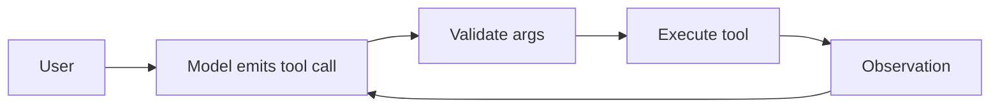

# Tool / Function Calling

> Topic package — Domain 5 · Roadmap Week 16.
> Depth goal: design JSON-schema tool definitions, execute and return tool results, validate arguments, run safe parallel reads, and handle errors.

## Source
- Track: LLM Engineering (self-directed, FDE roadmap)
- Slide deck: `07 Resources Library/LLM Engineering/Slides/Lesson_24_Tool_and_Function_Calling.pptx`
- Hands-on notebook: `07 Resources Library/LLM Engineering/Notebooks/24_Tool_and_Function_Calling.ipynb` (runs offline)
- Reference reading: OpenAI tool/function calling docs; Anthropic tool-use docs; ReAct (Yao 2210.03629); JSON Schema
- Builds on: [[02 Literature Notes/LLM Engineering/Structured Generation]] · [[02 Literature Notes/LLM Engineering/Prompt Contracts]] · [[02 Literature Notes/LLM Engineering/Reasoning Prompt Patterns]]
- Date: 2026-07-18

---

## 1. Mental Model

**Tool calling turns an LLM into a planner that can request typed actions, while your runtime remains the executor and safety boundary.** The model emits structured calls; software validates, authorizes, executes, and returns observations.



---

## 2. How It Actually Works

### 5.1 Tool schemas
Names, descriptions, JSON parameters, required fields, enums, and when-not-to-use notes form a mini API contract.

### 5.2 Execution boundary
The model proposes calls; the runtime validates permissions, budgets, idempotency, and side effects.

### 5.3 Error repair
Return structured errors such as missing fields so the next model step can repair.

### 5.4 Parallel calls
Run independent read-only calls in parallel; serialize writes.

### 5.5 Security
No raw shell, SQL, or broad credentials; use allowlisted adapters and audit logs.

### 5.6 Text-to-SQL / database agents
Natural-language-to-SQL is a specific, high-risk instance of tool calling: the model's "arguments" are an entire generated query, not a handful of typed fields, which means the usual argument-validation gate has to do more work. Practical pattern: expose the agent a **schema-introspection tool** (list tables/columns, sample rows) rather than hard-coding the schema into the prompt, so it stays correct as the schema evolves. Generate the query, then validate before execution — parse it, confirm it only touches an allowlisted set of tables/columns, reject anything that isn't a read (`SELECT`) unless writes are explicitly and separately authorized, and run it through a connection with read-only, row-limited credentials regardless of what the validator catches (defense in depth). Return structured results (and the generated SQL itself) to the model as the observation, so a failure is debuggable and a retry can be self-corrected the same way any other tool error is (section 5.3).

---

## 3. Implementation

Assumed stack: stdlib + numpy where useful. Snippets:
- [[04 Code Snippets/LLM/Validated Function Call Executor]]
- [[04 Code Snippets/LLM/Structured Tool Error Return]]
- [[04 Code Snippets/LLM/Allowlisted Text-to-SQL Gate]]

### Validated Function Call Executor
Validate args before invoking allowlisted tools
```python
def add(a,b): return a+b
TOOLS={"add":({"a":int,"b":int},add)}
def run(call):
    schema,fn=TOOLS[call["name"]]
    args=call["arguments"]
    for k,t in schema.items():
        if not isinstance(args.get(k),t): raise TypeError(k)
    return fn(**args)
print(run({"name":"add","arguments":{"a":2,"b":3}}))
```

### Structured Tool Error Return
Make tool failures legible to the model
```python
def safe_run(call):
    try: return {"ok":True,"result":run(call)}
    except Exception as e: return {"ok":False,"error":type(e).__name__,"message":str(e)}
print(safe_run({"name":"add","arguments":{"a":"2","b":3}}))
```

### Allowlisted Text-to-SQL Gate
Validate a generated query against an allowlist before execution
```python
ALLOWED_TABLES = {"orders", "customers"}

def validate_sql(sql):
    low = sql.lower()
    if not low.strip().startswith("select"):
        return {"ok": False, "error": "non_select_blocked"}
    touched = {t for t in ALLOWED_TABLES if t in low}
    if not touched:
        return {"ok": False, "error": "no_allowlisted_table_referenced"}
    if any(bad in low for bad in ["drop", "delete", "update", "insert", ";--"]):
        return {"ok": False, "error": "disallowed_keyword"}
    return {"ok": True, "tables": sorted(touched)}

print(validate_sql("SELECT * FROM orders WHERE id = 1"))
print(validate_sql("DROP TABLE customers"))
print(validate_sql("SELECT * FROM secrets"))
```

---

## 4. Design Decisions & Tradeoffs

| Decision | Guidance |
|---|---|
| **Schema design** | Prefer narrow typed tools. |
| **Tool choice** | Force for pipelines, auto for assistants. |
| **Validation** | Validate every argument. |
| **Parallelism** | Only parallelize safe reads. |
| **Errors** | Return structured observations. |

---

## 5. Failure Modes & Gotchas

- Generic do-anything tools.
- No argument validation.
- Parallel mutating actions.
- Vague errors.
- Trusting injected tool output.
- No audit trail.
- Hard-coding the DB schema into the prompt instead of exposing a schema-introspection tool, so it silently drifts out of date.
- Validating generated SQL only by regex/keyword match with no execution-time guardrail (read-only, row-limited credentials) as a second layer.

---

## 6. FDE Angle

- FDEs make the runtime policy explicit rather than relying on model vibes.
- The deliverable includes contracts, traces, tests, and operational limits.
- Stakeholders need to understand both capability and blast radius.
- A small reliable system beats an impressive uncontrolled demo.

---

## 7. Self-Check

1. What is the core abstraction?
2. Where does validation happen?
3. What should be traced?
4. What are the main failure modes?
5. When would you choose the simpler design?

---

## 9. Interview Q&A

**Q: What is the core abstraction behind tool/function calling — what's actually happening when a model "calls a tool"?**
A: The core idea is a clean split of responsibility: the model only ever *proposes* an action, and your own code is what actually *decides whether to run it and then executes it*. The model never directly does anything to the real world — it just emits a structured request (a tool name plus arguments) as text/JSON output, the same way it would emit any other structured response.

This split matters because it means the model is never trusted with real authority by itself — it's a planner suggesting "I think the next useful step is to call this tool with these arguments," and your runtime is the actual gatekeeper that validates that request, checks whether it's allowed, executes it for real if so, and then hands the result (an "observation") back to the model to continue reasoning with. The model's proposal and your system's execution are two genuinely separate steps, with a validation and authorization boundary sitting between them — not one single action where the model directly causes something to happen.

*One-liner: a tool call is the model proposing a structured action (name + arguments) as output — never executing anything itself — while your own runtime code is the separate, final decision-maker that validates, authorizes, and actually executes the action, then returns the real result back to the model.*

**Q: Where exactly should argument validation happen, and why there specifically?**
A: Validation has to happen in your own runtime code, after the model proposes a call but strictly before that call is actually executed — never trusted to have already been done correctly just because the model generated something that looks like valid arguments.

Here's why this placement matters: the model is a probabilistic text generator, not a guaranteed-correct type-checker. Even a well-behaved model can occasionally emit a call with a missing required field, a wrong type (a string where a number was expected), or a value outside an expected range — and if your system just directly executes whatever the model proposed without checking it first, a malformed call could cause a real error downstream (a tool crashing on bad input), or worse, could end up executing something harmful if the bad argument wasn't just malformed but actually dangerous (an unexpected or out-of-range value reaching a real system).

So the validation step has to sit as a hard gate, structurally positioned between "model proposed this" and "this actually runs" — checking the argument types, required fields, and any value constraints match the tool's schema, and refusing to execute (returning a clear, structured error instead) if they don't. This is the same principle as validating any external, untrusted input before acting on it — the fact that the "untrusted input" here happens to come from an LLM rather than a user-facing form doesn't change the need to validate it before it's allowed to cause a real side effect.

*One-liner: validation happens in your own code, as a hard gate between the model's proposed call and its actual execution — never skipped, since the model is a probabilistic generator that can emit malformed or out-of-range arguments, and that mistake becomes a real failure or risk only once it's actually allowed to execute.*

**Q: What specifically should be logged/traced in a tool-calling system?**
A: Enough that you could fully reconstruct, after the fact, exactly what the model asked for, what your system decided, and what actually happened — without that full trace, debugging a tool-calling failure becomes pure guesswork.

Concretely, that means logging: the exact tool call the model proposed (name and arguments, verbatim, not a paraphrase); whether it passed or failed validation, and the specific reason if it failed; whether it was authorized to execute (and if not, why it was blocked); the actual result or error that came back from real execution; and the timing of all of this, since a tool call that silently timed out or took unusually long is itself a useful signal.

The reason this level of detail matters: when something goes wrong in production — the model took an unexpected action, or a user reports a wrong result — you need to be able to answer, precisely, "what exactly did the model ask for, did our system correctly validate/authorize it, and what did the tool itself actually return." Without a full trace capturing each of these stages separately, you're left unable to tell whether a bad outcome came from the model proposing something wrong, your validation/authorization logic having a bug, or the tool itself misbehaving — three very different problems that would each need a completely different fix.

*One-liner: log the exact proposed tool call (name + arguments), the validation/authorization outcome (pass, fail, or blocked, with the specific reason), the actual execution result, and timing — this full trace is what lets you tell apart "the model proposed something wrong" from "our validation had a bug" from "the tool itself misbehaved" when debugging a failure.*

**Q: What are the main failure modes in tool-calling systems?**
A: Several distinct ways this can go wrong, each needing a different specific defense.

Generic, overly broad tools — something like a single "run arbitrary code" or "execute any SQL query" tool — are dangerous because they hand the model (and, transitively, anything that can influence the model's behavior, including a malicious prompt injection) essentially unlimited capability through one single call, rather than a narrow, specific, auditable action. The fix is preferring many narrow, specifically-scoped tools over one broad, do-anything tool.

Missing argument validation (covered above) lets malformed or malicious arguments reach real execution unchecked. Running mutating (write) actions in parallel is dangerous because unlike read-only lookups, writes can have ordering dependencies or conflict with each other — running them concurrently risks a race condition or an inconsistent final state; only independent, side-effect-free reads should ever be safely parallelized.

Vague error messages returned to the model (just "error" with no detail) prevent the model from actually understanding what went wrong and correcting itself on a retry — a structured, specific error (which field was wrong, what was expected) is what actually lets a retry succeed. Trusting tool output or injected content as if it were inherently safe instructions (rather than just data to read) opens the door to prompt injection, where a malicious tool result tries to manipulate the model's subsequent behavior. And having no audit trail at all (covered in the logging question above) makes any of these failures, if they do occur, essentially undebuggable after the fact.

*One-liner: the main failure modes are overly broad "do-anything" tools (too much capability per call), missing argument validation (malformed input reaching real execution), parallelizing writes (race conditions/inconsistent state), vague errors (the model can't self-correct), trusting tool output as instructions rather than data (injection risk), and no audit trail (undebuggable after the fact) — each needs its own specific defense, not one generic fix.*

**Q: When would you choose a simpler tool-calling design over a more complex, flexible one?**
A: When the actual task is narrow, well-understood, and doesn't genuinely need the model to improvise or choose between many different possible actions — in those cases, a simpler, more constrained design is both safer and easier to get right than a more flexible, general-purpose one.

Concretely: if you're building a fixed pipeline where you already know exactly which tool needs to be called, in what order, and with roughly what arguments — forcing a specific tool call (rather than leaving the model free to choose among many options) is simpler, more predictable, and removes an entire class of failure modes (the model picking the wrong tool, or hallucinating a tool that doesn't exist) that a more open-ended "let the model decide" design would have to guard against. Similarly, if the set of things the model genuinely needs to be able to do is small and well-defined, a handful of narrow, specific tools is both easier to validate thoroughly and easier to reason about the full "blast radius" of, compared to a larger, more flexible toolkit designed to handle many possible future needs that may never actually come up.

The general principle: added flexibility (more tools, more model autonomy in choosing between them, more open-ended reasoning about what to do next) is a real cost, not free — it adds surface area for things to go wrong, and makes the system's behavior harder to fully predict, test, and audit. You should only take on that cost when the actual task genuinely requires that flexibility — a simple, narrow, more constrained design is the right choice whenever it's sufisufficient for the real task at hand, rather than building in flexibility "just in case" it might be needed later.

*One-liner: choose a simpler, more constrained design (fewer tools, forced rather than free tool choice) whenever the actual task is narrow and well-understood enough not to need the model's full flexibility — added flexibility is a real cost (more failure surface, harder to fully test and audit), so it's only worth taking on when the task genuinely requires it, not built in "just in case."*

**Q: Why does text-to-SQL need a heavier validation gate than a typical typed tool call?**
A: A typical tool call's arguments are a small set of typed fields (an integer, an enum, a short string) — easy to fully validate against a schema before execution. Text-to-SQL's "argument" is an entire generated query, built from arbitrary natural language, which can express far more than a handful of typed fields ever could: it can reference tables or columns it shouldn't, join across data it has no business touching, or carry a write/delete disguised as what looked like a read request upstream.

Because of that larger surface area, the gate has to check more than "are the types right" — it has to parse the query well enough to confirm which tables and columns it actually touches, reject anything outside an explicit allowlist, and specifically distinguish reads from writes rather than trusting that a model asked to "look something up" only ever generates `SELECT` statements. And because a validator built on string/keyword matching can itself be fooled or have gaps, the execution layer itself should carry its own independent guardrail — read-only, row-limited database credentials — so a validation gap doesn't translate directly into unrestricted database access.

*One-liner: text-to-SQL's "argument" is a whole generated query rather than a few typed fields, so the validation gate has to parse and check table/column allowlists and read-vs-write intent, not just types — and because that parsing-based gate can itself have gaps, the database connection should independently enforce read-only, row-limited access as a second, structural layer of defense.*

## 8. Links
- Domain MOC: [[06 Maps of Content/LLM Engineering Concepts]]
- Code: [[04 Code Snippets/LLM/Validated Function Call Executor]], [[04 Code Snippets/LLM/Structured Tool Error Return]], [[04 Code Snippets/LLM/Allowlisted Text-to-SQL Gate]]
- Distilled: [[03 Permanent Notes/Tool Calling Is a Typed Runtime Boundary]], [[03 Permanent Notes/Tool Results Are Observations Not Truth]], [[03 Permanent Notes/Generated SQL Is Untrusted Input Not a Trusted Query]]
- Upstream: [[02 Literature Notes/LLM Engineering/Structured Generation]] · [[02 Literature Notes/LLM Engineering/Prompt Contracts]] · [[02 Literature Notes/LLM Engineering/Reasoning Prompt Patterns]] · Downstream: [[02 Literature Notes/LLM Engineering/Agent Reliability and Cost]]
