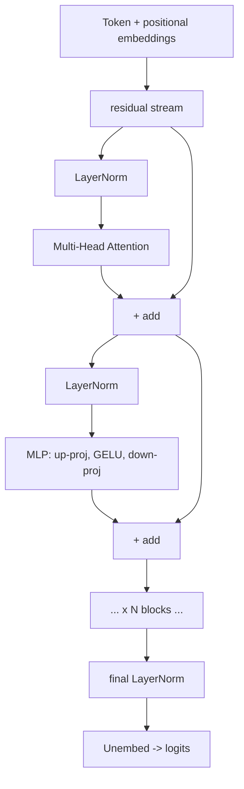

# Transformer / LLM Architecture

> Topic package — Domain 2 · Roadmap Weeks 08/10.
> Depth goal: assemble a full decoder-only transformer block from its parts, understand residual streams, layer norm placement, the MLP, and how depth+width scale.

## Source
- Track: LLM Engineering (self-directed, FDE roadmap)
- Slide deck: `07 Resources Library/LLM Engineering/Slides/Lesson_08_Transformer_Architecture.pptx`
- Hands-on notebook: `07 Resources Library/LLM Engineering/Notebooks/08_Transformer_Architecture.ipynb` (runs offline)
- Reference reading: [[02 Literature Notes/Papers/Vaswani et al. 2017 - Attention Is All You Need]] (arXiv:1706.03762); Radford et al. GPT-2; Karpathy nanoGPT; 'The Illustrated GPT-2' (Alammar); Elhage et al. 'A Mathematical Framework for Transformer Circuits' (Anthropic)
- Builds on: [[02 Literature Notes/LLM Engineering/Attention Deep-Dive]]
- Date: 2026-07-18

---

## 1. Mental Model

**A transformer is a stack of identical blocks that repeatedly read from and write to a shared 'residual stream'.** Each block does two things: (1) attention mixes information *across tokens*, and (2) an MLP processes each token *independently*. Both are wrapped in residual connections and layer norm.

The residual stream is the backbone: every block *adds* its output to it rather than replacing it. Information flows forward largely untouched unless a block chooses to write to it. Attention moves information between positions; the MLP transforms information at a position (it's where much factual "knowledge" lives).

> Key intuition: **attention = communication between tokens; MLP = computation within a token.** Stack N of these blocks, add embeddings in at the bottom and an unembedding (logits) at the top, and you have a GPT.



---

## 2. How It Actually Works

### 2.1 The residual stream
Each sublayer computes `x = x + sublayer(norm(x))`. The `x +` is the residual (skip) connection. It gives gradients a direct path to every layer (solving the vanishing-gradient problem that limited deep nets) and creates a shared communication channel that all blocks read from and write to. Interpretability research treats the residual stream as the model's 'memory bus'.

### 2.2 The transformer block
A decoder block = **pre-norm attention** + **pre-norm MLP**, each residual-added:

```
x = x + MHA(LayerNorm(x))     # mix across tokens
x = x + MLP(LayerNorm(x))     # process each token
```

Modern LLMs use **pre-norm** (LayerNorm *before* the sublayer) because it trains more stably at depth than the original post-norm. RMSNorm often replaces LayerNorm for speed.

### 2.3 The MLP (feed-forward)
Two linear layers with a nonlinearity, applied identically to every position:

$$\text{MLP}(x) = W_{down}\,\phi(W_{up}\,x), \quad \phi \in \{\text{GELU, SwiGLU}\}$$

The hidden dimension is typically **4× d_model**, so the MLP holds most of the parameters. This is widely believed to be where much of the model's factual/associative knowledge is stored (key-value memories).

### 2.4 Embeddings in, logits out
Bottom: token IDs → embedding lookup, plus positional information (learned, sinusoidal, or **RoPE** applied inside attention). Top: a final norm, then an unembedding matrix maps the residual stream to vocabulary logits. Many models **tie** the embedding and unembedding weights.

### 2.5 Depth, width, and scale
Model size ≈ `12 · n_layers · d_model²` (attention + MLP params). Scaling laws (Kaplan; Chinchilla) say loss falls predictably with parameters, data, and compute — and that most models are *under-trained* on data relative to their size. This is why '7B trained on 2T tokens' beats '13B trained on 300B'.

---

## 3. Implementation

Assumed stack: `numpy` for the forward pass (no training). Snippets:
- [[04 Code Snippets/LLM/A Transformer Block Forward Pass]]
- [[04 Code Snippets/LLM/Counting Transformer Parameters]]

### A Transformer Block Forward Pass
Pre-norm decoder block: attention + MLP with residuals, in numpy.
```python
import numpy as np
def softmax(x, ax=-1):
    x = x - x.max(ax, keepdims=True); e = np.exp(x); return e / e.sum(ax, keepdims=True)
def layernorm(x, g, b, eps=1e-5):
    mu = x.mean(-1, keepdims=True); var = x.var(-1, keepdims=True)
    return g * (x - mu) / np.sqrt(var + eps) + b
def gelu(x): return 0.5 * x * (1 + np.tanh(0.797885 * (x + 0.044715 * x**3)))

def attn(x, Wqkv, Wo, causal=True):
    seq, d = x.shape
    Q, K, V = (x @ Wqkv).reshape(seq, 3, d).transpose(1, 0, 2)
    s = Q @ K.T / np.sqrt(d)
    if causal: s = np.where(np.triu(np.ones((seq, seq)), 1).astype(bool), -1e9, s)
    return (softmax(s) @ V) @ Wo

def block(x, p):
    x = x + attn(layernorm(x, p['g1'], p['b1']), p['Wqkv'], p['Wo'])
    h = gelu(layernorm(x, p['g2'], p['b2']) @ p['Wup'])
    return x + h @ p['Wdown']

d, seq, ff = 16, 5, 64; rng = np.random.RandomState(0)
p = dict(g1=np.ones(d), b1=np.zeros(d), g2=np.ones(d), b2=np.zeros(d),
         Wqkv=rng.randn(d, 3*d)*.1, Wo=rng.randn(d, d)*.1,
         Wup=rng.randn(d, ff)*.1, Wdown=rng.randn(ff, d)*.1)
x = rng.randn(seq, d)
print("block output:", block(x, p).shape)
```

### Counting Transformer Parameters
Estimate parameter count and the attention/MLP split for any config.
```python
def params(n_layers, d_model, vocab, ff_mult=4):
    attn = 4 * d_model * d_model           # Wq,Wk,Wv,Wo
    mlp  = 2 * ff_mult * d_model * d_model # up + down
    per_layer = attn + mlp
    embed = vocab * d_model                # tied embed/unembed
    total = n_layers * per_layer + embed
    return total, attn / per_layer, mlp / per_layer

for name, (L, d, v) in {"GPT-2 small":(12,768,50257),
                        "GPT-2 XL":(48,1600,50257),
                        "7B-ish":(32,4096,32000)}.items():
    t, a, m = params(L, d, v)
    print(f"{name:<12} ~{t/1e6:>8.1f}M params   attn={a:.0%} mlp={m:.0%} per block")
```

---

## 4. Design Decisions & Tradeoffs

| Decision | Guidance |
|---|---|
| **Pre-norm vs post-norm** | Pre-norm for stable deep training (all modern LLMs); post-norm was the original and is finicky. |
| **LayerNorm vs RMSNorm** | RMSNorm is cheaper (no mean subtraction) and now common (LLaMA); LayerNorm is the classic. |
| **Activation** | GELU (GPT) or SwiGLU (LLaMA, usually best) over plain ReLU. |
| **Position encoding** | RoPE (rotary) for length generalization; learned/sinusoidal are simpler baselines. |
| **Depth vs width** | Scaling laws: balance params with data. Under-trained large models lose to well-trained smaller ones. |

---

## 5. Failure Modes & Gotchas

- Post-norm at depth without care → training instability / divergence.
- Forgetting the residual add → the network becomes untrainably deep.
- Placing norm after the residual add instead of before the sublayer (breaks pre-norm benefits).
- Assuming attention holds the parameters — the MLP (4× width) holds most of them.
- Ignoring scaling laws → over-sizing a model relative to available training tokens.

---

## 6. FDE Angle

- You can read a model card ('32 layers, d=4096, RoPE, SwiGLU, RMSNorm') and know exactly what it means.
- Parameter counting → VRAM/cost estimation for self-hosting decisions.
- Knowing the MLP holds knowledge explains why fine-tuning/LoRA targets specific layers.
- Scaling-law literacy stops clients from buying a bigger model when they need more/better data.

---

## 7. Self-Check

1. Draw a pre-norm decoder block with both residual connections.
2. Why does the residual stream help training and interpretability?
3. What does attention do that the MLP doesn't, and vice versa?
4. Roughly how many params in a 12-layer, d=768 model, and where do most live?
5. What do scaling laws say about a 13B model trained on 300B tokens?

---

## 9. Interview Q&A

**Q: Draw/describe a pre-norm decoder block with both residual connections — and explain why each piece is there.**
A: Start with what a block needs to do: let tokens share information with each other (attention's job), and let each token process what it just received on its own (the MLP's job). It has to do both without losing information gathered by earlier blocks. That's why the block adds new information onto a running stream instead of replacing it.

The block is: `x = x + MHA(LayerNorm(x))`, then `x = x + MLP(LayerNorm(x))`. Here's what that means in plain terms. First, `x` gets normalized — scaled to a consistent range — but only as a *copy* used just for this step's math. The real running stream isn't touched by this. Attention runs on that normalized copy and mixes information across words. Then the important part: the attention result gets *added* onto the original, untouched `x` — not used to replace it. The same pattern happens again for the MLP: normalize a copy, compute something, add it back onto the stream that still has everything from before.

Why does it have to be addition and not replacement? Because addition lets a block skip doing anything if it has nothing useful to add — it can just output something close to zero, and the information already in the stream passes through unchanged. If blocks replaced the stream instead, every single block would have to actively remember and re-output everything from before just to avoid losing it, which is a much harder thing for the network to learn. Early deep networks that didn't use this trick genuinely failed to train once they got too deep, for exactly this reason.

*One-liner: `x = x + MHA(LN(x))` then `x = x + MLP(LN(x))` — normalize a copy just for the block's own math, but always add the result onto the untouched running stream, so information keeps flowing through unless a block actively changes it.*

**Q: Why does the residual stream specifically help both training *and* interpretability — aren't those different concerns?**
A: They look different, but both come down to the same thing: a clean, traceable path for information to travel through the network.

For training: when the network learns, it needs to send a correction signal (the gradient) backward through every layer. In a plain stack of layers with no shortcuts, that signal gets multiplied by each layer's own derivative as it travels back. If those derivatives are usually a bit less than 1 — which happens often — the signal shrinks more and more with each layer, and by the time it reaches an early layer in a deep network, it's basically zero. That's called vanishing gradients, and it's exactly what made very deep networks hard to train before residual connections existed. The fix: `x = x + f(x)` always has a "+1" built into its derivative, no matter what `f` does. That guarantees there's always at least some path for the signal to travel back along, no matter how deep the network is.

For interpretability: because every block only ever *adds* to the stream, the stream at any point is just the sum of the starting embedding plus whatever every block before it added. That means you can actually split the final result apart and see how much each individual block contributed — which is the whole basis of techniques researchers use to peek inside these models (like checking what the model "believes" partway through, before it even reaches the final layer). None of that would be possible if blocks overwrote the stream instead of adding to it — you'd have no way to separate out any one block's contribution afterward.

*One-liner: the residual stream only adds, never replaces — that guarantees a backward path for training signal no matter how deep the network is, and it also means you can split the final output apart to see exactly how much each block contributed, which is how researchers look inside these models.*

**Q: What does attention do that the MLP doesn't, and vice versa — and why split the work this way at all?**
A: The split exists because "sharing information between words" and "processing one word's own information" are two genuinely different jobs, and no single mechanism does both well.

Attention's entire job is about relationships between different words — it can't even function with just one word, since its whole point is comparing words against each other. For a given word, attention's output is a mix of *other* words' information. This is the only part of the whole block where information actually moves from one word's position to another's. Without attention, the model would process each word completely alone and could never figure out, say, what "it" refers to earlier in a sentence.

The MLP works completely differently — it looks at each word's vector on its own, with no awareness of any other word. Its job is to transform that one word's (already context-enriched, post-attention) information through a learned function. Because this layer is wide (usually 4 times the normal width) and uses the same weights for every word, it has a lot of room to act like a big lookup table. This is part of why researchers increasingly think the MLP is where much of a model's factual knowledge actually lives, while attention is more like the part that decides which facts, from which words, are relevant right now.

Splitting the work this way is what makes transformers efficient: attention does the genuinely hard part — comparing words against each other, which is also the expensive part — while the MLP does simple, per-word processing that can run on every word at once with no dependency between them.

*One-liner: attention is the only place information moves between words (and it's the expensive part); the MLP processes each word's information on its own afterward (and likely holds most of the model's factual knowledge) — splitting them lets each one focus on what it's actually good at.*

**Q: Roughly how many parameters are in a 12-layer, d_model=768 model, and where do most of them live?**
A: Work this out from what actually holds the weights, rather than just recalling a number. Attention has four weight matrices, each of size `d_model × d_model`: one each for Query, Key, Value, and the output projection. So attention uses about `4 × d_model²` parameters per layer. The MLP has one layer that expands the width (usually 4 times wider) and one that shrinks it back down — so the MLP uses about `8 × d_model²` parameters per layer. Already, just from these shapes, the MLP has twice as many parameters as attention in every layer. That's not something you'd only notice by testing it — it falls directly out of the 4x-width design choice.

Add those up: `4d² + 8d² = 12d²` per layer. With `d_model = 768`, that's `12 × 768² ≈ 7.08 million` parameters per layer. Across 12 layers, that's about 85 million. Add the embedding table, which is `vocabulary size × d_model` — with a ~50,000-word vocabulary, that's about 38 million more (often counted once, since the same table is reused at the output). All together, that's roughly 110-120 million parameters — which matches GPT-2 small, a well-known reference point at this size.

The "where do most parameters live" part just falls out of the math above: the MLP always has twice as many parameters as attention, in every layer, by design. This trips people up because attention feels like the more important, more interesting mechanism — but it's actually the simpler per-word MLP that holds most of the weights.

*One-liner: with the usual 4x-wider MLP, each layer has `4·d_model²` parameters in attention and `8·d_model²` in the MLP — meaning the MLP always holds twice as many — giving around 110-120 million total parameters for a 12-layer, d=768 model (GPT-2-small size).*

**Q: A client trained a 13B-parameter model on 300B tokens and it's underperforming a 7B model trained on 2T tokens — what do scaling laws say happened, and what's the fix?**
A: This is exactly the kind of situation scaling-law research (often called Chinchilla scaling) was built to explain. The core finding: a model's final quality depends on *both* how many parameters it has and how much data it was trained on — and for any given amount of compute, there's a best balance between the two. Spend too much of your budget on parameters and not enough on data, and the model ends up with more capacity than it's actually learned to use well. It's not broken — it's just undertrained relative to how big it is.

As a rough rule of thumb, well-balanced training uses around 20 tokens of data for every parameter. The 13B model, at 300B tokens, got about 23 tokens per parameter — close to that rule in isolation. But the real comparison is against the 7B model, which was trained on 2T tokens — about 286 tokens per parameter, far more data relative to its size. Scaling laws say that once you're near or past the balanced ratio, adding more data keeps helping more reliably than adding more parameters does. That's exactly why a smaller model trained on a lot more data can beat a bigger model that wasn't trained on enough — the smaller model actually got to fully use what it has, while the bigger one didn't.

So the fix for the client is almost never "build an even bigger model." It's "get more or better training data, and train at a size that matches the data you actually have" — or keep training the existing model further if more data becomes available. The problem isn't that the model is too small — it's that it was never shown enough examples to justify its size.

*One-liner: a model's quality depends on both its size and how much data it saw, and there's a balanced ratio between the two (roughly 20 tokens per parameter) — the 13B model was undertrained for its size, while the 7B model saw enough data to make good use of its smaller size, so the fix is more data, not a bigger model.*

**Q: Why do all modern LLMs use pre-norm instead of the original Transformer paper's post-norm — what specifically breaks with post-norm at depth?**
A: The difference is just where the normalization step sits relative to the addition step — but that small placement choice has a big effect on whether training actually works at depth. Post-norm does the addition first, then normalizes the result: `x = LayerNorm(x + sublayer(x))`. That means what gets passed to the next block has always just been normalized — the original, untouched stream doesn't survive even one block.

Here's why that matters: normalization isn't a "free" operation for gradients — it rescales its input, and that rescaling effect carries through to the backward pass too. In post-norm, every single block reintroduces this rescaling right at the exact point where the shortcut connection was supposed to give a clean, untouched path for the training signal. Stack enough blocks, and that signal has now passed through many rounds of rescaling on its way back — which in practice makes very deep post-norm networks unstable or hard to train without extra tricks like careful warmup.

Pre-norm instead does `x = x + sublayer(LayerNorm(x))` — normalization only touches a copy used for the sublayer's own computation, and the actual addition back onto the stream uses the original, untouched `x`. That means the shortcut path is never touched by normalization at all, no matter how many blocks you stack — so the clean backward path argument holds up at any depth, which is exactly why pre-norm scales comfortably to the 30, 50, even 100+ layer depths modern LLMs use. The one downside is that without anything ever rescaling the main stream itself, its values can slowly grow larger at extreme depths — which is a much smaller problem than post-norm's instability, and is part of why models add one final normalization step right before producing output.

*One-liner: post-norm normalizes right after the addition, so every block disturbs the one path meant to carry a clean training signal — pre-norm only normalizes a copy used for the block's own math, leaving that path untouched, which is why pre-norm trains reliably at the depths modern LLMs actually use.*

## 8. Links
- Domain MOC: [[06 Maps of Content/LLM Engineering Concepts]]
- Code: [[04 Code Snippets/LLM/A Transformer Block Forward Pass]], [[04 Code Snippets/LLM/Counting Transformer Parameters]]
- Distilled: [[03 Permanent Notes/Attention Communicates Between Tokens the MLP Computes Within Them]], [[03 Permanent Notes/Scaling Laws Reward Data Not Just Parameters]]
- Upstream: [[02 Literature Notes/LLM Engineering/Attention Deep-Dive]] · Downstream: [[02 Literature Notes/LLM Engineering/Decoding and Sampling]]
