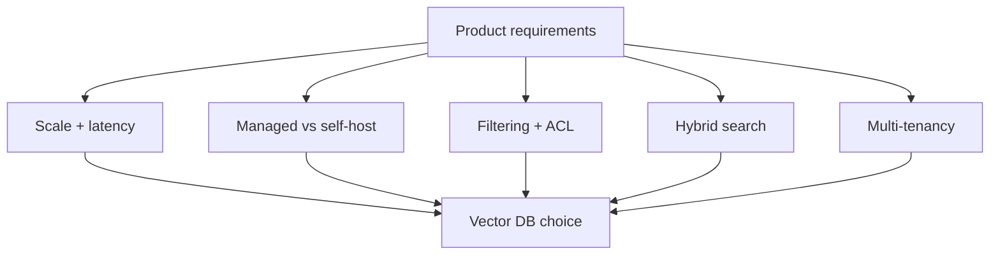

# Vector Database Landscape

> Topic package — Domain 4 · Roadmap Weeks 14/20.
> Depth goal: compare vector database options by deployment model, index algorithms, filtering, hybrid search, multi-tenancy, quantization, operational burden, and fit for RAG product requirements.

## Source
- Track: LLM Engineering (self-directed, FDE roadmap)
- Slide deck: `07 Resources Library/LLM Engineering/Slides/Lesson_23_Vector_Database_Landscape.pptx`
- Hands-on notebook: `07 Resources Library/LLM Engineering/Notebooks/23_Vector_Database_Landscape.ipynb` (runs offline)
- Reference reading: Chroma docs; Qdrant docs; Weaviate docs; Pinecone docs; Milvus docs; pgvector docs; FAISS docs; ANN-benchmarks; vendor hybrid search and filtering documentation
- Builds on: [[02 Literature Notes/LLM Engineering/Vector Search]] · [[02 Literature Notes/LLM Engineering/ANN Index Internals]] · [[02 Literature Notes/LLM Engineering/RAG Pipeline Fundamentals]]
- Date: 2026-07-18

---

## 1. Mental Model

**A vector database is not just a place to store embeddings; it is the operational retrieval layer for RAG.** It controls indexing, filtering, hybrid search, tenancy, updates, deletion, observability, and the latency/recall tradeoff users experience.

The landscape is a set of tradeoffs. FAISS is a library, not a service. Chroma is simple for local apps. pgvector keeps embeddings near relational data. Qdrant, Weaviate, Milvus, and Pinecone provide production vector services with different strengths in managed operations, hybrid search, scale, filtering, and multi-tenancy.

> Key intuition: **choose the retrieval operating model before choosing the vector database.** The right option depends on data scale, filters, hybrid needs, team ops capacity, tenant isolation, and latency SLOs.



---

## 2. How It Actually Works

### 4.1 The main categories
FAISS is an in-process ANN library: great for experiments and embedded/offline indexes, but you own persistence, serving, filters, and ops. Chroma emphasizes developer ergonomics/local RAG. pgvector adds vector indexes inside Postgres. Qdrant/Weaviate/Milvus/Pinecone are vector databases/services with APIs, metadata filtering, replication or managed options, and production operational features.

### 4.2 Managed vs self-host
Managed services reduce operational burden: scaling, backups, monitoring, upgrades, and availability. Self-host gives control over cost, data residency, and customization. The decision is often less about ANN accuracy and more about who will own incidents, migrations, and capacity planning.

### 4.3 Features that matter for RAG
RAG needs more than nearest neighbors: metadata filters (ACL, tenant, freshness), hybrid lexical+dense search, batch upserts/deletes, versioning, namespaces/collections, reranking integration, payload storage, and observability. If filters are slow or approximate, the system may leak data or miss evidence.

### 4.4 Index and compression tradeoffs
HNSW is common for high-recall low-latency search; IVF/PQ/quantization reduce memory at potential recall cost. ANN-benchmarks remind us there is no free lunch: recall, latency, memory, indexing time, and update behavior trade off. Evaluate with your embeddings, filters, and query distribution.

### 4.5 Selection framework
Small prototype: Chroma or FAISS. Postgres-first app with moderate scale and strong relational filters: pgvector. Need managed production with low ops: Pinecone or managed alternatives. Need open-source service with strong filtering: Qdrant/Weaviate/Milvus depending on scale and hybrid/ops preferences. Always run a proof-of-concept against your eval set.

---

## 3. Implementation

Assumed stack: stdlib + numpy. Snippets implement a decision matrix and a local ANN tradeoff simulator. Snippets:
- [[04 Code Snippets/LLM/Vector Store Selection Matrix]]
- [[04 Code Snippets/LLM/Local ANN Tradeoff Simulator]]

### Vector Store Selection Matrix
Score vector DB candidates against product requirements instead of vendor vibes.
```python
CANDIDATES = {
    "FAISS": {"managed":0, "simple":2, "filters":0, "hybrid":0, "ops":0},
    "Chroma": {"managed":0, "simple":3, "filters":1, "hybrid":1, "ops":1},
    "pgvector": {"managed":1, "simple":2, "filters":3, "hybrid":2, "ops":2},
    "Qdrant": {"managed":2, "simple":2, "filters":3, "hybrid":2, "ops":2},
    "Weaviate": {"managed":2, "simple":2, "filters":2, "hybrid":3, "ops":2},
    "Pinecone": {"managed":3, "simple":2, "filters":2, "hybrid":2, "ops":3},
    "Milvus": {"managed":1, "simple":1, "filters":2, "hybrid":2, "ops":2}}

def choose(weights):
    scores = {name: sum(features.get(k,0)*w for k,w in weights.items()) for name,features in CANDIDATES.items()}
    return sorted(scores.items(), key=lambda x: x[1], reverse=True)

print(choose({"managed":3, "filters":2, "hybrid":1, "ops":2})[:3])
```

### Local ANN Tradeoff Simulator
Simulate recall loss when searching only a candidate subset instead of exact nearest neighbors.
```python
import numpy as np
rng = np.random.RandomState(0)
vecs = rng.randn(200, 16); vecs /= np.linalg.norm(vecs, axis=1, keepdims=True)
q = rng.randn(16); q /= np.linalg.norm(q)
exact = set(np.argsort(vecs @ q)[-10:])

def approx_recall(candidate_fraction):
    n = int(len(vecs) * candidate_fraction)
    candidates = rng.choice(len(vecs), n, replace=False)
    found = set(candidates[np.argsort(vecs[candidates] @ q)[-10:]])
    return len(exact & found) / len(exact)

for frac in [0.1, 0.25, 0.5, 1.0]:
    print(frac, "recall@10", round(approx_recall(frac), 2))
```

---

## 4. Design Decisions & Tradeoffs

| Decision | Guidance |
|---|---|
| **Prototype choice** | Use FAISS/Chroma for local experiments; avoid over-optimizing infra before retrieval design is known. |
| **Postgres adjacency** | Use pgvector when relational filters, transactions, and existing Postgres ops matter more than extreme scale. |
| **Managed service** | Prefer managed when team lacks search/database ops capacity or needs uptime quickly. |
| **Hybrid search** | Require native or composable hybrid when exact terms, SKUs, or keyword constraints matter. |
| **Multi-tenancy** | Check namespaces, per-tenant filters, deletion, backups, and isolation guarantees. |
| **Benchmarking** | Benchmark with your embeddings, metadata filters, update rate, and eval queries — not vendor leaderboard claims. |

---

## 5. Failure Modes & Gotchas

- Choosing a vector DB solely from ANN benchmark recall without considering filters and deletion.
- Using a library like FAISS as if it handled serving, persistence, tenancy, and backups.
- Ignoring metadata filter performance until ACL filters become a latency bottleneck.
- Assuming hybrid search is available or equivalent across vendors.
- No plan for re-embedding, versioning, or deleting stale vectors.
- Locking into a managed vendor before testing export and migration paths.

---

## 6. FDE Angle

- Vector DB choice is an architecture decision, not a model choice.
- The FDE must map product requirements to retrieval operations: filters, tenants, updates, hybrid, SLOs.
- A small benchmark with the client's data beats generic vendor comparisons.
- Deliverable: a selection memo plus proof-of-concept metrics and operational risks.

---

## 7. Self-Check

1. Why is FAISS different from a vector database service?
2. When is pgvector a strong choice?
3. Which RAG features depend on metadata filtering?
4. What does hybrid search add beyond dense vectors?
5. What should be benchmarked before choosing a vendor?

---

## 9. Interview Q&A

**Q: Why is FAISS fundamentally different from a vector database service?**
A: FAISS is a *library* — a piece of code you import and run inside your own application, providing the core algorithms for fast similarity search (HNSW, IVF, PQ, and so on). It's excellent at the one specific thing it does: given a set of vectors already in memory, search them quickly. But that's genuinely all it does — it has no concept of a running service, no built-in persistence to disk, no API you call over a network, no metadata filtering, no multi-tenant isolation, no deletion/update handling beyond what you build yourself.

A vector database (Qdrant, Weaviate, Pinecone, Milvus, and similar) is a full *service* — something that runs as its own standalone system, with a network API you call, that handles not just the core similarity search, but everything around it that a real production system actually needs: persisting data reliably to disk and surviving restarts, scaling across multiple machines, supporting metadata filters efficiently, handling concurrent updates and deletes safely, managing multiple isolated tenants or namespaces, and providing operational visibility (monitoring, backups) into how the system is behaving.

The practical consequence of this distinction: if you use FAISS directly in a production system, you are explicitly signing up to build all of that missing infrastructure yourself — your own persistence layer, your own API, your own filtering logic, your own tenant isolation. FAISS gives you a very fast core algorithm; it does not give you a production-ready system around that algorithm. Treating "we use FAISS" as equivalent to "we have a vector database" is a common and risky mistake, since everything beyond the core search algorithm is something you now own and have to build and maintain yourself.

*One-liner: FAISS is a library providing just the core similarity-search algorithm, with no persistence, API, filtering, or tenancy built in — a vector database is a full service that provides all of that surrounding infrastructure too, which is why using FAISS directly in production means you're signing up to build everything else yourself.*

**Q: When is pgvector a strong choice for a vector store?**
A: pgvector is a strong choice specifically when your vector search needs can live comfortably alongside data and operations you're already running in Postgres, rather than needing a dedicated, separate, specialized vector infrastructure.

It's particularly compelling when: you already run Postgres for your application's regular relational data, and you want vector search to sit right next to that data rather than maintaining an entirely separate system; your filtering needs are genuinely relational in nature — joining vector search results against other tables, applying complex conditions that a relational database handles naturally; you want transactional guarantees tying vector updates together with other data changes in the same database (updating a record and its embedding together, atomically, in one transaction); and your scale is moderate rather than requiring the absolute highest possible throughput or the most specialized ANN index tuning a dedicated vector-first system might offer.

The tradeoff to be aware of: pgvector, because it's an extension bolted onto a general-purpose relational database rather than a system purpose-built from the ground up for vector search, may not match the raw performance or the most advanced ANN-specific features of a dedicated vector database at very large scale or under the most demanding retrieval requirements. But for many real production RAG systems — especially ones that already have Postgres as part of their stack, and don't need extreme scale — the operational simplicity of "one less system to run, monitor, and keep available" is a genuinely strong practical argument, often outweighing marginal performance differences a dedicated vector-first system might offer.

*One-liner: pgvector is a strong choice when you already run Postgres and want vector search to live alongside your relational data, benefit from relational filtering and transactional guarantees, and don't need extreme scale — trading some raw ANN performance for the operational simplicity of one fewer system to run and maintain.*

**Q: Which RAG features specifically depend on metadata filtering, and why does filter performance matter?**
A: Several core RAG capabilities are really just metadata filtering applied to vector search, not something separate bolted on top — which is why how well a vector database handles filtering isn't a minor feature, it's load-bearing for the whole system.

Access control (as covered in Vector Search) depends entirely on metadata filtering — restricting search results to only documents a specific user or tenant is allowed to see requires filtering by an owner/ACL field attached to each vector, applied as a pre-filter before (or integrated tightly with) the similarity search itself. Freshness and recency scoping (only search documents from the last year, or only the latest version of a document) similarly depends on filtering by a date or version field. Multi-tenancy (keeping different customers' or teams' data properly isolated from each other within the same overall system) depends on filtering by a tenant identifier.

Here's why filter *performance* specifically matters, not just filter *existence*: if metadata filtering is slow or only approximately correct, you get real, serious problems — a slow filter applied as an afterthought after search (post-filtering, as covered in Vector Search) can mean search looks fast in isolation but the actual end-to-end request is slow once filtering is layered on top; worse, an approximate or buggy filter implementation risks a genuine security failure — unauthorized content leaking through because the filter didn't reliably exclude it. This is exactly why, when evaluating a vector database for a real RAG system, you need to specifically test filtering performance and correctness under your actual access-control and freshness requirements, not just benchmark raw similarity search speed in isolation — a system that's fast at plain vector search but slow or unreliable at filtered search hasn't actually solved the problem a production RAG system needs solved.

*One-liner: access control, freshness/recency scoping, and multi-tenancy are all really metadata filtering applied to vector search — filter performance matters specifically because a slow filter undermines overall latency, and an unreliable filter risks a genuine security failure (unauthorized content leaking through), so filtering needs to be tested directly, not inferred from raw similarity-search benchmarks alone.*

**Q: What does hybrid search add beyond plain dense vector search?**
A: Hybrid search combines dense vector search (which matches by semantic meaning) with lexical/keyword search like BM25 (which matches by exact term overlap) — adding the specific capability dense search alone lacks: reliably finding exact terms, codes, names, and identifiers, which was covered in depth in Advanced Retrieval.

The reason this matters as a *vector database feature* specifically, rather than just a retrieval-algorithm concept you implement yourself: not every vector database actually supports hybrid search natively, and the quality and ease of hybrid search varies significantly between vendors — some provide it as a well-integrated, single-query capability, while others would require you to run dense and lexical search completely separately yourself and manually combine (fuse) the results in your own application code. If your actual retrieval needs genuinely require exact-term matching alongside semantic search — which is common in enterprise content full of product codes, names, and technical identifiers — this isn't a nice-to-have feature to check later, it's a real selection criterion that should be evaluated directly when choosing a vector database, not assumed to be universally available or equivalent across every vendor.

*One-liner: hybrid search adds the ability to reliably match exact terms, codes, and names (which dense vector search alone struggles with) by combining it with lexical/BM25 search — this should be checked directly as a vendor selection criterion, since native hybrid search support and quality genuinely varies between vector database options, it's not a universally available, interchangeable feature.*

**Q: What should actually be benchmarked before choosing a vector database vendor?**
A: The core principle: benchmark using *your* actual data, queries, and requirements — not a vendor's published leaderboard numbers or generic ANN-benchmark results, which reflect a different dataset and query pattern than whatever you'll actually be running in production.

Specifically, you'd want to test: raw retrieval quality (recall@k, precision) using your *own* embeddings and your *own* labeled evaluation queries (as covered in Retrieval Evaluation) — not a generic benchmark dataset that may have very different characteristics from your actual corpus; latency and throughput under your actual expected query volume and concurrency, not a vendor's best-case single-query demo numbers; metadata filter performance specifically under your real access-control and freshness filtering patterns, since (as above) filter performance is often the part that actually determines real-world usability, not raw unfiltered search speed; update and deletion behavior under your expected data change rate, since some index types handle frequent updates far more gracefully than others; and, if relevant, hybrid search quality specifically on your content, if exact-term matching matters for your use case.

The underlying reason all of this needs to be tested with your own data rather than trusted from vendor claims: ANN performance, recall, and even relative rankings between different index types can shift meaningfully depending on the specific characteristics of your embeddings (their dimensionality, their clustering structure) and your actual query distribution — a vendor's generic benchmark numbers were measured on their benchmark dataset, which may behave quite differently from your real corpus and real user queries.

*One-liner: benchmark recall/precision using your own embeddings and labeled queries, latency/throughput at your expected real volume, metadata filter performance under your real access-control patterns, and update/deletion behavior at your expected data change rate — all with your own data, since ANN performance and rankings can shift meaningfully depending on your specific embeddings and query patterns, making generic vendor benchmarks unreliable predictors for your actual workload.*

## 8. Links
- Domain MOC: [[06 Maps of Content/LLM Engineering Concepts]]
- Code: [[04 Code Snippets/LLM/Vector Store Selection Matrix]], [[04 Code Snippets/LLM/Local ANN Tradeoff Simulator]]
- Distilled: [[03 Permanent Notes/Choose a Vector Database by Retrieval Operations Not Brand]], [[03 Permanent Notes/FAISS Is a Library While Vector Databases Are Retrieval Services]]
- Upstream: [[02 Literature Notes/LLM Engineering/Retrieval Evaluation]] · Downstream: [[02 Literature Notes/LLM Engineering/LLMOps]]
