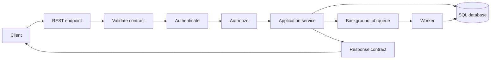

# APIs, Integration & Backend Engineering

> Topic package — Week 04 · Roadmap Week 04 — APIs, Integration & Backend Engineering.
> Depth goal: design backend interfaces that integrate reliably: clear REST resources, request/response contracts, authN/authZ boundaries, file-upload flows, background processing, versioning strategy, and safe database access.

## Source
- Track: Software Engineering (self-directed, FDE roadmap)
- Slide deck: `07 Resources Library/Software Engineering/Slides/Lesson_04_APIs,_Integration_&_Backend_Engineering.pptx`
- Hands-on notebook: `07 Resources Library/Software Engineering/Notebooks/04_APIs,_Integration_&_Backend_Engineering.ipynb` (runs offline)
- Reference reading: Fielding REST dissertation; FastAPI documentation concepts; OWASP API Security Top 10; RFC 9110 HTTP Semantics; PostgreSQL and SQLite documentation; Google API Improvement Proposals; Stripe API design examples
- Builds on: [[02 Literature Notes/Software Engineering/Data Structures, Algorithms & Complexity]]
- Date: 2026-07-18

---

## 1. Mental Model

**An API is a promise at a boundary: shape, behavior, security, latency, and evolution rules.** REST gives a resource-oriented vocabulary; request/response contracts make the boundary testable; authentication proves who is calling; authorization decides what they can do; background jobs protect request latency; databases make state durable; versioning lets clients and servers change safely.

Backend engineering is mostly boundary discipline. The handler should validate input, enforce identity and permissions, run a transaction or enqueue work, return a predictable response, and emit enough observability for debugging. FastAPI is a useful production tool, but the core ideas are framework-independent.

> Key intuition: **treat every integration as a contract plus an operations story** — what clients send, what they get back, who may call it, how failures surface, and how the contract changes without breaking them.



---

## 2. How It Actually Works

### 4.1 REST resources and HTTP contracts
REST APIs expose resources through URLs and use HTTP methods deliberately: `GET` reads, `POST` creates or starts processing, `PUT` replaces, `PATCH` partially updates, and `DELETE` removes. Status codes are part of the contract: `200/201/202` for success variants, `400` for invalid input, `401` unauthenticated, `403` unauthorized, `404` not found, `409` conflict, `422` semantic validation, `429` limited, and `5xx` server failure.

The contract includes headers, idempotency keys, pagination, error envelope, correlation id, and timeout expectations. A good API is boring: stable names, explicit schemas, predictable errors, and examples clients can paste into tests.

### 4.2 Validation and FastAPI-style handler shape
FastAPI popularized a clean shape: typed request model, dependency-injected auth, application function, typed response model, and automatic docs. You do not need a running server to practice the architecture. A local function can simulate the same boundary: parse a dict, validate fields, enforce auth, call a service, and return a response dict.

Validation belongs at the edge. Convert untrusted input into domain objects once, reject extra or malformed fields intentionally, and keep the core application code free of HTTP-specific details. That separation is what lets an FDE swap CLI, notebook, webhook, or REST adapters around the same workflow.

### 4.3 Authentication, authorization, and tokens
Authentication (AuthN) answers 'who is this caller?' Authorization (AuthZ) answers 'what may this caller do to this resource?' API keys identify applications; bearer tokens represent principals and scopes; sessions fit browser apps; mTLS and signed requests appear in enterprise integrations. Do not blur identity with permission: a valid token can still lack access to a tenant, file, or action.

Token patterns require operational choices: expiration, rotation, revocation, audience, issuer, scopes/roles, tenant binding, and audit logging. The safest handler checks AuthN first, then AuthZ against the specific resource, then executes the action.

### 4.4 Uploads, background jobs, and async processing
File uploads and slow work should not hold request threads hostage. Validate metadata and size, store the blob or staged content, create a job record, return `202 Accepted` with a job id, and process asynchronously. The worker updates status and stores results; clients poll or receive a webhook/callback. This makes latency predictable and isolates retries from user requests.

Background jobs need idempotency, status states, retry policy, dead-letter handling, progress visibility, and authorization on job reads. Async code is about concurrency around waiting, not making CPU work magically faster; use it for many I/O-bound tasks and keep shared-state mutation disciplined.

### 4.5 Databases, SQL basics, and API versioning
Relational databases store durable state in tables; SQL selects, filters, joins, groups, inserts, updates, and deletes. Backend safety starts with parameterized queries, transactions for multi-step changes, constraints for invariants, indexes for lookup paths, and migrations for schema evolution. Avoid building SQL with string concatenation from user input.

Versioning is how contracts evolve. Prefer additive changes first: new optional fields, new endpoints, tolerant clients. Use explicit versions when semantics break, and maintain deprecation windows. Database migrations and API versions must be planned together; a handler can often serve old and new response shapes from the same internal model during transition.

---

## 3. Implementation

Assumed stack: Python stdlib only. Snippets simulate FastAPI-style request handling, validation, auth, async background jobs, and SQL locally. Snippets:
- [[04 Code Snippets/Software Engineering/SE Week 04 Dataclass API Contract Handler]]
- [[04 Code Snippets/Software Engineering/SE Week 04 Async Job Queue and SQLite Demo]]

### SE Week 04 Dataclass API Contract Handler
A FastAPI-like handler without a server: validate request dicts, enforce auth, and return a response contract.
```python
from dataclasses import dataclass

@dataclass(frozen=True)
class CreateTicketRequest:
    title: str
    priority: int

@dataclass(frozen=True)
class TicketResponse:
    id: int
    title: str
    status: str

def parse_create_ticket(payload):
    title = payload.get("title")
    priority = payload.get("priority")
    if not isinstance(title, str) or not title.strip():
        raise ValueError("title must be a non-empty string")
    if not isinstance(priority, int) or not 1 <= priority <= 5:
        raise ValueError("priority must be an integer 1..5")
    return CreateTicketRequest(title=title.strip(), priority=priority)

def require_scope(token, scope):
    scopes = set(token.get("scopes", []))
    if scope not in scopes:
        raise PermissionError(f"missing scope: {scope}")

def create_ticket_handler(payload, token):
    require_scope(token, "tickets:write")
    req = parse_create_ticket(payload)
    return TicketResponse(id=1, title=req.title, status="open")

print(create_ticket_handler({"title": "Latency spike", "priority": 2}, {"sub": "u1", "scopes": ["tickets:write"]}))
```

### SE Week 04 Async Job Queue and SQLite Demo
A local background-job queue using asyncio plus sqlite3 persistence; no server or network required.
```python
import asyncio, sqlite3

async def worker(queue, db):
    while True:
        job_id, payload = await queue.get()
        if job_id is None:
            queue.task_done()
            break
        result = payload.upper()
        db.execute("UPDATE jobs SET status=?, result=? WHERE id=?", ("done", result, job_id))
        db.commit()
        queue.task_done()

async def main():
    db = sqlite3.connect(":memory:")
    db.execute("CREATE TABLE jobs (id INTEGER PRIMARY KEY, status TEXT, result TEXT)")
    q = asyncio.Queue()
    task = asyncio.create_task(worker(q, db))
    for payload in ["parse file", "embed chunks"]:
        cur = db.execute("INSERT INTO jobs(status, result) VALUES (?, ?)", ("queued", None))
        await q.put((cur.lastrowid, payload))
    await q.put((None, None))
    await q.join()
    await task
    print(db.execute("SELECT id, status, result FROM jobs ORDER BY id").fetchall())

asyncio.run(main())
```

---

## 4. Design Decisions & Tradeoffs

| Decision | Guidance |
|---|---|
| **Resource modeling** | Model URLs around nouns and stable business resources; use verbs for operations only when no durable resource exists or when starting a process. |
| **Status code selection** | Return precise status codes and a consistent error envelope so clients can branch safely without parsing prose. |
| **Auth boundary** | Authenticate every request before application logic; authorize against the exact tenant/resource/action, not just a coarse role. |
| **Sync vs background** | Keep requests synchronous for quick deterministic work; return `202 + job_id` for uploads, model calls, imports, and anything retryable or slow. |
| **Database access** | Use parameterized SQL, constraints, indexes, and transactions; keep DB rows separate from public API response models. |
| **Versioning strategy** | Prefer additive contract changes; introduce explicit versions and deprecation plans for semantic breaks. |

---

## 5. Failure Modes & Gotchas

- Returning ad-hoc error strings per endpoint → clients cannot reliably handle failures.
- Checking authentication but not resource-level authorization → cross-tenant data exposure.
- Running slow file parsing or model calls inside the HTTP request → timeouts and duplicate client retries.
- Constructing SQL with string interpolation from request data → injection risk and quoting bugs.
- Changing response semantics in place with no version or deprecation window → downstream client breakage.
- Treating background jobs as fire-and-forget with no status, idempotency, retry, or dead-letter story.

---

## 6. FDE Angle

- FDE integrations succeed when clients can see and test the contract: example requests, schemas, error envelopes, auth scopes, and versioning notes.
- Enterprise deployments require AuthN/AuthZ clarity; being able to explain tenant isolation and token scope checks is often as important as the feature.
- AI workflows usually need background processing for uploads, indexing, evaluation, and long model calls; `202 + job_id` is a practical product pattern.
- Deliverable: a contract-first API slice with local tests, SQL migration/query notes, operational logs, and a documented failure/retry model.

---

## 7. Self-Check

1. What is the difference between authentication and authorization?
2. When should an endpoint return `202 Accepted` instead of `200 OK`?
3. What belongs in a stable API error envelope?
4. Why should SQL queries be parameterized?
5. How do additive API changes differ from breaking semantic changes?
6. Where should request validation live relative to domain logic?

---

## 9. Interview Q&A

**Q: What's the actual difference between authentication and authorization, and why does the note insist you check them in that specific order?**
A: Authentication answers "who is this caller" — verifying that a request actually comes from the identity it claims to be, via a valid token, session, or signed request. Authorization is a completely separate question that only makes sense to ask *after* you know who's calling: "what is this specific, now-known caller allowed to do to this specific resource." A valid, authenticated token proves identity; it says nothing on its own about whether that identity has permission for the specific action being requested.

The order matters because authorization is meaningless without a confirmed identity to check permissions against — you can't sensibly ask "is this user allowed to delete this document" before you've established who the user actually is; a permission check against an unverified or spoofed identity is just checking permissions against a lie. Checking authentication first and rejecting immediately on failure also avoids doing any authorization work (which may itself involve a database lookup to check tenant/resource ownership) for a request that was never going to be let through anyway — failing fast on the cheaper, earlier check. The note's warning about "checking authentication but not resource-level authorization" producing cross-tenant data exposure is the concrete failure this ordering, done fully, is meant to prevent: a valid token (authenticated) for User A should still be rejected (authorization failure) when trying to access User B's resource, and skipping that second check is exactly how a correctly-authenticated request ends up accessing data it has no business touching.

*One-liner: authentication establishes who is calling; authorization decides what that now-known caller may do to a specific resource — they have to run in that order because authorization is meaningless without a confirmed identity to check permissions against, and skipping the authorization half (even with authentication working correctly) is exactly how a legitimately-authenticated user ends up accessing another tenant's data.*

**Q: When should an endpoint return 202 Accepted instead of 200 OK, and what does that choice actually commit you to building?**
A: `202 Accepted` signals that the request was received and will be processed, but the work isn't done yet and the response doesn't contain the final result — this is the right choice specifically when the underlying work is slow or unpredictable enough that holding the HTTP request open until completion would risk client/gateway timeouts, tie up a request-handling thread for an extended period, or make retries ambiguous (did the original request actually fail, or is it just still running?). File uploads requiring processing, document indexing, long model calls, and bulk imports are the canonical cases — anything where "how long will this take" doesn't have a short, predictable answer.

Returning `202` is not just a status-code choice — it's a commitment to build the surrounding machinery that makes "accepted but not yet done" actually usable: a job record with a stable ID returned in the response, a status field the client can poll (`queued`, `processing`, `done`, `failed`), either a polling endpoint or a webhook/callback mechanism for the client to learn when it's actually finished, and a defined behavior for what happens if the job fails (does the client see an error status, is it retried automatically, does it land in a dead-letter state for manual review). Choosing `202` without building this surrounding status/retry/dead-letter story just defers the problem — the client still needs to know what actually happened, and `202` without a way to check status later is strictly worse than a slow `200` that at least eventually tells you the real outcome.

*One-liner: 202 Accepted is the right choice when work is too slow or unpredictable to hold the request open for, but choosing it commits you to actually building the job-status machinery (a job ID, a status field, a way for the client to eventually learn the real outcome, and a defined failure/dead-letter behavior) — returning 202 without that surrounding story just defers the "did this actually work" question onto a client with no way to answer it.*

**Q: What specifically needs to be in a "stable API error envelope," and why does inconsistency here specifically break client code rather than just being an annoyance?**
A: A stable error envelope needs, at minimum: a machine-readable error code or type (something a client can branch on programmatically, like `"validation_error"` or `"insufficient_permissions"`, not just a human-readable sentence), a human-readable message (for logging/debugging/surfacing to a user), and ideally a correlation/request ID (so a specific failure can be traced back through server-side logs when debugging a client-reported issue) — and critically, this same shape needs to be used consistently across every endpoint, not invented freshly per handler.

The reason inconsistency here is a correctness bug rather than just an aesthetic annoyance: client code that wants to handle a specific error condition programmatically (e.g., "if this failed because of a validation error, show the user this specific inline field error; if it failed because of a permissions issue, redirect to a login/upgrade flow") needs a *stable, predictable* field to branch its logic on. If one endpoint returns `{"error": "title is required"}` and another returns `{"message": "missing field: title", "field": "title"}`, client code can't write one reusable error-handling path — it has to special-case every single endpoint's ad-hoc error shape, and any future endpoint added without matching that exact ad-hoc convention breaks client error handling again. A stable, consistent envelope is what lets client code branch safely on structure rather than parsing prose strings that could change wording at any time without warning.

*One-liner: a stable error envelope needs a machine-readable code/type, a human-readable message, and a correlation ID, used identically across every endpoint — inconsistency here is a correctness bug, not an aesthetic one, because client code needs a predictable field to branch its error-handling logic on, and ad-hoc per-endpoint error shapes force clients to special-case every single endpoint instead of writing one reusable error-handling path.*

**Q: Why specifically does string-interpolated SQL create an injection risk, mechanically — not just "it's insecure," but what's actually happening?**
A: When SQL is built by directly interpolating a user-supplied value into a query string (e.g., `f"SELECT * FROM users WHERE name = '{user_input}'"`), the database has no way to distinguish between "data the user supplied" and "SQL syntax that's part of the query structure" — both arrive as part of one single string that gets parsed as SQL. If `user_input` is something like `' OR '1'='1`, the resulting query becomes `SELECT * FROM users WHERE name = '' OR '1'='1'` — a condition that's always true, potentially returning every row in the table instead of the one row the query was supposed to filter for. More sophisticated payloads can chain additional statements, extract data through error messages or timing, or in the worst case modify/delete data, depending on what the interpolated string manages to inject into the query's actual structure.

Parameterized queries (passing the user value as a separate parameter to the database driver, rather than interpolating it into the SQL string itself, e.g. `cursor.execute("SELECT * FROM users WHERE name = ?", (user_input,))`) fix this at the mechanism level, not just by "being more careful": the database driver sends the query structure and the user-supplied value as genuinely separate things to the database engine, and the engine treats the parameter strictly as a literal data value to compare against — it is never parsed as part of the SQL syntax, no matter what characters it contains. This isn't a matter of escaping special characters more carefully in string interpolation (which is itself error-prone and easy to get subtly wrong) — it's a structurally different mechanism where user input can never be interpreted as query syntax in the first place, regardless of its content.

*One-liner: string-interpolated SQL lets user input and query syntax arrive in the database as one single string with no distinction between them, so crafted input (like `' OR '1'='1`) can alter the query's actual logic — parameterized queries fix this structurally, not just by escaping more carefully, by sending the value and the query syntax as genuinely separate things to the database engine, so the parameter can never be interpreted as SQL syntax regardless of its content.*

**Q: How do additive API changes actually differ from breaking semantic changes, and why does the note push you toward exhausting additive options before reaching for an explicit version?**
A: An additive change adds something new — a new optional field in a response, a new endpoint, a new optional query parameter — without altering the meaning or structure of anything that already exists. A client written against the old contract, who has never heard of the new field/endpoint/parameter, continues to work exactly as before, because nothing it already depends on has changed; it simply doesn't know about the new addition, which is fine, since it never needed to. A breaking semantic change alters the meaning of something a client already depends on — renaming a field, changing a field's type or units, changing what a given status code means for a given endpoint, or removing something that used to be there — any of which can silently break an existing client that built logic around the old meaning, even if the client's code technically still "runs" without an explicit error.

The reason to exhaust additive options first is that additive changes let the server evolve the API without forcing every client to immediately update, re-test, and re-deploy in lockstep with the server — old clients keep working, new clients can opt into new capability, and there's no coordination problem between server and client release schedules. Breaking changes force exactly that coordination problem: every client has to be updated before (or in careful lockstep with) the breaking change shipping, which is operationally expensive and risky, especially for an API with clients you don't fully control or can't force to update on your timeline. Versioning and deprecation windows exist specifically to manage the cases where a breaking change is genuinely unavoidable — but the whole point of preferring additive changes is to need that expensive, coordinated process as rarely as possible.

*One-liner: additive changes (new optional fields, new endpoints) don't alter anything an existing client already depends on, so old clients keep working unmodified — breaking semantic changes alter the meaning of something a client already relies on, forcing a coordinated update across every client; preferring additive changes is about avoiding that expensive, risky coordination problem as often as possible, reserving explicit versioning and deprecation windows for the cases where a breaking change is genuinely unavoidable.*

**Q: Why should request validation live at the edge, separate from domain logic, rather than being woven into the business logic itself?**
A: Validation at the edge means converting untrusted, loosely-typed input (a raw JSON dict from an HTTP request, with no guarantee about what fields are present, what types they actually are, or whether required fields are even there) into a well-typed, trusted domain object exactly once, as close to the boundary as possible — after which the rest of the application's business logic only ever deals with that already-validated, trusted shape, never raw untrusted input directly.

This separation matters for a few concrete reasons: it means business logic doesn't need to defensively re-check "is this field actually present, is it actually the right type" scattered throughout its own code — that noise is handled once, at the edge, and domain logic can assume its inputs are already well-formed. It also means the same validated domain object can be constructed from multiple different edges (a REST handler, a CLI command, a background-job payload, a test fixture) without duplicating validation logic in each one — this is exactly the separation the note calls out as letting "an FDE swap CLI, notebook, webhook, or REST adapters around the same workflow," since the core workflow only ever operates on the validated domain shape, regardless of which edge produced it. If validation were instead woven throughout the business logic, every new entry point would need to re-implement (or risk subtly diverging from) the same validation rules, and the business logic itself would be cluttered with input-shape concerns that have nothing to do with the actual domain problem it's solving.

*One-liner: validating once at the edge converts untrusted raw input into a trusted domain object before business logic ever sees it, which means business logic can assume well-formed input instead of defensively re-checking it everywhere, and the same validated domain object can be fed from multiple different entry points (REST, CLI, background job) without duplicating validation logic in each one — which is exactly what lets different adapters be swapped around the same core workflow.*

## 8. Links
- Domain MOC: [[06 Maps of Content/Software Engineering Concepts]]
- Code: [[04 Code Snippets/Software Engineering/SE Week 04 Dataclass API Contract Handler]], [[04 Code Snippets/Software Engineering/SE Week 04 Async Job Queue and SQLite Demo]]
- Distilled: [[03 Permanent Notes/SE Week 04 REST API Design Checklist]], [[03 Permanent Notes/SE Week 04 AuthN vs AuthZ and Token Patterns]]
- Upstream: [[02 Literature Notes/Software Engineering/Data Structures, Algorithms & Complexity]] · Downstream: [[06 Maps of Content/Software Engineering Concepts]]
