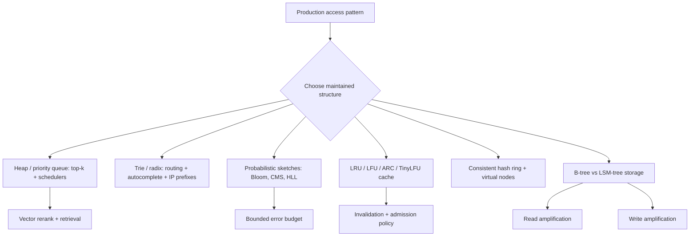

# Applied Data Structures for Backend and AI

> Topic package — Week 03+ · Roadmap Week 03+ — Applied Data Structures for Backend and AI.
> Depth goal: select and implement the production data structures that show up in backend infrastructure, databases, caches, stream processing, and LLM/vector retrieval systems — with realistic error bounds, memory costs, and failure modes.

## Source
- Track: Software Engineering (self-directed, FDE roadmap)
- Slide deck: `07 Resources Library/Software Engineering/Slides/Lesson_07_Applied_Data_Structures_for_Backend_and_AI.pptx`
- Hands-on notebook: `07 Resources Library/Software Engineering/Notebooks/07_Applied_Data_Structures_for_Backend_and_AI.ipynb` (runs offline)
- Reference reading: Designing Data-Intensive Applications; Redis internals; RocksDB and Cassandra architecture notes; Caffeine TinyLFU papers; Flajolet HyperLogLog; Bloom filter and Cuckoo filter papers; Dynamo consistent hashing and Merkle anti-entropy; PostgreSQL B-tree indexes
- Builds on: [[02 Literature Notes/Software Engineering/Data Structures, Algorithms & Complexity]]
- Date: 2026-07-18

---

## 1. Mental Model

**Production DSA is not about reciting structures; it is about choosing the state shape that preserves latency, memory, and correctness when data stops fitting in one request.** Backends use heaps for top-k and schedulers, tries for prefixes, sketches for approximate telemetry, caches for repeated work, consistent hashing for placement, and storage trees for read/write tradeoffs.

The key distinction is exact versus approximate, in-memory versus persisted, and per-request versus continuously maintained. A Bloom filter saves disk reads by accepting a tunable false-positive rate; a Count-Min Sketch gives frequency estimates with one-sided error; HyperLogLog trades exact counts for fixed memory; a heap avoids sorting all candidates when only the best k matter.

> Key intuition: **make the common query cheap, then name the approximation, invalidation, or write-amplification cost you accepted.**



---

## 2. How It Actually Works

### 3+.1 Top-k, priority, and prefix structures in hot paths
A heap is the production answer when you need the best `k` out of `n` without ordering the whole collection. Full sort is `O(n log n)`; heap top-k is `O(n log k)` and keeps only `k` candidates. In vector retrieval reranking, `n=100_000` candidates and `k=20` is common enough that avoiding a full sort saves CPU and memory churn. The same priority-queue pattern powers task schedulers, delayed retries, and Dijkstra-style routing.

Tries and radix trees optimize prefix lookup: HTTP routers, autocomplete, feature-flag namespaces, and longest-prefix IP routing. A naive trie can be pointer-heavy; radix compression collapses single-child chains to reduce memory. The tradeoff is implementation complexity and update cost versus predictable `O(length_of_key)` lookup independent of total routes.

### 3+.2 Probabilistic membership and frequency sketches
Bloom filters answer set membership with **no false negatives** and a tunable false-positive probability `p ≈ (1 - e^{-kn/m})^k`, where `m` is bits, `k` hash functions, and `n` inserted keys. Teams put them in front of object stores, RocksDB SSTables, duplicate checks, and crawler frontiers to avoid expensive negative lookups. Counting Bloom filters add counters so deletes are possible; Cuckoo filters support deletion and often better practical lookup locality.

Count-Min Sketch estimates frequencies with one-sided overcount error. It is useful for heavy hitters, abuse detection, cache admission, and telemetry when exact per-key maps would explode memory. The production move is to set a memory budget and error budget explicitly, then validate the sketch against a sample of exact counts.

### 3+.3 Cardinality, clustering, and streaming windows
HyperLogLog estimates unique counts using fixed memory: around 1.04/sqrt(m) relative standard error for `m` registers. With 16,384 registers the error is roughly 0.8%, which is often good enough for unique users, unique documents, and deduped embeddings where exact sets would cost gigabytes.

Union-find tracks connectivity with near-constant amortized operations when using path compression and union by rank. It appears in near-duplicate clustering, connected components, image/document grouping, and incremental graph construction. Sliding-window and two-pointer patterns power rate limiters, rolling metrics, stream joins, and chunk-window generation; the real requirement is an eviction rule tied to event time or monotonic processing time.

### 3+.4 Cache eviction and distributed placement
LRU is simple and good for recency-heavy workloads, but it fails on scans that evict the working set. LFU keeps frequent keys but can retain stale popularity. ARC adapts between recency and frequency; TinyLFU uses a frequency sketch for admission so one-hit wonders do not displace valuable entries. Caffeine's W-TinyLFU pattern is a named production design: small admission window plus sketch-based admission plus segmented eviction.

Consistent hashing maps keys to nodes so adding/removing a node moves roughly `1/N` of keys instead of reshuffling everything. Virtual nodes smooth load imbalance; hundreds of vnodes per physical node are common in caches and sharded services. The tradeoff is operational: placement becomes stable, but hot keys, uneven node capacity, and replica selection still need monitoring.

### 3+.5 Storage trees, integrity trees, and database tradeoffs
B-trees optimize ordered reads and point/range lookups with page-friendly fanout; they underpin Postgres indexes. Writes update pages in place and can pay random I/O and page splits. LSM-trees optimize writes by appending to memtables and immutable sorted files, then compacting later; Cassandra and RocksDB accept read amplification and compaction debt for high write throughput.

Skip lists provide ordered operations with probabilistic levels and simpler concurrent updates; Redis sorted sets use skip-list-like internals. Merkle trees hash subtrees so replicas can compare ranges efficiently; Git, Dynamo anti-entropy, and blockchains use this integrity pattern. These structures are not interchangeable: choose by read/write ratio, range-query needs, compaction budget, and repair model.

---

## 3. Implementation

Assumed stack: Python stdlib plus numpy for local vector-score generation. Snippets demonstrate approximate membership and heap-based retrieval without network access. Snippets:
- [[04 Code Snippets/Software Engineering/SE Week 03+ Bloom Filter False Positive Demo]]
- [[04 Code Snippets/Software Engineering/SE Week 03+ Heap Top K Vector Retriever]]

### SE Week 03+ Bloom Filter False Positive Demo
A small Bloom filter with double hashing and an empirical false-positive rate compared to the theoretical formula.
```python
import hashlib, math, random

class BloomFilter:
    def __init__(self, bits, hashes):
        self.bits = bits
        self.hashes = hashes
        self.array = bytearray((bits + 7) // 8)

    def _indexes(self, item):
        digest = hashlib.sha256(str(item).encode()).digest()
        h1 = int.from_bytes(digest[:8], 'big')
        h2 = int.from_bytes(digest[8:16], 'big') or 1
        for i in range(self.hashes):
            yield (h1 + i * h2) % self.bits

    def add(self, item):
        for idx in self._indexes(item):
            self.array[idx // 8] |= 1 << (idx % 8)

    def __contains__(self, item):
        return all(self.array[idx // 8] & (1 << (idx % 8)) for idx in self._indexes(item))

n, m, k = 5_000, 80_000, 7
bf = BloomFilter(bits=m, hashes=k)
for i in range(n):
    bf.add(f'user:{i}')

trials = 20_000
false_pos = sum(1 for i in range(n, n + trials) if f'user:{i}' in bf)
empirical = false_pos / trials
theoretical = (1 - math.exp(-k * n / m)) ** k
print(f'empirical={empirical:.4f} theoretical={theoretical:.4f}')
print('false negatives:', sum(1 for i in range(n) if f'user:{i}' not in bf))
```

### SE Week 03+ Heap Top K Vector Retriever
Use heapq.nlargest over numpy similarity scores so retrieval keeps only k winners instead of sorting every candidate.
```python
import heapq
import numpy as np

rng = np.random.default_rng(7)
doc_ids = np.array([f'doc-{i}' for i in range(50_000)])
scores = rng.random(len(doc_ids))
k = 5

def topk_heap(ids, scores, k):
    pairs = zip(scores.tolist(), ids.tolist())
    return [(doc_id, score) for score, doc_id in heapq.nlargest(k, pairs)]

def topk_sort(ids, scores, k):
    order = np.argsort(scores)[-k:][::-1]
    return [(ids[i], float(scores[i])) for i in order]

heap_result = topk_heap(doc_ids, scores, k)
sort_result = topk_sort(doc_ids, scores, k)
print(heap_result)
print('same ids:', [d for d, _ in heap_result] == [d for d, _ in sort_result])
print('heap keeps O(k) winners; full sort orders all n candidates')
```

---

## 4. Design Decisions & Tradeoffs

| Decision | Guidance |
|---|---|
| **Exact vs approximate** | Use exact sets/maps when correctness requires it; use Bloom, CMS, or HLL when memory is bounded and false positives or small error are acceptable and measured. |
| **Heap vs full sort** | Use heap top-k for large `n` and small `k`; use full sort when you need complete ordering, stable tie behavior, or repeated range scans. |
| **Trie vs hash lookup** | Use tries/radix trees for prefix and longest-prefix queries; use hash maps for exact-key lookup with lower implementation complexity. |
| **LRU vs TinyLFU** | Use LRU for simple recency workloads; use TinyLFU-style admission when scans or one-hit keys evict valuable cached entries. |
| **B-tree vs LSM-tree** | Choose B-tree for read-heavy ordered/range workloads; choose LSM when write throughput matters and compaction/read amplification are acceptable. |
| **Consistent hashing strategy** | Use virtual nodes and capacity weights for shard/cache placement; separately handle hot-key replication and rebalance observability. |

---

## 5. Failure Modes & Gotchas

- Using a Bloom filter as an authorization or deletion source of truth → false positives grant or retain access incorrectly.
- Full-sorting every vector candidate for top-10 retrieval → CPU spikes and p99 latency regressions as corpus size grows.
- Letting an LRU cache absorb one-time scans → the working set is evicted and downstream databases see a thundering herd.
- Adding a shard without consistent hashing or migration planning → most cache keys move and warm capacity disappears at once.
- Choosing an LSM store for range-heavy read paths without budgeting compaction and read amplification → tail latency cliffs.
- Implementing sliding windows by wall-clock timestamps without monotonic/event-time rules → duplicate or missing rate-limit decisions under clock skew.

---

## 6. FDE Angle

- Vector search systems use heap top-k, approximate membership, cache admission, and shard placement on every RAG path; FDEs must explain latency and recall tradeoffs to clients.
- Enterprise AI ingestion needs dedupe and near-duplicate clustering; Bloom filters, HLL, and union-find turn impossible exact bookkeeping into bounded-memory workflows.
- LLM job platforms depend on priority queues, idempotent schedulers, consistent hashing, and cache policies to keep tenant workloads fair and predictable.
- When choosing storage for embeddings, chunks, traces, or audit logs, the B-tree versus LSM decision becomes a product SLA decision: read latency, write rate, retention, and repair.

---

## 7. Self-Check

1. Why is heap top-k `O(n log k)` and when does that beat sorting?
2. What are the false-positive and false-negative guarantees of a Bloom filter?
3. When would Counting Bloom or Cuckoo filters beat a plain Bloom filter?
4. How does TinyLFU protect a cache from scan pollution?
5. What moves when a node is added to a consistent-hash ring with virtual nodes?
6. Why does an LSM-tree improve writes while creating compaction and read-amplification risk?

---

## 9. Interview Q&A

**Q: Why is heap top-k O(n log k) rather than O(n log n), and why does that difference actually matter at production scale (e.g., n=100,000, k=20)?**
A: A full sort has to establish the complete relative order of every single element against every other — that's fundamentally an O(n log n) problem, since you're extracting total ordering information for all n elements, including the vast majority you'll never actually look at again once you only want the top k. A heap-based top-k approach instead maintains a small heap of size k as it scans through all n elements once: for each element, it does O(log k) work to decide whether this element belongs in the current top-k set (comparing against the heap's current minimum, and if better, replacing it and re-heapifying) — crucially, the heap's internal size never exceeds k, so each individual operation's cost is bounded by log k, not log n, regardless of how large the full candidate set n actually is.

The gap between O(n log k) and O(n log n) is enormous specifically when k is much smaller than n, which is exactly the n=100,000, k=20 case the note describes: log(20) ≈ 4.3 versus log(100,000) ≈ 16.6 — roughly a 4x reduction in the per-element work, on top of the heap never needing memory proportional to the full candidate set (it only ever holds k=20 items, not 100,000). At real production scale, with this happening on every single retrieval request, that's the difference between CPU and memory cost that scales with the full candidate pool size versus cost that scales with the (typically small, fixed) number of results actually needed — which is precisely why the note's failure mode calls out "full-sorting every vector candidate for top-10 retrieval" as a specific, real production latency regression as corpus size grows, since a full sort's cost keeps growing with n even though the actual answer only ever needed k results.

*One-liner: a full sort does O(n log n) work to establish complete ordering across all n elements even though only k are ever used, while heap top-k maintains a heap bounded at size k throughout the scan, so each of the n elements costs only O(log k) — with k≪n (like k=20 out of 100,000 candidates), this is roughly a 4x reduction in per-element work plus memory bounded at k instead of n, which is exactly why full-sorting every retrieval candidate becomes a real, growing latency regression as corpus size increases while heap top-k's cost stays tied to the small, fixed k actually needed.*

**Q: What are the actual false-positive and false-negative guarantees of a Bloom filter, and why does that asymmetry make it dangerous to use as an authorization or deletion source of truth?**
A: A Bloom filter has a hard, structural guarantee of **zero false negatives** — if an item was actually inserted, checking membership will always correctly report "yes, this is in the set," because every bit position that insertion sets stays set, and membership checking just verifies all those same positions are still set. What it does *not* guarantee is zero false positives — because multiple different items can hash to overlapping bit positions, it's possible (at a known, tunable probability, based on the ratio of bits to inserted items and the number of hash functions used) for an item that was *never* actually inserted to still have all its corresponding bit positions happen to already be set by other items, causing the filter to incorrectly report "yes, this is in the set" for something that genuinely isn't.

This asymmetry is exactly why using a Bloom filter as a source of truth for authorization or deletion is dangerous in a specific, concrete way: a false positive on an authorization check means granting access to something that was never actually authorized — an item that was never explicitly inserted into the "allowed" set nevertheless reports as a member, due to collision with other inserted items' bit patterns. Similarly for deletion: a plain Bloom filter structurally cannot support deletion at all (clearing a bit for one item might also incorrectly un-set a bit another, still-valid item depends on, since bits are shared across colliding items) — so using one as evidence that something "has been deleted" is unreliable in exactly the direction that matters for correctness. A Bloom filter is appropriate specifically as a fast, cheap *pre-filter* in front of an authoritative source ("definitely not in the set, skip the expensive lookup" is always trustworthy; "possibly in the set, go check the real source" is the correct way to handle a positive result) — never as the actual, final answer to a security-sensitive question.

*One-liner: a Bloom filter guarantees zero false negatives (if it was inserted, membership always correctly says yes) but allows a known, tunable rate of false positives (something never inserted can still incorrectly report as a member due to bit-position collisions) — using it as an authorization or deletion source of truth is dangerous specifically because a false positive means granting access, or treating something as deleted, when the real answer should have been no, which is exactly the direction that matters for security correctness; it belongs as a fast pre-filter in front of an authoritative source, not as the final answer itself.*

**Q: When would Counting Bloom filters or Cuckoo filters actually beat a plain Bloom filter — what specific capability gap are they closing?**
A: A plain Bloom filter's bit array only ever stores a single bit per hashed position — set or unset — which means it fundamentally cannot support deletion: to "remove" an item, you'd need to clear the bits its hash functions point to, but those exact same bit positions may also be shared (due to hash collisions) by other, still-valid items currently in the set — clearing them would silently and incorrectly make those other items appear absent too, with no way to detect that this happened. This is a structural limitation of the plain-bit design, not a missing feature that could be bolted on without changing the underlying representation.

A Counting Bloom filter directly fixes this by replacing each single bit with a small counter — inserting an item increments the relevant counters, and deleting decrements them, so a bit position only truly "clears" once every item that set it has also been removed; this costs more memory per slot (a counter instead of a single bit) in exchange for supporting deletion at all. Cuckoo filters take a different approach — storing a small fingerprint of each item (rather than just setting shared bits) in one of a small number of candidate buckets (using cuckoo hashing's "if your bucket's full, evict the occupant to its alternate bucket" mechanism) — which supports deletion naturally (just remove the matching fingerprint from its bucket) and, in practice, often achieves better lookup performance and memory locality than Counting Bloom filters at comparable false-positive rates, since fingerprint comparison in a small set of candidate buckets tends to have better cache behavior than probing several scattered bit/counter positions across a large array. The deciding question for choosing between them is simply: does this workload need deletion at all (plain Bloom filters are simpler and more memory-efficient when it genuinely doesn't), and if so, is memory efficiency or lookup locality/performance the higher priority (Counting Bloom vs. Cuckoo, respectively, as a rough guide).

*One-liner: a plain Bloom filter's shared, single-bit-per-position design structurally cannot support deletion (clearing a bit might silently un-set other still-valid items sharing that bit from hash collisions) — Counting Bloom filters fix this with per-slot counters (costing more memory, supporting deletion via increment/decrement), while Cuckoo filters take a different fingerprint-in-a-bucket approach that supports deletion naturally and often achieves better lookup locality/performance, making the real decision "does this workload need deletion, and if so, is memory efficiency or lookup performance the higher priority."*

**Q: How does TinyLFU specifically protect a cache from scan pollution in a way that plain LRU can't?**
A: Plain LRU's eviction rule is purely about recency — the least-recently-used item gets evicted to make room for whatever was just accessed, with zero regard for how often that evicted item has historically been accessed versus the new item displacing it. This becomes a real problem during a scan — a one-time pass over a large range of keys that are each touched exactly once and never again — because every single key in that scan is, by definition, "most recently used" at the moment it's touched, which means a scan can evict an entire cache's worth of genuinely valuable, frequently-reused entries (the actual working set the cache exists to protect) in favor of one-hit-wonder keys that will never be accessed again, purely because recency alone can't distinguish "accessed once, never again" from "accessed once, about to become part of the regular working set."

TinyLFU addresses this specifically at the *admission* decision, not just the eviction decision — before a new key is even let into the cache's main space at all, TinyLFU checks a compact frequency sketch (a Count-Min-Sketch-style structure, the same frequency-estimation idea the note covers elsewhere) tracking historical access frequency, and compares the new candidate's estimated frequency against the frequency of whatever item would need to be evicted to make room for it. If the new candidate has a lower estimated historical frequency than the item it would displace, TinyLFU can simply refuse admission — the one-hit-wonder key from a scan never even enters the cache's protected main space in the first place, because its (correctly estimated, near-zero) historical frequency loses the comparison against whatever genuinely-popular item currently occupies that slot. This is the mechanism that lets a scan pass through the cache without actually displacing the real working set — recency alone (plain LRU) has no comparable concept of "has this actually been popular over time," which is exactly the signal needed to tell a genuinely valuable cached item apart from a transient scan key.

*One-liner: plain LRU's eviction is based purely on recency, which means a scan touching many keys exactly once can look "most recently used" and evict an entire genuinely-valuable working set — TinyLFU instead gates admission itself using a frequency sketch tracking historical access counts, refusing to admit a new candidate if its estimated frequency loses against whatever popular item it would displace, which is precisely the signal (sustained popularity, not just recency) that lets it distinguish real working-set entries from one-hit scan keys and keep the latter from ever displacing the former.*

**Q: What actually moves when a node is added to a consistent-hash ring, and why do virtual nodes matter for that answer to hold up in practice?**
A: In a naive hashing scheme (e.g., `node = hash(key) % N`), adding or removing a single node changes N, which changes the result of that modulo operation for nearly every key — almost the entire keyspace gets reassigned to a different node all at once, which for a cache means almost everything becomes a cache miss simultaneously, and for a sharded store means a massive, disruptive rebalance. Consistent hashing fixes this specific problem structurally: nodes and keys are both placed on the same conceptual ring (via hashing), and each key belongs to the next node clockwise from its own position on the ring — which means adding a new node only affects the specific contiguous range of keys between the new node's ring position and the next node clockwise from it; every other key, everywhere else on the ring, is completely unaffected and stays exactly where it was. This is the mechanism behind the "only ~1/N of keys move" property: a new node only "steals" the portion of ring space immediately counter-clockwise from its own position.

Virtual nodes matter because, with only one ring position per *physical* node, the amount of keyspace each physical node ends up owning depends entirely on the random luck of where that one hash position happens to land on the ring — with a small number of physical nodes, this can produce real, uneven load (one node's single ring position happens to own a disproportionately large arc, while another's happens to own a tiny one). Giving each physical node many virtual positions scattered around the ring (hundreds, as the note mentions) averages this luck out — the aggregate keyspace a physical node owns becomes the sum of many small, independently-placed arcs rather than one single arc's luck of the draw, which smooths load distribution close to proportional/even across physical nodes, while still preserving the core "only a bounded portion of keys move when a node joins/leaves" property that makes consistent hashing worth using in the first place.

*One-liner: consistent hashing places keys and nodes on the same ring so each key belongs to the next node clockwise, which means adding a node only reassigns the specific keyspace range immediately before its ring position — not the entire keyspace, unlike naive modulo hashing — and virtual nodes matter because a single ring position per physical node leaves load distribution to the luck of where that one position lands, while many virtual positions per physical node average that luck out into a smooth, near-even load distribution while still preserving the bounded-reassignment property.*

## 8. Links
- Domain MOC: [[06 Maps of Content/Software Engineering Concepts]]
- Code: [[04 Code Snippets/Software Engineering/SE Week 03+ Bloom Filter False Positive Demo]], [[04 Code Snippets/Software Engineering/SE Week 03+ Heap Top K Vector Retriever]]
- Distilled: [[03 Permanent Notes/SE Week 03+ Probabilistic Data Structures Cheat Sheet]], [[03 Permanent Notes/SE Week 03+ B-Tree vs LSM-Tree Decision Guide]]
- Upstream: [[02 Literature Notes/Software Engineering/Data Structures, Algorithms & Complexity]] · Downstream: [[02 Literature Notes/Software Engineering/APIs, Integration & Backend Engineering]]
