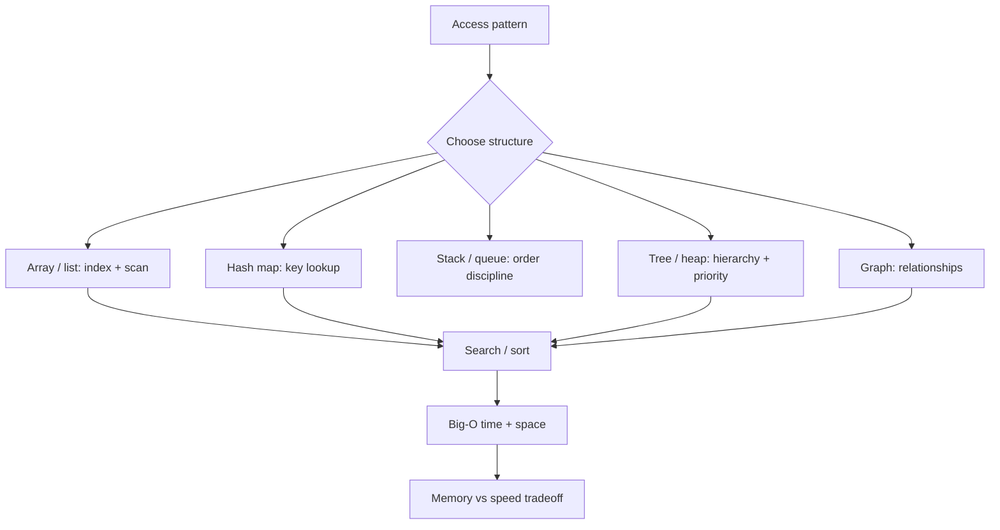

# Data Structures, Algorithms & Complexity

> Topic package — Week 03 · Roadmap Week 03 — Data Structures, Algorithms & Complexity.
> Depth goal: refresh core data structures and algorithms well enough to select the right representation, reason about Big-O time and space, and explain memory-vs-speed tradeoffs in production designs.

## Source
- Track: Software Engineering (self-directed, FDE roadmap)
- Slide deck: `07 Resources Library/Software Engineering/Slides/Lesson_03_Data_Structures,_Algorithms_&_Complexity.pptx`
- Hands-on notebook: `07 Resources Library/Software Engineering/Notebooks/03_Data_Structures,_Algorithms_&_Complexity.ipynb` (runs offline)
- Reference reading: CLRS; Algorithms (Sedgewick & Wayne); The Algorithm Design Manual (Skiena); Python TimeComplexity wiki; Designing Data-Intensive Applications chapters on indexes and data models
- Builds on: [[02 Literature Notes/Software Engineering/System Design Fundamentals]]
- Date: 2026-07-18

---

## 1. Mental Model

**Data structures are the shape of your constraints; algorithms are the cost model of your choices.** Arrays optimize contiguous scans and indexed access; hash maps optimize key lookup; stacks and queues encode processing order; trees maintain hierarchy or sorted access; graphs model relationships; search and sorting turn raw data into retrievable structure.

Big-O is not a trivia game — it is a negotiation between input growth, latency, memory, cache locality, implementation complexity, and operational risk. A theoretically faster algorithm can lose on tiny inputs or poor locality; a memory-heavy index can be correct but unaffordable; a one-pass hash map can convert nested loops into linear time by spending space.

> Key intuition: **pick the representation that makes the common operation cheap** — then verify the hidden cost in memory, constants, and worst-case behavior.



---

## 2. How It Actually Works

### 3.1 Big-O as a growth budget
Big-O describes how work grows as input grows: `O(1)` constant, `O(log n)` divide-and-conquer, `O(n)` scan, `O(n log n)` comparison sorting, `O(n^2)` pairwise comparisons, and `O(2^n)` combinatorial explosion. For engineering, it is a budget conversation: what is `n`, how large can it get, what is the p95 latency target, and which path runs per request versus offline?

Do not confuse asymptotic class with observed speed. Constants, allocation, branch prediction, cache locality, language overhead, and data distribution matter. Big-O tells you which design survives growth; benchmarks and profiling tell you whether the current implementation meets today's SLA.

### 3.2 Arrays, hash maps, stacks, and queues
Arrays/lists give compact storage, fast iteration, and `O(1)` index access, but insertion/deletion in the middle shifts elements. Hash maps trade memory and hashing cost for average `O(1)` lookup, insertion, and membership checks; they are the standard move for replacing repeated scans with a precomputed index. Collisions and adversarial keys matter at system boundaries, but most application code benefits enormously from map-based joins and dedupe.

Stacks (LIFO) and queues (FIFO) are not exotic — they encode control flow. DFS uses a stack; BFS and job processing use queues. Choosing the order discipline makes the algorithm easier to reason about and often reveals whether you need bounded memory, fairness, or shortest-path-by-edges behavior.

### 3.3 Trees, heaps, and graphs
Trees encode hierarchy and ordered search. Balanced search trees keep insert/search/delete near `O(log n)` and underpin many indexes. Heaps give `O(log n)` push/pop for priority queues, scheduling, top-k, and shortest-path algorithms. Tries optimize prefix lookup at the cost of pointer-heavy memory usage.

Graphs model arbitrary relationships: dependencies, social links, network routes, entity relationships, workflow states. The representation is a major decision. Adjacency lists are sparse and practical; adjacency matrices make edge checks `O(1)` but cost `O(V^2)` memory. BFS gives shortest path in unweighted graphs; DFS is useful for reachability, cycle detection, and topological reasoning.

### 3.4 Search and sorting as structure-building
Linear search is fine for tiny or unsorted data; binary search needs sorted data and gives `O(log n)` lookup with excellent locality. Sorting costs upfront `O(n log n)` for comparison sorts, then enables binary search, merge joins, dedupe, range queries, and predictable presentation. Python's Timsort exploits existing order, which is why real-world partially sorted data can beat textbook expectations.

The senior question is not 'which sort is fastest?' but 'should this request path sort at all?' If the same data is searched repeatedly, build and maintain an index. If the data is one-off and tiny, the simple scan may be more reliable and faster than a clever structure.

### 3.5 Memory vs speed and correctness tradeoffs
Most algorithmic wins spend memory to buy time: hash-map indexes, memoization caches, Bloom filters, precomputed sorted views, graph adjacency maps, and materialized aggregates. That memory has costs: stale data, invalidation, higher GC pressure, serialization overhead, tenant isolation, and capacity planning.

Correctness also changes with representation. Floating-point sort keys, duplicate handling, stable ordering, graph cycles, recursive depth, and mutation while iterating are real production bugs. For FDE work, explain the trade in client terms: latency saved, memory spent, freshness guarantee, and failure mode when the assumption is violated.

---

## 3. Implementation

Assumed stack: Python stdlib only. Snippets implement graph traversal and search/sort/index tradeoffs with tiny offline examples. Snippets:
- [[04 Code Snippets/Software Engineering/SE Week 03 Graph BFS DFS Traversal]]
- [[04 Code Snippets/Software Engineering/SE Week 03 Binary Search Sort and Hash Index]]

### SE Week 03 Graph BFS DFS Traversal
Adjacency-list graph traversal showing BFS shortest-hop order vs DFS reachability order.
```python
from collections import deque

graph = {
    "A": ["B", "C"],
    "B": ["D", "E"],
    "C": ["F"],
    "D": [],
    "E": ["F"],
    "F": [],
}

def bfs(start):
    seen, order, q = {start}, [], deque([start])
    while q:
        node = q.popleft()
        order.append(node)
        for nxt in graph[node]:
            if nxt not in seen:
                seen.add(nxt)
                q.append(nxt)
    return order

def dfs(start):
    seen, order, stack = set(), [], [start]
    while stack:
        node = stack.pop()
        if node in seen:
            continue
        seen.add(node)
        order.append(node)
        stack.extend(reversed(graph[node]))
    return order

print("BFS:", bfs("A"))
print("DFS:", dfs("A"))
```

### SE Week 03 Binary Search Sort and Hash Index
Compare linear scan, binary search over sorted data, and a hash-map index for repeated lookup.
```python
from bisect import bisect_left

rows = [("u3", "Chen"), ("u1", "Ada"), ("u4", "Diaz"), ("u2", "Grace")]

def linear_find(rows, user_id):
    for uid, name in rows:
        if uid == user_id:
            return name
    return None

sorted_rows = sorted(rows)
ids = [uid for uid, _ in sorted_rows]

def binary_find(user_id):
    i = bisect_left(ids, user_id)
    if i < len(ids) and ids[i] == user_id:
        return sorted_rows[i][1]
    return None

index = dict(rows)
print(linear_find(rows, "u2"), binary_find("u2"), index["u2"])
print("one-off tiny input: scan is fine; repeated lookup: build an index")
```

---

## 4. Design Decisions & Tradeoffs

| Decision | Guidance |
|---|---|
| **Representation by operation** | Start from dominant operations: indexed access, membership, ordered range, priority, traversal, or mutation; choose the structure that makes those cheap. |
| **Hash map vs scan** | Use scans for tiny one-off data and maps for repeated membership/joins/dedupe; document memory cost and key correctness. |
| **Sort vs maintain index** | Sort once for batch/range work; maintain an index when reads repeat and update complexity is acceptable. |
| **BFS vs DFS** | Use BFS for shortest unweighted path and level order; use DFS for reachability, cycle detection, and exhaustive search with stack discipline. |
| **Recursive vs iterative** | Prefer iterative traversal when depth is untrusted; recursion is elegant but risks stack limits and poor failure behavior. |
| **Benchmark vs Big-O** | Use Big-O to reject non-scaling designs, then benchmark representative inputs to catch constants, allocations, and locality effects. |

---

## 5. Failure Modes & Gotchas

- Using nested loops for joins or dedupe when a hash index would turn `O(n*m)` into `O(n+m)`.
- Sorting inside a hot request path on every call instead of precomputing or maintaining an index.
- Applying binary search to data that is not sorted by the exact key being searched.
- Using recursion for unbounded trees/graphs and hitting recursion limits or stack overflow in production data.
- Ignoring graph cycles and revisiting nodes forever or double-counting side effects.
- Quoting Big-O without measuring constants, allocation pressure, and realistic input sizes.

---

## 6. FDE Angle

- FDEs often inherit messy client data; a quick index, dedupe map, or graph traversal can turn a slow demo into a credible workflow without new infrastructure.
- Algorithm choices should be explainable to stakeholders as latency, memory, and freshness tradeoffs, not academic vocabulary.
- For AI systems, retrieval, chunk scheduling, dependency graphs, cache keys, and evaluation aggregation all depend on these fundamentals.
- Deliverable: state the expected data size, dominant operations, chosen structure, complexity, and the benchmark that proves it is good enough.

---

## 7. Self-Check

1. What operation does an array/list make cheap, and what operation does it make expensive?
2. When does a hash map convert a quadratic algorithm into a linear one?
3. Why does binary search require sorted data, and what is the upfront cost?
4. When would BFS be the right graph traversal over DFS?
5. What memory-vs-speed tradeoff are you making when you build an index?
6. Why can an `O(n)` algorithm beat an `O(log n)` algorithm on tiny inputs?

---

## 9. Interview Q&A

**Q: Why is Big-O described here as "a budget conversation" rather than just a formal classification of an algorithm — what does that framing actually change about how you'd use it in a design review?**
A: Treated as pure classification, Big-O just tells you which growth category an algorithm falls into — useful for ruling out designs that will definitely fall over at scale, but it doesn't by itself tell you whether a specific design is actually the right choice for a specific, real system. The "budget conversation" framing means the actual useful questions are concrete and contextual: what is `n` actually going to be in production (a few hundred rows, or hundreds of millions)? What's the latency target this path has to hit? Does this code run on every request, or once overnight in a batch job? An `O(n log n)` algorithm might be completely fine for an overnight batch job over millions of rows, while an `O(n)` scan might already be too slow for a hot request path if `n` is large enough and the latency budget is tight.

This matters concretely in a design review because quoting Big-O alone ("this approach is O(n log n)") answers a different question than what actually needs answering ("will this meet our p95 latency target given our actual expected data size on this specific request path"). The asymptotic class rules out designs that definitely won't scale as input grows, but it's silent on whether the current, specific input size and latency target are actually satisfied by a given implementation's real constants and overhead — that's a benchmark question, not a Big-O question, and conflating the two is exactly the mistake the note's Failure Modes section calls out ("quoting Big-O without measuring constants, allocation pressure, and realistic input sizes").

*One-liner: Big-O alone tells you which designs will definitely fail as input grows, but says nothing about whether a specific design actually meets a specific latency target at a specific, real data size — the "budget conversation" framing is what turns an abstract growth classification into the concrete design-review question that actually matters: given our real n and our real latency target, is this fast enough, and that's a benchmark question Big-O can't answer by itself.*

**Q: Give a concrete example of when a hash map converts a quadratic algorithm into a linear one, and explain mechanically why that works.**
A: The classic case is finding matching pairs between two collections — say, checking which of 1,000 customer IDs from one system also appear in 1,000 customer IDs from another system. The naive approach is a nested loop: for each of the 1,000 IDs in the first list, scan through all 1,000 IDs in the second list looking for a match — that's 1,000 × 1,000 = 1,000,000 comparisons in the worst case, which is `O(n×m)`, quadratic when both collections are roughly the same size.

Building a hash map from the second collection first (mapping each ID to, say, `True`, or to the associated record) costs `O(m)` time and `O(m)` memory upfront — one pass through the second collection. But then, checking whether each of the 1,000 IDs from the first collection exists in that hash map is an average `O(1)` lookup per check (hash maps give average-case constant-time membership testing), so checking all 1,000 IDs from the first collection against the map costs `O(n)` total. The total cost becomes `O(n + m)` — build the map once, then one linear pass checking membership — instead of `O(n×m)` from the nested-loop approach. The mechanism is precisely trading the repeated linear scan (checking membership by scanning, which is `O(m)` per check, done `n` times) for a single upfront investment (building the map once) that turns every subsequent membership check into `O(1)`.

*One-liner: a nested loop checking membership between two collections costs `O(n×m)` because each of the n items triggers a full O(m) scan of the other collection — building a hash map from one collection first (O(m) upfront) turns every subsequent membership check into average O(1), so checking all n items costs O(n) total, making the whole operation O(n+m) instead of O(n×m) — the mechanism is trading repeated linear scans for one upfront index-building cost.*

**Q: Why does binary search specifically require sorted data, and what's the actual upfront cost you're paying to use it?**
A: Binary search works by repeatedly eliminating half of the remaining search space with each comparison — look at the middle element, and because the data is sorted, you know with certainty that everything on one side of that middle element is either all smaller or all larger than your target, which means you can discard that entire half without checking any of it individually. This is precisely what sorted order buys you: a guarantee that lets you reason about an entire half of the data based on a single comparison, rather than needing to actually inspect each element to know whether it could possibly be the match.

On unsorted data, this guarantee doesn't hold — the target could be anywhere, since there's no structural relationship between position and value telling you which half to discard, so you'd have to check elements individually (a linear scan) rather than being able to eliminate half the remaining candidates with each comparison. The upfront cost of getting to use binary search at all is the sort itself — comparison-based sorting costs `O(n log n)`, paid once, before binary search's `O(log n)` per-lookup benefit becomes available. This is only worth paying when the sorted order will be reused across many subsequent lookups; if you're searching a dataset exactly once and then discarding it, the `O(n log n)` sort cost plus `O(log n)` search is strictly worse than just doing one `O(n)` linear scan directly — the sort only pays for itself across repeated searches.

*One-liner: binary search eliminates half the remaining candidates per comparison specifically because sorted order guarantees everything on one side of the midpoint is uniformly smaller or larger — unsorted data has no such structural guarantee, so you'd have to inspect elements individually instead; the upfront cost to unlock this is the O(n log n) sort itself, which only pays for itself if the sorted order gets reused across many subsequent searches rather than a single one-off lookup.*

**Q: When would BFS actually be the right choice over DFS for a graph traversal, beyond "BFS finds shortest path"?**
A: BFS explores level by level — it visits every node at distance 1 from the start before visiting any node at distance 2, which is precisely why it's guaranteed to find the shortest path (measured in number of edges, in an unweighted graph): the first time BFS reaches a given node, it's necessarily via the fewest possible edges, since every node at a shorter distance was already fully explored first. This makes BFS the right choice whenever the actual question is "what's the minimum number of hops/steps between two nodes" — closest connection in a social graph, minimum number of service calls in a dependency chain, fewest moves in a puzzle-state graph.

BFS is also the natural fit whenever you need "level order" information more broadly, not just shortest path to one target — e.g., "what can be reached in at most 2 hops from this node" is a natural question for BFS (since it processes nodes in order of increasing distance, you can simply stop after exhausting a given level), where DFS would need extra bookkeeping to track depth consistently since it plunges deep into one branch before backtracking rather than processing uniformly by distance. DFS, by contrast, is the right tool when the actual question isn't about distance at all — reachability (can you get from A to B at all, regardless of path length), cycle detection (does following edges ever lead back to a node already on the current path), or topological ordering (a valid sequence respecting dependency edges) — none of which care about shortest path, and all of which DFS's "go deep, backtrack, try the next branch" structure handles naturally and with less memory overhead than BFS's level-by-level frontier for a path-length-insensitive question.

*One-liner: BFS explores strictly by increasing distance from the start, which is exactly why it's the right choice whenever the actual question involves "fewest hops" or "what's reachable within N steps" — DFS is the right choice when the question isn't about distance at all (reachability, cycle detection, topological ordering), where BFS's level-by-level exploration offers no benefit and DFS's deeper-first structure handles the question more naturally and with less memory overhead.*

**Q: The note says most algorithmic wins "spend memory to buy time" — walk through what you're actually trading away when you build an index or cache, beyond the raw memory bytes.**
A: The memory itself is only the most visible cost; the less visible costs are what actually tend to bite in production. First, there's a freshness/correctness obligation: any index, cache, or memoized value is a copy, or a derived summary, of some underlying source of truth — and the moment that source changes, the derived copy is stale until something actively updates or invalidates it. Building the index is easy; keeping it correct as the underlying data changes is the actual ongoing engineering cost, and a missed invalidation path produces a bug that's specifically hard to catch because the system still runs and still returns *an* answer — just a wrong, stale one, with no error to flag it.

Second, there's a complexity cost that compounds with every additional derived structure: each index/cache is one more thing that can get out of sync with the source of truth, one more thing to reason about during a debugging session ("is this reading from the fresh source or the cached copy?"), and one more piece of state to account for during concurrent writes (what happens if two requests are updating the source data and the cache at the same time?). Third, there's an often-underestimated operational cost: more memory pressure can mean more garbage-collection overhead (in GC'd languages), more serialization/deserialization cost if the cache lives outside process memory, and — in multi-tenant systems — real questions about whether one tenant's large cached dataset can degrade performance or availability for other tenants sharing the same memory budget. None of these show up in a simple "O(n) extra memory" accounting, which is exactly why the tradeoff needs to be reasoned about explicitly, not treated as "memory is cheap, just cache it."

*One-liner: the memory bytes themselves are the most visible cost of an index/cache, but the real ongoing costs are a freshness obligation (someone has to keep the derived copy in sync with the source, and a missed invalidation produces a silently-wrong-but-still-running system), added debugging/concurrency complexity (now there are two things that can disagree), and operational costs like GC pressure and multi-tenant memory contention — none of which show up in a simple "O(n) extra space" accounting, which is why the tradeoff needs explicit reasoning rather than a blanket "memory is cheap" assumption.*

**Q: Why can an O(n) algorithm actually beat an O(log n) algorithm on tiny inputs — doesn't a "better" asymptotic class always win?**
A: Big-O describes how cost *grows* as input size increases toward infinity — it deliberately ignores constant factors (a fixed per-operation overhead that doesn't change with n) because, at large enough n, the growth rate dominates regardless of the constant. But "large enough n" is doing real work in that sentence — at small n, the constant factor can easily be the dominant term in actual wall-clock time, not the asymptotic growth rate, since the growth rate hasn't had enough input size to actually assert itself yet.

Concretely: an O(log n) algorithm like binary search requires sorted data (the upfront O(n log n) sort cost from an earlier question) plus has real per-step overhead — computing a midpoint, a comparison, a branch, updating two boundary pointers — that's genuinely more work per step than a simple O(n) linear scan's single comparison-and-advance per element. At n=10, a linear scan might do at most 10 simple comparisons total, while binary search's per-step overhead (even doing only ~4 steps, since log2(10) ≈ 3.3) could easily cost more in actual CPU cycles than those 10 simple comparisons, especially once you also account for the sort that had to happen first to make binary search valid at all. The crossover point — where the asymptotically "better" algorithm actually starts winning in real measured time — depends entirely on the actual constants involved for that specific implementation and hardware, which is exactly why the note insists on benchmarking representative inputs rather than picking an algorithm by asymptotic class alone.

*One-liner: Big-O deliberately ignores constant per-operation overhead because it only matters asymptotically "at large enough n" — but at genuinely small n, that ignored constant can dominate actual wall-clock time more than the growth rate does, so a "worse" O(n) algorithm with cheap, simple per-step work can genuinely outperform a "better" O(log n) algorithm whose per-step overhead (plus, for binary search, an upfront sort) hasn't been amortized away yet by a large enough input.*

## 10. Live-Coding Interview Questions

Everything above is explain-the-concept depth; this section is the other real interview format — write working code, live, under time pressure, then defend its complexity. These two are classic FAANG-style screening questions precisely because they look trivial at first glance but reward (or expose the lack of) real data-structure instinct.

**Q: Write a function `find_bigrams` that takes a string and returns a list of all its bigrams (consecutive word pairs).**
A: A bigram here means every pair of adjacent words in the sentence — "the quick brown fox" has bigrams ("the","quick"), ("quick","brown"), ("brown","fox"). The direct approach: split the string into words, then walk through consecutive index pairs.

```python
def find_bigrams(s):
    words = s.split()
    return [(words[i], words[i + 1]) for i in range(len(words) - 1)]

print(find_bigrams("the quick brown fox"))
# [('the', 'quick'), ('quick', 'brown'), ('brown', 'fox')]
```

The interview-relevant detail isn't the split/loop itself — it's correctly handling the boundary: `range(len(words) - 1)` deliberately stops one short of the last word, since the last word has no following word to pair with. An off-by-one here (`range(len(words))`) would throw an `IndexError` on the final iteration — exactly the kind of boundary bug a live-coding interviewer is watching for, more than whether you know what a bigram is.

*One-liner: a bigram-finder is really a test of boundary handling, not vocabulary — the entire question hinges on correctly stopping the loop one index short of the last word, since that word has nothing left to pair with.*

**Q: Given two strings A and B, write a function `can_shift` that returns whether A can be shifted (rotated) some number of places to produce B — without actually generating and checking every possible rotation.**
A: The brute-force approach — generate every rotation of A (shift by 1, by 2, ... by len(A)-1) and check if any equals B — works, but it's doing unnecessary, repeated string-building work and is the "I can solve it, but slowly and without the trick" answer. The trick: any rotation of A is, by definition, a substring of `A + A` (A concatenated with itself) — concatenating A with itself lays out every possible rotation's starting point, back to back, in one string, so checking "is B a rotation of A" reduces to "is B a substring of A+A."

```python
def can_shift(a, b):
    if len(a) != len(b):
        return False
    return b in (a + a)

print(can_shift("waterbottle", "erbottlewat"))  # True
print(can_shift("hello", "llohe"))               # True
print(can_shift("hello", "world"))               # False
```

The length check at the top isn't an edge-case afterthought — it's load-bearing: without it, a shorter string could spuriously test as "contained in" `a + a` purely by accident of character overlap, without actually being a genuine rotation of `a` at all (e.g. `can_shift("abc", "ab")` must return `False`, and skipping the length check risks a false positive if `"ab"` happens to appear inside `"abcabc"` — which it does, incorrectly). This problem is a good interview signal specifically because the "obviously correct but slow" brute-force solution and the "one-line but requires a real insight" solution are both fully valid things to say out loud — talking through *why* `A+A` captures every rotation, not just stating the trick, is what actually demonstrates understanding rather than memorized recall of the pattern.

*One-liner: checking whether B is a rotation of A reduces to checking whether B is a substring of A+A, since concatenating A with itself lays out every possible rotation point in one string — but the length-equality check isn't optional cleanup, it's what prevents a spurious substring match from masquerading as a genuine rotation.*

## 8. Links
- Domain MOC: [[06 Maps of Content/Software Engineering Concepts]]
- Code: [[04 Code Snippets/Software Engineering/SE Week 03 Graph BFS DFS Traversal]], [[04 Code Snippets/Software Engineering/SE Week 03 Binary Search Sort and Hash Index]]
- Distilled: [[03 Permanent Notes/SE Week 03 Big-O Complexity Cheat Sheet]], [[03 Permanent Notes/SE Week 03 Choosing the Right Data Structure]]
- Upstream: [[02 Literature Notes/Software Engineering/System Design Fundamentals]] · Downstream: [[02 Literature Notes/Software Engineering/APIs, Integration & Backend Engineering]]
