# Distributed Systems Reality

> Topic package — Week 02+ · Roadmap Week 02+ — Distributed Systems Reality.
> Depth goal: reason about distributed systems the way production teams debug them: explicit consistency guarantees, idempotent APIs, reliable event publication, failure isolation, backpressure, cache protection, shard placement, quorum tradeoffs, and capacity budgets.

## Source
- Track: Software Engineering (self-directed, FDE roadmap)
- Slide deck: `07 Resources Library/Software Engineering/Slides/Lesson_06_Distributed_Systems_Reality.pptx`
- Hands-on notebook: `07 Resources Library/Software Engineering/Notebooks/06_Distributed_Systems_Reality.ipynb` (runs offline)
- Reference reading: Designing Data-Intensive Applications (Kleppmann); Release It! (Nygard); Google SRE Book; DynamoDB, Cassandra, Spanner, Postgres, Kafka, SQS, Redis documentation; Stripe idempotency-key docs; Transactional Outbox and Saga pattern references; Raft visualizations
- Builds on: [[02 Literature Notes/Software Engineering/System Design Fundamentals]]
- Date: 2026-07-18

---

## 1. Mental Model

**A distributed system is a set of partial failures pretending to be one product.** The hard parts are not only algorithms; they are retries, duplicate messages, stale reads, lock contention, queue lag, hot keys, slow dependencies, and humans trying to infer truth from incomplete telemetry during an incident.

Production teams survive by choosing explicit contracts: consistency level, idempotency behavior, event publication path, retry budget, circuit-breaker threshold, load-shedding rule, cache-stampede defense, and rollback/compensation story. CAP and PACELC matter because they force teams to say what users see during partitions and what latency they pay when the system is healthy.

> Key intuition: **make duplicate, delayed, reordered, and missing work safe by design** — then failure becomes a controlled mode, not a surprise.

```mermaid
flowchart LR
    API[API request] --> IDEMP[Idempotency key store]
    IDEMP --> DB[(Postgres transaction)]
    DB --> OUTBOX[(Outbox table)]
    OUTBOX --> RELAY[Publisher relay]
    RELAY --> BUS[Kafka / SQS]
    BUS --> WORKER[Idempotent consumer]
    WORKER --> EXT[Model/provider/client API]
    EXT -. slow/fail .-> CB[Circuit breaker + bulkhead]
    CACHE[(Redis cache)] -. stampede protected .-> API
```



---

## 2. How It Actually Works

### 2+.1 CAP, PACELC, and consistency users can feel
CAP is useful only when tied to an actual partition decision: during a network split, do you reject writes to preserve consistency or accept writes and reconcile later? PACELC adds the normal-case cost: Else, when there is no partition, do you trade Latency for Consistency? Spanner pays coordination latency for external consistency; DynamoDB defaults to eventually consistent reads but offers strongly consistent reads in a region; Cassandra lets teams tune `ONE`, `QUORUM`, or `ALL` per operation.

Concrete guarantees matter: Postgres Serializable prevents anomalies at the cost of retries; Repeatable Read avoids non-repeatable reads but can still require careful write-conflict handling. Read-your-writes and monotonic reads are often more important to users than abstract strong consistency labels.

### 2+.2 Idempotency keys, outbox, and the end of naive dual writes
Stripe-style idempotency stores the request key, parameter hash, response body, status, and expiry. On retry, the server returns the cached response instead of performing the side effect again; if parameters differ for the same key, return a conflict. TTLs are commonly 24 hours for payments, but internal workflows may need longer based on retry windows and audit rules.

The transactional outbox fixes dual-write inconsistency: write business state and an outbox row in the same Postgres transaction, then a relay publishes to Kafka or SQS and marks the row sent. This trades immediate publish simplicity for at-least-once delivery, so consumers still need idempotent handlers.

### 2+.3 Sagas, CQRS, and event sourcing without mythology
When one workflow spans services, avoid distributed transactions unless the infrastructure truly supports them. A saga models each step plus compensating action: reserve credit, create shipment, capture payment; if capture fails, release shipment and credit. Choreography uses events and local reactions but can become hard to trace; orchestration centralizes state and timeouts but creates a coordinating service.

CQRS separates write models from read models when query shape and write invariants diverge. Event sourcing stores facts as the source of truth, which helps audit and replay but complicates schema evolution, GDPR deletion, and debugging. Use it for real audit/rebuild needs, not because append-only sounds elegant.

### 2+.4 Resilience: circuit breakers, bulkheads, load shedding, and backpressure
A circuit breaker has closed, open, and half-open states: after N failures or high error rate, stop calling the dependency for a cool-down; then allow a small probe before closing. Resilience4j/Hystrix-style breakers should sit with timeouts, retry budgets, and bulkheads so one slow model provider or client API does not consume every worker thread.

Backpressure is a contract for overload. Token buckets limit requests by rate; credit-based flow control lets consumers advertise capacity; reactive streams use bounded demand. If queues grow faster than workers drain, shed optional work, return 429/503 with retry-after, or degrade quality before p99 latency collapses.

### 2+.5 Caches, consistent hashing, quorum, and capacity math
Cache stampedes happen when a hot key expires and 5,000 requests recompute it simultaneously. Defenses include request coalescing, jittered TTLs, probabilistic early expiration, stale-while-revalidate, and single-flight locks. Redis Sentinel gives failover for a primary/replica deployment; Redis Cluster shards keys and changes client behavior during resharding.

Capacity math catches impossible designs early: 2,000 QPS × 20 KB responses ≈ 40 MB/s before TLS/HTTP overhead; 50 million events/day × 2 KB ≈ 100 GB/day raw; a 300 ms p99 budget might leave only 80 ms for an LLM provider after auth, retrieval, reranking, and serialization. Quorum systems use `R + W > N` for overlap, but leader election and split-brain protection still require leases, fencing tokens, or consensus discipline.

---

## 3. Implementation

Assumed stack: Python stdlib only. Snippets simulate production reliability patterns offline: idempotency-key response caching with TTL and a circuit breaker with token-bucket load shedding. Snippets:
- [[04 Code Snippets/Software Engineering/SE Week 02+ Idempotency Key Middleware Simulation]]
- [[04 Code Snippets/Software Engineering/SE Week 02+ Token Bucket Circuit Breaker]]

### SE Week 02+ Idempotency Key Middleware Simulation
A Stripe-style idempotency store that deduplicates retries, caches responses, detects parameter mismatch, and expires old entries.
```python
from dataclasses import dataclass
import hashlib, json

@dataclass
class IdempotencyRecord:
    params_hash: str
    status: int
    body: dict
    expires_at: float

class IdempotencyStore:
    def __init__(self, ttl_seconds=86_400):
        self.ttl = ttl_seconds
        self.records = {}
    def _hash(self, payload):
        encoded = json.dumps(payload, sort_keys=True).encode()
        return hashlib.sha256(encoded).hexdigest()
    def handle(self, key, payload, now, handler):
        rec = self.records.get(key)
        params_hash = self._hash(payload)
        if rec and rec.expires_at >= now:
            if rec.params_hash != params_hash:
                return 409, {"error": "idempotency key reused with different parameters"}
            return rec.status, {**rec.body, "cached": True}
        status, body = handler(payload)
        self.records[key] = IdempotencyRecord(params_hash, status, body, now + self.ttl)
        return status, body

def create_charge(payload):
    return 201, {"charge_id": "ch_" + payload["order_id"], "amount": payload["amount"]}

store = IdempotencyStore(ttl_seconds=10)
print(store.handle("k1", {"order_id": "7", "amount": 500}, 0, create_charge))
print(store.handle("k1", {"order_id": "7", "amount": 500}, 1, create_charge))
print(store.handle("k1", {"order_id": "7", "amount": 700}, 2, create_charge))
```

### SE Week 02+ Token Bucket Circuit Breaker
A deterministic circuit breaker with closed/open/half-open state plus token-bucket load shedding, using simulated time.
```python
class TokenBucket:
    def __init__(self, capacity, refill_per_second):
        self.capacity = capacity
        self.refill = refill_per_second
        self.tokens = capacity
        self.updated_at = 0.0
    def allow(self, now):
        self.tokens = min(self.capacity, self.tokens + max(0, now - self.updated_at) * self.refill)
        self.updated_at = now
        if self.tokens >= 1:
            self.tokens -= 1
            return True
        return False

class CircuitBreaker:
    def __init__(self, threshold=2, cooldown=5.0):
        self.threshold = threshold
        self.cooldown = cooldown
        self.failures = 0
        self.state = "closed"
        self.opened_at = None
    def call(self, now, fn):
        if self.state == "open" and now - self.opened_at < self.cooldown:
            return "blocked"
        if self.state == "open":
            self.state = "half-open"
        try:
            result = fn()
            self.failures = 0
            self.state = "closed"
            return result
        except Exception:
            self.failures += 1
            if self.state == "half-open" or self.failures >= self.threshold:
                self.state = "open"
                self.opened_at = now
            return "failed"

bucket = TokenBucket(2, 1)
breaker = CircuitBreaker()
bad = lambda: (_ for _ in ()).throw(TimeoutError())
for t in [0, 0, 0, 1, 2, 8]:
    print(t, "admit", bucket.allow(t), "breaker", breaker.call(t, bad), breaker.state)
```

---

## 4. Design Decisions & Tradeoffs

| Decision | Guidance |
|---|---|
| **Postgres isolation** | Use Read Committed for simple CRUD, Repeatable Read for stable reports, and Serializable for money/inventory invariants; plan for serialization retries. |
| **Queue or log** | Use SQS for simple work queues and managed visibility timeouts; use Kafka when replay, ordered partitions, high-throughput fanout, and long retention are product requirements. |
| **Cache topology** | Use Redis Sentinel for primary/replica failover with simple keyspace; use Redis Cluster when sharding memory/throughput matters and clients can handle MOVED/ASK redirects. |
| **Consistency level** | Use DynamoDB strong reads for user-facing read-after-write within one region; use eventual reads for cheaper feeds/search where staleness is acceptable; use Cassandra QUORUM when overlap matters. |
| **Saga coordination** | Use orchestration when auditability, timeouts, and compensation order matter; use choreography when teams are independent and the workflow is naturally event-driven. |
| **Provider resilience** | Use circuit breakers, bulkheads, and per-tenant token buckets around model providers or client APIs; retries must have deadlines, jitter, and idempotency keys. |

---

## 5. Failure Modes & Gotchas

- Naive dual write updates Postgres then fails before publishing Kafka event → downstream search index never reflects the order.
- Client retries POST without idempotency key → duplicate payment, duplicate LLM tool action, or duplicate ticket creation.
- Retry storm after model-provider latency spike → workers saturate, queues grow, and healthy dependencies time out too.
- Cache stampede on a hot tenant configuration key → database CPU pins at 100% exactly when the cache expires.
- Leader election split-brain without fencing tokens → two schedulers run the same migration or batch job concurrently.
- Saga compensation is missing for a late failure → shipment reserved, payment failed, and customer-visible state remains impossible.

---

## 6. FDE Angle

- LLM tool-call retries need idempotency keys so a timed-out agent does not create two tickets, send two emails, or charge twice.
- Circuit breakers and bulkheads around model providers let an enterprise AI system degrade to cached answers or queued work instead of exhausting all API workers.
- The outbox pattern is the reliable way to write audit logs, evaluation events, and client-system sync messages when the primary transaction commits.
- Capacity math keeps demos honest: token budgets, embedding refresh throughput, vector payload size, and p99 provider latency determine whether the design can survive production traffic.

---

## 7. Self-Check

1. What does PACELC add to CAP for normal, non-partitioned operation?
2. How should an idempotency-key store handle same key with different parameters?
3. Why does the outbox pattern still require idempotent consumers?
4. When would you choose saga orchestration over choreography?
5. How do circuit breakers, bulkheads, and token buckets address different overload modes?
6. What cache-stampede defense would you use for a 5,000 QPS hot key?

---

## 9. Interview Q&A

**Q: What does PACELC actually add to CAP that CAP alone doesn't capture, and why does that distinction matter in practice?**
A: CAP only describes a tradeoff that applies during an actual network partition — when part of the system genuinely can't communicate with another part, do you reject writes (favoring Consistency) or accept them and reconcile later (favoring Availability)? But partitions are, in practice, a relatively rare event for most systems — most of the time, the network is healthy and every node can talk to every other node. CAP is silent about what happens during that much more common, "everything's fine" normal operation, which is exactly the gap PACELC fills.

PACELC says: Else (when there's no partition), do you trade Latency for Consistency? This is a decision every distributed system actually makes on every single normal-case request, not just during rare partition events — do you wait for a write to be acknowledged by every replica (more consistency, more latency) or return as soon as one node has it, propagating to others asynchronously (less latency, a window where reads elsewhere could be stale)? This matters practically because a system's partition-time behavior (its CAP choice) and its normal-case latency/consistency tradeoff (its PACELC choice) are genuinely independent decisions — a system could, in principle, choose strong consistency during partitions but still trade some consistency for latency during normal operation, or vice versa. Evaluating a system (or designing one) using only CAP tells you nothing about the tradeoff that actually governs its behavior the vast majority of the time it's running, which is precisely why PACELC's "Else" half is the more operationally relevant question for most real systems most of the time.

*One-liner: CAP only describes the tradeoff during the relatively rare event of an actual network partition — PACELC adds the "Else" case (no partition, which is most of the time) asking whether the system trades Latency for Consistency during completely normal operation, which is the tradeoff that actually governs a system's behavior the vast majority of the time it's running, making it the more operationally relevant question for most real-world evaluation.*

**Q: Walk through why an idempotency-key store needs to detect "same key, different parameters" as its own distinct case — what actually goes wrong if it just blindly returns the cached response for any retry on a known key?**
A: The entire point of an idempotency key is to let a client safely retry a request that may have succeeded-but-the-response-was-lost (a timeout where the server actually processed the charge but the client never got the confirmation) without risking a duplicate side effect — the server recognizes "I've seen this exact key before" and returns the same cached response instead of charging the customer a second time. This only works correctly, though, if "same key" genuinely means "the same logical request" — the key is supposed to be a client-generated token representing one specific, intended operation.

If a client reuses the same idempotency key for what is actually a *different* request (a bug, or a key-generation collision, or a client incorrectly reusing a cached key across genuinely different user actions), blindly returning the cached response would silently give the client the wrong answer entirely — confirming a $500 charge happened when the client actually intended to charge $700 this time, with no error signaling that anything went wrong. That's a worse failure than simply processing the duplicate, because it's silent and produces a plausible-looking but actually-wrong response. This is exactly why the store needs to hash the request parameters alongside the key, and explicitly return a conflict (409) when the same key arrives with different parameters — surfacing "you're reusing a key for what looks like a different request" as a loud, actionable error instead of quietly serving a stale, mismatched cached response as if it were the correct answer to this new request.

*One-liner: an idempotency key is supposed to represent one specific intended operation, and blindly trusting "same key = safe to replay the cached response" without checking the parameters would silently serve a wrong, stale answer if the key gets reused for a genuinely different request — hashing parameters alongside the key and returning an explicit conflict on mismatch turns a silent wrong-answer bug into a loud, actionable error instead.*

**Q: Why does the transactional outbox pattern still require idempotent consumers downstream — doesn't writing the outbox row in the same transaction as the business state already solve the reliability problem?**
A: The outbox pattern solves one specific problem very well: the "dual write" inconsistency where you update your database and separately publish an event to a message broker as two independent operations, which can fail independently (the DB commit succeeds but the publish to Kafka fails, or vice versa), leaving your system state and your event stream silently out of sync. Writing the outbox row in the *same* transaction as the business state update guarantees these two things are atomic together — either both happen or neither does, so you genuinely can't end up with committed business state and no corresponding outbox record, or an outbox record with no actual committed business state behind it.

But the outbox pattern only gets the event *reliably recorded* — a separate relay process still has to actually read that outbox row and publish it to the real message broker (Kafka, SQS), and that publish step itself can still fail, time out, or need to be retried — and more importantly, the relay's own crash-recovery logic (what if the relay publishes successfully but crashes before marking the row as "sent," causing it to re-read and re-publish the same row on restart) means the broker can still end up delivering the same event more than once, in the exact same way any at-least-once messaging system can. The outbox pattern fixes "did we reliably record that this event needs to be published" — it does not, and structurally cannot, upgrade the downstream delivery guarantee from at-least-once to exactly-once, which is precisely why consumers reading from that event stream still need to be idempotent, for the same reasons any at-least-once consumer does.

*One-liner: the outbox pattern guarantees the event gets reliably recorded atomically alongside the business-state change it belongs to, which fixes the dual-write inconsistency problem — but the separate relay process publishing that recorded event to the actual message broker is still an at-least-once operation (the relay can crash and re-publish after a successful send), so downstream consumers still need the same idempotency any at-least-once consumer needs, for a genuinely different reason than the dual-write problem the outbox itself solves.*

**Q: When would you choose saga orchestration over choreography, given the note frames orchestration as "creating a coordinating service" — isn't that extra complexity worth avoiding if choreography is already event-driven and decoupled?**
A: Choreography's real appeal — services independently reacting to events with no central coordinator — comes with a real cost that grows specifically as the saga gets longer or more failure-prone: with no single place that holds "where is this saga right now, and what's the plan if step 3 fails," understanding the actual end-to-end flow means mentally tracing through every service's independent event handlers, and debugging a stuck or partially-failed saga means reconstructing its state from scattered logs across every participating service, since no single component has a complete picture.

Orchestration earns its added complexity (a genuinely new coordinating component to build and operate) specifically when that lack of a central, inspectable state becomes the actual problem — when timeouts and compensation ordering genuinely matter (if step 3 fails, you need to know precisely which of steps 1 and 2 need compensating, and in what order, which is much easier to express and audit in one orchestrator's explicit state machine than to infer from several services' independent event reactions), or when auditability is a real requirement (being able to point at one place and say "here's exactly what happened, in order, for this specific saga instance" rather than reconstructing it after the fact from distributed logs). Choreography remains the right choice when the workflow is naturally simple and short, when the participating teams are genuinely independent and shouldn't be coupled to a shared coordinator's release cycle, and when the cost of occasionally-harder debugging is outweighed by not having to build and operate an additional coordinating service at all.

*One-liner: choreography's lack of a central coordinator is exactly its appeal for simple, naturally event-driven, independently-owned workflows — but that same lack of central state becomes the actual problem once timeouts, precise compensation ordering, and after-the-fact auditability genuinely matter, which is specifically when orchestration's added complexity (one coordinating service with an explicit, inspectable state machine) earns its cost over distributed, harder-to-trace choreography.*

**Q: The note distinguishes circuit breakers, bulkheads, and token buckets as addressing "different overload modes" — what specifically does each one protect against that the others don't?**
A: A circuit breaker protects against *continuing to call a dependency that's already known to be failing* — it tracks recent failure rate to one specific dependency, and once that rate crosses a threshold, it stops attempting calls to that dependency entirely for a cool-down period, specifically to avoid wasting resources (time, threads, retries) on calls that are very likely to fail anyway, and to stop adding load to a dependency that's already struggling. It answers "should I even bother calling this right now," given recent evidence that calling it has been failing.

A bulkhead protects against *one slow or failing dependency exhausting shared resources needed by everything else* — by partitioning resources (a separate thread pool, a separate connection pool) per dependency, so that if one dependency becomes slow, only the resources dedicated to *that* dependency get tied up waiting, while calls to every other, healthy dependency can still proceed using their own separate resource pool. It answers "even if this one dependency is currently misbehaving, can everything else keep working," which a circuit breaker alone doesn't guarantee — a breaker can decide to stop calling a failing dependency, but without a bulkhead, the in-flight calls that were already stuck waiting on it before the breaker opened could still have exhausted a shared thread pool in the meantime.

A token bucket protects against *accepting more total work than the system (or a specific downstream dependency) can actually sustain*, independent of whether anything is currently failing at all — it's a proactive rate limit on how much work is allowed to even start, which matters even when everything is healthy, simply because unconstrained demand can exceed sustainable capacity on its own. It answers "should I even accept this request/call right now, given how much work I've already let through recently," which is a genuinely different question from "is this specific dependency currently failing" (circuit breaker) or "is one dependency's trouble able to spill over and affect others" (bulkhead) — all three can and typically should be used together, each covering a distinct failure mode the others don't.

*One-liner: a circuit breaker stops calling a dependency once it's shown it's currently failing (should I even bother calling this); a bulkhead isolates resources per dependency so one dependency's trouble can't exhaust resources needed by everything else (can everything else keep working regardless); a token bucket proactively caps total accepted work independent of whether anything is failing at all (should I even accept this much load right now) — each answers a genuinely different overload question, which is why production resilience typically layers all three rather than relying on just one.*

## 8. Links
- Domain MOC: [[06 Maps of Content/Software Engineering Concepts]]
- Code: [[04 Code Snippets/Software Engineering/SE Week 02+ Idempotency Key Middleware Simulation]], [[04 Code Snippets/Software Engineering/SE Week 02+ Token Bucket Circuit Breaker]]
- Distilled: [[03 Permanent Notes/SE Week 02+ Distributed Systems Failure Playbook]], [[03 Permanent Notes/SE Week 02+ Capacity Estimation Cheat Sheet]]
- Upstream: [[02 Literature Notes/Software Engineering/System Design Fundamentals]] · Downstream: [[06 Maps of Content/Software Engineering Concepts]]
